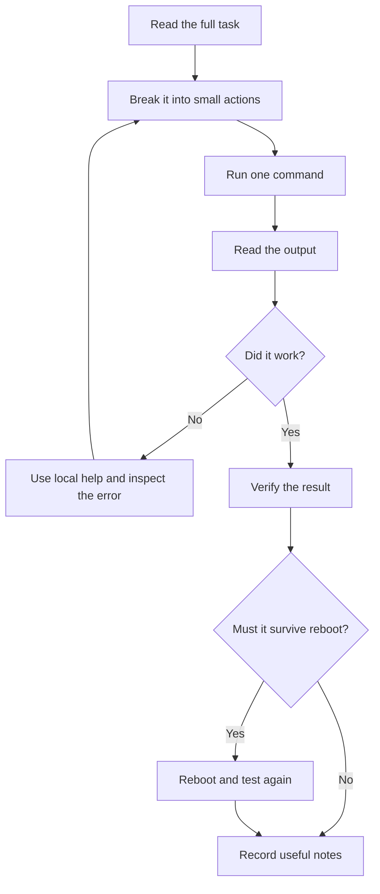
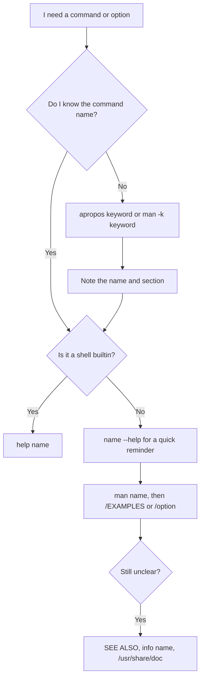

# 00 Study Skills and Offline Help

> By the end of this lesson you have a repeatable method for any hands-on task, and you can find the right command and the right option using only the help already installed on the machine.

!!! example "Try it now (2 minutes)"
    ```bash
    whatis passwd
    ```
    ```text title="Example output"
    passwd (1)           - update user's authentication tokens
    passwd (1ssl)        - compute password hashes
    passwd (5)           - password file
    ```
    <!-- VERIFY: exact entries and spacing for `whatis passwd` on a RHEL 10 minimal/server install; the set of entries depends on installed packages -->
    Notice that one word, `passwd`, has three manual pages. The number in brackets is the manual **section**. `man passwd` opens the command; `man 5 passwd` opens the file format. By the end of this lesson you will know why that matters and how to pick the right one in seconds.

## Why it matters

RHCSA is not a trivia exam. It is a performance exam. You pass by completing tasks correctly, verifying them, and making changes persist after reboot. If you panic, guess, or skip verification, you lose points even if you "almost" know the topic. Two of the official objectives live here: using a shell with correct syntax, and locating, reading and using the documentation that ships with the system. In real life, system administrators often work on servers with no internet access, where mistakes matter and time is short. Good admins use local help, test carefully, and recover from errors without drama.

**Objectives covered:**

- Access a shell prompt and issue commands with correct syntax
- Locate, read, and use system documentation including man, info, and files in /usr/share/doc

**Prereqs:** none. This file assumes you are starting from zero. · **Time:** about 3 h for the first study, plus a short repeat of this file every week.

**Tools used:** `man`, `info`, `--help`, `help`, `type`, `which`, `command -v`, `whatis`, `apropos`, `mandb`, `rpm -qd`, `pwd`, `ls`, `echo`, `history`, `clear`, `reset`, `script`, `cat`, `less`

**Offline help for this topic:** `man man`, `man info`, `help help`, `help type`, `man which`, `man command`, `man whatis`, `man apropos`, `man hier`, `man bash`, `/usr/share/doc`

!!! note "Supporting skill (not a listed RHEL 10 objective)"
    The study habits, panic control and "check your own work" routines below are not on Red Hat's objective list, but every other objective depends on them. The exam measures end state, so a method that always ends in verification is worth more than any single command.

## How it works

Linux is learned by repeated contact, not by one perfect reading. At first, every command looks unfamiliar. That is normal. Your goal is not to "feel smart." Your goal is to build a reliable working process:

1. Understand the task.
2. Break it into smaller actions.
3. Run one command at a time.
4. Read the output.
5. Verify the result.
6. Reboot-check if the task must persist.



### How Linux learning works for beginners

Beginners often think experts remember every command. In reality, experts remember patterns:

- where to look for help
- what type of tool solves a problem
- how to test safely
- how to confirm success

That means your first skill is not speed. Your first skill is method.

### How to practise effectively

Bad practice:

- reading a command and moving on
- doing a lab once
- skipping verification
- solving problems by random guessing

Good practice:

- typing commands by hand
- repeating tasks until you can do them without notes
- checking output every time
- rebooting to confirm persistence
- keeping short notes on mistakes and fixes

### How to build discipline and a learning attitude

Use this rule: small daily practice beats rare long sessions.

A strong beginner habit:

- 60 to 90 minutes
- one topic
- type everything
- write down three things you learned
- write down one thing you got wrong

### How to avoid panic when stuck

When stuck, do not say, "I know nothing." Ask smaller questions:

- What command am I trying to run?
- What file or service am I trying to affect?
- Am I in the right directory?
- Am I the right user?
- Did the command return an error?
- What does the manual say?

Panic shrinks when the problem becomes specific.

### How to break big tasks into small tasks

Example big task: "Configure a service to start at boot and allow network access to it."

Break it into smaller tasks:

1. Identify the service name.
2. Install it if needed.
3. Start it now.
4. Enable it for boot.
5. Open the correct firewall service or port.
6. Test locally.
7. Reboot.
8. Test again.

### How to check your own work

Every admin task should end with proof. Examples:

- If you created a user, check `id username`
- If you edited a file, display the file
- If you enabled a service, check `systemctl is-enabled`
- If a service should be running, check `systemctl status`
- If a mount should persist, reboot and check `mount` or `findmnt`

### How to recover from mistakes

Most Linux mistakes are recoverable if you stay calm. Useful recovery habits:

- read the full error message
- inspect the file before editing again
- make one correction at a time
- keep a backup copy before risky edits
- test immediately after changes

### Reboot-safe thinking

On RHCSA, many tasks are only truly complete if they still work after reboot without manual repair. Always ask:

- Did I edit the right persistent config file?
- Did I only make a temporary runtime change?
- Did I enable the service, not just start it?
- Did I use UUID or label correctly in `/etc/fstab`?

### How to think during a hands-on exam

Good exam thinking:

- Read the full task once.
- Mark required nouns: user, service, mount point, port, file.
- Mark required verbs: create, configure, enable, allow, persist.
- Solve the task in small chunks.
- Verify before moving on.

Bad exam thinking:

- starting immediately without reading carefully
- making several changes at once
- assuming success without checking
- spending too long guessing syntax you could look up

### Notes that are useful in a command-line exam

Your notes should not be essays. They should help you execute. Good note format:

- task name
- key file or command
- one verification command
- one common failure and fix

Example:

```text
Check service boot persistence
systemctl enable --now httpd
Verify: systemctl is-enabled httpd ; systemctl is-active httpd
Failure: service starts now but not at boot -> forgot enable
```

### How to learn without the internet

You do not need internet to keep learning basic administration if you know how to use local help. Linux systems already ship with documentation, examples, option summaries, and shell help. This is your offline help ladder, from fastest to deepest:

1. `command --help`
2. `man command`
3. `info command`
4. `help builtin` for shell builtins
5. `apropos keyword`
6. `man -k keyword`
7. `/usr/share/doc/package-name`



!!! info "Exam Focus"
    Be fast with both `apropos keyword` and `man -k keyword`.
    They solve the same kind of problem: finding commands when you only remember the topic, not the exact command name.

## Commands, step by step

### 1. `type`, `which` and `command -v`: what is this name?

Before you read help, find out what kind of thing the name is. Shell builtins have no manual page of their own, so `man cd` is the wrong first move.

```bash
type cd
type ls
which ls
command -v ls
command -v cd
```

```text title="Example output"
cd is a shell builtin
ls is aliased to `ls --color=auto'
/usr/bin/ls
/usr/bin/ls
cd
```
<!-- VERIFY: `type ls` alias wording and path (/usr/bin/ls) on a RHEL 10 login shell -->

- `type` tells you whether a name is a shell builtin, alias, function, or external command.
- `which` is common and simple. It only finds external programs.
- `command -v` is shell-friendly and can identify builtins too (it printed just `cd` above).

### 2. `help` and `--help`: quick reminders

```bash
help cd
ls --help | head -n 5
```

```text title="Example output"
cd: cd [-L|[-P [-e]] [-@]] [dir]
    Change the shell working directory.

    Change the current directory to DIR.  The default DIR is the value of the
    HOME shell variable.
Usage: ls [OPTION]... [FILE]...
List information about FILEs (the current directory by default).
Sort entries alphabetically if none of -cftuvSUX nor --sort is specified.

Mandatory arguments to long options are mandatory for short options too.
```
<!-- VERIFY: exact help text wording for cd and ls on RHEL 10 -->

- `help` shows help for shell builtins such as `cd`, `echo`, and `history`.
- `--help` shows quick syntax and options for external commands. Use it when you need a fast reminder and do not want a full manual page.

### 3. `man`: the main offline manual

```bash
man ls
```

Manual pages are available offline and are often enough to solve exam tasks.

**Anatomy of a manual page.** Most pages use the same headings, so you can jump straight to what you need:

| Heading | What it gives you |
|---|---|
| `NAME` | The command and a one-line description (this is what `apropos` searches) |
| `SYNOPSIS` | The shape of the command line |
| `DESCRIPTION` | What it does, in prose |
| `OPTIONS` | Every flag, one by one |
| `EXAMPLES` | Ready-to-adapt commands (not every page has one) |
| `FILES` | Config files the command reads |
| `SEE ALSO` | Related pages, written as `name(section)`: your map to the next page |

**Reading a `SYNOPSIS`.** `[ ]` means optional, `|` means "one or the other", and `...` means "you can repeat it". In `ls [OPTION]... [FILE]...` everything is optional, so plain `ls` is valid.

**Navigating inside `man`** (the pager is `less`):

| Key | Action |
|---|---|
| `Space` / `b` | Page forward / back |
| `/word` then `Enter` | Search forward |
| `n` / `N` | Next / previous match |
| `/EXAMPLES` | Jump to the EXAMPLES section if it exists |
| `g` / `G` | Top / bottom of the page |
| `h` | Show all pager keys |
| `q` | Quit |

**Manual sections.** The same name can exist in several sections. Pick the right one by putting the number before the name.

| Section | Contents | Example |
|---|---|---|
| 1 | User commands | `man 1 passwd` |
| 2 | System calls (programming) | `man 2 open` |
| 3 | Library functions (programming) | `man 3 printf` |
| 4 | Device files | `man 4 null` |
| 5 | File formats and config files | `man 5 passwd`, `man 5 fstab`, `man 5 sshd_config` |
| 6 | Games | rarely used |
| 7 | Overviews and conventions | `man 7 hier`, `man 7 signal` |
| 8 | Admin commands (usually root) | `man 8 useradd` |

A good rule: the **command** is in section 1 or 8, the **file that command edits** is in section 5. `man passwd` shows the command, `man 5 passwd` shows what each field in `/etc/passwd` means. `man hier` (section 7) describes the standard directory layout.

### 4. `whatis` and `apropos`: find the command when you only know the topic

```bash
whatis passwd
apropos password
man -k password
man -f passwd
```

```text title="Example output"
$ apropos password | head -n 6
chage (1)            - change user password expiry information
chpasswd (8)         - update passwords in batch mode
gpasswd (1)          - administer /etc/group and /etc/gshadow
passwd (1)           - update user's authentication tokens
passwd (5)           - password file
shadow (5)           - shadowed password file
```
<!-- VERIFY: apropos output depends on installed man pages and their exact one-line descriptions on RHEL 10 -->

| Command | Same as | What it does |
|---|---|---|
| `whatis name` | `man -f name` | One-line summary of pages whose name matches `name` |
| `apropos word` | `man -k word` | Searches names and descriptions of all pages for `word` |
| `apropos -s 8 word` | `man -k -s 8 word` | Same, but only manual section 8 (admin commands) |

Output format is `name (section) - description`. Search with more than one word and you get pages matching **any** of them; add `-a` to require all.

### 5. If `apropos` or `whatis` finds nothing: `mandb`

`apropos` and `whatis` do not read every page live. They search a prebuilt index, and on a fresh or just-installed system that index may be empty or stale.

```bash
apropos password
sudo mandb
apropos password | head -n 3
```

```text title="Example output"
password: nothing appropriate.

Processing manual pages under /usr/share/man...
Updating index cache for path `/usr/share/man/man8'. Wait...
...
3 man subdirectories contained newer manual pages.
5 manual pages were added.
```
<!-- VERIFY: mandb progress lines and counts on RHEL 10; also whether the man-db cache timer has already run on a fresh VM -->

`sudo mandb` rebuilds the index (it needs root to write the cache). After that, `apropos` and `whatis` work. Remember this: it is a classic "works at home, empty in the exam" problem.

### 6. `info`: longer, structured documentation

```bash
info coreutils 'ls invocation'
```

Some commands have more detailed examples in `info` than in `man`. Info pages are a tree of linked **nodes**, not one long scroll.

| Key | Action |
|---|---|
| `Space` / `Backspace` | Scroll forward / back |
| `n` / `p` | Next / previous node at the same level |
| `u` | Up one level |
| `Tab` then `Enter` | Move to the next link, then follow it |
| `l` | Go back to the last node you visited |
| `/word` | Search |
| `q` | Quit |

If a command has no info page, `info name` falls back to showing the man page.

### 7. `/usr/share/doc` and `rpm -qd`: package documentation

```bash
ls /usr/share/doc | head
rpm -qd bash | head -n 5
ls /usr/share/doc/bash
```

```text title="Example output"
$ rpm -qd bash | head -n 5
/usr/share/doc/bash/COMPAT
/usr/share/doc/bash/FAQ
/usr/share/doc/bash/INTRO
/usr/share/doc/bash/NEWS
/usr/share/doc/bash/RBASH
```
<!-- VERIFY: which doc files the bash package ships on RHEL 10 (README may not exist); the list above is illustrative -->

`/usr/share/doc` holds package documentation, examples, README files, and configuration samples for some software. File names differ by package and version, so do not guess: `rpm -qd packagename` lists the documentation files a package installed, and `ls /usr/share/doc/packagename` shows what is there. (Lesson 07 covers `rpm` queries in more depth.)

### 8. `history`, `script`, `clear` and `reset`

- `history` lists the commands you typed, which is useful for notes and for finding the exact line that worked. Searching and re-running history (`Ctrl+R`, `!!`) is covered in [01 Shell Basics and Command Syntax](01-shell-basics-and-command-syntax.md).
- `script ~/practice.log` records everything shown on your terminal until you type `exit`. Use it in practice to keep proof of a lab you can review later.
- `clear` wipes the screen. `reset` repairs a terminal that shows garbage after you accidentally `cat` a binary file.

## Worked examples

### Worked example 1: Find help for changing directories

Task: learn how to get help for `cd`.

```bash
type cd
help cd
```

`type cd` should report that `cd` is a shell builtin, and `help cd` should display syntax and behaviour. Verification: confirm you did not use `man cd` expecting a normal external command manual.

### Worked example 2: Find the right command offline, start to finish

Task: "Make a user's password expire after 30 days." You do not remember the command. You have no internet.

**Step 1: search by topic.** Words from the task: password, expire.

```bash
apropos expire
```

```text title="Example output"
chage (1)            - change user password expiry information
```
<!-- VERIFY: exact apropos hits for "expire" on RHEL 10; other pages may also match -->

`chage` looks right, and it is in section 1, so it is a command. (If you get `nothing appropriate`, run `sudo mandb` and repeat.)

**Step 2: confirm with a summary, then open the page.**

```bash
whatis chage
man chage
```

**Step 3: find the option inside the page.** Inside `man`, type `/maximum` and press `Enter`. You land on the option for the maximum number of days a password stays valid, `-M, --maxdays`. Press `q` to quit.

**Step 4: follow SEE ALSO.** At the bottom, `SEE ALSO` lists `passwd(5)` and `shadow(5)`. Those are **files**, so they live in section 5:

```bash
man 5 shadow
```

The `shadow` page explains each field of `/etc/shadow`, including the one `chage` changes.

**Step 5: try it safely before changing anything.** Reading is free. Ask for the current state first:

```bash
chage -l student
```

```text title="Example output"
Last password change					: Oct 27, 2026
Password expires					: never
Password inactive					: never
Account expires						: never
Minimum number of days between password change		: 0
Maximum number of days between password change		: 99999
Number of days of warning before password expires	: 7
```
<!-- VERIFY: chage -l output format and the default values on RHEL 10 -->

Now you know the command is `sudo chage -M 30 student`, and you found it without a search engine. Lesson 14 uses `chage` in full. The method is the lesson: **keyword, section, page, option, SEE ALSO, check current state, then change**.

### Worked example 3: Search for a command related to passwords

```bash
apropos password
whatis passwd
man passwd
```

`apropos` lists commands and manuals related to the word, `whatis passwd` shows one-line summaries, and `man passwd` opens the manual page. Verification: search inside `man passwd` using `/password`.

### Worked example 4: Inspect documentation under `/usr/share/doc`

```bash
ls /usr/share/doc | head
rpm -qd bash | head -n 3
ls /usr/share/doc/bash
less /usr/share/doc/bash/FAQ
```

You can list documentation directories and open a file with `less`. Verification: quit `less` with `q`. If a file name does not exist, pick one from the `rpm -qd` list instead of guessing.

## Common mistakes

- **Mistake:** Trying to memorise everything before typing commands. **Recovery:** type each command once, then keep a short note of command, purpose, verification.
- **Mistake:** Guessing command syntax instead of checking help. **Recovery:** `command --help`, then `man command`, then `/EXAMPLES`.
- **Mistake:** Copying commands without understanding them. **Recovery:** read the matching manual page or `--help` line for every option before you press `Enter`.
- **Mistake:** Forgetting whether you are root or a regular user. **Recovery:** run `whoami` (and `pwd`) before a risky command.
- **Mistake:** Declaring a task done without verifying the result, or assuming a task is done because no error appeared. **Recovery:** always run a verification command, such as `id user`, `systemctl is-enabled`, or `findmnt`.
- **Mistake:** Making a configuration change but never testing after reboot. **Recovery:** reboot and re-run the verification command.
- **Mistake:** Panicking after one error message. **Recovery:** read the full message, then ask smaller questions (which file, which user, which command).
- **Mistake:** Using `man` for shell builtins first. **Recovery:** run `type commandname`, then use `help` if it is a builtin.
- **Mistake:** Opening `man passwd` when you wanted the file format. **Recovery:** check the section list with `whatis passwd` and open `man 5 passwd`.
- **Mistake:** Reading help but not testing anything. **Recovery:** run a small, safe example immediately.
- **Mistake:** Writing long notes that are hard to review. **Recovery:** shorten notes to command, purpose, verification.
- **Mistake:** Changing several things when one command failed. **Recovery:** undo the last change mentally, inspect output, then fix one issue at a time.

### Troubleshooting

| Problem | Cause | Fix |
|---|---|---|
| `man: command not found` | Manual tools are not installed, or your `PATH` is unusual | `command -v man`; fall back to `--help`, `help`, and `/usr/share/doc` |
| `whatis` or `apropos` prints `nothing appropriate` | The manual page index has not been built or is stale | `sudo mandb`, then retry; otherwise try a different keyword and `man -k` |
| `man` shows the wrong page for a name | The name exists in several sections | `whatis name`, then `man 5 name` (or the right section number) |
| `less /usr/share/doc/bash/README` says no such file | File names differ by package version | `rpm -qd bash` or `ls /usr/share/doc/bash` first |
| Terminal output looks broken | A binary file or escape sequence confused the terminal | Type `reset` |
| You forget whether you are root | Prompt ends in `$` (user) or `#` (root) | `whoami` and `pwd` |

## Hands-on lab

**Setup:** shared lab environment, log in to `servera.lab.example` as `student`. No disks, users or files are needed. If `man` pages are missing, note it as a lab issue, run `sudo mandb`, and continue with whatever local help is available.

**Task:**

- [ ] Run `pwd` and note where you are.
- [ ] Find out whether `echo` is a builtin or an external command, and read its shell help.
- [ ] Read the `man` page for `ls` and search it for the word `sort`.
- [ ] Use `apropos` to find commands related to `directory`.
- [ ] Use `command -v` on `cd`, `ls`, and `man`.
- [ ] Open the file-format page for `/etc/fstab` using the right section number, and find the name of the sixth field.
- [ ] Look in `/usr/share/doc` for documentation related to `bash` (use `rpm -qd bash` to pick a real file).
- [ ] Create `/home/student/study-notes.txt` containing one builtin command, one external command, one place to search for manuals by keyword, and one way to verify a task after configuration.

??? question "Hint 1"
    Builtins are answered by `type`. The file format for a config file is in a different manual section than the command that uses it.

??? question "Hint 2"
    Use `whatis fstab` to see the sections, then open the section 5 page. For the notes file, `echo "text" >> file` appends one line at a time.

??? success "Solution"
    ```bash
    pwd
    type echo
    help echo | head -n 3
    man ls                 # inside: /sort  then n for the next match, q to quit
    apropos directory | head
    command -v cd ls man
    whatis fstab
    man 5 fstab            # sixth field: fs_passno (the fsck order)
    rpm -qd bash | head -n 5
    ls /usr/share/doc/bash
    echo "builtin: cd" > /home/student/study-notes.txt
    echo "external: ls" >> /home/student/study-notes.txt
    echo "search manuals: apropos keyword or man -k keyword" >> /home/student/study-notes.txt
    echo "verify: systemctl is-enabled SERVICE" >> /home/student/study-notes.txt
    cat /home/student/study-notes.txt
    ```
    **Verify:** `type echo` reports a shell builtin (and `/usr/bin/echo` also exists as an external program). `command -v ls` prints a path, `command -v cd` prints just `cd`. `cat /home/student/study-notes.txt` shows four lines.
    <!-- VERIFY: the name of fstab field 6 on the RHEL 10 man page (fs_passno) -->

Cleanup (optional): `rm -f /home/student/study-notes.txt`

## More practice

1. Use local help to learn what `pwd` does and record one useful option if available.
2. Find out whether `history` is a builtin or external command.
3. Search manuals for a command related to `hostname`.
4. Open the manual for `less` and search for the word `pattern`.
5. Use `/usr/share/doc` to inspect documentation for any installed package and write one sentence about what you found.
6. Use `command -v` to compare `cd`, `cat`, and `type`.
7. Find help for clearing a broken terminal display using local documentation only.

### Exam-style task 1

Without using the internet, find local help that lets you answer these questions:

- Is `cd` a builtin or external command?
- What command can search manual descriptions by keyword?
- Where can package documentation usually be found on disk?

Write your answers into `/tmp/help-audit.txt`.

**Grader mindset checklist:**

- [ ] `/tmp/help-audit.txt` must exist
- [ ] the file should contain correct answers
- [ ] commands used should be available from local help
- [ ] no internet should be required

??? success "Solution"
    ```bash
    type cd
    apropos keyword
    echo "cd is a shell builtin" > /tmp/help-audit.txt
    echo "Use apropos or man -k to search manuals by keyword" >> /tmp/help-audit.txt
    echo "Package documentation is usually under /usr/share/doc" >> /tmp/help-audit.txt
    cat /tmp/help-audit.txt
    ```

### Exam-style task 2

Create a plain-text note file `/tmp/exam-habits.txt` that lists:

- a four-step method for solving a hands-on Linux task
- one command to identify a command type
- one command to search manuals
- one command to verify whether a service is enabled at boot
- one reminder about reboot persistence

**Grader mindset checklist:**

- [ ] `/tmp/exam-habits.txt` must exist
- [ ] the file must contain all required items
- [ ] answers should be practical and command-based
- [ ] the verification command should be relevant to boot persistence

??? success "Solution"
    Possible content:
    ```text
    1. Read the task fully
    2. Break it into smaller actions
    3. Run one command at a time
    4. Verify the result
    type
    apropos
    systemctl is-enabled
    Always check after reboot if the task must persist
    ```

## Exam tips

!!! tip "What the exam expects"
    Documentation that ships with the system is your reference during the exam, so the skill is finding the right option fast: `apropos` or `man -k` for the command, `/EXAMPLES` or `/option` inside the page, `SEE ALSO` for the config file in section 5. A task counts only when the end state is correct and verified, so finish every task with a check command. Do not rely on search engines or memory for options you can look up in 20 seconds.

!!! warning "Must survive reboot"
    | Change | Persistent? | Make it persist with |
    |---|---|---|
    | `systemctl start httpd` | No | `systemctl enable httpd` (or `enable --now`) |
    | `hostname newname` | No | `hostnamectl set-hostname newname` |
    | `mount /dev/vdb1 /mnt` | No | an `/etc/fstab` line, then `mount -a` |
    | Editing a file under `/etc` | Yes | Nothing, but a syntax error can break boot or the service |
    | `sudo mandb` index | Yes | Nothing, it is a cache on disk |

    The full matrix for every topic is in [16 Persistence, Reboot Checks, and Troubleshooting](16-persistence-reboot-checks-and-troubleshooting.md).

**Verify like a grader:**

1. Run `whoami` so you know whether you are acting as root or as `student`.
2. After each change, run one command that proves it (`id`, `cat`, `systemctl is-enabled`, `findmnt`).
3. If help seems missing, try `sudo mandb`, then `man -k keyword`, then `/usr/share/doc`.
4. For anything that must persist, reboot and run the same check again.

## Quiz

1. What command gives help for a shell builtin such as `cd`?
2. What command helps you discover commands by keyword?
3. What does `type ls` tell you?
4. Where can package-specific local documentation often be found?
5. Why is "no error appeared" not enough to prove a task is complete?
6. What is the difference between starting a service now and making it start at boot?
7. What does the `5` in `passwd (5)` mean, and how do you open that page?
8. `apropos` prints `nothing appropriate` for a word you are sure exists. What do you run?
9. How do you jump to the examples inside a man page?
10. Which command lists the documentation files that an installed package shipped?

??? success "Answers"
    1. `help cd`
    2. `apropos keyword` or `man -k keyword`
    3. It tells you what kind of command `ls` is and often where it resolves from.
    4. Usually under `/usr/share/doc`
    5. Because a task may fail silently, may affect the wrong target, or may not persist after reboot.
    6. Starting affects the current session now. Enabling makes it start automatically at boot.
    7. It is the manual section, here file formats. Open it with `man 5 passwd`.
    8. `sudo mandb` to rebuild the manual page index, then repeat the search.
    9. Type `/EXAMPLES` and press `Enter` (if the page has such a section).
    10. `rpm -qd packagename`

## Summary

- Linux skill grows through repetition, not guessing.
- Your first skill is not speed. Your first skill is method.
- Panic shrinks when the problem becomes specific.
- Local help is a core exam skill: `type` tells you what a command really is, `help` is for shell builtins, `man` and `info` are offline references, `/usr/share/doc` often contains examples.
- A name can have several manual sections: command in 1 or 8, file format in 5.
- A task is not finished until you verify it, and persistent configuration must survive reboot.

| Task | Command |
|---|---|
| What kind of command is this? | `type cd`, `command -v ls`, `which ls` |
| Help for a builtin | `help cd` |
| Quick option reminder | `ls --help` |
| Open a manual page | `man ls` |
| Open a specific section | `man 5 passwd` |
| One-line summary | `whatis passwd` or `man -f passwd` |
| Search by keyword | `apropos password` or `man -k password` |
| Rebuild the man index | `sudo mandb` |
| Longer documentation | `info ls`, `info coreutils 'ls invocation'` |
| Package docs | `ls /usr/share/doc`, `rpm -qd bash` |
| Fix a garbled terminal | `reset` |
| Record a session | `script ~/practice.log` (end with `exit`) |

**Previous:** none, this is the start of the course. · **Next:** [01 Shell Basics and Command Syntax](01-shell-basics-and-command-syntax.md): with a method and offline help in hand, you start typing real commands.
