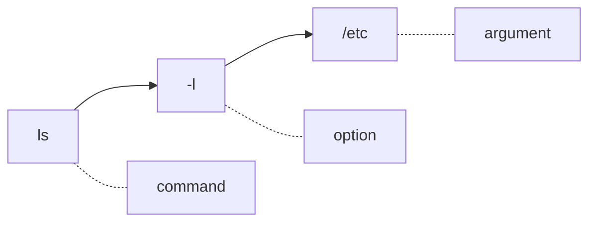
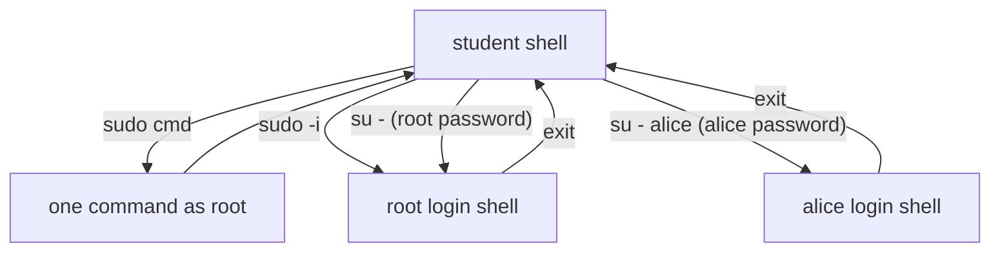

# 01 Shell Basics and Command Syntax

> By the end of this lesson you can read a prompt and a command, move around the filesystem, work fast with Tab and history, and switch between users on purpose.

!!! example "Try it now (2 minutes)"
    ```bash
    id
    ```
    ```text title="Example output"
    uid=1000(student) gid=1000(student) groups=1000(student),10(wheel) context=unconfined_u:unconfined_r:unconfined_t:s0-s0:c0.c1023
    ```
    <!-- VERIFY: exact id output (groups and SELinux context) on the RHEL 10 lab image -->
    Notice `groups=...,10(wheel)`. Membership of `wheel` is what lets `student` use `sudo`. By the end of this lesson you will know how to use that power, and how to become other users, without guessing who you are at any moment.

## Why it matters

Every RHCSA task starts at a shell prompt. If you cannot read a prompt, understand how a command is built, or tell who you are and where you are, every later topic gets harder. Administrators spend much of their day running commands, reading output and making careful changes as the right user. Typing speed matters too: Tab completion and history will save you many minutes in a timed exam.

**Objectives covered:**

- Access a shell prompt and issue commands with correct syntax
- Log in and switch users in multi-user targets
- Locate, read, and use system documentation including man, info, and files in /usr/share/doc

**Prereqs:** [00 Study Skills and Offline Help](00-study-skills-and-offline-help.md) · **Time:** about 4 h

**Tools used:** `pwd`, `ls`, `cd`, `echo`, `whoami`, `id`, `who`, `hostname`, `date`, `cal`, `clear`, `history`, `exit`, `su`, `sudo`, `uname`, `type`, `man`, `help`

**Offline help for this topic:** `help cd`, `help history`, `man bash`, `man su`, `man sudo`, `man pwd`, `man ls`, `man hier`

## How it works

The **shell** is a program (on RHEL it is `bash`) that reads what you type, expands it, and runs the program you named. A **user** is an identity with a number (UID) that decides what you may read, write and run. `root` is user 0 and may do anything, so you work as a normal user and become root only for the moment you need it.

A command normally has this shape:



```text
command option(s) argument(s)
```

Example:

```bash
ls -l /etc
```

- `ls` is the command
- `-l` is an option (changes how the command behaves)
- `/etc` is an argument (what to act on)

Separate every word with a space. `ls-l` is one word and fails; `ls -l/etc` is a different mistake.

### Prompt, user, and host

A shell prompt often shows your username, your hostname and your current directory:

```text
[student@servera ~]$
```

- user: `student`
- host: `servera`
- current location: home directory (`~`)
- `$` at the end means a normal user. `#` means root.

### Filesystem paths

An absolute path starts from the root directory `/`, for example `/etc/hosts` or `/var/log/messages`. A relative path starts from your current directory, for example `notes.txt` or `docs/report.txt`.

- `.` means the current directory
- `..` means the parent directory
- `~` means your home directory

### Reading command syntax

In documentation you may see syntax such as:

```text
command [OPTION]... FILE...
```

- items in `[]` are optional
- `...` means one or more can be used
- uppercase names like `FILE` are placeholders you replace with real values

### Options, short and long

Short options are one letter after a single dash and can be bundled: `ls -la` means `ls -l -a`. Long options use two dashes and a word: `ls --all`. A lone `--` means "no more options after this", which helps when a file name starts with a dash: `rm -- -oddname`.

### Root versus regular user

A regular user should do normal work. Root has full administrative power, so a mistake as root is far more dangerous. The user-switching section below shows the ways to become root and, just as important, how to leave again.

## Commands, step by step

### 1. Where am I, who am I

```bash
pwd
whoami
hostname
```

```text title="Example output"
/home/student
student
servera.lab.example
```

`pwd` prints your working directory. `whoami` prints your username. `hostname` prints the machine name. Run `pwd` before any risky action.

### 2. List files with `ls`

```bash
ls
ls -l
ls -a
ls -la /etc
ls -ld /etc /etc/hosts
```

```text title="Example output"
drwxr-xr-x. 94 root root 8192 Oct 27 08:50 /etc
-rw-r--r--.  1 root root  158 Jun 23  2020 /etc/hosts
```
<!-- VERIFY: link counts, sizes and dates are illustrative -->

Read a long listing left to right:

| Part | Example | Meaning |
|---|---|---|
| Type + permissions | `drwxr-xr-x.` | First character `d` directory, `-` file, `l` link. Then three rwx triplets (user, group, other). The trailing `.` means an SELinux label is present |
| Link count | `94` | Number of hard links to it |
| Owner | `root` | Owning user |
| Group | `root` | Owning group |
| Size | `8192` | Size in bytes |
| Date | `Oct 27 08:50` | Last modification time |
| Name | `/etc` | The file or directory |

Permissions are covered fully in [06 Links, Permissions, and Default Permissions](06-links-permissions-and-default-permissions.md). `-d` lists a directory itself instead of its contents.

| Option | Meaning |
|---|---|
| `-l` | long listing |
| `-a` | include hidden files (names starting with `.`) |
| `-d` | show the directory itself, not what is inside |

### 3. Move around with `cd`

```bash
cd /etc
cd
cd ..
cd -
```

- `cd /etc` moves to `/etc`
- `cd` returns to your home directory
- `cd ..` moves up one level
- `cd -` returns to the previous directory (and prints it)

`cd` is a shell **builtin**, not a separate program. Check with `type cd`:

```bash
type cd
type ls
help cd
```

```text title="Example output"
cd is a shell builtin
ls is aliased to `ls --color=auto'
```
<!-- VERIFY: RHEL 10 default alias for ls -->

### 4. Small helper commands

| Command | Use |
|---|---|
| `date` | Current date and time |
| `cal` | Calendar for this month <!-- VERIFY: cal is installed by default on RHEL 10 minimal (util-linux split) --> |
| `uname -a` | Kernel name, version and architecture |
| `clear` or Ctrl-L | Clear the screen |
| `echo text` | Print text (also prints variables, for example `echo $HOME`) |

### 5. Tab completion and keyboard shortcuts

Press Tab and the shell finishes the word for you. If more than one match exists, press Tab twice to list them. It completes command names, file names and paths. It is both faster and safer: if Tab completes a path, the path exists, so you have proved you typed it correctly.

```text title="Example session"
[student@servera ~]$ ls /etc/hos<Tab>
[student@servera ~]$ ls /etc/hosts
[student@servera ~]$ ls /etc/host<Tab><Tab>
host.conf  hostname  hosts  hosts.allow  hosts.deny
```
<!-- VERIFY: exact list of host* files on the RHEL 10 lab image -->

Completion of command options and service names needs the `bash-completion` package. <!-- VERIFY: bash-completion installed by default on RHEL 10 -->

| Keys | What they do |
|---|---|
| Tab | Complete the word; Tab Tab lists choices |
| Ctrl-C | Stop the running command |
| Ctrl-D | End input; on an empty prompt it logs out of the shell |
| Ctrl-L | Clear the screen |
| Ctrl-A / Ctrl-E | Jump to start / end of the line |
| Ctrl-U / Ctrl-W | Delete to start of line / delete the last word |
| Ctrl-R | Search history (see below) |
| Up / Down arrows | Walk through earlier commands |

### 6. Command history

The shell remembers what you typed. Reuse it instead of retyping.

```bash
history | tail -5
!!
!42
!ls
sudo !!
```

```text title="Example output"
  101  cd /etc
  102  ls hosts
  103  ls -l hosts
  104  cd
  105  history | tail -5
```

| Form | Meaning |
|---|---|
| `history` | Print the numbered list (`history 20` shows the last 20) |
| `!!` | Run the previous command again |
| `!42` | Run history entry number 42 |
| `!ls` | Run the most recent command that started with `ls` |
| `sudo !!` | Re-run the last command with sudo, handy after "Permission denied" |
| `!$` | The last argument of the previous command (also Alt-. ) |
| Ctrl-R | Type part of an old command; press Ctrl-R again for the next match; Enter runs it, Esc edits it |

History is written to `~/.bash_history` when the shell exits. `!` is special in double quotes, so put passwords and text with `!` inside single quotes.

### 7. Globbing: wildcards the shell expands

Before a command runs, the shell replaces patterns with matching file names. This is called **globbing**. The command never sees the pattern, only the result.

| Pattern | Matches |
|---|---|
| `*` | Any number of characters (including none) |
| `?` | Exactly one character |
| `[abc]` | One character from the set; `[0-9]` is a range; `[!0-9]` is "not these" |
| `{a,b}` | Not a glob but **brace expansion**: becomes `a` and `b`; `{1..3}` becomes 1 2 3 |

```bash
mkdir ~/glob-demo && cd ~/glob-demo
touch report1.txt report2.txt report10.txt notes.md .hidden
echo report?.txt
echo report*.txt
echo *
touch app{1..3}.log
echo app*.log
echo '*'
```

```text title="Example output"
report1.txt report2.txt
report10.txt report1.txt report2.txt
notes.md report10.txt report1.txt report2.txt
app1.log app2.log app3.log
*
```
<!-- VERIFY: sort order of report10.txt vs report1.txt depends on the locale on the lab image -->

Notice that `*` did not show `.hidden`: hidden files need `.*` or `ls -a`. Quotes turn globbing off, so `echo '*'` prints a literal star. Quoting is covered further in [08 Shell Scripting Basics](08-shell-scripting-basics.md).

### 8. Switch users: `su`, `sudo -i`, `sudo -u`

This is the objective "Log in and switch users in multi-user targets". A **multi-user target** is just the normal boot state with logins and networking, as opposed to rescue mode (see [09 Boot Targets, Processes, Logs, and Tuning](09-boot-targets-processes-logs-and-tuning.md)). Prove who is logged in with:

```bash
who
id -un
```

```text title="Example output"
student  pts/0        2026-10-27 09:01 (192.168.122.1)
student
```
<!-- VERIFY: who output format on RHEL 10 -->

There are two ideas. **su** *switches* the identity of your whole shell until you `exit`. **sudo** *borrows* root (or another user) for one command, or for one shell if you ask for it.



Setup for the examples (creates the user `alice` with password `redhat`; lesson 14 covers account management properly):

```bash
sudo useradd -m alice
echo 'alice:redhat' | sudo chpasswd
```

**Switch with `su`:**

```bash
su -
```

```text title="Example output"
Password:
[root@servera ~]# whoami
root
[root@servera ~]# pwd
/root
[root@servera ~]# exit
logout
[student@servera ~]$
```

`su -` (same as `su -l`) starts a **login shell**: it loads the target user's own environment, `PATH` and home directory. Without the dash, `su` keeps most of your current environment:

```bash
su
pwd
exit
```

```text title="Example output"
Password:
[root@servera student]# pwd
/home/student
```
<!-- VERIFY: prompt shown by plain su and which environment variables carry over on RHEL 10 -->

The directory stayed `/home/student` because plain `su` did not start a login shell. Root's `PATH` and variables may also be wrong or missing (for example `/usr/sbin` tools). Always use `su -` for admin work.

| Command | Result | Password asked |
|---|---|---|
| `su -` | Root login shell | Root's password |
| `su - alice` | Login shell as `alice` | `alice`'s password (root can switch without one) |
| `su` | Root shell, **your** environment | Root's password |
| `su -c 'cmd' -` | Run one command as root, then return | Root's password |
| `sudo cmd` | Run one command as root | **Your** password |
| `sudo -i` | Root login shell (like `su -`) | **Your** password |
| `sudo -u alice cmd` | Run one command as `alice` | **Your** password |
| `sudo -u alice -i` | Login shell as `alice` | **Your** password |

**Use `sudo` when root's password is locked.** Many systems lock root, so `su -` fails with `Authentication failure`. `sudo -i` needs only your own password and an account allowed by sudo (members of `wheel`; see [14 Users, Groups, Passwords, and Sudo](14-users-groups-passwords-and-sudo.md)).

```bash
sudo whoami
sudo -u alice id
sudo -i
```

```text title="Example output"
[sudo] password for student:
root
uid=1001(alice) gid=1001(alice) groups=1001(alice)
[root@servera ~]#
```

**Leave a switched shell** with `exit` (or Ctrl-D). Each `su` or `sudo -i` opens a new shell on top of the old one, so each needs its own `exit`. Check with `whoami` before you continue. If you `exit` too many times in the outermost shell, you close your terminal or SSH session.

!!! warning "Redirection happens in your shell"
    `sudo whoami > /root/out.txt` fails for a normal user: `sudo` runs only `whoami`, and the `>` is performed by **your** unprivileged shell. Lesson 03 shows the `sudo tee` fix.

### 9. Getting help offline

```bash
help cd          # for shell builtins
man ls           # for programs; press q to quit
type name        # builtin, alias or program?
command -v name  # where would it run from?
apropos keyword  # search manual descriptions
```

[00 Study Skills and Offline Help](00-study-skills-and-offline-help.md) goes deeper on `man`, `info` and `/usr/share/doc`.

## Worked examples

### Worked example 1: Identify where you are and who you are

```bash
pwd
whoami
id
hostname
```

Expected result: you know your current directory, username, groups and hostname. Verification: explain in words what each command showed you.

### Worked example 2: Move around the filesystem

```bash
pwd
cd /etc
pwd
cd /var
pwd
cd -
pwd
```

Expected result: you move between directories and can prove where you are after each move. Verification: `pwd` should match the directory you intended.

### Worked example 3: Compare `sudo` and `su -`

```bash
whoami
sudo whoami
su -
whoami
pwd
exit
whoami
```

Expected result: `sudo whoami` prints `root` for one command. `su -` changes the whole shell session until you exit. Verification: after `exit`, you should be back as your original user.

### Worked example 4: Act as another user

```bash
sudo -u alice whoami
sudo -u alice -i
pwd
exit
```

Expected result: the first command prints `alice`; the login shell starts in `/home/alice`. Verification: after `exit`, `whoami` prints `student`.

## Common mistakes

- **Mistake:** Mixing up command name and arguments. **Recovery:** read the command as `command option(s) argument(s)` and replace placeholders like `FILE` with real names.
- **Mistake:** Forgetting spaces between the command, options and values. **Recovery:** `ls -l /etc`, not `ls-l/etc`.
- **Mistake:** Confusing relative and absolute paths. **Recovery:** start the path with `/` when you need an absolute location; `/etc` is absolute, `etc` is relative.
- **Mistake:** Forgetting where you are, or editing or listing the wrong place because you assumed your location. **Recovery:** run `pwd` immediately, and check it before risky actions.
- **Mistake:** Running admin commands as a regular user and not noticing the permission errors. **Recovery:** confirm with `whoami`, then use `sudo command` or `sudo !!`.
- **Mistake:** Using `su` without `-` and getting the wrong environment. **Recovery:** `exit`, then re-enter with `su -`.
- **Mistake:** Not checking the current user or directory. **Recovery:** read the prompt (`$` or `#`) and run `whoami` and `pwd`.
- **Mistake:** Staying in a root shell longer than needed. **Recovery:** use `exit` as soon as the admin task is complete, and confirm the prompt shows `$` again.
- **Mistake:** Reading syntax placeholders as literal text. **Recovery:** replace words like `FILE` or `USER` with real names.
- **Mistake:** Quoting nothing and letting `*` expand to something unexpected. **Recovery:** run `echo pattern` first to see what the shell will pass on.

### Troubleshooting

| Problem | Cause | Fix |
|---|---|---|
| `Permission denied` | A regular user is doing an administrative action | Confirm with `whoami`, then use `sudo` or `su -` if appropriate |
| `No such file or directory` | Wrong path or typo | Use `pwd`, list the parent directory with `ls`, and complete with Tab |
| `command not found` | Typo, package not installed, or wrong command name | Check spelling, run `command -v name`, search with `apropos` |
| `su: Authentication failure` | Wrong password, or the root password is locked or unknown | Use `sudo -i` instead if your account is allowed |
| `student is not in the sudoers file` | The account has no sudo rights | Log in as root (`su -`) and add the user to `wheel`; see lesson 14 |
| You switched users but the environment looks strange | You used `su` instead of `su -` | `exit` and re-enter with `su -` |

## Hands-on lab

**Setup:** shared lab environment, `servera`, user `student` (sudo), root password `redhat`. Create the user and the practice files this lab needs:

```bash
sudo useradd -m alice
echo 'alice:redhat' | sudo chpasswd
mkdir -p ~/glob-demo && cd ~/glob-demo
touch report1.txt report2.txt report10.txt notes.md .hidden
cd
```

Clean up afterwards with `sudo userdel -r alice` and `rm -r ~/glob-demo`.

**Task:**

- [ ] Run `pwd`, `whoami`, `id` and `hostname`, and say what each one told you.
- [ ] List your home directory with `ls -la`, then use Tab to `cd /var/log` (type `cd /v`, Tab, `l`, Tab, `o`, Tab) and list it with `ls -l`.
- [ ] Return to your previous directory with `cd -`, then to your home directory with `cd`.
- [ ] Run `type cd`, `help cd` and `man ls` (press `q` to leave).
- [ ] In `~/glob-demo`, use one pattern to print only `report1.txt` and `report2.txt`, then a second pattern that also prints `report10.txt`.
- [ ] Run `date`, then repeat it with `!!`, then show the last 3 history lines.
- [ ] Use Ctrl-R to bring back the `cd /var/log` command.
- [ ] As `student`, run `sudo whoami` and `sudo -u alice id`.
- [ ] Open a login shell as `alice` with `su - alice` (password `redhat`), run `whoami` and `pwd`, then `exit`.
- [ ] Open a root login shell with `sudo -i`, confirm with `whoami` and `pwd`, then `exit`.
- [ ] Open a root login shell with `su -` (password `redhat`), switch to `alice` with `su - alice` (no password needed as root), run `whoami`, then `exit` twice and confirm you are `student`.
- [ ] Write `student`, `root`, `alice`, `root` (one per line, in that order) to `/home/student/switch-proof.txt`, each produced by the real command as that user. Do not type the names by hand.

??? question "Hint 1"
    Everything written to the file must be redirected by your own `student` shell. Do not open a root shell and append from inside it.

??? question "Hint 2"
    You need `whoami` once as yourself, once with `sudo`, once with `sudo -u alice`, and once with `su -l -c`. Use `>` for the first line and `>>` for the rest.

??? success "Solution"
    ```bash
    pwd; whoami; id; hostname
    ls -la
    cd /var/log && ls -l
    cd -
    cd
    type cd
    help cd
    man ls

    cd ~/glob-demo
    echo report[12].txt        # report1.txt report2.txt
    echo report*.txt           # also report10.txt
    cd

    date
    !!
    history 3
    # Ctrl-R, type "cd /v", press Enter

    sudo whoami
    sudo -u alice id
    su - alice                 # password redhat
    whoami; pwd; exit
    sudo -i
    whoami; pwd; exit
    su -                       # password redhat
    su - alice                 # no password as root
    whoami
    exit; exit

    whoami > /home/student/switch-proof.txt
    sudo whoami >> /home/student/switch-proof.txt
    sudo -u alice whoami >> /home/student/switch-proof.txt
    su -l -c whoami >> /home/student/switch-proof.txt   # password redhat
    cat /home/student/switch-proof.txt
    ```
    **Verify:** `cat /home/student/switch-proof.txt` prints four lines: `student`, `root`, `alice`, `root`. `whoami` prints `student` and the prompt ends in `$`.
    <!-- VERIFY: su -l -c whoami with stdout redirected still shows the Password prompt on the terminal on RHEL 10 -->

## More practice

1. Move from your home directory to `/usr/share/doc` and back without using mouse or GUI tools.
2. Use local help to find what `cd -` does.
3. Show all files, including hidden ones, in `/root` using `sudo ls -la /root`.
4. Confirm whether `history` is a shell builtin.
5. Switch to root with `su -`, run `pwd`, then exit and explain why the directory changed.
6. Use `sudo` to run `date` as root.
7. Use `uname -a` and describe what kind of information it shows.

### Exam-style task 1

As a regular user, gather basic system context and save it in `/tmp/session-info.txt`. The file must contain:

- current working directory
- current username
- hostname
- output showing whether `cd` is a builtin

**Grader mindset checklist:**

- [ ] `/tmp/session-info.txt` must exist
- [ ] file must contain all four required pieces of information
- [ ] commands should work without internet access

??? success "Solution"
    ```bash
    pwd > /tmp/session-info.txt
    whoami >> /tmp/session-info.txt
    hostname >> /tmp/session-info.txt
    type cd >> /tmp/session-info.txt
    cat /tmp/session-info.txt
    ```

### Exam-style task 2

Demonstrate controlled privilege use. Record the proof in `/tmp/priv-check.txt`:

- show your current username
- run one command as root with `sudo`
- if the root password is available, run one command as root through a root login (`su -`), then return to your original user

**Grader mindset checklist:**

- [ ] `/tmp/priv-check.txt` must exist
- [ ] evidence shows both normal and elevated context (`student`, then `root`)
- [ ] if `su -` is used, the session returns to the original user afterward

??? success "Solution"
    ```bash
    whoami > /tmp/priv-check.txt
    sudo whoami >> /tmp/priv-check.txt
    su -l -c whoami >> /tmp/priv-check.txt     # root password: redhat
    whoami >> /tmp/priv-check.txt
    cat /tmp/priv-check.txt
    ```
    Expected lines: `student`, `root`, `root`, `student`. If `su -` is not available in your lab (root locked), use `sudo -i whoami >> /tmp/priv-check.txt` and note that in the file.

    Every `>>` is done by your own shell, which owns the file. Avoid opening a root shell and appending to a file that `student` created in `/tmp`: on RHEL a root-owned process may be refused with `Permission denied` when it opens another user's file in a sticky directory such as `/tmp` (the `fs.protected_regular` setting).
    <!-- VERIFY: fs.protected_regular behaviour for root appending to a user-owned file in /tmp on RHEL 10 -->

## Exam tips

!!! tip "What the exam expects"
    You run the right command as the right user, and files end up with the contents the task describes. Use `sudo` or a root shell only for the commands that need it, and `exit` back to your normal user afterwards. Press Tab constantly: it is the fastest typo check you have.

!!! warning "Must survive reboot"
    | Change | Persistent? | Make it persist with |
    |---|---|---|
    | `su -` or `sudo -i` shell | No | Nothing needed; it ends at `exit` or logout |
    | `cd`, shell variables set at the prompt | No | Add to `~/.bashrc` (lesson 06 shows this for `umask`) |
    | Command history | Written on exit | `~/.bash_history`; not required for any task |
    | Files you write to prove work (`/tmp/...`) | `/tmp` is cleared at reboot | Put required files elsewhere unless told `/tmp` |

**Verify like a grader:**

1. `cat` every proof file the task named and check each required line.
2. Run `whoami` and check the prompt ends in `$`. You should not be left in a root shell.
3. Check names and paths character for character.

## Quiz

1. What does `pwd` show?
2. What is the difference between `/etc` and `etc`?
3. What does `cd -` do?
4. Why is `su -` usually better than plain `su` for admin work?
5. What command tells you who you are right now?
6. What command type is `cd`?
7. What does `sudo -u alice id` do, and whose password does it ask for?
8. What does `!!` do, and what does `sudo !!` do?
9. Which files does `report?.txt` match out of `report1.txt`, `report10.txt`, `report.txt`?
10. Which key combination searches your command history?
11. Root's password is locked. How do you get a root login shell?
12. Why does `sudo echo hi > /root/x` fail for a normal user?

??? success "Answers"
    1. Your current working directory.
    2. `/etc` is an absolute path from root. `etc` is a relative path from the current directory.
    3. It changes to the previous directory.
    4. It gives you the target user's login environment (home directory, `PATH`, variables).
    5. `whoami` or `id`
    6. A shell builtin.
    7. It runs `id` as `alice`. It asks for your own (student's) password, not alice's.
    8. `!!` re-runs the previous command. `sudo !!` re-runs it with `sudo`.
    9. Only `report1.txt`. `?` matches exactly one character.
    10. Ctrl-R.
    11. `sudo -i` (your own password, if your account may use sudo).
    12. The `>` is done by your unprivileged shell before `sudo` runs. Use `echo hi | sudo tee /root/x` (see lesson 03).

## Summary

- Command syntax usually means command, options, arguments.
- `pwd` tells you where you are. `whoami` tells you who you are.
- Absolute paths start with `/`. `cd` is a shell builtin.
- Use Tab to complete, `!!` and Ctrl-R to repeat, and quotes to stop the shell expanding `*`.
- `sudo` is for one elevated command. `su -` or `sudo -i` is for a full login shell. `exit` leaves it.
- Use root only when needed because mistakes as root are more dangerous.

| Task | Command |
|---|---|
| Where am I / who am I | `pwd`, `whoami`, `id` |
| Move | `cd /etc`, `cd ..`, `cd -`, `cd` |
| List with details / hidden | `ls -l`, `ls -a`, `ls -la /etc` |
| Is it builtin | `type cd`, `help cd` |
| Repeat commands | `!!`, `sudo !!`, `history`, Ctrl-R |
| Root login shell | `su -` or `sudo -i` |
| Login shell as another user | `su - alice` or `sudo -u alice -i` |
| One command as another user | `sudo -u alice cmd` |
| Leave a switched shell | `exit` or Ctrl-D |

**Previous:** [00 Study Skills and Offline Help](00-study-skills-and-offline-help.md) · **Next:** [02 Files, Directories, and Text Editing](02-files-directories-and-text-editing.md): now that you can move around and switch users, you learn to create, copy, move and edit files.
