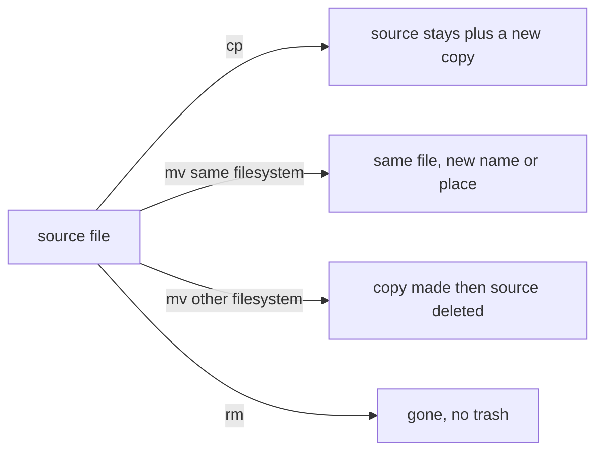

# 02 Files, Directories, and Text Editing

> By the end of this lesson you can create, inspect, copy, move, rename, delete and edit files and directories from the command line without destroying anything by accident.

!!! example "Try it now (2 minutes)"
    ```bash
    mkdir -p ~/try02 && cd ~/try02
    echo "first line" > a.txt
    cp a.txt b.txt
    mv b.txt c.txt
    ls -li
    ```
    ```text title="Example output"
    total 8
    33554567 -rw-r--r--. 1 student student 11 Oct 27 10:02 a.txt
    33554570 -rw-r--r--. 1 student student 11 Oct 27 10:02 c.txt
    ```
    <!-- VERIFY: inode numbers and timestamps are illustrative; the trailing "." after the permissions is the SELinux marker on RHEL -->
    Notice that `a.txt` and `c.txt` have **different inode numbers** (the first column): `cp` made a brand new file. `b.txt` is gone because `mv` only renamed it. By the end of this lesson you will know exactly what `cp`, `mv` and `rm` do to a file, and why that matters. Clean up with `cd; rm -r ~/try02`.

## Why it matters

Most RHCSA tasks touch files: configuration files, logs, user files, service files and mount points. If file handling is slow or careless, every admin task becomes harder, and one wrong `rm` or `mv` can break a system. In real life, administrators constantly create directories, back up configuration files before editing them, edit text, read logs and move data into the correct place.

**Objectives covered:**

- Create and edit text files
- Create, delete, copy, and move files and directories
- Access a shell prompt and issue commands with correct syntax

**Prereqs:** [00 Study Skills and Offline Help](00-study-skills-and-offline-help.md) and [01 Shell Basics and Command Syntax](01-shell-basics-and-command-syntax.md) · **Time:** about 5 h

**Tools used:** `touch`, `mkdir`, `rmdir`, `cp`, `mv`, `rm`, `cat`, `less`, `head`, `tail`, `wc`, `file`, `stat`, `find`, `vi`/`vim`, `nano`, `echo`, `printf`

**Offline help for this topic:** `man touch`, `man mkdir`, `man cp`, `man mv`, `man rm`, `man stat`, `man file`, `man find`, `man vim` or `man nano`

!!! tip "Type less, make fewer typos"
    Press `Tab` to complete file and directory names, and `Tab Tab` to list the choices. It is the best protection against the "wrong path" mistakes in this lesson. Tab completion, history and wildcards are taught in [01 Shell Basics and Command Syntax](01-shell-basics-and-command-syntax.md).

## How it works

A **file** stores data. A **directory** stores file names and other directories. Linux treats many things as files, including configuration data.

Think of a library. The **file name** is the label on the shelf, and the **inode** is the book itself plus its record card (size, owner, permissions, timestamps). A directory is a shelf listing labels. This explains the three core actions:

- `cp` photocopies the book. You now have two books with two record cards (two inodes).
- `mv` on the same filesystem just moves or relabels the shelf entry. The book (the inode) is untouched.
- `rm` removes the label. When no label is left, the book is freed.



### Case sensitivity

These are three different names:

- `report.txt`
- `Report.txt`
- `REPORT.TXT`

### Safe administration habit

Before editing an important file:

1. confirm the file path
2. make a backup copy
3. edit carefully
4. verify the result

```bash
cp /etc/hosts /etc/hosts.bak
```

## Commands, step by step

### 1. Create and inspect: `touch`, `ls`, `stat`, `file`

```bash
touch practice.txt
ls -l practice.txt
stat practice.txt
file practice.txt
file /etc/passwd
```

```text title="Example output"
-rw-r--r--. 1 student student 0 Oct 27 10:05 practice.txt
  File: practice.txt
  Size: 0         	Blocks: 0          IO Block: 4096   regular empty file
Device: 252,4	Inode: 33554567    Links: 1
Access: (0644/-rw-r--r--)  Uid: ( 1000/ student)   Gid: ( 1000/ student)
Context: unconfined_u:object_r:user_home_t:s0
Access: 2026-10-27 10:05:11.412000000 +0000
Modify: 2026-10-27 10:05:11.412000000 +0000
Change: 2026-10-27 10:05:11.412000000 +0000
 Birth: 2026-10-27 10:05:11.412000000 +0000
practice.txt: empty
/etc/passwd: ASCII text
```
<!-- VERIFY: exact stat layout, device numbers and SELinux context on the RHEL 10 lab image; values are illustrative -->

| Command | What it does |
|---|---|
| `touch name` | Creates an empty file if it does not exist. If it exists, it only updates the timestamps |
| `ls -l` | Long listing: permissions, owner, group, size, date, name |
| `stat name` | Full metadata: size, inode, links, permissions in numbers, owner, SELinux context, timestamps |
| `file name` | Identifies the type from the contents (`empty`, `ASCII text`, `directory`, and so on) |

`ls` options you will use constantly:

| Option | Meaning |
|---|---|
| `-a` | Include hidden files (names starting with `.`) |
| `-h` | With `-l`, show sizes like `4.0K` instead of bytes |
| `-R` | List subdirectories recursively |
| `-d` | Show the directory itself, not its contents (`ls -ld /etc`) |
| `-i` | Show inode numbers |

### 2. Create directories: `mkdir` and `rmdir`

```bash
mkdir lab
mkdir -p projects/rhcsa/notes
rmdir lab
rmdir projects
```

```text title="Example output"
rmdir: failed to remove 'projects': Directory not empty
```

- `mkdir -p` creates all missing parent directories in one go and is not an error if the directory already exists.
- `rmdir` removes only an **empty** directory. That makes it a safe delete: it refuses to remove anything that still contains files.

### 3. Copy: `cp`

```bash
cp file1 file2
cp -r dir1 dir2
cp -a source target
```

| Option | Meaning |
|---|---|
| `-r` | Copy a directory and everything inside it. Without it, `cp` skips directories |
| `-a` | "Archive": recursive, and keeps ownership, permissions, timestamps, SELinux context and symbolic links as they are. Use it for backups |
| `-p` | Keep mode, ownership and timestamps only (smaller than `-a`) |
| `-i` | Ask before overwriting an existing file |
| `-v` | Verbose: print each copy as it happens |

Plain `cp` gives the copy **you** as owner and the **current time** as its timestamp. `cp -p` and `cp -a` keep the original values:

```bash
ls -l --time-style=long-iso a.txt
cp a.txt plain.txt
cp -p a.txt kept.txt
ls -l --time-style=long-iso a.txt plain.txt kept.txt
```

```text title="Example output"
-rw-r--r--. 1 student student 11 2026-10-01 09:00 a.txt
-rw-r--r--. 1 student student 11 2026-10-01 09:00 a.txt
-rw-r--r--. 1 student student 11 2026-10-27 10:10 plain.txt
-rw-r--r--. 1 student student 11 2026-10-01 09:00 kept.txt
```
<!-- VERIFY: timestamps are illustrative -->

**The classic trap: does the destination directory already exist?**

```bash
mkdir -p src && touch src/a
cp -r src copy1           # copy1 does not exist: copy1 becomes a copy of src
mkdir existing
cp -r src existing        # existing exists: the copy goes INSIDE it
find copy1 existing | sort
```

```text title="Example output"
copy1
copy1/a
existing
existing/src
existing/src/a
```

If the target directory exists, `cp -r src existing` creates `existing/src`, not a replacement for `existing`. Check with `find` before and after.

If you forget `-r` on a directory, `cp` does not copy it:

```text title="Example output"
cp: -r not specified; omitting directory 'src'
```

### 4. Move and rename: `mv`

```bash
mv oldname newname
mv file.txt /tmp/
mv -i report.txt archive/
```

`mv` renames when the destination is a new name, and moves when the destination is an existing directory. The same "does the target exist?" rule applies: `mv dir1 dir2` renames `dir1` if `dir2` does not exist, but moves it **inside** `dir2` if it does. No `-r` is needed for directories.

- On the **same filesystem**, `mv` is instant and keeps the inode (the file is not rewritten).
- Across **different filesystems**, `mv` copies the data and then deletes the source, so a big move takes time and a half-finished move can leave the source in place.
- `mv -i` asks before overwriting. Without it, `mv a b` silently replaces `b`.

### 5. Delete: `rm`

```bash
rm file.txt
rm -i file.txt
rm -r olddir
rm -rf olddir
```

```text title="Example output"
rm: remove regular file 'file.txt'? y
rm: cannot remove 'olddir': Is a directory
```

| Option | Meaning |
|---|---|
| `-i` | Ask before each removal |
| `-r` | Remove a directory and everything inside it |
| `-f` | Force: no questions, ignore files that do not exist |

Danger:

- `rm` deletes immediately. There is no trash can in plain shell use.
- `rm -r` deletes whole directory trees.
- `rm -rf` does both without asking. Read the path twice, especially if it contains a variable or a `*`.

!!! note "Root's safety aliases"
    On RHEL, the `root` user's `~/.bashrc` normally defines `alias rm='rm -i'`, `alias cp='cp -i'` and `alias mv='mv -i'`, so root gets a confirmation prompt that `student` does not. This can surprise you in scripts and in `sudo` sessions. Check with `alias`. <!-- VERIFY: root aliases present on RHEL 10 default image -->

### 6. Read files: `cat`, `less`, `head`, `tail`, `wc`

```bash
cat /etc/hostname
head -n 3 /etc/passwd
tail -n 2 /etc/passwd
wc -l /etc/passwd
less /etc/services
```

```text title="Example output"
servera.lab.example
root:x:0:0:root:/root:/bin/bash
bin:x:1:1:bin:/bin:/sbin/nologin
daemon:x:2:2:daemon:/sbin:/sbin/nologin
student:x:1000:1000:student:/home/student:/bin/bash
tcpdump:x:72:72::/:/sbin/nologin
42 /etc/passwd
```
<!-- VERIFY: passwd contents differ per image; line counts are illustrative -->

| Command | Use it for |
|---|---|
| `cat` | Short files; dumps the whole file |
| `less` | Longer files, one screen at a time. `Space` next page, `/text` search, `q` quit |
| `head -n N` | First N lines |
| `tail -n N` | Last N lines (`tail -f` follows a growing log) |
| `wc -l` | Count lines (`-w` words, `-c` bytes) |

### 7. Find what you created: `find`

You will use `find` to prove a directory tree exists. Its basic form is `find <where> [tests]`, and with no tests it lists everything below `<where>`:

```bash
find lab1-copy
find /tmp/adminlab -name "*.conf"
find . -type d
```

```text title="Example output"
lab1-copy
lab1-copy/docs
lab1-copy/docs/notes1.txt
```

| Test | Meaning |
|---|---|
| `-name "*.conf"` | Match by name (quote the pattern so the shell does not expand it) |
| `-type f` / `-type d` | Only files / only directories |

`find` output order is not sorted. Pipe to `sort` when you compare output: `find . | sort`. Lesson [03 Redirection, Pipes, Grep, and Regex](03-redirection-pipes-grep-and-regex.md) covers pipes.

### 8. Edit text: `vi`/`vim`

You need at least one command-line editor. The exam is hands-on and offline, so you must be able to edit a config file without a graphical program. **`vi` is always installed on RHEL; the `vim` command usually is, but a minimal install may only have `vi`.** Use `vi` in the exam and you never get "command not found". <!-- VERIFY: vim-enhanced (the vim command) present or absent on the RHEL 10 minimal image -->

`vim` has two states. You start in **Normal mode** (keys are commands), and you switch to **Insert mode** to type text. The single most common beginner problem is typing while still in Normal mode.

```bash
vi notes.txt
```

A typical edit session:

1. `vi /etc/hosts` (or a copy of it)
2. press `i` to enter Insert mode
3. type or change the text
4. press `Esc`
5. type `:wq` and press `Enter`

**vi/vim survival table** (press `Esc` first to be in Normal mode):

| You want to | Press | What happens |
|---|---|---|
| Start typing | `i` | Insert mode (insert before the cursor) |
| Start typing at end of line | `A` | Insert mode at end of line |
| Start typing on a new line below | `o` | Opens a new line and enters Insert mode |
| Stop typing | `Esc` | Return to Normal mode |
| Save | `:w` then `Enter` | Write the file |
| Save and quit | `:wq` or `ZZ` | Write and exit |
| Quit without saving | `:q!` | Discard changes and exit |
| Move | arrow keys, or `h` `j` `k` `l` | Left, down, up, right |
| Undo | `u` | Undo last change |
| Redo | `Ctrl+r` | Redo the undone change |
| Delete current line | `dd` | Cut the whole line |
| Copy (yank) / paste line | `yy` / `p` | Yank the line, paste below |
| Delete one character | `x` | Delete under cursor |
| Go to line N | `:N` then `Enter` | Jump to line N |
| Go to end / start of file | `G` / `gg` | Jump |
| Search | `/text` then `Enter` | Find `text`; `n` for next match |
| Replace in whole file | `:%s/old/new/g` then `Enter` | Substitute every match |
| Show line numbers | `:set number` | Handy when a task names a line |

**The reliable rescue habit:** if you are ever lost, press `Esc` first, then type `:q!` to bail out without saving, or `:wq` to save and leave.

### 9. Edit text: `nano` (the simple alternative)

```bash
nano notes.txt
```

`nano` shows its shortcuts at the bottom of the screen, where `^` means the `Ctrl` key. It is friendlier but is not guaranteed to be installed.

| Keys | Action |
|---|---|
| `Ctrl+O` then `Enter` | Save (write Out) |
| `Ctrl+X` | Exit |
| `Ctrl+K` | Cut current line |
| `Ctrl+W` | Search |

For RHCSA study, practice editing one real config file (for example a copy of `/etc/hosts`) in `vi` until open, insert, save, quit feels automatic.

### 10. Write small files without an editor: `echo` and `printf`

```bash
echo "first line" > notes.txt        # create or overwrite
echo "second line" >> notes.txt      # append
printf "line1\nline2\nline3\n" > three.txt
cat notes.txt three.txt
```

```text title="Example output"
first line
second line
line1
line2
line3
```

`>` replaces the file, `>>` adds to the end. `printf` does not add a newline for you, so write `\n` yourself. Redirection is covered fully in [03 Redirection, Pipes, Grep, and Regex](03-redirection-pipes-grep-and-regex.md).

## Worked examples

### Worked example 1: Create and inspect a practice file

```bash
touch practice.txt
ls -l practice.txt
stat practice.txt
file practice.txt
```

Verification: `practice.txt` exists in the intended directory; `ls -l` shows size 0 and permissions; `stat` shows metadata; `file` says `empty`. After you add text, `file` says `ASCII text`.

### Worked example 2: Build and copy a directory tree

```bash
mkdir -p lab1/docs
touch lab1/docs/notes1.txt
cp -r lab1 lab1-copy
find lab1-copy
```

Verification: `find lab1-copy` shows `lab1-copy`, `lab1-copy/docs` and `lab1-copy/docs/notes1.txt`.

### Worked example 3: Back up and edit a text file

```bash
echo "first line" > notes.txt
cp notes.txt notes.txt.bak
echo "second line" >> notes.txt
cat notes.txt
cat notes.txt.bak
```

```text title="Example output"
first line
second line
first line
```

Verification: `notes.txt` has two lines and the backup still has the original one line.

## Common mistakes

- **Mistake:** Deleting the wrong file because you did not check the path. **Recovery:** run `ls` or `find` on the exact path first, and use `rm -i` until you trust yourself. A deleted file cannot be recovered; restore from a backup if you made one.
- **Mistake:** Using `rm -r` carelessly. **Recovery:** prefer `rmdir` for empty directories, and read the path twice before `rm -r`.
- **Mistake:** Confusing copy and move, for example using `mv` when you meant `cp`. **Recovery:** check whether the source still exists. If not, move it back with `mv`.
- **Mistake:** Overwriting a file by accident. **Recovery:** restore from backup if you have one; use `cp -i` and `mv -i`, and build the habit of `cp file file.bak` first.
- **Mistake:** Editing a file, especially a system file, without a safety copy. **Recovery:** adopt a standard backup suffix such as `.bak` and make the copy first.
- **Mistake:** Deleting before verifying the backup. **Recovery:** create the backup, inspect it with `ls -l` and `cat`, then delete.
- **Mistake:** Forgetting `-r` when copying a directory. **Recovery:** rerun with `cp -r`.
- **Mistake:** Expecting `cp -r src existing` to replace `existing`. **Recovery:** the copy lands in `existing/src`. Remove the stray copy and use a target name that does not exist yet.
- **Mistake:** Forgetting that Linux file names are case-sensitive, so `Report.txt` and `report.txt` are different files. **Recovery:** list with `ls -l` and inspect the exact names.

### Troubleshooting

| Problem | Cause | Fix |
|---|---|---|
| `No such file or directory` | Typo in the path, or the parent directory does not exist | Check with `pwd`, list nearby directories with `ls`, use `mkdir -p` for nested directories |
| `cp: -r not specified; omitting directory 'x'` | You tried to copy a directory without `-r` | Rerun with `cp -r` |
| `cat: x: Is a directory` | You used a file command on a directory | Inspect with `ls`; to read files inside, name the file |
| `rm: cannot remove 'x': Is a directory` | `rm` without `-r` on a directory | `rmdir x` if empty, or `rm -r x` carefully |
| `rm: cannot remove 'x': Permission denied` | You lack write permission on the parent directory (deleting is a directory permission) | Check ownership and permissions (see lesson 06), then use the right account or `sudo` |
| `rmdir: failed to remove 'x': Directory not empty` | The directory still has contents | Look inside with `ls -a x`, then `rm -r x` if you really mean it |
| You overwrote the wrong file | The target path was wrong | Restore from backup if available; use `cp -i` and `mv -i` in future |
| The editor feels confusing | Modes | Practise only: open, insert, save, quit |

## Hands-on lab

**Setup:** shared lab environment, `servera`, user `student`. Use your home directory as the workspace, and start from scratch:

```bash
cd
rm -rf rhcsa-file-lab
mkdir rhcsa-file-lab
cd rhcsa-file-lab
```

**Task:**

- [ ] Create the directories `configs`, `logs` and `archive` in one command.
- [ ] Create the files `configs/app.conf`, `configs/db.conf` and `logs/app.log`.
- [ ] Put the text `app_port=8080` into `app.conf` and `db_name=appdb` into `db.conf` with `echo`.
- [ ] Display both config files with one `cat` command.
- [ ] Create the backup directory `archive/backup1`.
- [ ] Copy the `configs` directory into `archive/backup1` (it will become `archive/backup1/configs`).
- [ ] Rename `logs/app.log` to `logs/app.log.1`.
- [ ] Create `todo.txt` with `vi` containing exactly three lines: `buy milk`, `write notes`, `sleep`.
- [ ] Inspect `todo.txt` with `cat`, `wc -l` and `stat`.
- [ ] Create `oops.txt` by mistake and remove it with `rm`.
- [ ] Create an empty directory `empty` and remove it with `rmdir`.
- [ ] Prove the final tree with `find . | sort`.

??? question "Hint 1"
    `mkdir` accepts several names at once, and the target `archive/backup1` already exists when you copy, so think about where the copy lands.

??? question "Hint 2"
    Use `touch`, `echo ... >`, `cp -r`, `mv`, `vi`, `rm` and `rmdir`. In `vi`: `i`, type, `Esc`, `:wq`.

??? success "Solution"
    ```bash
    mkdir configs logs archive
    touch configs/app.conf configs/db.conf logs/app.log
    echo "app_port=8080" > configs/app.conf
    echo "db_name=appdb" > configs/db.conf
    cat configs/app.conf configs/db.conf
    mkdir archive/backup1
    cp -r configs archive/backup1
    mv logs/app.log logs/app.log.1
    vi todo.txt            # i, type the three lines, Esc, :wq
    cat todo.txt
    wc -l todo.txt
    stat todo.txt
    touch oops.txt && rm oops.txt
    mkdir empty && rmdir empty
    find . | sort
    ```
    ```text title="Example output"
    .
    ./archive
    ./archive/backup1
    ./archive/backup1/configs
    ./archive/backup1/configs/app.conf
    ./archive/backup1/configs/db.conf
    ./configs
    ./configs/app.conf
    ./configs/db.conf
    ./logs
    ./logs/app.log.1
    ./todo.txt
    ```
    **Verify:** `wc -l todo.txt` prints `3 todo.txt`; `cat archive/backup1/configs/app.conf` prints `app_port=8080`; `oops.txt` and `empty` are not in the `find` output.

Clean up when finished (optional): `cd; rm -r rhcsa-file-lab`.

### More practice

1. Create a directory tree `practice/a/b/c` with one command.
2. Create three empty files inside `practice/a`.
3. Copy one file to a new name and verify both copies exist.
4. Move one file from `practice/a` to `practice/a/b`.
5. Rename a directory without changing its contents.
6. Create a text file with at least three lines and display only the first two lines.
7. Make a backup copy of that text file before editing it.
8. Delete an empty directory and then delete a directory that contains files.

??? success "Solution"
    ```bash
    mkdir -p practice/a/b/c
    touch practice/a/f1 practice/a/f2 practice/a/f3
    cp practice/a/f1 practice/a/f1-copy && ls practice/a
    mv practice/a/f2 practice/a/b/
    mv practice/a/b/c practice/a/b/cc          # rename a directory
    printf "one\ntwo\nthree\n" > lines.txt
    head -n 2 lines.txt
    cp lines.txt lines.txt.bak
    rmdir practice/a/b/cc                       # empty directory
    rm -r practice                              # directory with files
    ```

### Exam-style task 1

Create this structure under `/tmp/adminlab`:

- directory `configs`
- directory `backups`
- file `configs/web.conf`
- file `configs/db.conf`

Add one line of sample text to each config file. Then make a backup copy of the entire `configs` directory into `backups/configs-copy`.

**Grader mindset checklist:**

- [ ] `/tmp/adminlab/configs` exists
- [ ] both config files exist
- [ ] each file contains text
- [ ] `/tmp/adminlab/backups/configs-copy` exists
- [ ] copied files are still present in the backup directory

??? success "Solution"
    ```bash
    mkdir -p /tmp/adminlab/configs /tmp/adminlab/backups
    echo "web_port=8080" > /tmp/adminlab/configs/web.conf
    echo "db_name=appdb" > /tmp/adminlab/configs/db.conf
    cp -r /tmp/adminlab/configs /tmp/adminlab/backups/configs-copy
    find /tmp/adminlab | sort
    ```
    `configs-copy` does not exist before the `cp`, so it becomes the copy of `configs`. **Verify:** the `find` output includes `/tmp/adminlab/backups/configs-copy/web.conf` and `/tmp/adminlab/backups/configs-copy/db.conf`.

### Exam-style task 2

Create `/tmp/editcheck.txt` with at least three lines, then:

- append one more line
- make a backup named `/tmp/editcheck.txt.bak`
- display only the last two lines of the edited file

**Grader mindset checklist:**

- [ ] edited file and backup both exist
- [ ] main file has at least four lines
- [ ] backup represents the file state at the time you copied it
- [ ] `tail` or an equivalent command succeeds

??? success "Solution"
    ```bash
    printf "line1\nline2\nline3\n" > /tmp/editcheck.txt
    cp /tmp/editcheck.txt /tmp/editcheck.txt.bak
    echo "line4" >> /tmp/editcheck.txt
    tail -n 2 /tmp/editcheck.txt
    ```
    ```text title="Example output"
    line3
    line4
    ```
    The backup was copied before the append, so it keeps three lines and the main file has four.

## Exam tips

!!! tip "What the exam expects"
    The exact paths, file names and contents from the task exist, and you did not damage anything else. Back up a file before you edit it, use `vi` (always installed) rather than `vim`, and prove every result with `ls -l`, `cat` or `find`. If you are stuck in `vi`: `Esc`, then `:q!` (discard) or `:wq` (save).

!!! warning "Must survive reboot"
    | Change | Persistent? | Make it persist with |
    |---|---|---|
    | Files and directories in `/home`, `/etc`, `/root` | Yes | Nothing, they are on disk |
    | Files in `/tmp` | Not guaranteed | Do not rely on `/tmp` for exam answers unless the task names it; `/tmp` is cleaned automatically |
    | Unsaved edits in `vi` or `nano` | No | Save with `:wq` or `Ctrl+O` |

    <!-- VERIFY: /tmp cleanup behaviour on RHEL 10 (systemd-tmpfiles age rules, tmpfs or disk) -->

**Verify like a grader:**

1. `ls -l` the path: owner, permissions and size look right.
2. `cat` or `tail` the file to prove the content is the expected content.
3. `find <dir> | sort` for a directory tree and compare with the task.
4. Confirm the backup exists before you delete or overwrite the original.
5. For edits made in a system file, re-open it and re-read the line you changed.

## Quiz

1. What command creates an empty file?
2. What option lets `mkdir` create parent directories too?
3. What is the difference between `cp` and `mv`?
4. Why is `rm -r` dangerous?
5. What command shows detailed file metadata?
6. What command is better for reading a long file one screen at a time?
7. In `vim`, which key enters Insert mode, and how do you save and quit?
8. In `vim`, you are stuck and do not want to save your changes. What do you type?
9. `/tmp/dest` already exists. Where does `cp -r /tmp/src /tmp/dest` put the copy?
10. What does `cp: -r not specified; omitting directory 'x'` mean?
11. Which command removes a directory only if it is empty?
12. Why can `mv` be instant on the same filesystem but slow across filesystems?

??? success "Answers"
    1. `touch`
    2. `-p`
    3. `cp` duplicates. `mv` moves or renames.
    4. It recursively deletes and can remove large directory trees quickly.
    5. `stat`
    6. `less`
    7. Press `i` to enter Insert mode; press `Esc`, then type `:wq` and press `Enter` to save and quit.
    8. Press `Esc`, then type `:q!` and press `Enter`.
    9. Inside it, as `/tmp/dest/src`, because the target already exists.
    10. You tried to copy a directory without `-r`, so `cp` skipped it.
    11. `rmdir`
    12. On the same filesystem it only changes the directory entry (the inode is kept); across filesystems it must copy all the data and then delete the source.

## Summary

- `touch` creates files; `mkdir -p` creates directory paths.
- `cp` copies; `mv` moves or renames. Always ask whether the target directory already exists.
- `rm` deletes with no trash, so verify paths first. Prefer `rmdir` for empty directories.
- `cat`, `less`, `head`, `tail` and `wc` inspect content; `stat` and `file` prove details; `find` proves a tree.
- Back up important files before editing. In `vi`: `i`, `Esc`, `:wq`, and `:q!` to bail out.

| Task | Command |
|---|---|
| Create empty file | `touch file.txt` |
| Create nested directories | `mkdir -p dir/subdir` |
| Back up a file | `cp file.txt file.txt.bak` |
| Copy a directory | `cp -r dir dir-copy` |
| Copy keeping attributes | `cp -a dir dir-backup` |
| Rename or move | `mv oldname newname` |
| Delete file / directory tree | `rm file.txt` / `rm -r dir` |
| Delete empty directory | `rmdir dir` |
| Read whole file / screen at a time | `cat file.txt` / `less file.txt` |
| First / last lines | `head -n 5 file.txt` / `tail -n 5 file.txt` |
| Count lines | `wc -l file.txt` |
| File type / metadata | `file file.txt` / `stat file.txt` |
| List a tree | `find dir \| sort` |
| Edit | `vi file.txt` or `nano file.txt` |

**Previous:** [01 Shell Basics and Command Syntax](01-shell-basics-and-command-syntax.md) · **Next:** [03 Redirection, Pipes, Grep, and Regex](03-redirection-pipes-grep-and-regex.md): now that you can create and edit files, you learn to redirect output into them and search inside them.
