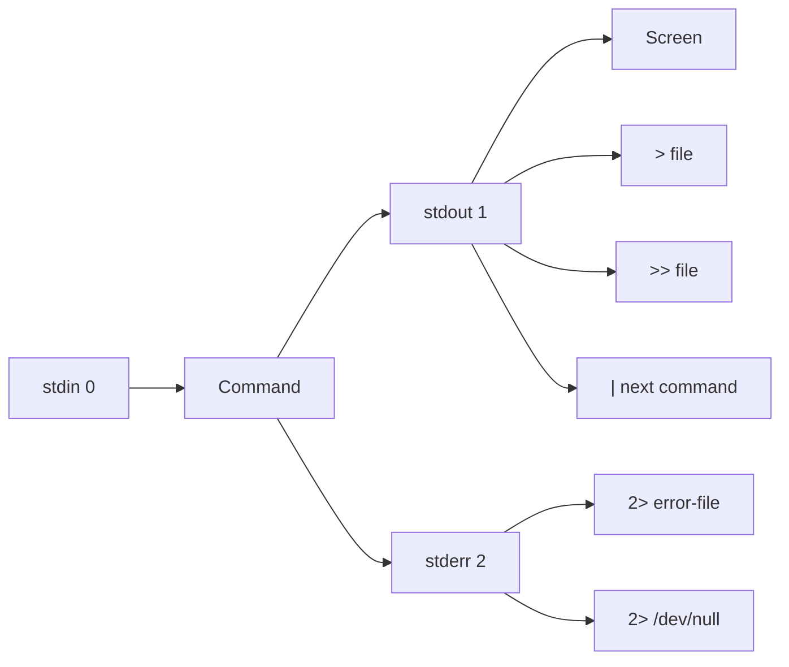

# 03 Redirection, Pipes, Grep, and Regex

> By the end of this lesson you can control where a command's input and output go, connect commands into pipelines, and pull exactly the lines you need out of a file with `grep` and simple patterns.

!!! example "Try it now (2 minutes)"
    ```bash
    ls /etc/passwd /no-such-file
    ls /etc/passwd /no-such-file 2> /dev/null
    ```
    ```text title="Example output"
    ls: cannot access '/no-such-file': No such file or directory
    /etc/passwd
    /etc/passwd
    ```
    <!-- VERIFY: ordering of the error line versus the listing on the first command (stderr and stdout are separate streams) -->
    Notice that the first command printed an error and a result, and the second printed only the result. The error was thrown into `/dev/null`, the system's rubbish bin. By the end of this lesson you will know exactly why that works.

## Why it matters

RHCSA tasks often say "save the output of ...", "count the lines that ...", or "find the line in this config that ...". If you cannot redirect output or search text quickly, you lose time on simple tasks. In real life, administrators constantly inspect logs, search configuration files, capture errors, and combine small commands to answer a specific question fast.

**Objectives covered:**

- Use input-output redirection (>, >>, |, 2>, etc.)
- Use grep and regular expressions to analyze text

**Prereqs:** [01 Shell Basics and Command Syntax](01-shell-basics-and-command-syntax.md) and [02 Files, Directories, and Text Editing](02-files-directories-and-text-editing.md) · **Time:** about 5 h

**Tools used:** `echo`, `cat`, `grep`, `head`, `tail`, `wc`, `sort`, `uniq`, `cut`, `tee`, `less`, `sed`, `awk`

**Offline help for this topic:** `man bash` (search `/REDIRECTION`), `man grep`, `info grep`, `grep --help`, `man tee`, `man cut`, `man sed`, `man awk`, `man 7 regex`

!!! note "Supporting skill (not a listed RHEL 10 objective)"
    `sed` and `awk` are not named in the official RHEL 10 list. They are kept here because they are the fastest way to edit a file in place or print one column, and later labs use them. `grep`, redirection and pipes are the listed skills; learn those first.

## How it works

Every command has three channels, called **streams**. Think of a command as a tap with two pipes out of it and one pipe in:

- **stdin** (standard input, number `0`): where the command reads from. Normally your keyboard.
- **stdout** (standard output, number `1`): where normal results go. Normally your screen.
- **stderr** (standard error, number `2`): where error messages go. Also your screen by default, which is why you cannot tell them apart until you separate them.

You do not need advanced theory. You do need to know how to direct them.



A **pipe** (`|`) joins the stdout of one command to the stdin of the next. Each command does one small job, and the pipeline does a big one:


### Redirection forms at a glance

| Form | Meaning |
|---|---|
| `cmd > file` | Write stdout to `file`, **overwriting** it |
| `cmd >> file` | **Append** stdout to `file` |
| `cmd < file` | Read stdin from `file` |
| `cmd 2> file` | Write stderr to `file` (overwrite). `2>>` appends |
| `cmd > out 2> err` | Split: stdout to `out`, stderr to `err` |
| `cmd > file 2>&1` | stdout to `file`, and stderr to **wherever stdout now goes** (same file) |
| `cmd &> file` | Bash shorthand for the line above. `&>>` appends |
| `cmd 2> /dev/null` | Throw errors away |
| <code>cmd1 &#124; cmd2</code> | stdout of `cmd1` becomes stdin of `cmd2` |
| <code>cmd1 &#124;&amp; cmd2</code> | Bash shorthand: stdout **and** stderr go into the pipe |
| <code>cmd &#124; tee file</code> | Show the output **and** save it. `tee -a` appends |

### Basic regex mindset

A **regular expression** (regex) is a text pattern. Treat it as a few small matching rules, not magic. `grep` reads the pattern, then prints every line that contains a match.

| Pattern | Matches | Example |
|---|---|---|
| `abc` | the literal text `abc` anywhere in the line | `grep root` |
| `^abc` | line **starts** with `abc` | `^root` |
| `abc$` | line **ends** with `abc` | `bash$` |
| `^$` | an empty line | `grep -c '^$' file` |
| `.` | any single character | `r..t` matches `root` |
| `*` | zero or more of the previous item | `.*` is "anything" |
| `[abc]` | one character from the set | `[0-9]` one digit |
| `[^#]` | one character **not** in the set | `^[^#]` starts with a non-`#` |
| `[[:digit:]]`, `[[:alpha:]]`, `[[:space:]]` | named classes (digits, letters, whitespace) | `[[:digit:]]` |
| `\s`, `\w` | whitespace, word character (GNU extension) | `^\s*#` |
| `\.` | a literal dot (backslash switches off the special meaning) | `192\.168` |

"Basic" (BRE) and "extended" (ERE) regex are two flavours. With plain `grep` the characters `+ ? | ( ) { }` are ordinary text. With `grep -E` (extended) they become operators:

| ERE operator | Meaning | Example |
|---|---|---|
| <code>a&#124;b</code> | `a` or `b` | <code>root&#124;student</code> |
| `+` | one or more of the previous item | `[0-9]+` |
| `?` | zero or one of the previous item | `colou?r` |
| `{n,m}` | between n and m repeats | `[0-9]{1,3}` |
| `( )` | group items | `(ab)+` |

For RHCSA, basic pattern matching is usually enough. Use `grep -E` whenever you want alternation (`|`), because it avoids backslash clutter. The old command `egrep` still works but prints a warning on current systems, so always write `grep -E`.

## Commands, step by step

### 1. Send output to a file: `>` and `>>`

```bash
echo "hello" > file.txt
echo "again" >> file.txt
cat file.txt
wc -l file.txt
```

```text title="Example output"
hello
again
2 file.txt
```

`>` creates the file, or **empties it first** if it exists. `>>` adds to the end. If you are unsure, use `>>`: an extra line is easier to fix than a lost file.

### 2. Split errors from results: `2>`, `2>&1`, `&>`, `/dev/null`

```bash
ls /tmp /no-such-dir > good.txt 2> bad.txt
cat bad.txt
ls /tmp /no-such-dir > all.txt 2>&1
ls /tmp /no-such-dir 2> /dev/null | head -2
```

```text title="Example output"
ls: cannot access '/no-such-dir': No such file or directory
/tmp:
systemd-private-...
```
<!-- VERIFY: the exact files listed under /tmp on the lab image; the names are illustrative -->

Order matters with `2>&1`. Read it left to right: "send stdout to the file, **then** send stderr to where stdout points now".

| Command | Where the error goes |
|---|---|
| `cmd > f 2>&1` | into `f` (both streams in the file) |
| `cmd 2>&1 > f` | to the **screen**; stderr was copied to the screen before stdout moved to `f` |

`|` carries stdout only. An error still reaches the screen unless you add `2>&1` before the pipe (or use `|&`).

### 3. Feed a file in: `<` and here-documents `<<`

```bash
wc -l < /etc/passwd
cat > app.conf <<'EOF'
port=8080
EOF
```

```text title="Example output"
45
```
<!-- VERIFY: the line count of /etc/passwd differs per machine; 45 is illustrative -->

`wc -l < file` prints just the number (no file name), because `wc` never saw a name. A **here-document** (`<<'EOF'`) sends the lines that follow, up to a line containing only `EOF`, as stdin. It is the clean way to create a multi-line file from the shell. The quotes around `'EOF'` stop the shell expanding `$` inside the text.

### 4. Connect commands with `|` and show-and-save with `tee`

```bash
cat /etc/passwd | grep root
grep -c 'bash$' /etc/passwd
grep 'bash$' /etc/passwd | cut -d: -f1 | sort | tee bash-users.txt
```

```text title="Example output"
root:x:0:0:Super User:/root:/bin/bash
operator:x:11:0:operator:/root:/sbin/nologin
2
root
student
```
<!-- VERIFY: exact GECOS text "Super User" and the count of bash users on the lab image -->

Notice that `operator` matched `root` because its home directory is `/root`. That is what "searching too broadly" looks like: `^root` or `^root:` would have matched only the real account.

`tee` copies its stdin to the screen **and** to a file. This is what you want when a task says "save the output and also display it". It also fixes one classic trap: the shell does the redirection, not `sudo`.

```bash
sudo echo "hello" > /root/test.txt
echo "hello" | sudo tee /root/test.txt
```

```text title="Example output"
bash: /root/test.txt: Permission denied
hello
```
<!-- VERIFY: exact wording of the bash permission error -->

The first line fails because your normal shell opens `/root/test.txt`; `sudo` only affects `echo`. In the second, `tee` runs under `sudo` and opens the file itself.

Small filters you will chain with pipes:

| Command | Does |
|---|---|
| `head -n 3` / `tail -n 3` | first / last 3 lines (`tail -f` follows a growing file) |
| `wc -l` | counts lines (`-w` words, `-c` bytes) |
| `sort` | sorts lines (`-n` numeric, `-r` reverse, `-u` unique) |
| `uniq -c` | collapses **adjacent** duplicate lines and counts them, so `sort` first |
| `cut -d: -f1,7` | takes fields 1 and 7, using `:` as the separator |
| `less` | scroll a long result (`/text` searches, `q` quits) |

```bash
printf 'apple\nbanana\napple\ncherry\nbanana\napple\n' | sort | uniq -c | sort -rn
```

```text title="Example output"
      3 apple
      2 banana
      1 cherry
```

### 5. Search with `grep`

```bash
grep root /etc/passwd
grep -i ROOT /etc/passwd
grep -n root /etc/passwd
grep -v '^#' file.conf
```

```text title="Example output"
1:root:x:0:0:Super User:/root:/bin/bash
10:operator:x:11:0:operator:/root:/sbin/nologin
```
<!-- VERIFY: the line number of the operator entry on the lab image -->

| Option | Meaning |
|---|---|
| `-i` | ignore case |
| `-n` | show line numbers |
| `-v` | show lines that do **not** match |
| `-c` | print only the count of matching lines |
| `-w` | match whole words only (`root` but not `rootfs`) |
| `-r` | search every file under a directory (exam favourite: "find which file sets this option") |
| `-l` | print only the names of files that match |
| `-o` | print only the matching part, not the whole line |
| `-A 2` / `-B 2` / `-C 2` | show 2 lines After / Before / around each match |
| `-q` | print nothing, just set the exit status (0 = found), useful in scripts |
| `-E` | extended regex (<code>&#124;</code>, `+`, `?`, `{}`, `( )`) |

```bash
grep -E 'root|student' /etc/passwd
grep -E '^[a-z].*bash$' /etc/passwd
grep -rn 'servera' ~/rhcsa-redirection-lab
grep -Ev '^\s*(#|$)' /etc/ssh/sshd_config
```

The last one is the standard way to read a config file without noise: `-v` hides every line that is empty or begins (after optional spaces) with `#`.

Which interactive shell users exist? `bash$|nologin$` is a better example than `bash$|sh$`, because `sh$` already matches every `bash` line:

```bash
grep -E 'bash$|nologin$' /etc/passwd
```

Pipelines are how you use `grep` on command output, not only on files:

```bash
rpm -qa | grep -i ssh
ls -l /etc | grep '^d'
```

### 6. Replace text with `sed` (supporting skill)

`sed` is a **stream editor**: it reads lines, applies an instruction, and prints the result. The most common instruction is `s/old/new/`.

```bash
echo banana | sed 's/a/A/'
echo banana | sed 's/a/A/g'
sed -n '1,3p' /etc/passwd
sed -i.bak 's/http:/https:/' app.conf
```

```text title="Example output"
bAnana
bAnAnA
root:x:0:0:Super User:/root:/bin/bash
bin:x:1:1:bin:/bin:/sbin/nologin
daemon:x:2:2:daemon:/sbin:/sbin/nologin
```

| Part | Meaning |
|---|---|
| `s/old/new/` | substitute the **first** `old` on each line |
| `s/old/new/g` | the `g` flag replaces **every** `old` on each line |
| `-n '1,3p'` | `-n` stops automatic printing; `p` prints only lines 1 to 3 |
| `-i` | edit the file **in place** instead of printing. `-i.bak` keeps a backup copy as `file.bak` |
| <code>s&#124;/usr/bin&#124;/opt/bin&#124;</code> | any character can be the delimiter, handy for paths |

Without `-i`, `sed` never touches the file; it only prints. Test your expression without `-i` first, then repeat with `-i`.

### 7. Print columns with `awk` (supporting skill)

`awk` splits every line into fields and lets you print the ones you want. Always set the separator for files like `/etc/passwd`, whose fields are separated by `:`, not spaces.

```bash
awk -F: '{print $1}' /etc/passwd | head -3
awk -F: '/bash$/ {print $1, $7}' /etc/passwd
```

```text title="Example output"
root
bin
daemon
root /bin/bash
student /bin/bash
```
<!-- VERIFY: which accounts end in bash on the lab image -->

| Part | Meaning |
|---|---|
| `-F:` | use `:` as the field separator (default is whitespace) |
| `$1`, `$7` | first and seventh field; `$0` is the whole line |
| `/bash$/` | only act on lines matching this pattern |

Without `-F:`, `awk '/bash$/ {print $1, $7}'` sees the whole line as field 1 and prints nothing useful. When to choose: `sed` to change text, `awk` (or `cut`) to pick fields.

!!! info "Exam Focus"
    `grep`, `cut`, `sed`, and `awk` form a practical text-processing toolkit.
    You do not need advanced scripting to gain value from them.

## Common mistakes

- **Mistake:** Overwriting a file with `>` when you meant to append with `>>`. **Recovery:** restore from backup if available, and use `>>` next time. In an interactive shell, `set -o noclobber` makes `>` refuse to overwrite existing files (override with `>|`).
- **Mistake:** Forgetting that `|` sends standard output, not errors. **Recovery:** redirect errors into the pipe deliberately with `2>&1 |` (or `|&`).
- **Mistake:** Searching too broadly and not anchoring patterns. **Recovery:** anchor with `^` or `$`, use `-w`, or use more specific text.
- **Mistake:** Treating regex as magic instead of small matching rules. **Recovery:** inspect the file first with `cat` or `less`, then build the pattern one piece at a time.
- **Mistake:** Ignoring error output that should have been redirected separately. **Recovery:** use `2> errors.txt`, then read that file.
- **Mistake:** Placing the redirection in the wrong spot. **Recovery:** remember that redirection applies to the command's stream, and the order is read left to right. `cmd > f 2>&1` sends both streams to `f`; `cmd 2>&1 > f` does not.
- **Mistake:** Assuming pipes include error output. **Recovery:** they do not unless you redirect error into output deliberately.
- **Mistake:** Forgetting to inspect saved files. **Recovery:** always `cat`, `less`, or `wc` the result.
- **Mistake:** Using regex before understanding the exact text format. **Recovery:** inspect the file first with `cat` or `less`.
- **Mistake:** Reading and writing the same file in one command, such as `sort data.txt > data.txt`. The shell empties the file before `sort` reads it. **Recovery:** write to a new file, or use `sort -o data.txt data.txt`.
- **Mistake:** `sudo cmd > /root/file` fails with "Permission denied". **Recovery:** use `cmd | sudo tee /root/file` (`tee -a` to append).

### Troubleshooting

| Problem | Cause | Fix |
|---|---|---|
| File got overwritten | You used `>` instead of `>>` | Restore from backup if available; append carefully next time |
| Error text still appears on screen | Only standard output was redirected | Redirect errors with `2>` (or `2>&1` / `&>`) |
| `grep` matches too many lines | Pattern too broad | Anchor with `^` or `$`; use `-w` or more specific text |
| `grep -E` behaves differently than expected | The shell expanded or split your pattern because it was unquoted (a separate problem from BRE versus ERE) | Quote the pattern: <code>grep -E 'root&#124;student' file</code> |
| <code>grep 'a\&#124;b'</code> is needed for "or", and <code>grep 'a&#124;b'</code> matches the literal text | In basic regex <code>\&#124;</code> means "or" and a bare <code>&#124;</code> is plain text | Use <code>grep -E 'a&#124;b'</code>, where a bare <code>&#124;</code> means "or" |
| Output file is empty after `sed -i` | A typo in the expression, or the wrong file | Restore from `file.bak` (created by `-i.bak`) and rerun without `-i` first |

The quoting fix, written out:

```bash
grep -E 'root|student' file
```

## Hands-on lab

**Setup:** shared lab environment, `servera`, logged in as `student`. This lab needs no root access. Run this once to create all the input files, so nothing else is assumed:

```bash
mkdir -p ~/rhcsa-redirection-lab && cd ~/rhcsa-redirection-lab
cat > app.conf <<'EOF'
# Web app settings
server=servera.lab.example
port=8080

# Logging
log_level=info
url=http://servera.lab.example/app
EOF
printf 'apple\nbanana\napple\ncherry\nbanana\napple\n' > fruit.txt
```

**Task:** work inside `~/rhcsa-redirection-lab`.

- [ ] Create `users.txt` with five lines (`alice`, `bob`, `carol`, `dave`, `erin`) using `echo`, one `>` and four `>>`.
- [ ] Display `users.txt` with line numbers using `grep -n`, matching every line (a pattern that matches everything is `''`).
- [ ] Save the current date into `report.txt`, then append the hostname to `report.txt`.
- [ ] Run `ls ~/rhcsa-redirection-lab /no-such-dir` and save normal output to `good.out` and the error to `errors.out`.
- [ ] Use `grep` to find the lines containing `root` in `/etc/passwd`.
- [ ] Write `app.conf` without comments or blank lines to `clean.conf`.
- [ ] Use `grep -E` to count the lines in `/etc/passwd` that end in `bash` or `nologin`, and save only the number to `shell-count.txt`.
- [ ] Use `tee` to both view and save the sorted names of the accounts that end in `bash` into `bash-users.txt`.
- [ ] Use `sort` and `uniq` to count each word in `fruit.txt`, most frequent first.
- [ ] Use `sed -n '1,3p'` to print only the first three lines of `app.conf`.
- [ ] Change `http:` to `https:` in `app.conf` in place, keeping a `.bak` backup.
- [ ] Use `awk -F:` to print only usernames from `/etc/passwd` into `names.txt`.

??? question "Hint 1"
    Redirection decides where each stream goes: one `>` to start `users.txt`, then `>>` for the rest. For `clean.conf`, you need to hide two kinds of line: comments and empty lines.

??? question "Hint 2"
    Commands to use: `grep -n`, `date`, `hostname`, `ls` with `2>`, `grep -Ev`, `grep -Ec`, `sort`, `tee`, `uniq -c`, `sed -n`, `sed -i.bak`, `awk -F:`.

??? success "Solution"
    ```bash
    cd ~/rhcsa-redirection-lab
    echo alice > users.txt
    echo bob   >> users.txt
    echo carol >> users.txt
    echo dave  >> users.txt
    echo erin  >> users.txt
    grep -n '' users.txt

    date > report.txt
    hostname >> report.txt

    ls ~/rhcsa-redirection-lab /no-such-dir > good.out 2> errors.out

    grep root /etc/passwd

    grep -Ev '^\s*(#|$)' app.conf > clean.conf
    grep -Ec 'bash$|nologin$' /etc/passwd > shell-count.txt
    grep 'bash$' /etc/passwd | cut -d: -f1 | sort | tee bash-users.txt

    sort fruit.txt | uniq -c | sort -rn
    sed -n '1,3p' app.conf
    sed -i.bak 's/http:/https:/' app.conf
    awk -F: '{print $1}' /etc/passwd > names.txt
    ```
    **Verify:**

    ```bash
    cat report.txt                     # a date line, then servera.lab.example
    wc -l users.txt                    # 5 users.txt
    grep -n carol users.txt            # 3:carol
    cat errors.out                     # ls: cannot access '/no-such-dir': ...
    cat clean.conf                     # 4 lines: server, port, log_level, url
    cat shell-count.txt                # a single number
    grep -c https app.conf             # 1
    ls app.conf.bak                    # backup exists
    head -3 names.txt                  # root, bin, daemon
    ```
    <!-- VERIFY: hostname prints servera.lab.example only if the lab sets the FQDN as hostname -->

## More practice

1. Create a file and append three separate lines to it.
2. Produce an error on purpose and capture it with `2>`.
3. Search `/etc/passwd` for lines that start with `root`.
4. Search `/etc/passwd` for lines ending in `nologin`.
5. Count how many non-comment, non-blank lines exist in `~/rhcsa-redirection-lab/app.conf`.
6. Use `sort` and `uniq` on a file with repeated words.
7. Pipe the output of `ls -l /etc` into `less`.
8. Use `sed` to replace one word with another in sample text.
9. Use `awk` to print the first and seventh fields from `/etc/passwd`.
10. Use `grep -r` to list the files under `/etc/ssh` that contain the word `Port`.

### Exam-style task 1

Create `/tmp/account-report.txt` containing only the lines from `/etc/passwd` that end with `bash`. Then create `/tmp/account-count.txt` containing the number of such lines.

**Grader mindset checklist:**

- [ ] both files must exist
- [ ] report file must contain only matching lines
- [ ] count file must contain a numeric result

??? success "Solution"
    ```bash
    grep 'bash$' /etc/passwd > /tmp/account-report.txt
    grep 'bash$' /etc/passwd | wc -l > /tmp/account-count.txt
    cat /tmp/account-report.txt /tmp/account-count.txt
    ```
    The count file holds a bare number because `wc -l` reads from the pipe and has no file name to print. `grep -c 'bash$' /etc/passwd > /tmp/account-count.txt` gives the same result.

### Exam-style task 2

Run a command that lists `/tmp` and also attempts to list `/no-such-dir`. Save successful output to `/tmp/list-ok.txt` and errors to `/tmp/list-errors.txt`.

**Grader mindset checklist:**

- [ ] both output files must exist
- [ ] success file must contain directory listing output
- [ ] error file must contain the failure message

??? success "Solution"
    ```bash
    ls /tmp /no-such-dir > /tmp/list-ok.txt 2> /tmp/list-errors.txt
    cat /tmp/list-errors.txt
    ```
    The error file should contain `ls: cannot access '/no-such-dir': No such file or directory`.

## Exam tips

!!! tip "What the exam expects"
    The named output files exist at the exact paths given, hold only what was asked for (no stray error text, no extra lines), and any count is a bare number. If a task says "save", redirect; if it says "display and save", use `tee`. For "find the setting", reach for `grep -rn`.

!!! warning "Must survive reboot"
    | Change | Persistent? | Make it persist with |
    |---|---|---|
    | `> file`, `>> file`, `tee file` | Yes, the file is on disk | Nothing, but a file under `/tmp` can be cleaned up by the system, so use the exact path the task gives |
    | `sed -i` edit | Yes | Nothing; keep the `.bak` only if allowed |
    | Pipes, `grep` output on screen | No, nothing is stored | Redirect to a file if the task needs the result |
    | `set -o noclobber` | No, it is per shell | Add it to `~/.bashrc` if you want it always |

**Verify like a grader:**

1. `cat` each output file and check that the content is only what was asked.
2. `wc -l` the file when a line count matters.
3. Re-run the pipeline without the redirect and compare it to the file.
4. For `sed -i`, run `diff file.bak file` to see exactly what changed.

## Quiz

1. What is the difference between `>` and `>>`?
2. What does `2>` redirect?
3. What does `|` do?
4. What does `^root` mean in `grep`?
5. What does `bash$` mean in `grep`?
6. What does `grep -v` do?
7. What does `awk -F:` change?
8. What does `sed 's/old/new/'` do?
9. What is the difference between `cmd > f 2>&1` and `cmd 2>&1 > f`?
10. Which tool lets you save a command's output to a file *and* see it on screen?
11. Why does `sudo echo hi > /root/x` fail, and how do you fix it?
12. Which `grep` option searches all files under a directory?

??? success "Answers"
    1. `>` overwrites. `>>` appends.
    2. Standard error.
    3. Sends standard output into the next command.
    4. A line starting with `root`.
    5. A line ending with `bash`.
    6. It shows non-matching lines.
    7. It sets the field separator to `:`.
    8. It substitutes the first matching `old` text on each line with `new` (add `g` for every match).
    9. The first sends both streams to `f`. In the second, stderr is copied to the screen before stdout moves to `f`, so errors still show on screen.
    10. `tee` (`cmd | tee file`).
    11. Your shell, not `sudo`, opens `/root/x`. Use `echo hi | sudo tee /root/x`.
    12. `-r` (for example `grep -rn pattern /etc/ssh`).

## Summary

- `>` overwrite
- `>>` append
- `2>` errors only; `2>&1` joins errors to output; `2> /dev/null` discards them
- `|` connect commands; `tee` saves and shows
- `grep` finds text
- `^` start of line
- `$` end of line

| Task | Command |
|---|---|
| Overwrite / append | `echo "text" > file`, `echo "more" >> file` |
| Errors to a file | `ls /tmp /bad 2> errors.txt` |
| Output and errors apart | `cmd > out.txt 2> err.txt` |
| Both into one file | `cmd > all.txt 2>&1` or `cmd &> all.txt` |
| Read a file as input | `wc -l < file` |
| Search a file | `grep -n root /etc/passwd` |
| Skip comments and blanks | <code>grep -Ev '^\s*(#&#124;$)' file.conf</code> |
| Alternatives | <code>grep -E 'bash$&#124;nologin$' /etc/passwd</code> |
| Search a directory | `grep -rn text /etc/ssh` |
| Show and save | <code>cmd &#124; tee saved.txt</code> |
| Count each value | <code>sort file &#124; uniq -c &#124; sort -rn</code> |
| Replace all, in place | `sed -i.bak 's/old/new/g' file` |
| Print column 1 | `awk -F: '{print $1}' /etc/passwd` |

**Previous:** [02 Files, Directories, and Text Editing](02-files-directories-and-text-editing.md) · **Next:** [04 Archives, Compression, and Secure File Transfer](04-archives-compression-and-secure-file-transfer.md): now that you can handle text and output, you learn to bundle, compress and move files.
