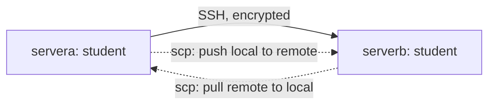

# 04 Archives, Compression, and Secure File Transfer

> By the end of this lesson you can pack a directory into one compressed file, unpack it where you choose, and copy it to another machine securely.

!!! example "Try it now (2 minutes)"
    ```bash
    tar -czvf /tmp/try.tar.gz -C /etc hosts fstab
    tar -tvf /tmp/try.tar.gz
    ```
    ```text title="Example output"
    hosts
    fstab
    -rw-r--r-- root/root       158 2024-06-12 09:14 hosts
    -rw-r--r-- root/root       579 2026-10-27 08:41 fstab
    ```
    <!-- VERIFY: file sizes and dates are illustrative; the contents of /etc/hosts and /etc/fstab on the RHEL 10 lab image will differ -->
    Notice that you made a compressed archive of two root-owned files as a normal user (they are world-readable, so no `sudo` was needed), and that `-t` lists the contents without extracting anything. By the end of this lesson you will know what each letter did, and what to do when a file is not readable.

## Why it matters

An exam task reads like "create a compressed archive of `/etc/ssh` in `/tmp`" or "copy the file to `serverb`". Both are quick marks if you know the flags and slow, error-prone ones if you guess. In real life, admins archive a configuration directory before changing it, compress log bundles to save space, and move files between servers with `scp`, `sftp` or `rsync` instead of unencrypted tools.

**Objectives covered:**

- Archive, compress, unpack, and uncompress files using tar, gzip, and bzip2
- Securely transfer files between systems

**Prereqs:** [00 Study Skills and Offline Help](00-study-skills-and-offline-help.md), [01 Shell Basics and Command Syntax](01-shell-basics-and-command-syntax.md) and [02 Files, Directories, and Text Editing](02-files-directories-and-text-editing.md) · **Time:** about 3 h

**Tools used:** `tar`, `gzip`, `gunzip`, `bzip2`, `bunzip2`, `xz`, `unxz`, `zcat`, `scp`, `sftp`, `rsync`, `sha256sum`, `ls`, `file`, `ssh`

**Offline help for this topic:** `man tar`, `man gzip`, `man bzip2`, `man xz`, `man scp`, `man sftp`, `man rsync`

!!! note "Supporting skill (not a listed RHEL 10 objective)"
    The official RHEL 10 list names `tar`, `gzip` and `bzip2` only. Two extras are kept here because you will meet them at work. **`xz`** gives the smallest files and is common for kernel source and many downloadable tarballs. **`star`** is an older archiver that the RHEL 9 objective also named; it is not on the RHEL 10 list and is not taught below. `dnf info star` finds no such package in the default RHEL 10 repositories.

    Logging in to the remote machine with `ssh` is lesson [05 SSH, Login Control, and Remote Workflows](05-ssh-login-switching-users-and-remote-workflows.md). This lesson only uses it to move files.

## How it works

Think of packing for a trip. **Archiving** is putting everything into one suitcase: the same stuff, but now it is one thing you can carry. **Compression** is the vacuum bag that squeezes the suitcase smaller. They are related but not identical. `tar` is the suitcase. `gzip`, `bzip2` and `xz` are the vacuum bags.


`tar -czf` does steps B and D in one command. The file name suffix is only a label for humans (and for you to remember which tool made it). `tar` does not require it, but always use the matching one.

| File | What it is |
|---|---|
| `.tar` | Archive only, not compressed |
| `.tar.gz` or `.tgz` | tar archive compressed with gzip |
| `.tar.bz2` | tar archive compressed with bzip2 |
| `.tar.xz` | tar archive compressed with xz |
| `.gz`, `.bz2`, `.xz` | One single file compressed, no archive |

| Tool | Speed | Size | Flag in `tar` |
|---|---|---|---|
| `gzip` | fastest | largest | `-z` |
| `bzip2` | middle | smaller | `-j` |
| `xz` | slowest | smallest | `-J` (capital) |

Secure transfer means the data is encrypted on the wire. `scp`, `sftp` and `rsync` all run over **SSH**, so they use the same login and the same port 22 as `ssh`. Old tools such as `ftp` and `rcp` send everything in clear text.



The remote address is always `user@host:/path`. The colon is what tells the tool "this side is remote".

## Commands, step by step

### 1. Create an archive with `tar`

```bash
cd ~
mkdir -p demo/a
echo one > demo/a/file1
echo two > demo/a/file2
tar -cvf demo.tar demo
```

```text title="Example output"
demo/
demo/a/
demo/a/file1
demo/a/file2
```

| Option | Meaning |
|---|---|
| `-c` | **c**reate a new archive |
| `-v` | **v**erbose: print each name as it is processed (leave it off for quiet) |
| `-f` | **f**ile: the archive name follows. It must come right after, so `-cvf demo.tar`, not `-cfv demo.tar` |
| `-t` | lis**t** the contents |
| `-x` | e**x**tract |
| `-C dir` | **C**hange to `dir` first (create: read files from there. Extract: write files there) |

The old-style letters work with or without a dash (`tar cvf demo.tar demo`). Use the dash form; it is consistent with every other command.

### 2. List what is inside

Always look before you extract.

```bash
tar -tvf demo.tar
```

```text title="Example output"
drwxr-xr-x student/student   0 2026-10-27 09:20 demo/
drwxr-xr-x student/student   0 2026-10-27 09:20 demo/a/
-rw-r--r-- student/student   4 2026-10-27 09:20 demo/a/file1
-rw-r--r-- student/student   4 2026-10-27 09:20 demo/a/file2
```

The columns are permissions, owner/group, size in bytes, modification time, and the stored name.

### 3. Extract, and choose where it lands

```bash
tar -xvf demo.tar
```

That extracts into the **current directory**, the most common surprise (see Common mistakes). Choose the destination explicitly with `-C`, and make sure it exists first:

```bash
mkdir extract-here
tar -xvf demo.tar -C extract-here
find extract-here
```

```text title="Example output"
extract-here
extract-here/demo
extract-here/demo/a
extract-here/demo/a/file1
extract-here/demo/a/file2
```

To pull out a single member, name it exactly as `tar -t` showed it:

```bash
tar -xvf demo.tar -C extract-here demo/a/file1
```

### 4. Add compression with `-z`, `-j`, `-J`

```bash
tar -czvf demo.tar.gz demo      # gzip
tar -cjvf demo.tar.bz2 demo     # bzip2
tar -cJvf demo.tar.xz demo      # xz (capital J)
file demo.tar.gz
```

```text title="Example output"
demo.tar.gz: gzip compressed data, from Unix, original size modulo 2^32 10240
```

Remember the pairing: `-z` gzip, `-j` bzip2, `-J` xz.

`tar` detects the compression automatically on extraction and listing, so you do not need `-z`, `-j` or `-J` there. The same command works for all three:

```bash
tar -xvf demo.tar.gz  -C restore1
tar -xvf demo.tar.bz2 -C restore2
tar -xvf demo.tar.xz  -C restore3
tar -tvf demo.tar.xz
```

### 5. The "Removing leading '/'" message

When you archive an **absolute path**, `tar` prints a notice:

```bash
sudo tar -czvf /tmp/configs.tar.gz /etc/ssh
```

```text title="Example output"
tar: Removing leading `/' from member names
/etc/ssh/
/etc/ssh/moduli
/etc/ssh/ssh_config.d/
/etc/ssh/ssh_config.d/50-redhat.conf
/etc/ssh/ssh_config
/etc/ssh/sshd_config.d/
/etc/ssh/sshd_config.d/40-redhat-crypto-policies.conf
...
```
<!-- VERIFY: the order of the files listed under /etc/ssh depends on the filesystem; the names are illustrative -->

This is a **notice, not an error**, and the archive is fine. `tar` strips the leading `/` on purpose so that extracting an archive cannot overwrite real system files. The names inside are stored as `etc/ssh/...`. When you extract with `-C /tmp/test-restore` you get `/tmp/test-restore/etc/ssh/...`. Equivalent and tidier, because it keeps the paths short:

```bash
sudo tar -czvf /tmp/configs.tar.gz -C /etc ssh     # members are stored as ssh/...
```

**Permissions.** `/etc/ssh` holds the private host keys, readable only by root (mode `600`). A normal user gets `Cannot open: Permission denied` and a non-zero exit. Use `sudo`. The archive is then owned by root, but is world-readable (`-rw-r--r--`), so `student` can still copy it.

### 6. Compress and uncompress a single file

`gzip`, `bzip2` and `xz` work on **files**, not directories. By default they replace the original with the compressed version.

```bash
cp /etc/services ~/services.txt
ls -l services.txt
gzip services.txt                 # makes services.txt.gz, removes services.txt
ls -l services.txt.gz
gunzip services.txt.gz            # back to services.txt
```

```text title="Example output"
-rw-r--r--. 1 student student 701707 Oct 27 09:30 services.txt
-rw-r--r--. 1 student student 145001 Oct 27 09:30 services.txt.gz
```

| Command | Result |
|---|---|
| `gzip file` / `gunzip file.gz` | compress / uncompress (`gzip -d` does the same as `gunzip`) |
| `bzip2 file` / `bunzip2 file.bz2` | same, with bzip2 |
| `xz file` / `unxz file.xz` | same, with xz |
| `gzip -k file` | **k**eep the original too |
| `gzip -9 file` | slowest, smallest (levels 1 to 9; the default is 6) |
| `zcat file.gz`, `bzcat file.bz2`, `xzcat file.xz` | print the content without uncompressing the file |

### 7. Copy files securely: `scp`, `sftp`, `rsync`

The first time you connect, SSH asks you to accept the remote host key. Type `yes`. Lesson [05](05-ssh-login-switching-users-and-remote-workflows.md) explains what that prompt means. The examples below send files from `servera` to `serverb` as user `student`.

**`scp`: quick one-shot copy.**

```bash
scp demo.tar.gz student@serverb:/tmp/            # push: local to remote
scp student@serverb:/tmp/demo.tar.gz ~/back.gz   # pull: remote to local
scp -r demo student@serverb:/tmp/                # whole directory
```

```text title="Example output"
student@serverb's password:
demo.tar.gz                                   100%  176    92.4KB/s   00:00
```

| Option | Meaning |
|---|---|
| `-r` | recursive, needed for directories |
| `-P 2222` | remote SSH **port**. Capital `P`. `ssh` uses lowercase `-p` for the same thing |
| `-p` | **p**reserve modification times and modes |
| `-i key` | use this private key file |

**`sftp`: interactive session** (like FTP, but inside SSH).

```bash
sftp student@serverb
```

```text title="Example output"
Connected to serverb.
sftp> pwd
Remote working directory: /home/student
sftp> put demo.tar.gz /tmp/
sftp> ls /tmp
sftp> get /tmp/demo.tar.gz copy.tar.gz
sftp> quit
```

| Command | Meaning |
|---|---|
| `put file` / `get file` | upload / download |
| `ls`, `cd`, `pwd` | work on the **remote** side |
| `lls`, `lcd`, `lpwd` | the same on the **local** side (the extra `l` stands for local) |
| `quit` | leave |

**`rsync`: copy only what changed.** It transfers just the differences, so it is the best choice for repeated copies of a large directory. It uses SSH by default for remote hosts.

```bash
rsync -av demo/ student@serverb:/tmp/demo-copy/
```

```text title="Example output"
sending incremental file list
./
a/
a/file1
a/file2

sent 253 bytes  received 77 bytes  660.00 bytes/sec
total size is 8  speedup is 0.02
```
<!-- VERIFY: rsync is installed by default on both lab machines (otherwise: sudo dnf install rsync) -->

`-a` (archive) keeps permissions, times and symlinks; `-v` is verbose. A **trailing slash** on the source (`demo/`) means "the contents of demo". Without it you get `demo-copy/demo/...`.

**Prove the copy is identical.** Matching sizes is a weak check. Compare checksums on both ends; the strings must be identical:

```bash
sha256sum demo.tar.gz
ssh student@serverb sha256sum /tmp/demo.tar.gz
```

```text title="Example output"
9b3f1c6d0b9d7a4b6d2e4f5a1c8e7d3a2b1c0f9e8d7c6b5a4f3e2d1c0b9a8f7e  demo.tar.gz
9b3f1c6d0b9d7a4b6d2e4f5a1c8e7d3a2b1c0f9e8d7c6b5a4f3e2d1c0b9a8f7e  /tmp/demo.tar.gz
```

## Common mistakes

- **Mistake:** Compressing a directory with the wrong tool directly (`gzip dir` fails with "is a directory"). **Recovery:** use `tar` first, or do both at once with `tar -czf`.
- **Mistake:** Forgetting `-f` with `tar`, or putting another letter between `-f` and the name. **Recovery:** review `man tar` and always put the archive file name immediately after `-f`.
- **Mistake:** Forgetting where extracted files will appear (they land in the current directory). **Recovery:** use `tar -xvf archive -C targetdir`, and check with `find` or `ls -R`.
- **Mistake:** Mixing up archive creation and extraction options (`-c` vs `-x`), which can overwrite the archive. **Recovery:** list with `tar -tvf` first, and double-check the first letter before pressing Enter.
- **Mistake:** Copying files to the wrong remote path. **Recovery:** confirm the remote destination with `ssh student@serverb ls -ld /tmp` before the copy.
- **Mistake:** Not verifying that a transferred file matches the original. **Recovery:** compare `sha256sum` on both sides, not only `ls -l` sizes.
- **Mistake:** Not checking extracted content. **Recovery:** verify with `find` or `ls -R`.
- **Mistake:** Reading `Removing leading '/' from member names` as a failure. **Recovery:** it is a harmless notice; confirm with `tar -tvf`.

### Troubleshooting

| Problem | Cause | Fix |
|---|---|---|
| `tar` says it cannot open the archive | Wrong file name or wrong path | List files with `ls`; use the exact archive name |
| Extracted files appear in the wrong directory | You extracted from the current directory without `-C` | Use `tar -xvf archive -C targetdir` |
| `tar: Cannot open: Permission denied` | You are not allowed to read a source file (for example `/etc/ssh` host keys) | Re-run with `sudo` |
| `scp` says `No such file or directory` | Remote path or local path is wrong | Verify both paths carefully |
| `scp -P` vs `-p` confusion | `scp` uses capital `-P` for the port; lowercase `-p` preserves times | Use `-P` for ports |
| SSH transfer fails | Remote host unavailable, wrong username, firewall, or SSH service not running | Test plain `ssh student@serverb` first |

## Hands-on lab

**Setup:** shared lab environment, run as `student` on `servera`. `serverb` must be running with sshd and the user `student` (lab 23 baseline). Create the practice data:

```bash
cd ~
rm -rf rhcsa-archive-lab
mkdir -p rhcsa-archive-lab/data
cp /etc/services rhcsa-archive-lab/data/services
seq 1 20000 > rhcsa-archive-lab/data/numbers.txt
echo alpha > rhcsa-archive-lab/data/file1
echo beta  > rhcsa-archive-lab/data/file2
cd rhcsa-archive-lab
```

A real file such as `/etc/services` and a long number list are used because with tiny files the three compressors give misleading sizes.

**Task:**

- [ ] Create `data.tar` from the `data` directory and list its contents without extracting.
- [ ] Create `data.tar.gz`, `data.tar.bz2` and `data.tar.xz`.
- [ ] Extract them into `restore1` (gz), `restore2` (bz2) and `restore3` (xz). The directories must exist first.
- [ ] Use `file` and `ls -l` on all four archives and say which is smallest.
- [ ] Compress a copy of `/etc/services` as a single file with `gzip -k`, so both the original and `.gz` remain.
- [ ] Copy `data.tar.gz` to `/tmp/` on `serverb` as `student` with `scp`, then open `sftp` and list `/tmp`.
- [ ] Confirm the `sha256sum` of the file is identical on `servera` and `serverb`.

??? question "Hint 1"
    Check the order of the letters after the dash: the archive name must come right after `-f`. For extraction you need an existing destination directory.

??? question "Hint 2"
    Use `mkdir` for the three restore directories, `-C` on extraction, and `gzip` with the keep option. For the remote check, run `sha256sum` through `ssh`.

??? success "Solution"
    ```bash
    tar -cvf data.tar data
    tar -tvf data.tar
    tar -czvf data.tar.gz data
    tar -cjvf data.tar.bz2 data
    tar -cJvf data.tar.xz data

    mkdir restore1 restore2 restore3
    tar -xvf data.tar.gz  -C restore1
    tar -xvf data.tar.bz2 -C restore2
    tar -xvf data.tar.xz  -C restore3

    file data.tar data.tar.gz data.tar.bz2 data.tar.xz
    ls -l data.tar data.tar.gz data.tar.bz2 data.tar.xz
    cp data/services services.copy
    gzip -k services.copy

    scp data.tar.gz student@serverb:/tmp/
    sftp student@serverb       # then: ls /tmp, quit
    sha256sum data.tar.gz
    ssh student@serverb sha256sum /tmp/data.tar.gz
    ```
    **Verify:** `find restore1 restore2 restore3` shows `data/services`, `data/numbers.txt`, `data/file1` and `data/file2` in each. `ls -l` shows `data.tar` largest and `data.tar.xz` smallest (roughly `.tar` > `.tar.gz` > `.tar.bz2` > `.tar.xz`; the exact order of the last two can differ by file type). `ls services.copy*` shows both files. The two `sha256sum` lines match.

### More practice

1. Create a tar archive from any practice directory.
2. Create both gzip and bzip2 versions.
3. Extract one archive into `/tmp/test-restore`.
4. List archive contents without extracting.
5. Copy a file to another machine with `scp`.
6. Use `sftp` to download one file from another machine.

Verification steps: confirm the archive contains the expected files with `tar -tvf`; confirm extracted files appear in the intended directory; confirm transferred files exist on the destination system; compare `sha256sum` on both ends.

### Exam-style task 1

Create `/tmp/configs.tar.gz` from the directory `/etc/ssh`. Do not modify the source directory. Then list the archive contents.

**Grader mindset checklist:**

- [ ] archive file must exist
- [ ] source directory must remain intact
- [ ] archive listing command must succeed

??? success "Solution"
    ```bash
    sudo tar -czvf /tmp/configs.tar.gz /etc/ssh
    tar -tvf /tmp/configs.tar.gz
    ```
    `sudo` is needed because the SSH host private keys are readable only by root. The `Removing leading '/'` line is only a notice. The archive is root-owned but world-readable, so the listing works as `student`.

### Exam-style task 2

If a second host is available, securely copy `/tmp/configs.tar.gz` to user `student` on `serverb` under `/tmp/`.

**Grader mindset checklist:**

- [ ] file should exist on the destination host
- [ ] transfer should use SSH-based tooling
- [ ] file should remain readable after transfer

??? success "Solution"
    ```bash
    scp /tmp/configs.tar.gz student@serverb:/tmp/
    ssh student@serverb ls -l /tmp/configs.tar.gz
    ```
    The copy on `serverb` is owned by `student` (the remote user), not root.

## Exam tips

!!! tip "What the exam expects"
    The archive file exists at the exact path you were given, it contains the right files (check with `tar -tvf`), and the source is unchanged. For transfers, the file is present on the other host. Neither archives nor copies need anything special to survive a reboot; they are just files.

!!! warning "Must survive reboot"
    | Change | Persistent? | Make it persist with |
    |---|---|---|
    | An archive, extracted files, a copied file | Yes (they are ordinary files), unless the path is `/tmp`, which may be cleaned | Put it where the task says; treat `/tmp` as temporary |
    | `scp`/`sftp` host key accepted in `~/.ssh/known_hosts` | Yes | Nothing |

**Verify like a grader:**

1. `ls -l` the archive at the exact path from the task.
2. `tar -tvf` it: check the member names and that nothing was left out.
3. Check `/etc/ssh` (or the source) is unchanged and you did not extract into it.
4. For transfers: `ssh student@serverb ls -l /tmp/file` and compare `sha256sum`.
5. Use `man tar` and `man scp` if you forget a flag; both are available offline.

## Quiz

1. What is the difference between an archive and compression?
2. Which `tar` option extracts files?
3. Which option makes a gzip-compressed tar archive?
4. Which `tar` options make bzip2 and xz archives?
5. What tool quickly copies files over SSH?
6. What command lists the contents of a tar archive?
7. What does `tar: Removing leading '/' from member names` mean, and is it an error?
8. How do you extract an archive into `/tmp/test-restore`?
9. Which flag gives the port to `scp`, and which to `ssh`?

??? success "Answers"
    1. An archive bundles files. Compression reduces size.
    2. `-x`
    3. `-z`
    4. `-j` for bzip2, `-J` (capital) for xz.
    5. `scp`
    6. `tar -tvf archive.tar`
    7. `tar` strips the leading `/` so extracting cannot overwrite system files. It is a notice, not an error.
    8. `tar -xvf archive.tar.gz -C /tmp/test-restore` (the directory must exist).
    9. `scp -P port`, `ssh -p port`.

## Summary

- `tar` bundles
- `gzip`, `bzip2`, and `xz` compress (smallest is `xz`)
- `-c` create, `-x` extract, `-t` list
- `-z` gzip, `-j` bzip2, `-J` xz
- `scp` copies over SSH; verify archive contents before assuming success

| Task | Command |
|---|---|
| Create archive | `tar -cvf files.tar dir` |
| Extract archive | `tar -xvf files.tar` |
| List archive | `tar -tvf files.tar` |
| Extract to a directory | `tar -xvf files.tar -C /tmp/restore` |
| gzip / bzip2 / xz archive | `tar -czvf files.tar.gz dir`, `tar -cjvf files.tar.bz2 dir`, `tar -cJvf files.tar.xz dir` |
| Uncompress single file | `gunzip file.gz`, `bunzip2 file.bz2`, `unxz file.xz` |
| Copy to remote | `scp file user@host:/tmp/` |
| Interactive transfer | `sftp user@host` |
| Sync a directory | `rsync -av dir/ user@host:/tmp/dir/` |
| Verify | `sha256sum file` on both hosts |

**Previous:** [03 Redirection, Pipes, Grep, and Regex](03-redirection-pipes-grep-and-regex.md) · **Next:** [05 SSH, Login Control, and Remote Workflows](05-ssh-login-switching-users-and-remote-workflows.md): you used SSH to move files; now you learn to log in properly and work on a remote system.
