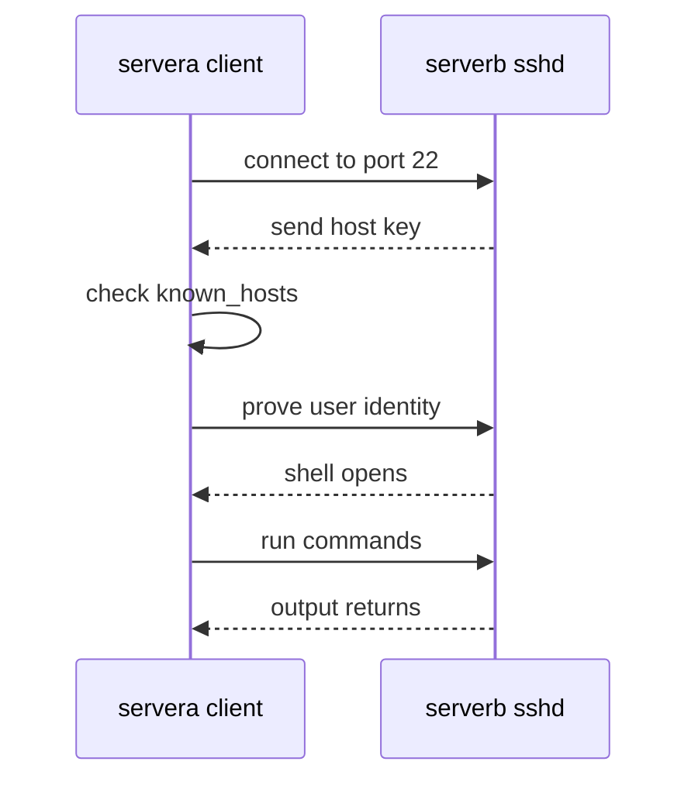
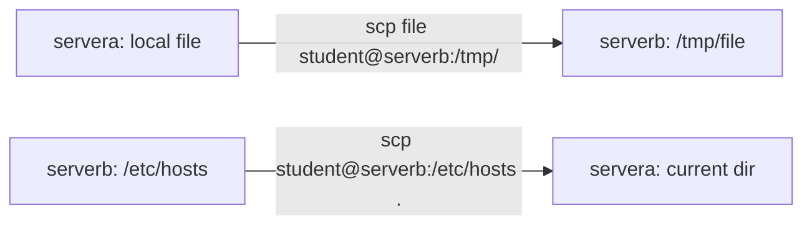

# 05 SSH, Login Control, and Remote Workflows

> By the end of this lesson you can open a session on another server, run commands there, copy files securely, log in with a key instead of a password, and work out why a connection failed.

!!! example "Try it now (2 minutes)"
    ```bash
    hostname; whoami; ssh -V
    ```
    ```text title="Example output"
    servera.lab.example
    student
    OpenSSH_9.9p1, OpenSSL 3.2.2 4 Jun 2024
    ```
    <!-- VERIFY: OpenSSH and OpenSSL version strings on the RHEL 10 lab image -->
    Notice that the first two lines answer "which machine?" and "which user?". Those are the two questions you must be able to answer before every important command on a remote system. By the end of this lesson you will know why they matter and how to change both.

## Why it matters

The exam gives you more than one machine and expects you to move between them without losing track of where you are. A command run on the wrong host is a wrong answer, or a broken server. In real life nearly every Linux server is reached over SSH, so clear habits about host, user and connection method prevent expensive mistakes.

**Objectives covered:**

- Access remote systems using SSH
- Log in and switch users in multi-user targets
- Securely transfer files between systems

This lesson also gives a first look at the key-based login objective, "Configure key-based authentication for SSH". The SELinux and permissions side of that objective is finished in [15 SELinux, SSH Keys, and Security](15-selinux-ssh-keys-and-security.md).

**Prereqs:** [01 Shell Basics and Command Syntax](01-shell-basics-and-command-syntax.md) and [04 Archives, Compression, and Secure File Transfer](04-archives-compression-and-secure-file-transfer.md) · **Time:** about 4 h

**Tools used:** `ssh`, `scp`, `sftp`, `ssh-keygen`, `ssh-copy-id`, `whoami`, `hostname`, `id`, `who`, `w`, `last`, `su`, `sudo`, `exit`

**Offline help for this topic:** `man ssh`, `man ssh_config`, `man sshd_config`, `man ssh-keygen`, `man ssh-copy-id`, `man scp`, `man sftp`, `man su`, `man sudo`

## How it works

SSH (Secure Shell) gives you a shell on another system. You type on your local computer, but the commands run on the remote host after you log in. Everything between the two machines is encrypted. Think of it as a phone call to another office: you speak from your desk, but the person on the other end does the work in their room.

Two SSH ideas are worth knowing before you type anything:

- **Host key:** the server proves who it is. The first time you connect, your client stores the server's fingerprint in `~/.ssh/known_hosts`. If the fingerprint later changes, SSH refuses to continue until you deal with it. This protects you from connecting to an impostor.
- **User authentication:** you prove who you are, either with a password or with a key pair. A key pair is a private key that stays with you and a public key that you place on the server.



### Remote awareness

Before you do anything important on a remote system, check three things:

- `hostname`
- `whoami`
- `pwd`

These three commands prevent many mistakes.

### Local vs remote paths

In `scp`, one side may look like `user@host:/path`. That side is remote. A plain path like `/tmp/file` is local, to the machine where you typed the command.



### Multiuser thinking

Systems can have many users. You need to know who you are now, when you need elevated privileges, when to use `sudo`, and when to switch to another account with `su -`. Switching users (`su`, `su -`, `sudo -i`, `sudo -u`) is explained in [01 Shell Basics and Command Syntax](01-shell-basics-and-command-syntax.md); this lesson only shows how it looks inside an SSH session.

## Commands, step by step

### 1. Log in and identify context

```bash
ssh student@serverb.lab.example
```

The very first time, SSH asks you to trust the server. Compare the fingerprint with a trusted source if you can, then type `yes`:

```text title="Example output"
The authenticity of host 'serverb.lab.example (192.168.122.11)' can't be established.
ED25519 key fingerprint is SHA256:Qm7kZ1xW3nR0vJ5t8bYhC2pLd9aEoUe4fGiTs6XyNwA.
This key is not known by any other names.
Are you sure you want to continue connecting (yes/no/[fingerprint])? yes
Warning: Permanently added 'serverb.lab.example' (ED25519) to the list of known hosts.
student@serverb.lab.example's password:
Last login: Mon Oct 27 09:12:44 2026 from 192.168.122.10
[student@serverb ~]$
```
<!-- VERIFY: first-connect wording, login banner and "Last login" line on RHEL 10; the fingerprint is illustrative -->

Look at the prompt. It changed from `[student@servera ~]$` to `[student@serverb ~]$`. The part after `@` is the host. Then confirm:

```bash
hostname
whoami
pwd
exit
```

```text title="Example output"
serverb.lab.example
student
/home/student
logout
Connection to serverb.lab.example closed.
```

`exit` (or Ctrl-D) returns you to your original host. If you forget to type it, the next command runs on the remote machine.

| Option | Meaning |
|---|---|
| `ssh user@host` | Log in as `user` on `host`. Without `user@`, SSH uses your current local username |
| `-p 2222` | Connect to a non-default port (the default is 22) |
| `-i ~/.ssh/key` | Use a specific private key file |
| `-l user` | Same as `user@`, an alternative way to name the user |
| `-v` | Verbose: prints what SSH is trying. Add more `v` for more detail. First tool for debugging |

### 2. Run one remote command without staying logged in

```bash
ssh student@serverb.lab.example hostname
ssh student@serverb.lab.example 'whoami && pwd'
ssh student@serverb.lab.example 'hostname; whoami; date'
```

```text title="Example output"
serverb.lab.example
student
/home/student
serverb.lab.example
student
Mon Oct 27 09:15:02 UTC 2026
```

The output comes from the remote host, and you are still on your own machine afterwards. Use **single quotes** around a command with `&&`, `;`, `>`, `$(...)` or variables, so your local shell does not process them first. With double quotes, `$(hostname)` would run on your machine and give the wrong answer. If a task says "run this on serverb", this form is both safe and quick.

### 3. Copy files with scp

```bash
scp report.txt student@serverb.lab.example:/tmp/
scp student@serverb.lab.example:/etc/hosts .
```

```text title="Example output"
report.txt                                    100%   32    41.7KB/s   00:00
hosts                                         100%  158   188.2KB/s   00:00
```
<!-- VERIFY: scp progress line layout on RHEL 10 (scp uses the SFTP protocol by default in current OpenSSH) -->

The rule is the same every time: `scp SOURCE DESTINATION`. The side with `user@host:` is remote. Useful options:

| Option | Meaning |
|---|---|
| `-r` | Copy a directory recursively |
| `-P 2222` | Port (capital P for `scp`, unlike `ssh -p`) |
| `-p` | Preserve modification times and modes |
| `-i key` | Use a specific private key |

`sftp user@host` opens an interactive file-transfer session (`ls`, `get`, `put`, `exit`). Archives and `sftp` details are in [04 Archives, Compression, and Secure File Transfer](04-archives-compression-and-secure-file-transfer.md).

Always verify that the file arrived:

```bash
ssh student@serverb.lab.example 'ls -l /tmp/report.txt'
```

### 4. Key-based login: create the key pair, then install it

Passwords can be guessed. A key pair is stronger and lets scripts log in without typing anything. Do the steps in this order, because `ssh-copy-id` copies a key that must already exist.

```bash
ssh-keygen -t ed25519
```

```text title="Example output"
Generating public/private ed25519 key pair.
Enter file in which to save the key (/home/student/.ssh/id_ed25519):
Enter passphrase (empty for no passphrase):
Enter same passphrase again:
Your identification has been saved in /home/student/.ssh/id_ed25519
Your public key has been saved in /home/student/.ssh/id_ed25519.pub
The key fingerprint is:
SHA256:7Hq2fVbN4zLx0JkPcA9sYtW1uRgE5oMdXiB3nCvT6hI student@servera.lab.example
```
<!-- VERIFY: exact ssh-keygen prompts and the randomart block on RHEL 10 -->

Press Enter at each prompt to accept the default file and an empty passphrase (fine for a lab; a passphrase is stronger). You now have a private key (`id_ed25519`, never share it) and a public key (`id_ed25519.pub`, safe to copy). Now install the public key on the server:

```bash
ssh-copy-id student@serverb.lab.example
```

```text title="Example output"
/usr/bin/ssh-copy-id: INFO: Source of key(s) to be installed: "/home/student/.ssh/id_ed25519.pub"
/usr/bin/ssh-copy-id: INFO: attempting to log in with the new key(s), to filter out any that are already installed
/usr/bin/ssh-copy-id: INFO: 1 key(s) remain to be installed -- if you are prompted now it is to install the new keys
student@serverb.lab.example's password:

Number of key(s) added: 1

Now try logging into the machine, with:   "ssh 'student@serverb.lab.example'"
and check to make sure that only the key(s) you wanted were added.
```

Test it. If it logs you in without a password prompt, it worked:

```bash
ssh student@serverb.lab.example hostname
```

Permissions matter. SSH silently ignores a key setup that other users could tamper with:

| Path | Mode | Why |
|---|---|---|
| `~/.ssh/` | `700` | Only you may enter the directory |
| `~/.ssh/authorized_keys` (on the server) | `600` | Public keys allowed to log in as you |
| `~/.ssh/id_ed25519` (private key) | `600` | SSH refuses a private key others can read |
| `~/.ssh/id_ed25519.pub` | `644` | Public, safe to read |

`ssh-copy-id` sets these for you. If you create `authorized_keys` by hand, you must set them. When key login still asks for a password even though the file looks right, the cause is often an SELinux label or a permission problem. That diagnosis is in [15 SELinux, SSH Keys, and Security](15-selinux-ssh-keys-and-security.md).

### 5. Who is logged in, and who may log in

```bash
who
w
last -n 3
```

```text title="Example output"
student  pts/0        2026-10-27 09:12 (192.168.122.10)

 09:16:31 up  1:22,  1 user,  load average: 0.00, 0.01, 0.00
USER     TTY      FROM             LOGIN@   IDLE   JCPU   PCPU WHAT
student  pts/0    192.168.122.10   09:12    0.00s  0.03s  0.00s w

student  pts/0        192.168.122.10   Mon Oct 27 09:12   still logged in
reboot   system boot  6.12.0-55.el10.x86_64 Mon Oct 27 07:54   still running

wtmp begins Mon Oct 27 07:54:12 2026
```
<!-- VERIFY: kernel version string and exact column layout of who/w/last on RHEL 10 -->

| Command | What it tells you |
|---|---|
| `who` | Who is logged in right now, from which terminal and address |
| `w` | Same, plus what each user is running and system load |
| `last` | History of past logins and reboots (read from `/var/log/wtmp`) |

Which accounts the server accepts is set in `/etc/ssh/sshd_config` (and files in `/etc/ssh/sshd_config.d/`). To see the active values, including defaults, use the test mode of the daemon:

```bash
sudo sshd -T | grep -Ei 'permitrootlogin|passwordauthentication|pubkeyauthentication'
```

```text title="Example output"
permitrootlogin yes
pubkeyauthentication yes
passwordauthentication yes
```
<!-- VERIFY: default PermitRootLogin value on the RHEL 10 lab image -->

After you edit `sshd_config`, apply it with `sudo systemctl reload sshd`. Check the syntax first with `sudo sshd -t`: no output means the file is valid. A typo that stops `sshd` from restarting can lock you out of a remote machine, so keep your current session open while you test a new one.

### 6. Switching users inside an SSH session

Logging in as `student` and then switching works exactly as in lesson 01:

```bash
ssh student@serverb.lab.example
sudo whoami
su -
whoami
exit
exit
```

```text title="Example output"
root
Password:
root
logout
logout
Connection to serverb.lab.example closed.
```

Two `exit` commands are needed here: the first leaves the `su -` root shell, the second closes the SSH session. Count your shells: each `su` or `ssh` adds one level, each `exit` removes one. `sudo whoami` runs one command as root and returns. See [01 Shell Basics and Command Syntax](01-shell-basics-and-command-syntax.md) for `su` versus `su -`, `sudo -i` and `sudo -u`.

## Worked examples

### Worked example 1: Open a remote session and identify context

```bash
ssh student@serverb.lab.example
hostname
whoami
pwd
exit
```

Verification: the prompt shows `serverb` while you are in, and you return to `servera` after `exit`.

### Worked example 2: Run remote commands without staying logged in

```bash
ssh student@serverb.lab.example 'hostname; whoami; date'
```

Verification: all three lines of output come from the remote host.

### Worked example 3: Transfer a file both directions

```bash
scp notes.txt student@serverb.lab.example:/tmp/
scp student@serverb.lab.example:/tmp/notes.txt ./notes-from-remote.txt
ls -l notes.txt notes-from-remote.txt
```

Verification: both local files have the same size. `cmp notes.txt notes-from-remote.txt` prints nothing when the contents are identical.

## Common mistakes

- **Mistake:** Forgetting which host you are connected to. **Recovery:** read the prompt, and run `hostname` first on login.
- **Mistake:** Running a command on the wrong system. **Recovery:** check `hostname` before each destructive or configuration command, and `exit` back to the right host.
- **Mistake:** Confusing local and remote paths in `scp`. **Recovery:** the side written `user@host:/path` is the remote side.
- **Mistake:** Switching users and not verifying the current identity. **Recovery:** run `whoami` (and `id` if groups matter) right after every `su` or `ssh`.
- **Mistake:** Ignoring host key warnings without understanding them. **Recovery:** read the warning. A new server asks once; a *changed* key needs an explanation first (see Troubleshooting).
- **Mistake:** Forgetting the remote hostname. **Recovery:** run `hostname` first on login.
- **Mistake:** Copying a file to a remote directory that does not exist. **Recovery:** verify the path first, or create it remotely with `ssh user@host 'mkdir -p /path'`.
- **Mistake:** Staying logged in as root remotely longer than needed. **Recovery:** `exit` back to the regular account promptly.
- **Mistake:** Assuming a file transfer succeeded without checking. **Recovery:** verify with `ls -l` on the destination.
- **Mistake:** Using double quotes around a remote command that contains `$(...)`, variables or `>`. **Recovery:** use single quotes so the remote shell does the work, not your local one.
- **Mistake:** Running `ssh-copy-id` before any key exists (`ERROR: No identities found`). **Recovery:** run `ssh-keygen -t ed25519` first.
- **Mistake:** Leaving a private key readable by others (`WARNING: UNPROTECTED PRIVATE KEY FILE!`). **Recovery:** `chmod 600 ~/.ssh/id_ed25519`.

### Troubleshooting

Read the exact error message first. Each one points to a different layer.

| Problem | Cause | Fix |
|---|---|---|
| `Connection refused` | Nothing is listening on the port: `sshd` is stopped, or you used the wrong port | On the server: `systemctl status sshd`, `sudo ss -tlnp \| grep ':22'`; start it with `sudo systemctl enable --now sshd` |
| `Connection timed out` or `No route to host` | The packet never arrives: wrong IP, network down, or a firewall dropping it | `ping 192.168.122.11`; on the server `sudo firewall-cmd --list-services` should include `ssh`; add it with `sudo firewall-cmd --permanent --add-service=ssh` then `sudo firewall-cmd --reload` |
| `Permission denied` | Wrong password, wrong user, or key rejected | Confirm the username and method; run `ssh -v` to see which methods were tried; check key permissions |
| `Host key verification failed` | The server's key differs from the one saved in `known_hosts` | See below: investigate, then `ssh-keygen -R` |
| `scp` copied the wrong way | Source and destination were reversed | Remember `scp SOURCE DESTINATION`; `user@host:/path` is the remote side |

**Host key changed.** If SSH prints the banner below, do not just ignore it:

```text title="Example output"
@@@@@@@@@@@@@@@@@@@@@@@@@@@@@@@@@@@@@@@@@@@@@@@@@@@@@@@@@@@
@    WARNING: REMOTE HOST IDENTIFICATION HAS CHANGED!     @
@@@@@@@@@@@@@@@@@@@@@@@@@@@@@@@@@@@@@@@@@@@@@@@@@@@@@@@@@@@
IT IS POSSIBLE THAT SOMEONE IS DOING SOMETHING NASTY!
...
Offending ED25519 key in /home/student/.ssh/known_hosts:1
Host key verification failed.
```

First ask whether the server was expected to change, for example it was rebuilt or reinstalled. If yes, remove the old entry and reconnect, then accept the new fingerprint:

```bash
ssh-keygen -R serverb.lab.example
ssh student@serverb.lab.example
```

```text title="Example output"
# Host serverb.lab.example found: line 1
/home/student/.ssh/known_hosts updated.
Original contents retained as /home/student/.ssh/known_hosts.old
```
<!-- VERIFY: ssh-keygen -R output wording on RHEL 10 -->

If you did not expect any change, stop and investigate before connecting.

## Hands-on lab

**Setup:** shared lab environment, two machines: `servera` (192.168.122.10) and `serverb` (192.168.122.11), user `student` with sudo on both, root password `redhat`. Run on **servera**, unless a step says otherwise. Single-machine fallback: replace `serverb.lab.example` with `localhost` everywhere.

```bash
grep -q serverb /etc/hosts || echo '192.168.122.11 serverb.lab.example serverb' | sudo tee -a /etc/hosts
echo 'student:student' | sudo chpasswd
rm -f ~/.ssh/id_ed25519 ~/.ssh/id_ed25519.pub
```

The first line makes `serverb` resolve. The second sets the lab password `student` for the `student` user; run the same `chpasswd` line on serverb from its console. The last line removes any key from a previous attempt so the key steps start clean. On serverb, `systemctl is-active sshd` must print `active`.

**Task:**

- [ ] Log in to `serverb.lab.example` as `student`. Accept the host key. Run `hostname`, `whoami`, and `pwd`, then `exit` back to servera.
- [ ] Without opening a shell, run `id` on serverb and save its output to `/tmp/serverb-id.txt` on **serverb**.
- [ ] Create `~/remote-test.txt` on servera containing the single line `from servera`. Copy it to `/tmp/` on serverb, then copy it back as `~/remote-test-copy.txt`. Prove the two files are identical.
- [ ] Create an ed25519 key pair with an empty passphrase, install the public key on serverb, and prove you can log in with the key and no password.
- [ ] On serverb, run `sudo whoami`, then use `su -` with password `redhat` to become root, confirm with `whoami`, and `exit` back to `student`, then close the SSH session.
- [ ] On serverb, show your own session with `who`, then on servera show the active `PermitRootLogin` value with `sudo sshd -T`.

??? question "Hint 1"
    For the saved `id` output, think about which machine should create the file. The redirection `>` has to be processed by the remote shell, not yours. What kind of quotes keep your shell away from it?

??? question "Hint 2"
    Key setup order: `ssh-keygen`, then `ssh-copy-id`, then test. To prove "no password", ask SSH not to try one, with the option `-o PasswordAuthentication=no`. To compare files, use `cmp`.

??? success "Solution"
    ```bash
    # 1. login and identify
    ssh student@serverb.lab.example
    hostname; whoami; pwd
    exit

    # 2. remote command, output saved on serverb
    ssh student@serverb.lab.example 'id > /tmp/serverb-id.txt'
    ssh student@serverb.lab.example 'cat /tmp/serverb-id.txt'

    # 3. transfer both ways
    echo 'from servera' > ~/remote-test.txt
    scp ~/remote-test.txt student@serverb.lab.example:/tmp/
    scp student@serverb.lab.example:/tmp/remote-test.txt ~/remote-test-copy.txt
    cmp ~/remote-test.txt ~/remote-test-copy.txt && echo identical

    # 4. key-based login
    ssh-keygen -t ed25519 -N '' -f ~/.ssh/id_ed25519
    ssh-copy-id student@serverb.lab.example
    ssh -o PasswordAuthentication=no student@serverb.lab.example hostname

    # 5. privilege and switching, on serverb
    ssh student@serverb.lab.example
    sudo whoami
    su -
    whoami
    exit
    who
    exit

    # 6. active server setting, on servera
    sudo sshd -T | grep -i permitrootlogin
    ```
    **Verify:** step 2 prints a line starting `uid=1000(student)` from serverb. `cmp` prints nothing and the shell echoes `identical`. The key test prints `serverb.lab.example` without asking for a password. `sudo whoami` and the `su -` shell both print `root`; `who` lists your own `pts` session.
    <!-- VERIFY: student UID is 1000 on the lab image -->

## More practice

1. Log in to a second host and record its hostname.
2. Run `id` remotely without opening a full interactive shell.
3. Copy `/etc/hosts` from a remote host to your current directory.
4. Copy a local file to a remote user's home directory.
5. Switch to root using `su -` and then return safely.
6. Use `sudo` for one privileged command without opening a root shell.

### Exam-style task 1

From one system, connect to another system with SSH and create `/tmp/host-proof.txt` on the remote system containing that remote host's hostname and your username on that host.

**Grader mindset checklist:**

- [ ] remote file must exist
- [ ] file contents must match remote hostname and user
- [ ] task must use SSH

??? success "Solution"
    ```bash
    ssh student@serverb.lab.example 'hostname > /tmp/host-proof.txt; whoami >> /tmp/host-proof.txt'
    ssh student@serverb.lab.example 'cat /tmp/host-proof.txt'
    ```
    ```text title="Example output"
    serverb.lab.example
    student
    ```
    The single quotes make the remote shell perform both redirections. With double quotes the file would be created on your local machine instead.

### Exam-style task 2

Transfer `/etc/hosts` from a remote host to local `/tmp/hosts.copy`, then verify the file exists locally.

**Grader mindset checklist:**

- [ ] `/tmp/hosts.copy` must exist locally
- [ ] transfer must use a secure method such as `scp` or `sftp`

??? success "Solution"
    ```bash
    scp student@serverb.lab.example:/etc/hosts /tmp/hosts.copy
    ls -l /tmp/hosts.copy
    ```
    **Verify:** `ls` shows the file, and `diff /tmp/hosts.copy <(ssh student@serverb.lab.example cat /etc/hosts)` prints nothing.

## Exam tips

!!! tip "What the exam expects"
    You reach the right host as the right user, the requested files exist on the right side with the right contents, and you used a secure method (`ssh`, `scp`, `sftp`). If key-based login is requested, it works without a password prompt. Name the host and user in your head before you press Enter.

!!! warning "Must survive reboot"
    | Change | Persistent? | Make it persist with |
    |---|---|---|
    | `known_hosts` entry after first connect | Yes | Nothing, it is a file in `~/.ssh/` |
    | Public key in `~/.ssh/authorized_keys` | Yes | Nothing, it is a file. Keep modes `700` and `600` |
    | `sshd` running now | No | `sudo systemctl enable --now sshd` |
    | `ssh` allowed by firewalld | Only if permanent | `sudo firewall-cmd --permanent --add-service=ssh` then `--reload` |
    | Edit to `/etc/ssh/sshd_config` | Yes in the file, applied only after reload | `sudo sshd -t` then `sudo systemctl reload sshd` |

**Verify like a grader:**

1. `ssh student@serverb.lab.example 'hostname; whoami'` returns the expected host and user.
2. `ssh student@serverb.lab.example 'ls -l /tmp/remote-test.txt'` shows the transferred file.
3. `ssh -o PasswordAuthentication=no student@serverb.lab.example hostname` succeeds if keys were required.
4. `systemctl is-enabled sshd` prints `enabled` on the server.
5. Confirm you left remote or elevated sessions cleanly with `exit`, then check the prompt.

## Quiz

1. What does `ssh user@host` do?
2. How do you run one command remotely without staying logged in?
3. In `scp`, which side is remote: `user@host:/tmp/file` or `/tmp/file`?
4. What should you check first after logging into a remote server?
5. Why is it important to know your current user before an admin command?
6. Which command creates the key pair, and which one installs the public key on the server? In which order?
7. Which file on the server lists the public keys allowed to log in, and what mode should it have?
8. SSH prints `REMOTE HOST IDENTIFICATION HAS CHANGED!` and the rebuilt server is expected. What command removes the old entry?
9. `ssh` says `Connection refused`. Name two things to check on the server.

??? success "Answers"
    1. It opens a secure remote shell session.
    2. `ssh user@host 'command'`
    3. `user@host:/tmp/file` is remote.
    4. `hostname`, `whoami`, and often `pwd`
    5. Because permissions and consequences depend on identity.
    6. `ssh-keygen -t ed25519` first, then `ssh-copy-id user@host`.
    7. `~/.ssh/authorized_keys`, mode `600` (in a `700` `~/.ssh` directory).
    8. `ssh-keygen -R hostname`, then reconnect and accept the new fingerprint.
    9. That `sshd` is running and enabled (`systemctl status sshd`), that it listens on the expected port (`ss -tlnp`), and that firewalld allows `ssh` (`firewall-cmd --list-services`).

## Summary

- SSH gives remote shell access. Always identify host and user first.
- `ssh host command` runs one remote command; use single quotes for anything with `;`, `>` or `$`.
- `scp SOURCE DEST` copies files securely; `user@host:/path` is the remote side.
- Key order is `ssh-keygen`, then `ssh-copy-id`; `~/.ssh` is `700` and `authorized_keys` is `600`.
- `su -` changes full user context; `sudo` runs one elevated command. Count your `exit` commands.
- A changed host key is a warning to investigate first, then fix with `ssh-keygen -R`.

| Task | Command |
|---|---|
| Log in | `ssh user@host` |
| Run one remote command | `ssh user@host 'hostname; whoami'` |
| Copy to remote | `scp file user@host:/tmp/` |
| Copy from remote | `scp user@host:/etc/hosts .` |
| Interactive transfer | `sftp user@host` |
| Create key pair | `ssh-keygen -t ed25519` |
| Install public key | `ssh-copy-id user@host` |
| Forget a host key | `ssh-keygen -R host` |
| Debug a connection | `ssh -v user@host` |
| Who is logged in | `who`, `w`, `last` |
| Active sshd settings | `sudo sshd -T` |
| One elevated command | `sudo whoami` |
| Full root context | `su -`, then `exit` |

**Previous:** [04 Archives, Compression, and Secure File Transfer](04-archives-compression-and-secure-file-transfer.md) · **Next:** [06 Links, Permissions, and Default Permissions](06-links-permissions-and-default-permissions.md): now that you can reach a machine and copy files to it, you learn the permissions that decide who can read and change them.
