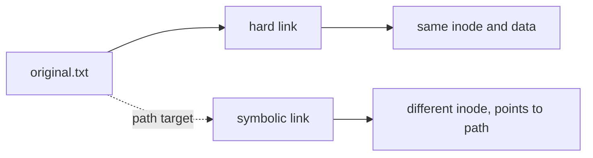
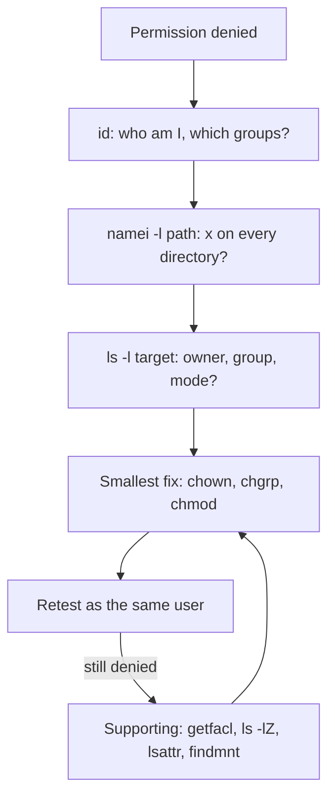

# 06 Links, Permissions, and Default Permissions

> By the end of this lesson you can create links, read and change permissions in symbolic and numeric form, set and persist a default `umask`, and track down why a user gets "Permission denied".

!!! example "Try it now (2 minutes)"
    ```bash
    ls -ld / /tmp /etc/passwd /usr/bin/passwd
    namei -l /etc/passwd
    ```
    ```text title="Example output"
    dr-xr-xr-x. 18 root root   235 Oct 20 08:12 /
    drwxrwxrwt. 12 root root   280 Oct 27 09:58 /tmp
    -rw-r--r--.  1 root root  2452 Oct 20 08:14 /etc/passwd
    -rwsr-xr-x.  1 root root 32200 Aug 14 12:00 /usr/bin/passwd

    f: /etc/passwd
    dr-xr-xr-x root root /
    drwxr-xr-x root root etc
    -rw-r--r-- root root passwd
    ```
    <!-- VERIFY: sizes, dates and link counts are illustrative; modes of / and /usr/bin/passwd on the RHEL 10 image -->
    Notice that `/tmp` ends in `t`, `passwd` has an `s` where an `x` should be, and `namei -l` shows the permissions of **every directory on the way** to a file. By the end of this lesson you will know what each of those letters means and why the path matters as much as the file.

## Why it matters

Permissions and links are core RHCSA tasks. Many failures that look like "Linux is broken" are really permission or path problems. A typical task reads "make `/srv/data/report.txt` readable by the `devteam` group but by nobody else", or "new files created by user alice must default to mode 640". In real life, admins manage shared directories, protect private data, and create links to files and directories for easier access or compatibility.

**Objectives covered:**

- Create hard and soft links
- List, set, and change standard ugo/rwx permissions
- Manage default file permissions
- Diagnose and correct file permission problems

**Prereqs:** [00 Study Skills and Offline Help](00-study-skills-and-offline-help.md), [01 Shell Basics and Command Syntax](01-shell-basics-and-command-syntax.md) and [02 Files, Directories, and Text Editing](02-files-directories-and-text-editing.md) · **Time:** about 5 h

**Tools used:** `ls`, `ln`, `chmod`, `chown`, `chgrp`, `umask`, `touch`, `mkdir`, `stat`, `id`, `namei`, `readlink`

**Offline help for this topic:** `man ln`, `man chmod`, `man chown`, `man namei`, `help umask`, `man umask`, `man stat`

!!! note "Supporting skill (not a listed RHEL 10 objective)"
    Special permission bits (setuid, setgid, sticky), set-GID directories for team collaboration, ACLs (`getfacl`/`setfacl`) and SELinux labels as a cause of "Permission denied" are not named in the official RHEL 10 list. They stay in this course because they are everyday admin knowledge and they explain odd `ls -l` output. They are marked "Supporting" below. Learn the four objectives above first.

## How it works

Every file and directory has **one owner**, **one group** and a **mode** (the permission bits). Three classes of people can be granted three kinds of access each:

| Class | Letter | Who |
|---|:-:|---|
| user | `u` | the single owner of the file |
| group | `g` | members of the file's group |
| others | `o` | everybody else |

| Permission | Letter | On a file | On a directory |
|---|:-:|---|---|
| read | `r` | read the contents | list the names inside |
| write | `w` | change the contents | create, rename and delete entries inside |
| execute | `x` | run it as a program | enter it (`cd`) and reach things inside by name |

Linux checks the classes in order: if you are the owner, only the **owner** bits apply to you, even if the group bits are more generous. If you are not the owner but are in the group, the **group** bits apply. Otherwise the **others** bits apply. `root` skips most of these checks.

### Reading `ls -l`

```text
-rw-r--r--. 1 student student 5 Oct 27 10:02 report.txt
```

| Part | Meaning |
|---|---|
| `-` | file type: `-` regular file, `d` directory, `l` symbolic link |
| `rw-` `r--` `r--` | permissions for user, group, others |
| `.` | an SELinux label exists (a `+` here would mean an ACL exists). Lesson 15 covers labels |
| `1` | number of hard links to this inode |
| `student student` | owner, then group |
| `5` | size in bytes |

For a **directory**, `x` is the one people forget. Without `x` you cannot `cd` into it or open anything inside by name, even if you know the exact path. Without `r` you can still open a file inside if you know its exact name, but you cannot list the directory. Without `w` you cannot create or delete entries, whatever the permissions on the files inside are.

### Numeric mode: r=4 w=2 x=1

Each class is one digit, made by adding up the permissions it has: **r = 4, w = 2, x = 1**. A missing permission adds 0.

| Digit | Sum | Permissions |
|:-:|---|:-:|
| 7 | 4+2+1 | `rwx` |
| 6 | 4+2 | `rw-` |
| 5 | 4+1 | `r-x` |
| 4 | 4 | `r--` |
| 3 | 2+1 | `-wx` |
| 2 | 2 | `-w-` |
| 1 | 1 | `--x` |
| 0 | 0 | `---` |

So `644` is owner `6` (`rw-`), group `4` (`r--`), others `4` (`r--`) which is `-rw-r--r--`. `750` is `rwxr-x---`. `600` is `rw-------`. Work these out on paper until it is automatic.

### Hard links vs symbolic links

An **inode** is the filesystem's internal record for a file: owner, mode, size and where the data blocks are. A file name is just a directory entry that points at an inode.



Hard link:

- another directory entry pointing to the same file data
- usually cannot cross filesystems
- usually not for directories
- shares the same inode with the original file, so it also shares the **same owner, mode and contents**
- deleting one name does not delete the data; the data goes away when the last name (the link count) is removed

You do not need deep filesystem theory for RHCSA, but you should know this:

- same inode usually means the same underlying file data
- hard links share an inode
- symbolic links do not share the inode of their target

Symbolic link (soft link):

- a special file that points to a path
- can cross filesystems
- can point to directories
- breaks if the target path is removed or moved
- always shows as `lrwxrwxrwx`; the permissions that count are the **target's**

### Default permissions and `umask`

When a program creates a file, it asks for a starting mode: **666** for regular files (never executable by default, for safety) and **777** for directories. The `umask` is a **mask**: every permission bit that is set in the umask is **cleared** from that starting mode.

It is a bitwise operation, not arithmetic subtraction. The two give the same answer for common masks like `022`, which is why the "subtract" shortcut survives, but they differ for others. With `umask 033`, subtraction would suggest files of `666 - 033 = 633`. The real result is `644`: in the owner digit nothing is cleared (`033` has `0` there), and in the group and others digits the mask `3` (`-wx`) clears `w` and `x`, but a file's `6` (`rw-`) has no `x` to clear, so only `w` goes, leaving `r--` = `4`.

| `umask` | New files | New directories | Typical use |
|:-:|:-:|:-:|---|
| `022` | `644` | `755` | root and system default |
| `002` | `664` | `775` | regular users with their own private group |
| `027` | `640` | `750` | group can read, others locked out |
| `077` | `600` | `700` | private |
| `033` | `644` | `744` | shows why it is a mask and not subtraction |

### Diagnosing permission problems

When a user gets "Permission denied", do not guess with `chmod 777`. Walk the same path the kernel walks.



## Commands, step by step

### 1. Create links

```bash
cd
echo "demo" > original.txt
ln original.txt hardlink.txt
ln -s original.txt symlink.txt
ls -li original.txt hardlink.txt symlink.txt
```

```text title="Example output"
51234 -rw-r--r--. 2 student student  5 Oct 27 10:02 hardlink.txt
51234 -rw-r--r--. 2 student student  5 Oct 27 10:02 original.txt
51240 lrwxrwxrwx. 1 student student 12 Oct 27 10:02 symlink.txt -> original.txt
```
<!-- VERIFY: inode numbers are illustrative -->

Read it:

- the first column (`-i`) is the inode: `hardlink.txt` and `original.txt` share `51234`, the symlink has its own
- the link count (second column after the mode) is `2` for the hard-linked pair
- the symlink is type `l`, is 12 bytes long (the length of the path `original.txt`) and shows `-> original.txt`

What happens when the original is removed:

```bash
rm original.txt
cat hardlink.txt
cat symlink.txt
```

```text title="Example output"
demo
cat: symlink.txt: No such file or directory
```

The hard link still works: the data lives as long as one name remains. The symlink is now **broken** (dangling), because the path it points to is gone.

Two refusals to recognise:

```text title="Example output"
ln: failed to create hard link 'link-to-etc' => '/etc/hostname': Invalid cross-device link
ln: /tmp/somedir: hard link not allowed for directory
```
<!-- VERIFY: exact wording of both ln errors on RHEL 10 coreutils -->

Both mean "use `ln -s` instead".

!!! tip "What the exam expects"
    Know the argument order: `ln [-s] TARGET LINKNAME`. A relative symlink is resolved from the **directory containing the link**, not from where you typed the command, so use an absolute target (`ln -s /etc/hosts /tmp/hosts.lnk`) unless told otherwise. `readlink symlink.txt` prints a link's target.

### 2. Read permissions: `ls`, `stat`, `id`

```bash
ls -l report.txt          # one file
ls -ld /srv/data          # the directory ITSELF (without -d it lists the contents)
stat report.txt
id
```

```text title="Example output"
  File: report.txt
  Size: 5         	Blocks: 8          IO Block: 4096   regular file
Device: fd00h/64768d	Inode: 51240       Links: 1
Access: (0644/-rw-r--r--)  Uid: ( 1000/ student)   Gid: ( 1000/ student)
Context: unconfined_u:object_r:user_home_t:s0

uid=1000(student) gid=1000(student) groups=1000(student),10(wheel) context=unconfined_u:unconfined_r:unconfined_t:s0-s0:c0.c1023
```
<!-- VERIFY: stat layout and the exact SELinux context shown on the RHEL 10 image -->

`stat` shows the mode in **both** numeric and symbolic form (`0644/-rw-r--r--`), which is handy for checking your arithmetic. `id` shows who you are and every group you are in. `stat -c '%a %U:%G %n' file` prints just the mode, owner, group and name.

### 3. Change permissions with symbolic mode

Form: `chmod WHO OPERATOR WHAT file`.

| Part | Values | Meaning |
|---|---|---|
| WHO | `u` `g` `o` `a` | user, group, others, all three. Left out means `a`, filtered by umask |
| OPERATOR | `+` `-` `=` | add, remove, set exactly |
| WHAT | `r` `w` `x` | the permissions |
| WHAT (special) | `X` | execute only if it is a directory, or someone already has `x` |
| WHAT (special) | `s` `t` | setuid/setgid, sticky (Supporting, below) |

```bash
chmod u+x script.sh
chmod g-w file.txt
chmod o-r file.txt
chmod u=rw,g=r,o= file.txt
```

`=` replaces the whole set for that class: `o=` with nothing after it means "others get nothing".

### 4. Change permissions with numeric mode

```bash
chmod 644 file.txt
chmod 600 secret.txt
chmod 755 script.sh
chmod 700 private-dir
```

Use numeric mode when the task gives an exact mode; use symbolic mode when you want to change one thing and keep the rest.

### 5. Change owner and group, and apply recursively

`chmod` changes the mode. `chown` and `chgrp` change who the owner and group are. Ownership is half of every permission fix.

| Command | Effect |
|---|---|
| `sudo chown alice file` | set the owner |
| `sudo chown alice:devteam file` | set owner and group |
| `sudo chown :devteam file` | set the group only (same as `chgrp devteam file`) |
| `sudo chgrp devteam file` | set the group |
| `sudo chown -R alice:devteam dir` | `-R` recurses into everything below `dir` |
| `chmod -R g+rX dir` | recursive; capital `X` adds `x` to directories but not to plain files |

Only root may give a file to another user. The owner may use `chgrp` without sudo, but only to a group the owner belongs to.

!!! warning "Careful with -R"
    `chmod -R 644 dir` removes `x` from the directories inside, so nobody can enter them any more. Use `chmod -R g+rX dir`, or fix files and directories separately with `find dir -type f -exec chmod 644 {} +` and `find dir -type d -exec chmod 755 {} +`.

### 6. Check, set and persist the default `umask`

```bash
umask
umask -S
touch masktest.txt
mkdir maskdir
ls -ld masktest.txt maskdir
```

```text title="Example output"
0002
u=rwx,g=rwx,o=rx
-rw-rw-r--. 1 student student 0 Oct 27 10:11 masktest.txt
drwxrwxr-x. 2 student student 6 Oct 27 10:11 maskdir
```

On RHEL a regular user whose private group has the same name as the user gets `002`; root and users without a private group get `022`. <!-- VERIFY: umask logic location (/etc/profile vs /etc/bashrc) and values on RHEL 10 -->

Change it for the current shell only:

```bash
umask 027
touch locked.txt
mkdir lockeddir
ls -ld locked.txt lockeddir
```

```text title="Example output"
-rw-r-----. 1 student student 0 Oct 27 10:12 locked.txt
drwxr-x---. 2 student student 6 Oct 27 10:12 lockeddir
```

That setting vanishes when the shell exits. To make it **persistent**, put it where the shell reads it at start-up:

| Where | Effect | Notes |
|---|---|---|
| `umask 027` at the prompt | this shell only | lost on exit or reboot |
| `~/.bashrc` | one user | add the line `umask 027`; applies to every new interactive shell of that user |
| `/etc/profile.d/umask-custom.sh` | all users | any `*.sh` here is read by login shells; create your own file instead of editing `/etc/profile` |
| `/etc/skel/.bashrc` | **future** users | copied into home directories at `useradd` time; existing users are unaffected |
| `UMASK` in `/etc/login.defs` | login sessions | read by `useradd` and, via PAM, at login |

<!-- VERIFY: whether UMASK in /etc/login.defs is honoured for interactive logins on RHEL 10, and which of ~/.bashrc, /etc/profile.d and /etc/bashrc runs last -->

```bash
echo 'umask 027' | sudo tee -a /home/alice/.bashrc
sudo -u alice -i umask
```

```text title="Example output"
0027
```
<!-- VERIFY: sudo -u alice -i umask prints 0027 on RHEL 10 (login shell sources .bashrc via .bash_profile; the order against /etc/profile.d matters) -->

Switching users with `sudo -u` and `su -` is covered in [01 Shell Basics and Command Syntax](01-shell-basics-and-command-syntax.md).

### 7. Diagnose and correct file permission problems

This is the workflow to run every time, in this order. The user who has the problem is called the **victim** below.

**Step 1: read the exact error and note the full path.** `Permission denied` means the permissions blocked it. `No such file or directory` is a different problem (wrong path, broken symlink).

**Step 2: who is the victim?** `id` shows user and groups. `id alice` shows another account's groups. A group added with `usermod -aG` only applies to **new** logins, so a user who was just added must log in again. A `sudo -u alice ...` command starts fresh and sees the new groups.

```bash
id alice
```

```text title="Example output"
uid=1001(alice) gid=1001(alice) groups=1001(alice),1003(devteam)
```

**Step 3: check every directory on the path, not just the file.** The victim needs `x` on each directory in turn.

```bash
sudo namei -l /srv/reports/q3/summary.txt
```

```text title="Example output"
f: /srv/reports/q3/summary.txt
dr-xr-xr-x root root /
drwxr-xr-x root root srv
drwx------ root root reports
drwxr-xr-x root root q3
-rw------- root root summary.txt
```
<!-- VERIFY: namei -l column spacing on RHEL 10 -->

Read it top to bottom as alice: `/` fine, `srv` fine, `reports` is `drwx------` owned by root, so alice (neither owner nor in the group, so "others") has no `x` there. **The file is not the problem. The directory is.** Fixing `summary.txt` would not have helped.

**Step 4: check the target.** `ls -l /srv/reports/q3/summary.txt` shows owner, group and mode. Ask three questions: is the victim the owner, in the group, or "others"? Which class's bits apply? Does that class have the access the task needs?

**Step 5: apply the smallest fix.** Give the right group access, not the world:

```bash
sudo chgrp -R devteam /srv/reports
sudo chmod -R g+rX,o-rwx /srv/reports
```

**Step 6: retest as the same user**, using the exact command that failed:

```bash
sudo -u alice cat /srv/reports/q3/summary.txt
```

Still denied after the mode looks right? Check the less common blockers (Supporting):

| Check | Command | What it reveals |
|---|---|---|
| ACL on the file | `getfacl file`, `+` at the end of the `ls -l` mode | an extra rule overriding the plain bits |
| SELinux label | `ls -lZ file` | wrong type, for example after a `mv`; fix with `restorecon -Rv path` (lesson 15) |
| Immutable flag | `lsattr file` | an `i` stops even root from changing the file; clear with `chattr -i` |
| Read-only mount | `findmnt -no OPTIONS /mountpoint` | `ro` in the options means no writes anywhere |
| Wrong user or group | `id`, `id username` | the user is not in the group you thought |

### 8. Supporting: special permission bits

!!! note "Supporting skill (not a listed RHEL 10 objective)"
    Beyond `rwx` there are three special bits. They appear as a fourth, leading digit in numeric mode (`4`, `2`, `1`), and in `ls -l` they replace an `x` with `s`, `S`, `t`, or `T`.

    | Bit | Numeric | On a file | On a directory |
    |-----|:-------:|-----------|----------------|
    | setuid | `4` | runs as the file's owner | (no standard effect) |
    | setgid | `2` | runs as the file's group | new files inherit the directory's group |
    | sticky | `1` | (no standard effect) | only the file owner, the directory owner or root can delete files in it |

    Where you actually see them on RHEL:

    - **setuid**: `ls -l /usr/bin/passwd` shows `-rwsr-xr-x`. The `s` in the user field lets any user run `passwd` with the owner's (root's) rights so they can update `/etc/shadow`.
    - **setgid on a directory**: every file created inside takes the directory's group, so a whole team shares files automatically. This is why a collaborative directory is `2775`, not `775`.
    - **sticky bit**: `ls -ld /tmp` shows `drwxrwxrwt`. Everyone can write in `/tmp`, but the trailing `t` stops users from deleting each other's files.

    Reading the letter:

    - lowercase `s`/`t` means the special bit **and** the underlying `x` are set
    - uppercase `S`/`T` means the special bit is set but `x` is **not**, usually a mistake to fix

```bash
chmod u+s program         # setuid (symbolic)
chmod g+s shareddir       # setgid (symbolic)
chmod +t /shared/upload   # sticky bit (symbolic)

chmod 4755 program        # setuid (numeric: leading 4)
chmod 2775 shareddir      # setgid (numeric: leading 2)
chmod 1777 /shared/upload # sticky (numeric: leading 1)
```

The leading digit adds to the normal three. `2775` = setgid (`2`) plus `rwxrwxr-x` (`775`).

### 9. Supporting: ACLs in one minute

Plain `ugo` gives one owner and one group. An **ACL** adds extra named users or groups on top.

```bash
sudo setfacl -m u:bob:r-- /srv/reports/q3/summary.txt
getfacl /srv/reports/q3/summary.txt
ls -l /srv/reports/q3/summary.txt
```

```text title="Example output"
getfacl: Removing leading '/' from absolute path names
# file: srv/reports/q3/summary.txt
# owner: root
# group: devteam
user::rw-
user:bob:r--
group::r--
mask::r--
other::---

-rw-r-----+ 1 root devteam 15 Oct 27 10:20 /srv/reports/q3/summary.txt
```
<!-- VERIFY: exact getfacl header and the + marker spacing on RHEL 10 -->

The trailing `+` in `ls -l` is the clue that an ACL exists. `setfacl -x u:bob file` removes one rule, `setfacl -b file` removes them all. A permission fix that "looks right" but still fails is often an ACL (or an SELinux label).

## Worked examples

### Worked example 1: Create hard and symbolic links

```bash
echo "demo" > original.txt
ln original.txt hardlink.txt
ln -s original.txt symlink.txt
ls -li original.txt hardlink.txt symlink.txt
```

Verification:

- hard link and original should share the same inode
- symlink should show a different file type and a target path

### Worked example 2: Lock down a secret file

```bash
echo "secret" > secret.txt
chmod 600 secret.txt
ls -l secret.txt
```

```text title="Example output"
-rw-------. 1 student student 7 Oct 27 10:05 secret.txt
```

Verification: permissions should show `-rw-------`.

### Worked example 3: See the effect of `umask`

```bash
umask
touch masktest.txt
mkdir maskdir
ls -ld masktest.txt maskdir
```

Verification: compare created permissions to the current `umask`. Files start at 666, directories at 777, and the umask bits are cleared.

### Worked example 4: Build a set-GID collaborative directory (Supporting)

This is the classic group-collaboration task: a shared directory where every new file automatically belongs to the team group. It is not on the RHEL 10 list, but it is common at work and teaches how group ownership works.

```bash
sudo groupadd devteam
sudo useradd -m alice
sudo usermod -aG devteam alice
sudo mkdir /srv/devshare
sudo chgrp devteam /srv/devshare
sudo chmod 2775 /srv/devshare
ls -ld /srv/devshare
```

```text title="Example output"
drwxrwsr-x. 2 root devteam 6 Oct 27 10:15 /srv/devshare
```

Prove it. Compare against a normal directory:

```bash
sudo mkdir /srv/plainshare
sudo chgrp devteam /srv/plainshare
sudo chmod 775 /srv/plainshare
sudo -u alice touch /srv/devshare/a.txt /srv/plainshare/b.txt
ls -l /srv/devshare/a.txt /srv/plainshare/b.txt
```

```text title="Example output"
-rw-rw-r--. 1 alice devteam 0 Oct 27 10:16 /srv/devshare/a.txt
-rw-rw-r--. 1 alice alice   0 Oct 27 10:16 /srv/plainshare/b.txt
```

Verification:

- the group field of `/srv/devshare` shows `rws` (the `s` is the setgid bit)
- `a.txt` took the **directory's** group (`devteam`); `b.txt` took alice's own primary group. Same user, same moment, same umask: only the setgid bit made the difference

## Common mistakes

- **Mistake:** Confusing hard links and symbolic links. **Recovery:** hard links share an inode (check `ls -i`); symlinks point to a path (check `ls -l` for `->`). Use `ln -s` for directories and across filesystems.
- **Mistake:** Forgetting execute permission on directories. **Recovery:** thinking file execute permission works the same as directory execute permission is the root of it. Directory `x` means traversal or entry; add it with `chmod g+x dir` or `chmod -R g+rX dir`.
- **Mistake:** Using the wrong permission target: user, group, or others. **Recovery:** run `id` and `ls -l`, decide which class applies to the person, then edit that digit or letter.
- **Mistake:** Applying file-style thinking to directories. **Recovery:** for a directory, `r` lists, `w` changes entries, `x` enters. A directory usually needs `x`.
- **Mistake:** Changing permissions without verifying the effect. **Recovery:** always retest as the affected user (`sudo -u alice cat path`), not as yourself.
- **Mistake:** Setting `777` everywhere. **Recovery:** use only the minimum needed permissions; give the group access instead of the world.
- **Mistake:** Forgetting that symbolic links point to paths. **Recovery:** check the link target with `ls -l` or `readlink`; recreate the link with the correct path.
- **Mistake:** Not verifying default permission behavior. **Recovery:** create a fresh file after checking `umask`. Old files do not change when you change the umask.
- **Mistake:** Treating `umask` as subtraction. **Recovery:** it clears bits; `umask 033` gives files `644`, not `633`.
- **Mistake:** Setting `umask` at the prompt and expecting it to last. **Recovery:** add it to `~/.bashrc` (or a file under `/etc/profile.d/`) and test in a fresh login.
- **Mistake:** `chmod -R 644 dir`, which strips `x` from the subdirectories. **Recovery:** `chmod -R g+rX dir`, or restore directories with `find dir -type d -exec chmod 755 {} +`.
- **Mistake:** Fixing the file when the directory above it is the real blocker. **Recovery:** `namei -l path`.
- **Mistake:** Adding a user to a group and testing in the same old shell. **Recovery:** log in again, or test with `sudo -u user ...`.

### Troubleshooting

| Problem | Cause | Fix |
|---|---|---|
| `Permission denied` on a directory | missing execute permission on the directory | inspect with `ls -ld dir` and `namei -l path`; add `x` where appropriate |
| Symbolic link is broken | target path is wrong or the target was removed | inspect with `ls -l`; recreate the link with the correct path |
| Hard link not allowed | target is on another filesystem or is a directory | use a symbolic link instead |
| Permission change did not solve the access issue | wrong user, wrong group, directory permissions, ACLs, or SELinux may also matter | verify identity (`id`) and the whole path (`namei -l`); then `getfacl` and `ls -lZ` |
| `Operation not permitted` on `chmod` or `chown` | you are not the owner (or not root) | use `sudo`, or ask the owner |
| `bash: ./script.sh: Permission denied` | the file has no `x` bit | `chmod u+x script.sh` |

## Hands-on lab

**Setup:** shared lab environment, `servera`, user `student` with sudo. Create two test users and a group with exact names and membership. The commands are safe to repeat: errors such as "already exists" can be ignored.

```bash
sudo groupadd devteam
sudo useradd -m alice
sudo useradd -m bob
sudo usermod -aG devteam alice
id alice
```

Expected: `alice` is in `devteam`, `bob` is not. To undo everything at the end, see the cleanup block after Lab B.

### Lab A: links, permissions and umask

Work in `~/rhcsa-perm-lab` on `servera` as `student`.

**Task:**

- [ ] `mkdir -p ~/rhcsa-perm-lab` and `cd` into it.
- [ ] Create `report.txt` with one line of text.
- [ ] Create a hard link `report.hard` and a symbolic link `report.soft`; list all three with `ls -li`.
- [ ] Change `report.txt` to mode `640`.
- [ ] Create directory `shared` with mode `775` and directory `private` with mode `700`.
- [ ] As root, create `/srv/team` with group `devteam` and mode `2775`; as `alice`, create `/srv/team/f1.txt`, and confirm its group is `devteam` (not `alice`).
- [ ] Create directory `dropbox` with mode `1777` and confirm the trailing `t` in `ls -ld`.
- [ ] Display the symbolic form of the `umask`; set `umask 077`, create `u077.txt`, and check its mode is `600`; then set `umask 022` again.
- [ ] Remove `report.txt` and observe what happens to `report.hard` and `report.soft`.

??? question "Hint 1"
    Group inheritance can only be proven if the creator's own primary group differs from the directory's group. Make sure the directory is owned by group `devteam` first, and create the file as `alice`.

??? question "Hint 2"
    Use `chgrp` on the directory before `chmod 2775`, and `sudo -u alice touch` to create the test file. Check the new file with `ls -l`.

??? success "Solution"
    ```bash
    mkdir -p ~/rhcsa-perm-lab && cd ~/rhcsa-perm-lab
    echo "first line" > report.txt
    ln report.txt report.hard
    ln -s report.txt report.soft
    ls -li report.txt report.hard report.soft
    chmod 640 report.txt
    mkdir shared private
    chmod 775 shared
    chmod 700 private
    sudo mkdir /srv/team
    sudo chgrp devteam /srv/team
    sudo chmod 2775 /srv/team
    sudo -u alice touch /srv/team/f1.txt
    ls -ld /srv/team
    ls -l /srv/team/f1.txt
    mkdir dropbox
    chmod 1777 dropbox
    ls -ld shared private dropbox
    umask -S
    umask 077
    touch u077.txt
    ls -l u077.txt
    umask 022
    rm report.txt
    cat report.hard
    cat report.soft
    ```
    **Verify:**

    - `ls -li` shows the same inode for `report.txt` and `report.hard`, and `report.soft -> report.txt`
    - `ls -ld /srv/team` shows `drwxrwsr-x`, and `f1.txt` shows group `devteam`
    - `dropbox` shows `drwxrwxrwt`
    - `u077.txt` is `-rw-------`
    - after `rm report.txt`, `cat report.hard` still prints the line, and `cat report.soft` fails with `No such file or directory`

### Lab B: break and fix

You are given a reports tree that `alice` cannot use. Goal: `alice` (member of `devteam`) can read `/srv/reports/q3/summary.txt` and run `/srv/reports/q3/check.sh`, while `bob` can do neither. No file may be mode `777`.

**Setup:** this creates the broken state.

```bash
sudo mkdir -p /srv/reports/q3
echo "Q3 totals: 42" | sudo tee /srv/reports/q3/summary.txt
printf '#!/bin/bash\necho report ok\n' | sudo tee /srv/reports/q3/check.sh
sudo chmod 700 /srv/reports
sudo chmod 755 /srv/reports/q3
sudo chmod 600 /srv/reports/q3/summary.txt
sudo chmod 644 /srv/reports/q3/check.sh
sudo -u alice cat /srv/reports/q3/summary.txt
```

You see `cat: /srv/reports/q3/summary.txt: Permission denied`.

**Task:**

- [ ] Use `id alice` and `sudo namei -l /srv/reports/q3/summary.txt` to find **every** fault (there are three).
- [ ] Fix them with the smallest changes. The files are owned by `root`; the group must become `devteam`.
- [ ] Prove `alice` can `cat` the file and run `check.sh`.
- [ ] Prove `bob` is still denied.

??? question "Hint 1"
    Three separate problems: the group of the tree, who may enter the top directory, and what the script needs in order to run. `namei -l` shows the first two; the third shows up when you try to run the script.

??? question "Hint 2"
    Use `chgrp -R` for the group, `chmod -R` with the capital `X` for the directories, and give the script `x` for the group. Test with `sudo -u alice ...` and `sudo -u bob ...`.

??? success "Solution"
    ```bash
    id alice                                         # alice is in devteam
    sudo namei -l /srv/reports/q3/summary.txt        # reports is 700 root:root, summary.txt is 600
    sudo chgrp -R devteam /srv/reports               # fault 1: group
    sudo chmod -R g+rX,o-rwx /srv/reports            # fault 2: directory access for the group; others locked out
    sudo chmod 750 /srv/reports/q3/check.sh          # fault 3: script needs x for the group
    sudo -u alice cat /srv/reports/q3/summary.txt
    sudo -u alice /srv/reports/q3/check.sh
    sudo -u bob cat /srv/reports/q3/summary.txt
    ```
    **Verify:** alice's `cat` prints `Q3 totals: 42`, the script prints `report ok`, and bob gets `cat: /srv/reports/q3/summary.txt: Permission denied`. `sudo namei -l /srv/reports/q3/check.sh` should show `drwxr-x--- root devteam reports` and `-rwxr-x--- root devteam check.sh`.

??? warning "Cleanup (removes every test object from this lesson)"
    ```bash
    sudo rm -rf /srv/reports /srv/team /srv/devshare /srv/plainshare
    rm -rf ~/rhcsa-perm-lab
    sudo userdel -r alice
    sudo userdel -r bob
    sudo groupdel devteam
    ```

## More practice

1. Create a file and both link types pointing to it.
2. Set a file so only the owner can read and write it.
3. Set a script file to be executable by everyone.
4. Create a directory that only root or the owner can access.
5. Change a file from numeric mode `644` to `600`.
6. Observe default permissions before and after changing `umask` in the current shell.
7. Make `alice`'s umask `027` permanently and prove it with a freshly created file.
8. Without running it, write the mode a new file and directory get with `umask 037`.

### Exam-style task 1

Create `/tmp/permtest.txt`, place text inside it, create:

- a hard link `/tmp/permtest.hard`
- a symbolic link `/tmp/permtest.soft`

Then set the original file permissions so only the owner can read and write it.

**Grader mindset checklist:**

- [ ] all three paths must exist
- [ ] hard link must share inode with the original
- [ ] symbolic link must point to the original path
- [ ] original file permissions must be `600`

??? success "Solution"
    ```bash
    echo "data" > /tmp/permtest.txt
    ln /tmp/permtest.txt /tmp/permtest.hard
    ln -s /tmp/permtest.txt /tmp/permtest.soft
    chmod 600 /tmp/permtest.txt
    ls -li /tmp/permtest.txt /tmp/permtest.hard /tmp/permtest.soft
    ```
    The hard link shares the inode and therefore also the `600` mode. The symlink shows `-> /tmp/permtest.txt`.

### Exam-style task 2

Create a directory `/tmp/project-private` that only its owner can access, and a directory `/tmp/project-shared` that owner and group can fully use while others can only read and enter.

**Grader mindset checklist:**

- [ ] both directories must exist
- [ ] private directory should be `700`
- [ ] shared directory should be `775`

??? success "Solution"
    ```bash
    mkdir /tmp/project-private /tmp/project-shared
    chmod 700 /tmp/project-private
    chmod 775 /tmp/project-shared
    ls -ld /tmp/project-private /tmp/project-shared
    ```

### Exam-style task 3

Set the default `umask` for the user `bob` so that every new file he creates is mode `640` and every new directory is mode `750`. The setting must apply to his future logins.

**Grader mindset checklist:**

- [ ] `umask 027` is stored in a startup file for bob, not only set in a running shell
- [ ] a new login as bob reports `umask` `0027`
- [ ] a new file as bob is `-rw-r-----` and a new directory is `drwxr-x---`

??? success "Solution"
    ```bash
    echo 'umask 027' | sudo tee -a /home/bob/.bashrc
    sudo -u bob -i bash -c 'umask; touch /home/bob/f; mkdir /home/bob/d; ls -ld /home/bob/f /home/bob/d'
    ```
    <!-- VERIFY: bash -c under sudo -u bob -i reads .bashrc; if umask prints 0002, check that .bash_profile sources .bashrc and test with a real login (ssh bob@localhost) -->
    Expected: `0027`, then `-rw-r-----` for `f` and `drwxr-x---` for `d`.

### Exam-style task 4 (Supporting)

Create the group `engineers` and a collaborative directory `/srv/engineering` owned by group `engineers`, set up so that every file created inside it automatically belongs to the `engineers` group. Group members should be able to read, write, and enter; others should have no access.

**Grader mindset checklist:**

- [ ] group `engineers` must exist
- [ ] `/srv/engineering` group must be `engineers`
- [ ] the setgid bit must be set (mode `2770`, shown as `drwxrws---`)
- [ ] a new file created inside must inherit group `engineers`

??? success "Solution"
    ```bash
    sudo groupadd engineers
    sudo mkdir /srv/engineering
    sudo chgrp engineers /srv/engineering
    sudo chmod 2770 /srv/engineering
    ls -ld /srv/engineering
    # prove inheritance (root's primary group is root, so engineers can only come from setgid):
    sudo touch /srv/engineering/testfile
    ls -l /srv/engineering/testfile
    ```

## Exam tips

!!! tip "What the exam expects"
    The task names an exact path, an exact mode or access rule, and sometimes an owner or group. The grader checks the resulting mode, owner and group (`stat -c '%a %U:%G' path`), that the right user can (and the wrong user cannot) reach the file, and that the setting is still there after a reboot. Read "owner and group can fully use, others read and enter" as `775`, "only the owner" as `700` or `600`. Fix the cause, not the symptom: never fall back to `777`.

!!! warning "Must survive reboot"
    | Change | Persistent? | Make it persist with |
    |---|---|---|
    | `chmod`, `chown`, `chgrp` | Yes | Nothing, the mode and owner are stored in the inode |
    | `ln`, `ln -s` | Yes | Nothing, links are stored on disk |
    | setgid / sticky bits | Yes | Nothing, they are part of the mode |
    | ACLs (`setfacl`) | Yes | Nothing, stored with the file (Supporting) |
    | `umask 027` typed at a prompt | No | `umask 027` in `~/.bashrc`, or a file in `/etc/profile.d/` |
    | Editing `/etc/skel/.bashrc` | Only for **new** users | Existing users keep their own `~/.bashrc` |
    | Files under `/tmp` | Not guaranteed | `/tmp` is cleaned by `systemd-tmpfiles`; use `/srv` or a home directory for lasting data |

**Verify like a grader:**

1. `stat -c '%a %U:%G %n' path` shows the exact mode, owner and group the task asks for.
2. `sudo namei -l path` shows `x` for the target user on every directory.
3. `sudo -u user cat path` works for the allowed user and fails with `Permission denied` for another user.
4. For umask tasks: `sudo -u user -i umask`, then create a fresh file and directory and check their modes.
5. Reboot (or at least open a fresh login) and run the checks again.

## Quiz

1. What is the difference between a hard link and a symbolic link?
2. What does `chmod 600 file` mean?
3. What does execute permission mean on a directory?
4. What command creates a symbolic link?
5. What command shows the shell's default permission mask?
6. Why might a symbolic link fail after the original file is removed?
7. What numeric mode makes a collaborative directory where new files inherit the group, and which bit does it set?
8. What does the sticky bit do on a world-writable directory like `/tmp`?
9. Write `rwxr-x---` in numeric form, and explain how you worked it out.
10. With `umask 027`, what mode does a new file get, and a new directory?
11. Why is the result of `umask 033` for files `644` and not `633`?
12. A user gets `Permission denied` on `/srv/reports/q3/summary.txt` although the file is `640 root:devteam` and the user is in `devteam`. What do you run first?
13. How do you make a user's `umask` permanent?

??? success "Answers"
    1. Hard links point to the same file data. Symbolic links point to a path.
    2. Owner can read and write. Group and others have no permissions.
    3. It allows entering or traversing the directory.
    4. `ln -s target linkname`
    5. `umask` or `umask -S`
    6. Because the symlink target path no longer resolves to a valid file.
    7. `2775` (or `chmod g+s`); it sets the setgid bit on the directory so new files inherit the directory's group.
    8. It lets everyone create files but stops users from deleting files they do not own.
    9. `750`: owner `rwx` = 4+2+1 = 7, group `r-x` = 4+1 = 5, others `---` = 0.
    10. Files `640`, directories `750`. Bits set in the umask are cleared from 666 and 777.
    11. `umask` is a mask, not subtraction. Files start at 666 and have no `x` bits, so clearing the `x` bit from the mask's `3` changes nothing; only `w` is cleared, giving `r--` = 4 in the group and others digits.
    12. Check every directory above it: `sudo namei -l /srv/reports/q3/summary.txt`. A directory without `x` for that user is blocking it. Then `id user` to confirm the group is active.
    13. Put `umask 027` in `~/.bashrc` (one user), in a file under `/etc/profile.d/` (all users), or in `/etc/skel/.bashrc` (future users). Test in a fresh login.

## Summary

- hard links share data; symlinks point to paths
- r=4, w=2, x=1; add them per class: `644`, `755`, `600`, `700`
- `chmod` changes permissions; `chown` and `chgrp` change who owns the file
- `600` protects private files; `700` protects private directories; `775` is common for shared directories
- `umask` clears bits from 666 (files) and 777 (directories); it is a mask, not subtraction
- "Permission denied": `id`, then `namei -l`, then `ls -l`, fix the smallest thing, retest as that user
- Supporting: `2775`/`2770` setgid directory = team files inherit the group; sticky bit (`1777`) lets all write but only owners delete

| Task | Command |
|---|---|
| Hard link | `ln file hardlink` |
| Symbolic link | `ln -s file symlink` |
| Show inodes | `ls -li` |
| Exact mode, owner, group | `stat -c '%a %U:%G %n' file` |
| Set numeric mode | `chmod 644 file`, `chmod 600 secret`, `chmod 755 script`, `chmod 700 private-dir`, `chmod 775 shared-dir` |
| Add or remove one permission | `chmod g+w file`, `chmod o-rwx file` |
| Recursive, keep dirs enterable | `chmod -R g+rX dir` |
| Change owner / group | `chown user:group file`, `chgrp group file` |
| Check who I am | `id`, `id username` |
| Check every directory on a path | `namei -l /full/path` |
| Show default mask | `umask`, `umask -S` |
| Persist umask | `echo 'umask 027' >> ~/.bashrc` |
| Check ACL / SELinux label (Supporting) | `getfacl file`, `ls -lZ file` |
| Setgid directory (Supporting) | `chmod 2775 collab-dir` |
| Sticky directory (Supporting) | `chmod 1777 dropbox-dir` |

**Previous:** [05 SSH, Login Control, and Remote Workflows](05-ssh-login-switching-users-and-remote-workflows.md) · **Next:** [07 Software Management, RPM Repositories, and Flatpak](07-software-management-rpm-repos-and-flatpak.md): with files and permissions under control, you move on to installing and updating the software that creates them.
