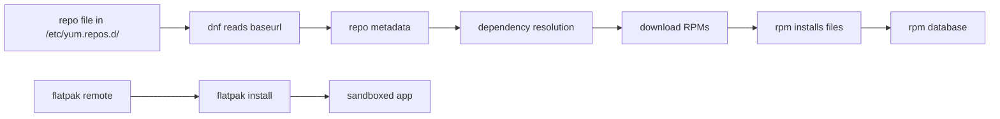

# 07 Software Management, RPM Repositories, and Flatpak

> By the end of this lesson you can point a system at a repository, install, update and remove packages from it or from a local file, and manage Flatpak apps separately.

!!! example "Try it now (2 minutes)"
    ```bash
    rpm -q bash
    rpm -qf /usr/bin/passwd
    sudo dnf repolist
    ```
    ```text title="Example output"
    bash-5.2.26-6.el10.x86_64
    passwd-0.80-20.el10.x86_64
    repo id        repo name
    baseos-local   BaseOS Local Repo
    appstream-local AppStream Local Repo
    ```
    <!-- VERIFY: package versions and repo ids on the RHEL 10 lab image; all values above are illustrative -->
    Notice that `rpm` answers questions about what is installed, while `dnf repolist` shows where new software can come from. By the end of this lesson you will know how to build both sides yourself.

## Why it matters

Software management is a direct exam objective. A typical task reads "create a repository definition for the URL you are given, then install a package from it". In real life, administrators install services and troubleshooting tools, apply updates, and need to know which repository a package came from and how to remove software cleanly.

**Objectives covered:**

- Configure access to RPM repositories
- Install and remove RPM software packages
- Configure access to Flatpak repositories
- Install and remove Flatpak software packages
- Install and update software packages from Red Hat Content Delivery Network, a remote repository, or from the local file system

**Prereqs:** [00 Study Skills and Offline Help](00-study-skills-and-offline-help.md) and [01 Shell Basics and Command Syntax](01-shell-basics-and-command-syntax.md) · **Time:** about 5 h

**Tools used:** `rpm`, `dnf` (and `yum`, a compatibility name for `dnf`), `subscription-manager`, `flatpak`, `createrepo_c`, `cat`, `ls`

**Offline help for this topic:** `man dnf`, `man rpm`, `dnf --help`, `man flatpak`, `flatpak --help`, `man yum.conf` or `man dnf.conf` (repo file options), and the directory `/etc/yum.repos.d/`

!!! note "Offline reality (read this)"
    The RHCSA exam is performed **without internet access**. You will install packages from a **local repository** that the exam provides, usually an HTTP URL on the lab network or a directory on attached install media, not from the public Red Hat CDN or the internet. The skill being tested is *writing a working `.repo` file and installing from it*, not registering a system online. Treat every step in this lesson that reaches the internet (`subscription-manager` registration, `flathub.org`, public mirrors) as **study-time-only practice**. The `dnf`, `rpm`, and `.repo` mechanics are identical whether the source is local or remote, so practice them against a local repo and you are exam-ready.

## How it works

On RHEL-style systems, most software is installed as **RPM packages**. An RPM is one file (`name-version-release.arch.rpm`) that holds the program files plus metadata: its dependencies, and scripts to run on install. A **repository** is a web folder (or local folder) of RPMs plus an index called *metadata* that lists what is inside. Think of a repository as a shop catalogue: the `.repo` file is the shop's address card, and `dnf` is the shopper who reads the catalogue, fetches every part you need (the dependencies) and puts it on your shelf.

- **`dnf`** is the high-level tool. It reads repo files, resolves dependencies, downloads and installs.
- **`rpm`** is the low-level tool. It works on package files and on the local database of installed packages. It does **not** fetch dependencies, so use `dnf` to install and `rpm` to query.
- **Flatpak** is a separate system, mostly for desktop-style applications. Each app brings its own libraries and lives in its own sandbox. It has its own *remotes* (not `.repo` files) and its own commands.



Persistence is simple here: installed packages stay installed, repo files under `/etc/yum.repos.d/` stay until you change them, and Flatpak remotes and apps stay too. Still, after you change software sources or install a tool you will depend on later, verify after a reboot.

!!! warning "Exam Focus"
    Be comfortable reading and creating `.repo` files under `/etc/yum.repos.d/`. Even if `yum` exists as a compatibility command, think in `dnf` terms first.

### Core vs version-specific

- Core: repository files, install, remove, update, query and verify installed packages.
- Version-specific: the exact CDN workflow and subscription state may vary by RHEL version and lab access.

## Commands, step by step

### 1. See your repositories

```bash
sudo dnf repolist
sudo dnf repolist --all
ls /etc/yum.repos.d/
```

```text title="Example output"
repo id          repo name
appstream-local  AppStream Local Repo
baseos-local     BaseOS Local Repo
```
<!-- VERIFY: dnf repolist column layout on RHEL 10 -->

| Command | What it shows |
|---|---|
| `dnf repolist` | Enabled repositories only (`yum repolist` is the same) |
| `dnf repolist --all` | Enabled **and disabled** repositories, with a status column |
| `ls /etc/yum.repos.d/` | The `.repo` files `dnf` reads. Every `*.repo` file in this directory counts |

### 2. Write a `.repo` file (configure access to a repository)

A repo file is plain text in INI style: a `[repo-id]` header and `key=value` lines. Create one for a remote (HTTP) repository, the common exam style:

```bash
sudo vi /etc/yum.repos.d/baseos-local.repo
```

```ini
[baseos-local]
name=BaseOS Local Repo
baseurl=http://repo.example.com/baseos/
enabled=1
gpgcheck=1
gpgkey=file:///etc/pki/rpm-gpg/RPM-GPG-KEY-redhat-release
```

A repo can also point at a local directory or mounted media with a `file://` URL, with no network needed at all:

```ini
[appstream-dvd]
name=AppStream from DVD
baseurl=file:///mnt/dvd/AppStream/
enabled=1
gpgcheck=0
```

| Key | Meaning |
|---|---|
| `[repo-id]` | Short unique name. Used by `--enablerepo` and `--disablerepo`, and shown by `repolist` |
| `name=` | Human-readable description |
| `baseurl=` | Where the repo lives: `http://`, `https://`, `ftp://` or `file:///`. Must be the folder that contains the `repodata/` directory |
| `enabled=` | `1` means dnf uses it, `0` means dnf ignores it |
| `gpgcheck=` | `1` makes dnf check each package signature, `0` skips the check |
| `gpgkey=` | Path or URL of the public key used for the check |

- `gpgcheck=1` with a `gpgkey` is the secure, real-world setting; use it when the repo is signed.
- `gpgcheck=0` skips signature checks. That is acceptable only for a trusted local lab repo, and it is the right fix if a practice repo is unsigned and `dnf` refuses to install.
- To import a key by hand: `sudo rpm --import /path/to/key`.

The exam gives you BaseOS and AppStream, so a real task often needs **two** repo files (or two sections), one for each `baseurl`.

After creating or editing a repo file:

```bash
sudo dnf clean all
sudo dnf repolist
```

`dnf clean all` throws away cached metadata so dnf re-reads your new definition. If the URL is wrong you will see an error here, not at install time.

!!! note "Supporting skill (not a listed RHEL 10 objective)"
    You can also create repo definitions with a plugin command instead of an editor: `sudo dnf config-manager --add-repo URL` and `sudo dnf config-manager --set-enabled REPO_ID` (needs the `dnf-plugins-core` package). The DNF 5 syntax differs (`dnf config-manager addrepo --from-repofile=URL` and `dnf config-manager setopt REPO_ID.enabled=1`). <!-- VERIFY: whether RHEL 10 ships DNF 4 or DNF 5 and which config-manager syntax applies --> Writing the file by hand always works, which is why it is the method to learn.

### 3. Install, update and remove with `dnf`

```bash
sudo dnf install -y tree
sudo dnf check-update
sudo dnf update -y tree
sudo dnf remove -y tree
```

```text title="Example output"
$ sudo dnf install -y tree
Dependencies resolved.
================================================================
 Package   Architecture   Version          Repository      Size
================================================================
Installing:
 tree      x86_64         2.1.0-8.el10     appstream-local  55 k

Transaction Summary
================================================================
Install  1 Package
...
Complete!
```
<!-- VERIFY: exact dnf output layout and tree version on RHEL 10 -->

| Command | What it does |
|---|---|
| `dnf install -y PKG` | Install a package and its dependencies. `-y` answers "yes" to the prompt |
| `dnf remove PKG` | Remove a package and the dependencies nothing else needs |
| `dnf update` | Update all installed packages to the newest version in the enabled repos (same as `dnf upgrade`). Add a name to update one package |
| `dnf check-update` | List available updates without installing. Exit status `100` means updates exist |
| `dnf search WORD` | Find packages by name or summary |
| `dnf provides /path/to/file` | Find which package ships a file or command |
| `dnf info PKG` | Version, repository and description |
| `dnf history` | List past transactions; `dnf history undo N` reverses one |

Finding the package behind a missing command is a classic exam move:

```bash
sudo dnf provides '*/semanage'
```

### 4. Install from a local `.rpm` file

When you have the file itself, install it with `dnf` so dependencies are still resolved:

```bash
sudo dnf install ./tree-2.1.0-8.el10.x86_64.rpm
```

`./` matters: it tells `dnf` this is a file path, not a package name. For raw `rpm` (no dependency resolution), `rpm -ivh file.rpm` installs and `rpm -Uvh file.rpm` upgrades, but prefer `dnf` unless a task explicitly requires `rpm`.

To get an RPM file to practice with:

```bash
mkdir -p ~/rpms
dnf download --destdir ~/rpms tree
```

<!-- VERIFY: dnf download needs dnf-plugins-core on DNF 4; built in on DNF 5 -->

### 5. Query with `rpm`

```bash
rpm -q bash
rpm -qi tree
rpm -ql tree
rpm -qf /usr/bin/passwd
rpm -qa | head -3
```

```text title="Example output"
$ rpm -qi tree
Name        : tree
Version     : 2.1.0
Release     : 8.el10
Architecture: x86_64
Install Date: Tue 27 Oct 2026 09:14:02 AM UTC
Size        : 107616
Signature   : RSA/SHA256, ... Key ID 199e2f91fd431d51
Source RPM  : tree-2.1.0-8.el10.src.rpm
Summary     : File system tree viewer

$ rpm -ql tree
/usr/bin/tree
/usr/share/doc/tree/LICENSE
/usr/share/man/man1/tree.1.gz
```
<!-- VERIFY: rpm -qi field values and rpm -ql file list; illustrative -->

| Option | Meaning |
|---|---|
| `-q PKG` | Is it installed? Prints the full package name or "is not installed" |
| `-qi PKG` | Info: version, install date, summary |
| `-ql PKG` | List: every file the package installed |
| `-qf FILE` | Which installed package owns this file |
| `-qa` | All installed packages (pipe to `head` or `grep`) |
| `-V PKG` | Verify files against the database (silent output means unchanged) |

### 6. Red Hat CDN and subscription checks

!!! warning "Study-time only: needs internet"
    `subscription-manager register` and `refresh` talk to Red Hat over the internet, so they are **not** an exam-day task. Practice these only to understand registration state; on the exam you use the provided local repo.

The Content Delivery Network (CDN) is Red Hat's own download service. A registered, subscribed system gets BaseOS and AppStream repositories from it automatically. If your lab uses real subscription access, these commands matter:

```bash
sudo subscription-manager identity
sudo subscription-manager status
sudo subscription-manager repos --list-enabled
sudo subscription-manager refresh
```

Use them to answer basic questions:

- is this system registered?
- is the subscription valid?
- which CDN-backed repositories are enabled?

Registration generates `/etc/yum.repos.d/redhat.repo`, so a CDN-backed system uses the same `dnf` workflow; only the source differs.

### 7. Flatpak: remotes, install, update, remove

!!! warning "Study-time only: needs a reachable remote"
    Adding the `flathub.org` remote and installing from it requires internet access, so those steps are **practice-time only**. For the exam, know the command shapes; any graded Flatpak task uses a remote the exam provides.

A Flatpak **remote** is the Flatpak equivalent of a repository: a named source of apps. An **application ID** such as `org.gnome.gedit` (reverse-DNS style) names an app. Flatpak is installed from RPM if missing:

```bash
sudo dnf install -y flatpak
```

**System or user scope.** By default Flatpak works **system-wide** (run it with `sudo`, or accept a polkit password prompt). Add `--user` to keep a remote and its apps private to your own account, with no root needed:

| Scope | Flag | Data lives in | Who sees it |
|---|---|---|---|
| System | `--system` (default) | `/var/lib/flatpak` | every user |
| Per user | `--user` | `~/.local/share/flatpak` | only you |

Remotes and apps are tracked **per scope**: a remote added with `--user` is not visible to `sudo flatpak remotes`, and the other way round.

```bash
flatpak remotes
sudo flatpak remote-add --if-not-exists flathub https://flathub.org/repo/flathub.flatpakrepo
flatpak remotes
flatpak search gedit
flatpak install -y flathub org.gnome.gedit
flatpak list
flatpak info org.gnome.gedit
flatpak update -y
flatpak uninstall -y org.gnome.gedit
```

```text title="Example output"
$ flatpak remotes
Name    Options
flathub system

$ flatpak list
Name   Application ID    Version  Branch  Installation
gedit  org.gnome.gedit   48.1     stable  system
```
<!-- VERIFY: flatpak remotes/list column layout, and gedit version, on RHEL 10 -->

| Command | Meaning |
|---|---|
| `flatpak remotes` | List configured remotes (`--user` or `--system` to pick a scope) |
| `flatpak remote-add --if-not-exists NAME URL` | Add a remote; `URL` is usually a `.flatpakrepo` file. `--if-not-exists` makes it safe to repeat |
| `flatpak remote-delete NAME` | Remove a remote |
| `flatpak remote-ls NAME` | List apps a remote offers |
| `flatpak search WORD` | Search the configured remotes |
| `flatpak install REMOTE APPID` | Install an app. `-y` skips the prompt |
| `flatpak list` | Installed apps and runtimes |
| `flatpak info APPID` | Details of an installed app |
| `flatpak update` | Update installed apps |
| `flatpak uninstall APPID` | Remove an app |
| `flatpak run APPID` | Start an app by its ID |

RHEL 10 ships its own Flatpak content from Red Hat rather than Flathub. The remote is typically named `rhel` and points at `oci+https://flatpaks.redhat.io/rhel`, and it needs registry authentication. <!-- VERIFY: default Flatpak remote name, URL and login requirement on RHEL 10 --> On the exam, use whatever remote the task gives you; a remote can also be a `.flatpakrepo` file path or a local repository directory. <!-- VERIFY: adding a local file:// ostree repo with remote-add --no-gpg-verify -->

## Common mistakes

- **Mistake:** Installing from an unverified source. **Recovery:** use the repositories the task provides, keep `gpgcheck=1` where a key exists, and check the source with `dnf info PKG` (the `Repository` line).
- **Mistake:** Confusing `rpm` with dependency-resolving package managers such as `dnf`. **Recovery:** install with `dnf install`; use `rpm` for queries. A direct `rpm -ivh` install fails with "Failed dependencies" when a library is missing.
- **Mistake:** Using `rpm -ivh` first for everything. **Recovery:** prefer `dnf install` unless the task explicitly requires raw `rpm`.
- **Mistake:** Forgetting to enable a repository. **Recovery:** set `enabled=1` in the `.repo` file, then `sudo dnf repolist` (or `repolist --all` to see disabled ones).
- **Mistake:** Assuming a package installed correctly without verifying it. **Recovery:** `rpm -q PKG` after every install, and run the command if the package provides one.
- **Mistake:** Not verifying installed software at all. **Recovery:** query the package after installation, and again after removal.
- **Mistake:** Removing the wrong package. **Recovery:** inspect package names carefully before deletion (`dnf remove` also removes dependencies, so read the transaction list before you answer `y`). `dnf history undo last` reverses a mistake.
- **Mistake:** Mixing system packages and Flatpak packages in your thinking. **Recovery:** treat Flatpak remotes as a separate system; `dnf repolist` never shows them, and `flatpak list` never shows RPMs.
- **Mistake:** Assuming Flatpak uses the same repo system as `dnf`. **Recovery:** use `flatpak remotes`, not `/etc/yum.repos.d/`.
- **Mistake:** Adding a Flatpak remote with `sudo`, then listing it without `sudo` (or `--user`). **Recovery:** list in the same scope you added it: `flatpak remotes --system` or `--user`.

### Troubleshooting

| Problem | Cause | Fix |
|---|---|---|
| `No match for argument` | Wrong package name, or the repository is missing or disabled | `dnf search name`, then `dnf repolist --all` |
| Dependency failure with `rpm` | Direct `rpm` installs do not resolve dependencies | Use `dnf install ./package.rpm` |
| Repo file exists but package still unavailable | Repo disabled, wrong `baseurl`, stale metadata, or a network or subscription problem | Inspect the file, run `sudo dnf clean all`, then `dnf repolist --all` |
| `Cannot download repomd.xml` or `Failed to download metadata` | `baseurl` is wrong or does not contain a `repodata/` directory | Open the URL path again; the folder must hold `repodata/repomd.xml` |
| `GPG check FAILED` / `Public key ... is not installed` | `gpgcheck=1` but the key is missing, or the repo is unsigned | Add a correct `gpgkey=` and `rpm --import` it, or set `gpgcheck=0` for a trusted lab repo |
| `flatpak: command not found` | Flatpak is not installed | `sudo dnf install -y flatpak` |

## Hands-on lab

**Setup:** shared lab environment, `servera`, user `student` with sudo. The machine needs a working repository to start with (the one your lab already provides) so you can fetch two helper packages and one RPM. You will build your own repository from that RPM, then use it. No disk is used, so no disk reset is needed.

```bash
sudo dnf install -y createrepo_c dnf-plugins-core
sudo dnf remove -y tree
sudo mkdir -p /srv/labrepo
sudo chown student: /srv/labrepo
```

**Task:**

- [ ] List the enabled repositories and read the files in `/etc/yum.repos.d/`.
- [ ] Query whether `bash`, `tar` and `vim-minimal` are installed, and find which package owns `/usr/bin/passwd`.
- [ ] Download the `tree` RPM into `/srv/labrepo` and turn that folder into a repository with `createrepo_c`.
- [ ] Create `/etc/yum.repos.d/lab-local.repo` with id `lab-local`, name `Lab Local Repo`, `baseurl=file:///srv/labrepo`, enabled, `gpgcheck=0`. Confirm it appears in `dnf repolist`.
- [ ] Install `tree` using **only** the `lab-local` repository, and verify with `rpm -q` and `command -v`.
- [ ] Remove `tree` and confirm it is gone. Then install it again from the file `/srv/labrepo/tree-*.rpm` by path.
- [ ] Run `dnf check-update` and update the `tree` package.
- [ ] Install `flatpak`, list its remotes, and (study-time only, internet needed) add a **per-user** remote `flathub`, install `org.gnome.gedit`, list it, then uninstall it.

??? question "Hint 1"
    `dnf download` saves a package without installing it, and `createrepo_c` creates the `repodata/` folder that turns a plain directory of RPMs into a repository.

??? question "Hint 2"
    To prove the install came from your repo, disable every repo and enable only yours for one command with `--disablerepo` and `--enablerepo`. Use `--user` on every `flatpak` command that touches the remote.

??? success "Solution"
    ```bash
    sudo dnf repolist
    ls /etc/yum.repos.d/
    cat /etc/yum.repos.d/*.repo
    rpm -q bash tar vim-minimal
    rpm -qf /usr/bin/passwd

    dnf download --destdir /srv/labrepo tree
    createrepo_c /srv/labrepo
    ls /srv/labrepo
    ```
    Create the repo file with `sudo vi /etc/yum.repos.d/lab-local.repo`:
    ```ini
    [lab-local]
    name=Lab Local Repo
    baseurl=file:///srv/labrepo
    enabled=1
    gpgcheck=0
    ```
    ```bash
    sudo dnf clean all
    sudo dnf repolist
    sudo dnf install -y --disablerepo='*' --enablerepo=lab-local tree
    rpm -q tree
    command -v tree

    sudo dnf remove -y tree
    rpm -q tree                      # package tree is not installed
    sudo dnf install -y /srv/labrepo/tree-*.rpm
    rpm -q tree

    sudo dnf check-update
    sudo dnf update -y tree

    sudo dnf install -y flatpak
    flatpak remotes
    flatpak remote-add --user --if-not-exists flathub https://flathub.org/repo/flathub.flatpakrepo
    flatpak install --user -y flathub org.gnome.gedit
    flatpak list --user
    flatpak uninstall --user -y org.gnome.gedit
    ```
    **Verify:** `dnf repolist` lists `lab-local`; `rpm -q tree` prints a name, and prints "package tree is not installed" after removal; `flatpak list --user` shows the app after install and nothing after uninstall. Reboot and repeat `dnf repolist` and `flatpak remotes --user` to confirm the repo file and remote persist.
    <!-- VERIFY: dnf install with --disablerepo='*' --enablerepo works on RHEL 10 for a file:// repo; flathub user remote needs internet -->

    Clean up when done: `sudo rm /etc/yum.repos.d/lab-local.repo; sudo rm -rf /srv/labrepo; sudo dnf clean all`.

## More practice

1. List all enabled repositories.
2. Find out which package owns a known file using `rpm -qf`.
3. Install a package from a repository.
4. Remove that package.
5. Query package information before installing.
6. Add a Flatpak remote if your lab supports it.
7. Install and uninstall one Flatpak package.
8. Compare `dnf repolist` and `dnf repolist --all`.
9. Read one `.repo` file and explain what `baseurl`, `enabled`, and `gpgcheck` mean.
10. If your system is registered, run `subscription-manager repos --list-enabled` and compare the result with `dnf repolist`.
11. Check Red Hat subscription state: run `sudo subscription-manager identity`, `status` and `repos --list-enabled`; say whether the system is registered, whether access is current, and why CDN-backed installs depend on this state.

### Exam-style task 1

Configure repository access available in your lab, then install a package that provides the `tree` command. Verify the package is installed and the command works.

**Grader mindset checklist:**

- [ ] repository access must be functional
- [ ] package must be installed
- [ ] `rpm -q` should succeed
- [ ] `tree` command should run

??? success "Solution"
    ```bash
    sudo dnf repolist
    sudo dnf install -y tree
    rpm -q tree
    command -v tree
    ```
    If `dnf repolist` shows no usable repository, create a `.repo` file for the URL you were given (see step 2) before installing.

### Exam-style task 2

Add a Flatpak remote if your environment supports it, install one Flatpak application, verify it is installed, then remove it.

**Grader mindset checklist:**

- [ ] remote must be configured
- [ ] package must appear in Flatpak installed list
- [ ] uninstall should complete cleanly

??? success "Solution"
    ```bash
    sudo flatpak remote-add --if-not-exists flathub https://flathub.org/repo/flathub.flatpakrepo
    flatpak remotes
    flatpak install -y flathub org.gnome.gedit
    flatpak list
    flatpak uninstall -y org.gnome.gedit
    ```
    Use the remote name and URL the task gives you; `flathub` is only the example.

## Exam tips

!!! tip "What the exam expects"
    The repository is defined and shown by `dnf repolist`, the requested package is installed (and, when asked, updated) from it, and removed packages are really gone. For Flatpak, the remote exists and the app is in `flatpak list`. Verify each with its own command.

!!! warning "Must survive reboot"
    | Change | Persistent? | Make it persist with |
    |---|---|---|
    | `.repo` file in `/etc/yum.repos.d/` | Yes | Nothing, it is a file on disk |
    | `dnf install` / `dnf remove` / `dnf update` | Yes | Nothing, the RPM database is on disk |
    | `--enablerepo=x` on the command line | No | `enabled=1` in the `.repo` file |
    | `dnf config-manager --set-enabled x` | Yes | Nothing, it edits the repo file |
    | `flatpak remote-add` and `flatpak install` | Yes | Nothing, but they are per scope (`--system` or `--user`) |
    | `subscription-manager register` | Yes | Nothing, registration is stored on disk |

**Verify like a grader:**

1. `sudo dnf repolist` shows the repository, with no errors.
2. `rpm -q PACKAGE` prints the package, and the command it provides runs.
3. After removal, `rpm -q PACKAGE` says "is not installed".
4. `flatpak remotes` and `flatpak list` show the remote and the app (or nothing, after uninstall).
5. Reboot and repeat `dnf repolist` and `flatpak remotes`.

## Quiz

1. What is the main difference between `dnf` and `rpm` for installation?
2. Where are normal RPM repository files commonly stored?
3. What command lists repositories, and how do you also see disabled ones?
4. How do you query whether a package is installed?
5. What command lists Flatpak remotes?
6. Why should you verify installation after running the install command?
7. Which `.repo` setting turns signature checking on or off, and when is turning it off acceptable?
8. How do you install a downloaded `.rpm` file and still get dependencies resolved?
9. What does `dnf check-update` do, and how is it different from `dnf update`?
10. What is the difference between `flatpak ... --user` and the default scope?
11. How do you find which installed package owns `/usr/bin/passwd`?

??? success "Answers"
    1. `dnf` resolves dependencies and fetches from repositories; `rpm` is a lower-level package tool that works on files and the installed database.
    2. `/etc/yum.repos.d/`
    3. `dnf repolist`; add `--all` to include disabled ones.
    4. `rpm -q package`
    5. `flatpak remotes`
    6. Because command success alone does not prove the package is installed correctly.
    7. `gpgcheck=1` or `0`. Turning it off is acceptable only for a trusted local lab repo that is unsigned.
    8. `sudo dnf install ./package.rpm` (the `./` marks it as a file path).
    9. It lists available updates without changing anything; `dnf update` actually installs them.
    10. The default (system) scope is shared by all users and needs root; `--user` keeps remotes and apps in your own home directory, with no root needed.
    11. `rpm -qf /usr/bin/passwd`

## Summary

- `dnf` is the main package manager; `rpm` queries and works with package files
- repos feed `dnf`; a repo file is `[id]`, `name`, `baseurl`, `enabled`, `gpgcheck`
- Flatpak is separate from RPM repos, with its own remotes and its own scope (`--system` or `--user`)
- always verify package state after changes

| Task | Command |
|---|---|
| List repos | `dnf repolist`, `dnf repolist --all` |
| Search / find owner | `dnf search name`, `dnf provides /path/file` |
| Install / remove | `dnf install package`, `dnf remove package` |
| Update | `dnf check-update`, `dnf update` |
| Local RPM file | `dnf install ./package.rpm` |
| Refresh metadata | `dnf clean all` |
| Query installed | `rpm -q package`, `rpm -qa`, `rpm -qf /path/to/file` |
| Subscription state (study) | `subscription-manager identity`, `status`, `repos --list-enabled` |
| Flatpak remote | `flatpak remotes`, `flatpak remote-add --if-not-exists name URL` |
| Flatpak app | `flatpak install remote appid`, `flatpak list`, `flatpak uninstall appid` |

**Previous:** [06 Links, Permissions, and Default Permissions](06-links-permissions-and-default-permissions.md) · **Next:** [08 Shell Scripting Basics](08-shell-scripting-basics.md): with packages installed, you start combining commands into scripts.
