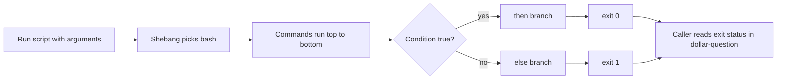

# 08 Shell Scripting Basics

> By the end of this lesson you can write, install and test a small Bash script that takes input, makes decisions, loops over data and reports success or failure.

!!! example "Try it now (2 minutes)"
    ```bash
    [ -f /etc/hosts ]; echo "exit status: $?"
    [ -f /no/such/file ]; echo "exit status: $?"
    ```
    ```text title="Example output"
    exit status: 0
    exit status: 1
    ```
    Every command ends with a number. `0` means success, anything else means failure. `if`, `while` and `&&` are all just ways of reacting to that number. By the end of this lesson you will use it to build scripts that decide things for you.

## Why it matters

The exam objective is simple scripting, not software development. A task usually reads "create `/usr/local/bin/name.sh` that takes an argument and prints something" and a grader runs your script with real and fake input. In real life, admins turn the same five commands they type every morning into one script that never mistypes them.

**Objectives covered:**

- Conditionally execute code (use of: if, test, [], etc.)
- Use Looping constructs (for, etc.) to process file, command line input
- Process script inputs ($1, $2, etc.)
- Processing output of shell commands within a script

**Prereqs:** [01 Shell Basics and Command Syntax](01-shell-basics-and-command-syntax.md), [02 Files, Directories, and Text Editing](02-files-directories-and-text-editing.md) and [03 Redirection, Pipes, Grep, and Regex](03-redirection-pipes-grep-and-regex.md) · **Time:** about 6 h

**Tools used:** `bash`, `echo`, `test`, `[ ]`, `if`, `for`, `while`, `read`, `exit`, `id`, `date`, `hostname`, `grep`, `chmod`, `install`, `bc`

**Offline help for this topic:** `help if`, `help test`, `help [`, `help for`, `help while`, `help read`, `help exit`, `man bash` (search `/Conditional Expressions` and `/Special Parameters`), `man bc`

!!! note "Supporting skill (not a listed RHEL 10 objective)"
    Here-strings (`<<<`) and `bc` are not named in the official RHEL 10 list. They are kept here because they are quick admin tools for small text and math jobs. `$(( ))` integer arithmetic is the first choice; reach for `bc` only when you need decimals.

## How it works

A shell script is a text file of commands that Bash runs top to bottom. Think of it as a recipe: the shebang line says which cook (interpreter) to use, the arguments are the ingredients, and the exit status is the cook telling you whether the dish worked.

- **Shebang:** the first line, `#!/bin/bash`. It tells the system which interpreter runs the file.
- **Argument:** a word you type after the script name. Inside the script it is `$1`, `$2` and so on.
- **Exit status:** the number a command or script returns, stored in `$?` right after it finishes. `0` is success.
- **Command substitution:** `$(command)` runs the command and pastes its output in place.



Safe workflow: type one command in the shell and check it works, paste it into the script, run the script, repeat. Never write forty lines before the first test.

## Commands, step by step

### 1. Write, make executable, run

```bash
cd
mkdir -p rhcsa-script-lab
cd rhcsa-script-lab
vi hello.sh
```

Put these two lines in the file:

```bash
#!/bin/bash
echo "Hello from $(hostname)"
```

```bash
./hello.sh
chmod +x hello.sh
./hello.sh
bash hello.sh
```

```text title="Example output"
-bash: ./hello.sh: Permission denied
Hello from servera.lab.example
Hello from servera.lab.example
```

| Way to run | What it needs |
|---|---|
| `./hello.sh` | The execute bit (`chmod +x`) and a shebang. The `./` is needed because the current directory is not in `PATH` |
| `bash hello.sh` | Only the read bit. The shebang is ignored. Handy for a quick test |
| `hello.sh` (bare name) | The script must be in a `PATH` directory such as `/usr/local/bin` |

To install a script where the exam asks (for example `/usr/local/bin`), copy it with the right mode:

```bash
sudo install -m 0755 hello.sh /usr/local/bin/hello.sh
hello.sh
ls -lZ /usr/local/bin/hello.sh
```

```text title="Example output"
Hello from servera.lab.example
-rwxr-xr-x. 1 root root unconfined_u:object_r:bin_t:s0 52 Oct 27 10:14 /usr/local/bin/hello.sh
```
<!-- VERIFY: exact SELinux type shown for a file created by install in /usr/local/bin on RHEL 10 -->

Use `install` or `cp`, not `mv`. A moved file keeps the label of the directory it came from, a new copy gets the label of the directory it lands in (see [15 SELinux, SSH Keys, and Security](15-selinux-ssh-keys-and-security.md)).

Two debugging helpers cost nothing: `bash -n script.sh` checks syntax without running, and `bash -x script.sh` prints every command as it runs.

### 2. Script inputs: `$0`, `$1`, `$#`, `"$@"`

Create `args.sh`:

```bash
#!/bin/bash
echo "name=$0 count=$# first=$1 second=$2"
for a in "$@"; do
    echo "[$a]"
done
```

```bash
chmod +x args.sh
./args.sh one "two words" three
```

```text title="Example output"
name=./args.sh count=3 first=one second=two words
[one]
[two words]
[three]
```

| Variable | Meaning |
|---|---|
| `$0` | The script name as you typed it |
| `$1`, `$2`, ... | The first, second, ... argument. Use `${10}` from the tenth on |
| `$#` | How many arguments were given |
| `"$@"` | All arguments, each kept as its own word. Use this in loops |
| `$*` | All arguments joined into one string. Rarely what you want |
| `$?` | Exit status of the last command |

`"two words"` is one argument because the quotes group it. Always write `"$1"` and `"$@"` with quotes, or a name containing a space splits into two.

A missing argument is just an empty variable, so check `$#` first. A default value is a one-liner: `name=${1:-world}` means "use `$1`, or `world` if it is empty".

### 3. Exit status and `exit`

```bash
ls /etc/hosts
echo $?
ls /nope
echo $?
```

```text title="Example output"
/etc/hosts
0
ls: cannot access '/nope': No such file or directory
2
```

A script ends with the status of its last command, or with whatever you give `exit`:

```bash
exit 0     # success
exit 1     # general failure
exit 2     # conventional "bad usage"
```

The caller reads it with `$?`. Chain commands on it with `&&` (run the next one only on success) and `||` (only on failure):

```bash
grep -q student /etc/passwd && echo "found" || echo "not found"
```

`grep -q` prints nothing and only sets the exit status, which is exactly what a test wants.

### 4. Conditionals: `if`, `elif`, `else` and `test`

```bash
if [ -f /etc/hosts ]; then
    echo "file exists"
elif [ -d /etc/hosts ]; then
    echo "it is a directory"
else
    echo "nothing there"
fi
```

```text title="Example output"
file exists
```

`if` runs a command and looks at its exit status. `[ ... ]` is just a command (the same as `test ...`) that returns 0 for true and 1 for false. That is why the spaces matter: `[` is a program name and `]` is its last argument.

**File tests**

| Test | True when |
|---|---|
| `-e path` | it exists (any type) |
| `-f path` | it is a regular file |
| `-d path` | it is a directory |
| `-r path`, `-w path`, `-x path` | you can read, write, execute it |
| `-s path` | it exists and is not empty |

**String tests**

| Test | True when |
|---|---|
| `"$a" = "$b"` | the strings are equal (single `=`) |
| `"$a" != "$b"` | they differ |
| `-z "$a"` | the string is empty |
| `-n "$a"` | the string is not empty |

**Number tests** (use these, not `=`, for numbers)

| Test | Meaning |
|---|---|
| `-eq`, `-ne` | equal, not equal |
| `-gt`, `-ge` | greater than, greater or equal |
| `-lt`, `-le` | less than, less or equal |

Put `!` in front to negate (`[ ! -d /data ]`). Join two tests with `&&` or `||` between separate brackets: `[ -f "$f" ] && [ -r "$f" ]`.

```bash
n=7
if [ "$n" -gt 5 ]; then echo "big"; else echo "small"; fi
if [ -z "$1" ]; then echo "no argument"; fi
```

`if` also works directly on any command, with no brackets:

```bash
if id student >/dev/null 2>&1; then
    echo "user exists"
fi
```

`>/dev/null 2>&1` throws away both normal and error output, so only the exit status is left.

!!! note "Supporting skill (not a listed RHEL 10 objective)"
    Bash also has `[[ ... ]]`, which does not word-split variables and supports patterns such as `[[ $f == *.txt ]]`. It works only in Bash, not plain `sh`. `[ ]` is enough for the exam.

### 5. Loops: `for` and `while read`

**`for` over a list, a range, files or arguments:**

```bash
for name in alice bob carol; do echo "$name"; done
for i in {1..3}; do echo "round $i"; done
for f in /etc/*.conf; do echo "$f"; done | head -3
for f in "$@"; do echo "arg: $f"; done
```

```text title="Example output"
alice
bob
carol
round 1
round 2
round 3
/etc/asound.conf
/etc/chrony.conf
/etc/dracut.conf
arg: one
```
<!-- VERIFY: which .conf files exist in /etc on the RHEL 10 lab image; the names above are illustrative -->

Use a glob (`/etc/*.conf`) to loop over files. Do not write `for f in $(ls)`: the output is split on spaces, so `has space.txt` becomes two items.

**`while read` goes through a file line by line:**

```bash
printf 'web01 up\nweb02 down\ndb01 up\n' > hosts.txt

up=0
while read -r name state; do
    echo "$name is $state"
    [ "$state" = "up" ] && up=$((up + 1))
done < hosts.txt
echo "$up hosts up"
```

```text title="Example output"
web01 is up
web02 is down
db01 is up
2 hosts up
```

`read` splits each line into the variable names you give it (the last one takes the rest of the line). `-r` stops backslashes being eaten. Feed the file in with `< hosts.txt` after `done`.

Why not `cat hosts.txt | while read ...`? Every part of a pipe runs in its own subshell, so `up` would be back to `0` when the loop ends. Redirecting the file in with `<` keeps the loop in your shell.

`read` can also ask a person a question:

```bash
read -p "Username: " u
```

### 6. Command substitution and arithmetic

`$(command)` replaces itself with the command's output. Prefer it over the old backtick form because it nests.

```bash
today=$(date +%F)
echo "report-$today.txt"
count=$(wc -l < /etc/passwd)
echo "$count accounts"
```

```text title="Example output"
report-2026-10-27.txt
42 accounts
```

`$(( ))` does integer math and needs no external program:

```bash
echo $((3 + 4 * 2))
echo $((17 / 5)) $((17 % 5))
```

```text title="Example output"
11
3 2
```

Division drops the fraction. For decimals use `bc` (supporting skill):

```bash
bc <<< 'scale=2; 10 / 3'
echo '2 + 3' | bc
```

```text title="Example output"
3.33
5
```
<!-- VERIFY: bc is installed by default on the RHEL 10 lab image; if not, dnf install bc -->

A **here-string** (`<<<`) sends one short string into a command's standard input, so you can test a command without making a file:

```bash
grep root <<< "root:x:0:0:root:/root:/bin/bash"
read first rest <<< "alice bob carol"
echo "$first|$rest"
```

```text title="Example output"
root:x:0:0:root:/root:/bin/bash
alice|bob carol
```

### 7. Quoting

| Form | Effect |
|---|---|
| `"$name"` | Variables and `$( )` are expanded, spaces are kept |
| `'$name'` | Nothing is expanded, you get the literal text |
| `\$name` | Escape a single character |

```bash
name=student
echo "Hello $name, today is $(date +%F)"
echo 'Hello $name'
```

```text title="Example output"
Hello student, today is 2026-10-27
Hello $name
```

Set a variable with no spaces around `=`: `name=student`. Read it with `$name`.

## Worked examples

### Worked example 1: print arguments

```bash
#!/bin/bash
echo "arg1=$1"
echo "arg2=$2"
```

Verification: run it with two values and confirm the output matches.

### Worked example 2: check for a user

```bash
#!/bin/bash
if id "$1" >/dev/null 2>&1; then
    echo "user exists"
else
    echo "user missing"
fi
```

Verification: test with an existing user and a fake user.

```text title="Example output"
$ ./usercheck.sh root
user exists
$ ./usercheck.sh nosuchuser
user missing
```

### Worked example 3: loop through files

```bash
#!/bin/bash
for file in "$@"
do
    echo "checking $file"
    if [ -f "$file" ]; then
        echo "regular file"
    else
        echo "not a regular file"
    fi
done
```

Verification: run it with a mix of real and fake file names, including one with a space in it.

### Worked example 4: `bc` and a here-string

```bash
#!/bin/bash
echo "sum=$(bc <<< '4 + 6')"
grep root <<< "root:x:0:0:root:/root:/bin/bash"
```

Verification: the output shows `sum=10` and the `grep` match for `root`.

## Common mistakes

- **Mistake:** forgetting to make the script executable. **Recovery:** `chmod +x script.sh`, or run it with `bash script.sh`. The error is `Permission denied`.
- **Mistake:** a missing space after `[`, as in `[-f /etc/hosts]`. **Recovery:** write `[ -f /etc/hosts ]`. Bash looks for a command called `[-f` and says `command not found`.
- **Mistake:** a missing or unspaced closing `]`. **Recovery:** the error is ``[: missing `]'``. There must be a space before `]` too.
- **Mistake:** mixing shell syntax with plain English (`if file exists`). **Recovery:** `if [ -f file ]; then`. Shell keywords are exact.
- **Mistake:** forgetting `then` or `fi` in an `if` block (or `do` or `done` in a loop). **Recovery:** read the structure line by line, and run `bash -n script.sh` to find the line.
- **Mistake:** writing a large script before testing pieces. **Recovery:** test each command in the shell first, then build up.
- **Mistake:** not quoting variables. **Recovery:** write `"$1"`. With an empty `$1`, `[ -f $1 ]` becomes `[ -f ]`, which is true, so the wrong branch runs. With `has space.txt` it fails with `[: too many arguments`.
- **Mistake:** assuming script input always exists. **Recovery:** check `$#` or test `[ -z "$1" ]` first, print a usage line and `exit 2`.
- **Mistake:** not redirecting command output in tests. **Recovery:** use `>/dev/null 2>&1` when you only care about success or failure (or `grep -q`).
- **Mistake:** spaces around `=` in an assignment (`name = value`). **Recovery:** `name=value`. Otherwise Bash reports `name: command not found`.
- **Mistake:** using `=` to compare numbers. **Recovery:** use `-eq`, `-gt` and friends. Use `=` for strings only.
- **Mistake:** `cat file | while read` and then using a variable set inside the loop. **Recovery:** `while read ...; done < file`.

### Troubleshooting

| Problem | Cause | Fix |
|---|---|---|
| `Permission denied` | No execute bit | `chmod +x script.sh` |
| `command not found` when you type the script name | Current directory is not in `PATH` | Run `./script.sh` or install it in `/usr/local/bin` |
| `[-f: command not found` | No space after `[` | `[ -f file ]` |
| ``[: missing `]'`` | Closing bracket missing or not separated by a space | Add ` ]` |
| `[: too many arguments` | Unquoted variable holds spaces | Quote it: `"$1"` |
| `syntax error: unexpected end of file` | Missing `fi` or `done` | `bash -n script.sh`, then match every opener with its closer |
| `bad interpreter: No such file or directory` | Wrong path after `#!` | Use `#!/bin/bash` |
| Variable appears empty | No argument passed or name misspelled | `echo "[$var]"` and check the inputs |
| Script works for one file but fails for names with spaces | Variables not quoted | Quote them: `"$1"`, `"$@"` |

## Hands-on lab

**Setup:** shared lab environment, `servera`, user `student`. Create the working directory and sample data first.

```bash
cd
mkdir -p rhcsa-script-lab
cd rhcsa-script-lab
touch alpha.txt beta.txt "has space.txt"
mkdir somedir
printf 'web01 up\nweb02 down\ndb01 up\n' > hosts.txt
```

**Task:** write each script in `/home/student/rhcsa-script-lab`, make it executable, and test it.

- [ ] `showargs.sh` prints the script name, the number of arguments, and `$1` and `$2`.
- [ ] `usercheck.sh` prints `exists` or `missing` for the user in `$1`. With no argument it prints `Usage: ./usercheck.sh username` to standard error and exits with status 2. Test it with `root` and `nosuchuser`.
- [ ] `loopfiles.sh` loops over all its arguments and prints `NAME: regular file`, `NAME: directory` or `NAME: missing` for each. Test it with `alpha.txt somedir nope "has space.txt"`.
- [ ] `uphosts.sh` reads `hosts.txt` with `while read` and prints `2 of 3 hosts up`, counting with `$(( ))`.
- [ ] `stamp.sh` writes the output of `hostname` into a file named `report-YYYY-MM-DD.txt` using `$(date +%F)` in the name, then prints the file name.
- [ ] Use `bc` in a script to add two numbers, and a here-string with `grep` to test a pattern without a file.

??? question "Hint 1"
    Check the argument count first with `$#`, before you use `$1`. For the file types you need three different tests: regular file, directory, and "anything else".

??? question "Hint 2"
    Use `[ $# -ne 1 ]` for the count, `[ -f ... ]` then `[ -d ... ]` inside a `for ... in "$@"` loop, and `while read -r name state; do ... done < hosts.txt`. Redirect the usage message with `>&2`.

??? success "Solution"
    ```bash
    cat > showargs.sh <<'EOF'
    #!/bin/bash
    echo "Script name: $0"
    echo "Number of arguments: $#"
    echo "First: $1"
    echo "Second: $2"
    EOF

    cat > usercheck.sh <<'EOF'
    #!/bin/bash
    if [ $# -ne 1 ]; then
        echo "Usage: $0 username" >&2
        exit 2
    fi
    if id "$1" >/dev/null 2>&1; then
        echo exists
    else
        echo missing
    fi
    EOF

    cat > loopfiles.sh <<'EOF'
    #!/bin/bash
    for f in "$@"; do
        if [ -f "$f" ]; then
            echo "$f: regular file"
        elif [ -d "$f" ]; then
            echo "$f: directory"
        else
            echo "$f: missing"
        fi
    done
    EOF

    cat > uphosts.sh <<'EOF'
    #!/bin/bash
    total=0
    up=0
    while read -r name state; do
        total=$((total + 1))
        [ "$state" = "up" ] && up=$((up + 1))
    done < hosts.txt
    echo "$up of $total hosts up"
    EOF

    cat > stamp.sh <<'EOF'
    #!/bin/bash
    out="report-$(date +%F).txt"
    hostname > "$out"
    echo "$out"
    EOF

    chmod +x *.sh
    ./showargs.sh one two
    ./usercheck.sh root; ./usercheck.sh nosuchuser; ./usercheck.sh; echo "status=$?"
    ./loopfiles.sh alpha.txt somedir nope "has space.txt"
    ./uphosts.sh
    ./stamp.sh
    bc <<< '4 + 6'
    grep -c up <<< "web01 up"
    ```
    ```text title="Example output"
    Script name: ./showargs.sh
    Number of arguments: 2
    First: one
    Second: two
    exists
    missing
    Usage: ./usercheck.sh username
    status=2
    alpha.txt: regular file
    somedir: directory
    nope: missing
    has space.txt: regular file
    2 of 3 hosts up
    report-2026-10-27.txt
    10
    1
    ```
    **Verify:** `ls -l *.sh` shows `x` on every script, `bash -n *.sh` prints nothing (no syntax errors), and `cat report-*.txt` shows `servera.lab.example`.

## More practice

1. Write a script that prints the current hostname.
2. Write a script that checks whether one file path exists.
3. Write a script that loops through three names and prints them.
4. Write a script that prints `missing argument` if no first argument is given.
5. Write a script that uses `grep` output inside the script.
6. Write a script that creates a dated report file name using `$(date ...)`.
7. Write a script that uses `bc` to add two numbers.
8. Write a script that uses `grep <<< "text"` to test a pattern without a file.

### Exam-style task 1

Create `/usr/local/bin/userexists.sh` that accepts one username as an argument and prints either `exists` or `missing`.

**Grader mindset checklist:**

- [ ] script path must exist
- [ ] script must be executable
- [ ] script must use the first argument
- [ ] script should return correct output for real and fake users

??? success "Solution"
    ```bash
    cat > ~/userexists.sh <<'EOF'
    #!/bin/bash
    if id "$1" >/dev/null 2>&1; then
        echo exists
    else
        echo missing
    fi
    EOF
    sudo install -m 0755 ~/userexists.sh /usr/local/bin/userexists.sh
    userexists.sh root
    userexists.sh nosuchuser
    ```
    **Verify:** the two runs print `exists` and `missing`, and `ls -l /usr/local/bin/userexists.sh` shows `-rwxr-xr-x`.

### Exam-style task 2

Create `/usr/local/bin/filecheck.sh` that accepts one or more file paths as arguments and prints whether each is a regular file.

**Grader mindset checklist:**

- [ ] script must accept multiple inputs
- [ ] loop logic must work
- [ ] output should match the actual file state

??? success "Solution"
    ```bash
    cat > ~/filecheck.sh <<'EOF'
    #!/bin/bash
    for file in "$@"
    do
        if [ -f "$file" ]; then
            echo "$file regular"
        else
            echo "$file not-regular"
        fi
    done
    EOF
    sudo install -m 0755 ~/filecheck.sh /usr/local/bin/filecheck.sh
    filecheck.sh /etc/hosts /nope /etc
    ```
    ```text title="Example output"
    /etc/hosts regular
    /nope not-regular
    /etc not-regular
    ```

## Exam tips

!!! tip "What the exam expects"
    The script exists at the exact path asked, is executable (`-rwxr-xr-x`), starts with `#!/bin/bash`, and gives correct output for both real and fake input. Run it yourself with at least one good and one bad argument before you move on.

!!! warning "Must survive reboot"
    | Change | Persistent? | Make it persist with |
    |---|---|---|
    | Script file in `/usr/local/bin` | Yes | Nothing, it is a file on disk |
    | `chmod +x` | Yes | Nothing, the mode is stored on disk |
    | Variable set in the shell (`name=x`) | No | Put it inside the script, or in `~/.bashrc` for your login |

**Verify like a grader:** `ls -l /usr/local/bin/name.sh`, `head -1 /usr/local/bin/name.sh`, `bash -n /usr/local/bin/name.sh`, then run it from another directory with a good argument, a bad argument, and no argument. Check `echo $?` after each if the task mentions a status.

## Quiz

1. What does `$1` mean in a shell script?
2. What does `$#` mean?
3. Why is `#!/bin/bash` useful?
4. What keyword starts a conditional block, and what ends it?
5. What loop is commonly used to process a list of items?
6. What does `$(date)` do?
7. What does `<<<` do?
8. What command can calculate `2 + 3` from standard input?
9. What does `$?` hold, and which value means success?
10. Which test checks that a path is a directory?
11. Why is `-gt` used instead of `>` inside `[ ]` for numbers?
12. Why does `cat file | while read x; do count=$((count+1)); done` leave `count` unchanged afterwards?

??? success "Answers"
    1. The first argument.
    2. The number of arguments.
    3. It tells the system to run the script with Bash.
    4. `if` starts it, `fi` ends it.
    5. `for` (and `while read` for lines of a file).
    6. It runs `date` and substitutes its output.
    7. It sends a short string into a command as input.
    8. `bc`, for example `echo '2 + 3' | bc`.
    9. The exit status of the last command. `0` is success.
    10. `[ -d path ]`.
    11. `>` inside `[ ]` is a redirection, not a comparison. `-gt`, `-lt`, `-eq` compare numbers.
    12. The loop runs in a subshell because of the pipe, so its variables vanish. Use `done < file` instead.

## Summary

- scripts are just text files with commands
- shebang first
- arguments use `$1`, `$2`, and `"$@"` for all of them
- conditionals use `if [ ... ]; then ... fi`
- loops use `for` and `while read`
- `$(command)` captures output, `$(( ))` does integer math
- exit status `0` means success; `exit N` sets yours
- test small pieces first

| Task | Command |
|---|---|
| Make executable | `chmod +x script.sh` |
| Run | `./script.sh arg1 arg2` or `bash script.sh arg1 arg2` |
| Install | `sudo install -m 0755 script.sh /usr/local/bin/` |
| Syntax check / trace | `bash -n script.sh` / `bash -x script.sh` |
| File test | `if [ -f file ]; then echo ok; fi` |
| Number test | `[ "$n" -gt 5 ]` |
| Loop over args | `for item in "$@"; do echo "$item"; done` |
| Loop over lines | `while read -r a b; do ...; done < file` |
| Capture output | `name=$(hostname)` |
| Integer math | `echo $((3 + 4))` |
| Last exit status | `echo $?` |

**Previous:** [07 Software Management, RPM Repositories, and Flatpak](07-software-management-rpm-repos-and-flatpak.md) · **Next:** [09 Boot, Targets, Processes, Logs, and Tuning](09-boot-targets-processes-logs-and-tuning.md): scripts are what you will use to check and automate the running system you learn to operate next.
