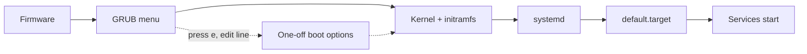
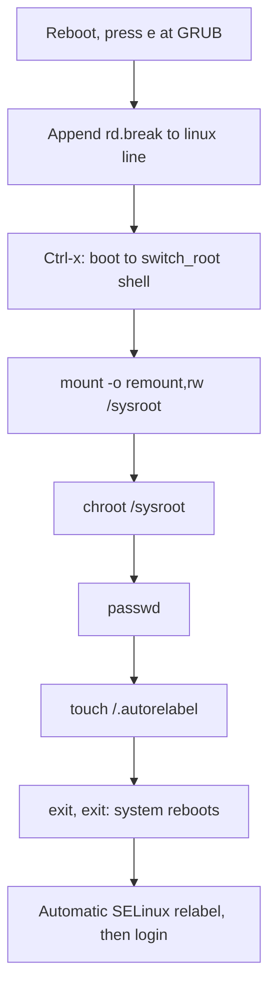

# 09 Boot Targets, Processes, Logs, and Tuning

> By the end of this lesson you can boot a system into a chosen target, break into a machine you are locked out of, control processes, read the evidence in logs, keep the journal across reboots, and pick a tuning profile.

!!! example "Try it now (2 minutes)"
    ```bash
    systemctl get-default
    systemctl is-active sshd
    systemctl is-enabled sshd
    uptime
    ```
    ```text title="Example output"
    multi-user.target
    active
    enabled
    10:42:17 up 2 days,  1:28,  1 user,  load average: 0.00, 0.01, 0.05
    ```
    <!-- VERIFY: default target and sshd state on the RHEL 10 lab image -->
    Notice that "active" (running now) and "enabled" (starts at boot) are two different answers from two different commands. By the end of this lesson you will know why that difference decides whether a task survives a reboot.

## Why it matters

These are direct objectives and they are central to real administration. You must understand how the system starts, how services and processes behave, and how to read evidence from logs. Admins reboot systems for maintenance, isolate broken services, kill runaway processes, review journals for failures, recover lost root passwords and tune systems for different workloads.

**Objectives covered:**

- Boot, reboot, and shut down a system normally
- Boot systems into different targets manually
- Interrupt the boot process in order to gain access to a system
- Identify CPU/memory intensive processes and kill processes
- Adjust  process scheduling
- Manage tuning profiles
- Locate and interpret system log files and journals
- Preserve system journals
- Start, stop, and check the status of network services

**Prereqs:** [01 Shell Basics and Command Syntax](01-shell-basics-and-command-syntax.md) and [03 Redirection, Pipes, grep, and Regex](03-redirection-pipes-grep-and-regex.md) · **Time:** about 6 h

**Tools used:** `systemctl`, `reboot`, `shutdown`, `ps`, `pgrep`, `top`, `free`, `uptime`, `kill`, `pkill`, `nice`, `renice`, `journalctl`, `tuned-adm`, `ss`

**Offline help for this topic:** `man systemctl`, `man journalctl`, `man journald.conf`, `man ps`, `man top`, `man kill`, `man nice`, `man renice`, `man tuned-adm`, `man systemd.special`, `man dracut.cmdline`

## How it works

Modern RHEL systems use `systemd`. It is the first process the kernel starts (PID 1), and from there it starts everything else, manages services, collects logs in the **journal**, and decides what state the machine ends up in.



### Targets

A **target** is a named system state: a group of units that should be running together. Think of it as the "mode" the machine is in.

| Target | Meaning |
|---|---|
| `graphical.target` | Multi-user plus a graphical login |
| `multi-user.target` | Full text-mode system with networking and all normal services |
| `rescue.target` | Single-user repair mode: basic system up, local filesystems mounted, root shell |
| `emergency.target` | Bare minimum: only the root filesystem, mounted **read-only**, no other services |
| `reboot.target`, `poweroff.target` | The states `reboot` and `poweroff` move to |

`rescue` and `emergency` both give you a root shell, but `rescue` is a working (if quiet) system while `emergency` is the last-ditch option for when even mounting filesystems fails, for example a broken `/etc/fstab`.

### Running vs enabled

- **Running (active):** the service is up right now.
- **Enabled:** the service is configured to start at boot.

These are not the same thing. `systemctl start` changes only the first; `systemctl enable` changes only the second; `systemctl enable --now` does both.

### Processes and signals

A **process** is a running program, identified by a PID (process ID). You control a process by sending it a **signal** (for example "please stop") or by changing its **niceness**, a politeness number that decides how willingly it gives up CPU time to others.

### Logs and the journal

`systemd-journald` collects messages from the kernel and every service into the **journal**, a binary database you read with `journalctl`. By default the journal may live only in memory (`/run/log/journal`) and vanish at reboot. Making it persistent means storing it on disk in `/var/log/journal`.

### Interrupting boot to gain access

This objective is about controlled recovery, not random experiments. The general pattern is:

1. interrupt the GRUB menu during boot
2. edit the kernel line temporarily (the edit is **never saved**)
3. boot into a recovery or emergency path
4. make the repair
5. schedule an SELinux relabel if you changed files such as `/etc/shadow`
6. reboot normally

Practice this only on disposable lab systems.

## Commands, step by step

### 1. Boot, reboot and shut down normally

```bash
sudo systemctl reboot
sudo systemctl poweroff
sudo shutdown -r +5 "Rebooting for maintenance"
sudo shutdown -c
sudo shutdown -h now
```

```text title="Example output"
Broadcast message from root@servera.lab.example (Tue 2026-10-27 10:50:00 UTC):

Rebooting for maintenance
The system will reboot at Tue 2026-10-27 10:55:00 UTC!
```
<!-- VERIFY: exact shutdown broadcast wording on RHEL 10 -->

| Command | Meaning |
|---|---|
| `systemctl reboot` | Clean reboot now |
| `systemctl poweroff` | Clean power off now |
| `shutdown -r now` / `shutdown -h now` | Reboot / halt-and-power-off now |
| `shutdown -r +5 "msg"` | Reboot in 5 minutes and warn logged-in users |
| `shutdown -c` | Cancel a pending timed shutdown |

On a normal exam-style task you reboot only when the task says so, or when you need to prove that your work persists.

### 2. Check and change targets

```bash
systemctl get-default
systemctl list-units --type=target
sudo systemctl set-default multi-user.target
sudo systemctl isolate rescue.target
```

```text title="Example output"
$ systemctl get-default
graphical.target

$ sudo systemctl set-default multi-user.target
Removed '/etc/systemd/system/default.target'.
Created symlink '/etc/systemd/system/default.target' → '/usr/lib/systemd/system/multi-user.target'.
```

| Command | Effect | Survives reboot? |
|---|---|---|
| `systemctl set-default X.target` | Changes the target used at every boot | Yes |
| `systemctl isolate X.target` | Switches the running system to `X.target` now | No |
| `systemctl get-default` | Shows the boot target | n/a |

`isolate rescue.target` stops almost everything and drops you into a root shell on the console, so do not run it over an SSH session you need. Leave with `systemctl default` (back to the default target) or `systemctl reboot`.

### 3. Boot into a different target from GRUB (one time)

This is how you boot "manually" into a target without changing the default. It also works when the machine will not reach its normal target.

1. Reboot and, at the GRUB menu, highlight the normal kernel entry and press **e** (do not press Enter).
2. Find the line that begins with `linux` (it mentions `vmlinuz`). Move to the **end** of it (press `End` or `Ctrl-e`).
3. Append a space and one of:

    ```text
    systemd.unit=rescue.target
    ```

    ```text
    systemd.unit=emergency.target
    ```

4. Press **Ctrl-x** (or F10) to boot with the edited line. Enter the root password when asked.

```text title="Example output (rescue)"
You are in rescue mode. After logging in, type "journalctl -xb" to view
system logs, "systemctl reboot" to reboot, "systemctl default" or ^D to
boot into default mode.
Give root password for maintenance
(or press Control-D to continue):
```
<!-- VERIFY: exact rescue/emergency banner text on RHEL 10 -->

| Choice | Root fs | Other filesystems | Use when |
|---|---|---|---|
| `systemd.unit=rescue.target` | Read-write | Mounted | You need a quiet system to repair services or config |
| `systemd.unit=emergency.target` | **Read-only** | Not mounted | `rescue` itself fails, for example because of a bad `fstab` |

In emergency mode remount root read-write before editing anything: `mount -o remount,rw /`. The kernel-line edit applies to this boot only; a normal reboot returns to the default target. Both modes ask for the root password, so if you do not know it use the next section.

### 4. Interrupt the boot to reset a lost root password

Resetting a lost root password is the classic example of "interrupt the boot process in order to gain access to a system". You must know the **whole** sequence, including the GRUB edit: there is no graphical shortcut and no internet to look it up. Practice it until you can do it from memory.



1. **Reboot** the system. At the GRUB menu, highlight the normal kernel entry and press `e`.
2. Move to the end of the `linux` line and append a space and `rd.break`.
3. Press **Ctrl-x** (or F10). The system stops in the early `switch_root:/#` shell, with the real root filesystem mounted **read-only** at `/sysroot`. This early shell is the initramfs, the tiny system the kernel uses to find the real root.
4. Remount `/sysroot` read-write and enter it:

    ```bash
    mount -o remount,rw /sysroot
    chroot /sysroot
    ```

5. Set the new root password:

    ```bash
    passwd
    ```

6. Schedule a full SELinux relabel on the next boot:

    ```bash
    touch /.autorelabel
    ```

7. Leave both shells. The system continues booting:

    ```bash
    exit
    exit
    ```

```text title="Example output (inside the shell)"
switch_root:/# mount -o remount,rw /sysroot
switch_root:/# chroot /sysroot
sh-5.2# passwd
Changing password for user root.
New password:
Retype new password:
passwd: all authentication tokens updated successfully.
sh-5.2# touch /.autorelabel
sh-5.2# exit
exit
switch_root:/# exit
```
<!-- VERIFY: exact prompts and shell version string in the rd.break shell on RHEL 10 -->

The relabel runs automatically and the machine reboots again, then you can log in as root with the new password.

!!! warning "Do not skip the relabel"
    If you forget `touch /.autorelabel`, the new `/etc/shadow` can end up with the wrong SELinux context and **root login can fail**. In this early shell the SELinux policy is not loaded, so `restorecon` will normally do nothing useful. Use `touch /.autorelabel`. <!-- VERIFY: `load_policy -i` followed by `restorecon -v /etc/shadow` inside the chroot is a possible alternative on RHEL 10; not needed for the exam procedure -->

### 5. Start, stop and check network services

"Network services" here means any daemon that listens or manages the network: `sshd`, `chronyd`, `firewalld`, `NetworkManager`, `httpd` and so on.

```bash
systemctl status sshd
systemctl is-active sshd
systemctl is-enabled sshd
sudo systemctl restart sshd
sudo systemctl enable --now chronyd
systemctl --failed
sudo ss -tlnp | grep ':22 '
```

```text title="Example output"
● sshd.service - OpenSSH server daemon
     Loaded: loaded (/usr/lib/systemd/system/sshd.service; enabled; preset: enabled)
     Active: active (running) since Mon 2026-10-26 09:14:02 UTC; 1 day 1h ago
       Docs: man:sshd(8)
             man:sshd_config(5)
   Main PID: 842 (sshd)
      Tasks: 1 (limit: 11118)
     Memory: 4.1M
        CPU: 312ms
     CGroup: /system.slice/sshd.service
             └─842 "sshd: /usr/sbin/sshd -D [listener] 0 of 10-100 startups"
```
<!-- VERIFY: status output layout and preset wording on RHEL 10 -->

Read the status like this: `Loaded: ... enabled` is the boot setting; `Active: active (running)` is the state now; the last lines of the journal appear below the CGroup block.

| Command | Meaning |
|---|---|
| `systemctl start` / `stop` | Change the state now only |
| `systemctl restart` | Stop then start (drops connections) |
| `systemctl reload` | Re-read config without stopping, if the service supports it |
| `systemctl enable` / `disable` | Change the boot setting only |
| `systemctl enable --now` | Enable at boot **and** start now |
| `systemctl mask` | Make a unit impossible to start (stronger than `disable`); undo with `unmask` |
| `systemctl is-active` / `is-enabled` | Short answer, handy in scripts |
| `systemctl --failed` | List units that failed |

Writing your own unit files and timers is in [12 Scheduling, Services, Time, and Bootloader](12-scheduling-services-time-and-bootloader.md).

### 6. Find CPU and memory intensive processes

```bash
ps aux --sort=-%cpu | head -4
ps aux --sort=-%mem | head -4
ps -eo pid,ni,%cpu,%mem,comm --sort=-%cpu | head -4
top
free -h
uptime
```

```text title="Example output"
USER         PID %CPU %MEM    VSZ   RSS TTY      STAT START   TIME COMMAND
student     2231 99.0  0.1   5512  1024 pts/0    R+   10:55   1:12 sha1sum /dev/zero
root         842  0.0  0.3  15420  6144 ?        Ss   Oct26   0:00 sshd: /usr/sbin/sshd -D
...
               total        used        free      shared  buff/cache   available
Mem:           1.7Gi       356Mi       1.0Gi       8.0Mi       483Mi       1.3Gi
Swap:             0B          0B          0B
```
<!-- VERIFY: ps column widths and free output on the lab VM; numbers are illustrative -->

| Column | Meaning |
|---|---|
| `PID` | Process ID, the handle you give to `kill` and `renice` |
| `%CPU`, `%MEM` | Share of CPU and of RAM in use |
| `NI` (`-o ni`) | Niceness (see below) |
| `STAT` | `R` running, `S` sleeping, `Z` zombie, `T` stopped |

`top` is the live version. Keys inside `top`:

| Key | Action |
|---|---|
| `P` | Sort by CPU |
| `M` | Sort by memory |
| `k` | Kill: it asks for a PID, then a signal (default 15) |
| `r` | Renice: it asks for a PID, then the new niceness |
| `1` | Show each CPU core separately |
| `q` | Quit |

### 7. Kill processes

Always confirm the PID first, then ask politely, then force.

```bash
pgrep -a sha1sum
kill 2231
kill -9 2231
pkill sha1sum
pkill -u student sleep
```

```text title="Example output"
$ pgrep -a sha1sum
2231 sha1sum /dev/zero
```

| Signal | Number | Meaning |
|---|---|---|
| `SIGTERM` | 15 (default) | Please exit cleanly. Try this first |
| `SIGKILL` | 9 | Kernel ends the process immediately; no cleanup. Last resort |
| `SIGHUP` | 1 | "Hang up"; many daemons re-read config on it |
| `SIGSTOP` / `SIGCONT` | 19 / 18 | Pause / resume |

`pkill` and `pgrep` match by **pattern**, so `pkill ssh` could also match `sshd`. Run `pgrep -a pattern` first to see exactly what would die. A normal user can only signal their own processes; root can signal anything.

### 8. Adjust process scheduling (nice and renice)

Niceness runs from **-20** (greediest, highest priority) to **19** (most polite, lowest priority); the default is **0**.

```bash
nice -n 10 sleep 300 &
ps -o pid,ni,cmd -p $(pgrep -n sleep)
sudo renice -n 5 -p $(pgrep -n sleep)
ps -o pid,ni,cmd -p $(pgrep -n sleep)
```

```text title="Example output"
[1] 2301
    PID  NI CMD
   2301  10 sleep 300
2301 (process ID) old priority 10, new priority 5
    PID  NI CMD
   2301   5 sleep 300
```
<!-- VERIFY: renice output wording on RHEL 10 -->

A normal user may only **raise** niceness (make a process more polite). Lowering it, for example to `-5`, needs root. Only the process's owner or root can renice it.

### 9. Locate and interpret log files

Many logs live in `/var/log`, and the journal holds the rest.

| Where | What it holds |
|---|---|
| `/var/log/messages` | General system messages (needs `rsyslog`; may not be installed by default on RHEL 10) |
| `/var/log/secure` | Logins, `sudo`, `ssh` authentication <!-- VERIFY: also depends on rsyslog on RHEL 10 --> |
| `/var/log/audit/audit.log` | Audit and SELinux denials (`auditd`) |
| `/var/log/dnf*.log` | Package manager activity |
| `journalctl` | Everything from journald, filterable. Always available |

Useful `journalctl` filters:

```bash
journalctl -b
journalctl -b -1
journalctl -u sshd
journalctl -p err -b
journalctl --since "10 minutes ago"
journalctl -u sshd --since today --until "1 hour ago"
journalctl -n 20 --no-pager
journalctl -f
journalctl -k
```

| Option | Meaning |
|---|---|
| `-b` | Current boot only (`-b -1` is the previous boot, which needs a persistent journal) |
| `-u UNIT` | One service |
| `-p err` | Priority `err` and worse (`emerg`, `alert`, `crit`, `err`) |
| `--since`, `--until` | Time window, e.g. `"2026-10-27 09:00"`, `yesterday` |
| `-n N` | Last N lines |
| `-f` | Follow new messages (`Ctrl-c` to stop) |
| `-k` | Kernel messages only |

```text title="Example output"
Oct 27 10:55:03 servera.lab.example sshd[2250]: Failed password for invalid user bob from 192.168.122.11 port 52114 ssh2
```

Read a line left to right: **timestamp**, **host**, **program[PID]**, then the **message**. Narrow by boot, unit or priority first; reading the whole journal is rarely useful.

### 10. Preserve system journals

On a default install the journal can be kept in memory only. That is why "the logs from before the reboot are gone" happens. Check:

```bash
ls -d /var/log/journal
journalctl --disk-usage
journalctl --list-boots
```

Two ways to make it persistent. Pick one.

**Method A, the configuration route.** Use a drop-in file. There is no `/etc/systemd/journald.conf` by default (the stock file is `/usr/lib/systemd/journald.conf`, all commented defaults), so editing the `/etc` path with `sed` would find nothing to change. A drop-in always works, and a package update never overwrites it.

```bash
sudo mkdir -p /etc/systemd/journald.conf.d
printf '[Journal]\nStorage=persistent\n' | sudo tee /etc/systemd/journald.conf.d/persistent.conf
sudo systemctl restart systemd-journald
sudo journalctl --flush
systemd-analyze cat-config systemd/journald.conf
```

Restarting `systemd-journald` makes it read the drop-in, but on its own it does **not** create `/var/log/journal`. `sudo journalctl --flush` moves the in-memory journal to disk, and that creates `/var/log/journal/<machine-id>`.

`systemd-analyze cat-config` prints the stock file followed by every drop-in, so you can see `Storage=persistent` in effect: the last lines are `# /etc/systemd/journald.conf.d/persistent.conf`, `[Journal]` and `Storage=persistent`.

**Method B, the directory route** (`Storage=auto` is the default, which writes to disk when `/var/log/journal` exists):

```bash
sudo mkdir -p /var/log/journal
sudo systemctl restart systemd-journald
sudo journalctl --flush
```
<!-- VERIFY: on RHEL 10, whether journald needs `systemd-tmpfiles --create --prefix /var/log/journal` to fix ownership and permissions after a manual mkdir, and the default Storage= value -->

```text title="Example output (after a reboot, persistent journal working)"
$ ls /var/log/journal
4d6f9a2b1c8e4f3a9b7c2e5d1a0f3b6c
$ journalctl --list-boots
IDX BOOT ID                          FIRST ENTRY                 LAST ENTRY
 -1 7e1f0c3a9b2d4c6e8a5b1d3f7c9e2a4b Mon 2026-10-26 09:12:41 UTC Tue 2026-10-27 10:51:09 UTC
  0 b3a9d5e1c7f24b0d8e6a2c4f1b3d5e79 Tue 2026-10-27 10:52:02 UTC Tue 2026-10-27 11:20:33 UTC
```

Boot IDs and the machine-id directory name are illustrative. Before the first reboot with persistent storage, `--list-boots` shows only the current boot (index `0`).

An existing `/var/log/journal` directory is **not** proof the journal is persistent. The proof is a machine-id directory inside it, plus a second boot in `journalctl --list-boots` after a reboot.

### 11. Manage tuning profiles

`tuned` applies a bundle of kernel and power settings for a workload.

```bash
sudo systemctl enable --now tuned
tuned-adm list
tuned-adm active
tuned-adm recommend
sudo tuned-adm profile throughput-performance
tuned-adm verify
```

```text title="Example output"
$ tuned-adm active
Current active profile: virtual-guest

$ tuned-adm recommend
virtual-guest

$ sudo tuned-adm profile throughput-performance
$ tuned-adm active
Current active profile: throughput-performance
```

| Command | Meaning |
|---|---|
| `tuned-adm list` | Profiles available on **your** system. Use a name from this list, do not assume one exists |
| `tuned-adm active` | Profile in use now |
| `tuned-adm recommend` | The profile `tuned` thinks fits this machine (often `virtual-guest` on a VM, `throughput-performance` on a server) |
| `tuned-adm profile NAME` | Switch (needs root) |
| `tuned-adm verify` | Check that the system still matches the active profile |
| `tuned-adm off` | Turn off tuning |

The chosen profile is stored on disk and persists across reboot (`tuned-adm active` after a reboot proves it). If `tuned-adm` says the daemon is not running, start it with `sudo systemctl enable --now tuned` first.

## Worked examples

### Worked example 1: Running versus enabled

```bash
systemctl status sshd
systemctl is-active sshd
systemctl is-enabled sshd
```

Verification: explain the difference between active and enabled using the `Active:` and `Loaded:` lines.

### Worked example 2: Find and stop a busy process

```bash
sha1sum /dev/zero &
ps aux --sort=-%cpu | head -3
kill %1
```

Verification: confirm the process is gone with `pgrep sha1sum` (no output). `%1` is the shell's job number; use the PID if you are in a different shell.

### Worked example 3: Read logs for one service

```bash
journalctl -u sshd -b
```

Verification: identify one recent event involving `sshd`.

### Worked example 4: Reset the root password

Follow the full procedure in section 4 above.

Verification: explain why you must append `rd.break` and remount `/sysroot` read-write, why `/sysroot` starts read-only, and why `touch /.autorelabel` matters. After the automatic reboot, confirm you can log in as root with the new password.

## Common mistakes

- **Mistake:** Rebooting without checking for persistent configuration, or without a reason. **Recovery:** on exam tasks, reboot when the task requires persistence verification, and first check `systemctl is-enabled` and files on disk.
- **Mistake:** Killing the wrong process because the PID was not verified. **Recovery:** `pgrep -a name` or `ps -p PID` first.
- **Mistake:** Using `kill -9` immediately. **Recovery:** try normal termination (`kill PID`) first when possible.
- **Mistake:** Looking only at running state, not enabled state (or only at `systemctl status` and missing `is-enabled`). **Recovery:** check both, and use `enable --now` when you want both.
- **Mistake:** Reading logs without narrowing by service or time (the whole journal). **Recovery:** narrow by boot (`-b`), unit (`-u`), priority (`-p err`) or time (`--since`).
- **Mistake:** Changing runtime behaviour but not making it persistent. **Recovery:** use the persistent form (`set-default`, `enable`, `Storage=persistent`) and test with a reboot.
- **Mistake (service starts now but not after reboot):** the service was started but not enabled. **Recovery:** `sudo systemctl enable service`.
- **Mistake (`kill` did nothing):** wrong PID, or the signal was not enough. **Recovery:** verify the PID again, then escalate carefully (`kill -9` last).
- **Mistake (journal empty after reboot):** persistent storage was never configured. **Recovery:** create the `journald.conf.d/persistent.conf` drop-in with `Storage=persistent` (or create `/var/log/journal`), restart `systemd-journald` and run `sudo journalctl --flush`; only boots after that are kept. A restart alone does not create `/var/log/journal`.
- **Mistake (boot target change did not persist):** `isolate` was used instead of `set-default`. **Recovery:** `sudo systemctl set-default multi-user.target`.
- **Mistake:** pressing Enter instead of `e` at GRUB, so no edit happens. **Recovery:** reboot and try again; `e` edits, Enter boots.
- **Mistake:** skipping `touch /.autorelabel` after a password reset, or trying `restorecon` in the early shell. **Recovery:** boot with `rd.break` again and create `/.autorelabel`.
- **Mistake:** expecting a GRUB edit to be permanent. **Recovery:** it is not; use `set-default` for the target and the bootloader tools in lesson 12 for permanent kernel options.

## Hands-on lab

**Setup:** shared lab environment, `servera`, user `student` with sudo, root password `redhat`. You need console access (the VM's console window) for the GRUB steps. No spare disk is used. Work only on a disposable VM.

**Task:**

- [ ] Show the current default target. Set it to `multi-user.target`.
- [ ] Show whether `sshd` is active and whether it is enabled. Restart it and read its last lines in the journal.
- [ ] Start `sha1sum /dev/zero &`, find it as the top CPU user, renice it to `10`, then kill it.
- [ ] Make the journal persistent and prove it with `journalctl --list-boots` after a reboot (two boots listed).
- [ ] Show the tuned profiles, the active profile and the recommended profile. Switch to `throughput-performance`, then switch back to the recommended one.
- [ ] Reboot once into `rescue.target` from the GRUB menu, enter the root password `redhat`, then reboot normally.
- [ ] Reset the root password to `redhat` using `rd.break`, then confirm you can log in as root.

??? question "Hint 1"
    Nothing you do with `systemctl start`, `isolate` or an edited GRUB line survives a reboot. Ask yourself for each step: which command stores the change on disk?

??? question "Hint 2"
    Use `set-default`, a `Storage=persistent` drop-in in `/etc/systemd/journald.conf.d/`, `renice -n`, `tuned-adm profile`, and for the GRUB steps `systemd.unit=rescue.target` and `rd.break` on the `linux` line.

??? success "Solution"
    ```bash
    systemctl get-default
    sudo systemctl set-default multi-user.target

    systemctl is-active sshd
    systemctl is-enabled sshd
    sudo systemctl restart sshd
    journalctl -u sshd -n 10 --no-pager

    sha1sum /dev/zero &
    ps aux --sort=-%cpu | head -3
    sudo renice -n 10 -p $(pgrep -n sha1sum)
    pkill sha1sum

    sudo mkdir -p /etc/systemd/journald.conf.d
    printf '[Journal]\nStorage=persistent\n' | sudo tee /etc/systemd/journald.conf.d/persistent.conf
    sudo systemctl restart systemd-journald
    sudo journalctl --flush
    systemd-analyze cat-config systemd/journald.conf
    ls /var/log/journal
    sudo reboot

    journalctl --list-boots

    tuned-adm list
    tuned-adm active
    tuned-adm recommend
    sudo tuned-adm profile throughput-performance
    sudo tuned-adm profile "$(tuned-adm recommend)"
    ```
    GRUB steps (console): reboot, press `e`, append `systemd.unit=rescue.target`, Ctrl-x, log in as root with `redhat`, then `systemctl reboot`. For the password reset, press `e`, append `rd.break`, Ctrl-x, then:

    ```bash
    mount -o remount,rw /sysroot
    chroot /sysroot
    passwd
    touch /.autorelabel
    exit
    exit
    ```

    **Verify:** `systemctl get-default` prints `multi-user.target`; `journalctl --list-boots` lists at least two boots; `tuned-adm active` shows the recommended profile; after the relabel reboot, `su -` with the new root password works.

## More practice

1. Reboot a non-critical lab machine safely.
2. Start a `sleep 500` process and kill it by PID.
3. Use `pkill` to stop a test process by name.
4. Show journal messages from the current boot only, then only error-priority messages.
5. Show the processes using the most memory.
6. Boot once into `emergency.target`, remount `/` read-write, then reboot.
7. In a disposable lab, write down from memory the exact `rd.break` recovery steps, then perform them.

### Exam-style task 1

Configure a system so its default boot target is `multi-user.target`. Verify the setting now and after reboot.

**Grader mindset checklist:**

- [ ] default target must be `multi-user.target`
- [ ] setting must persist after reboot

??? success "Solution"
    ```bash
    sudo systemctl set-default multi-user.target
    systemctl get-default
    sudo reboot
    systemctl get-default
    ```

### Exam-style task 2

Enable persistent journaling, then prove that log storage is configured and journald is functioning.

**Grader mindset checklist:**

- [ ] journal storage is persistent (`Storage=persistent` or `/var/log/journal` with a machine-id directory inside)
- [ ] journald should be running
- [ ] `journalctl -b` should return current boot logs
- [ ] after a reboot, `journalctl --list-boots` shows more than one boot

??? success "Solution"
    ```bash
    sudo mkdir -p /etc/systemd/journald.conf.d
    printf '[Journal]\nStorage=persistent\n' | sudo tee /etc/systemd/journald.conf.d/persistent.conf
    sudo systemctl restart systemd-journald
    sudo journalctl --flush
    systemd-analyze cat-config systemd/journald.conf
    ls /var/log/journal
    journalctl --disk-usage
    systemctl is-active systemd-journald
    journalctl -b | tail
    sudo reboot
    journalctl --list-boots
    ```

## Exam tips

!!! tip "What the exam expects"
    The requested default target is set, the service is both running and enabled when asked, the journal keeps previous boots, the tuning profile is the one requested, and everything is still true after a reboot. For the recovery objective, you can change a root password from the GRUB menu and log in afterwards.

!!! warning "Must survive reboot"
    | Change | Persistent? | Make it persist with |
    |---|---|---|
    | `systemctl isolate X.target` | No | `systemctl set-default X.target` |
    | `systemctl set-default X.target` | Yes | Nothing, it is a symlink on disk |
    | `systemctl start service` | No | `systemctl enable service` (or `enable --now`) |
    | `systemctl enable service` | Yes | Nothing, but it does not start it now |
    | Edited kernel line at GRUB | No | Not meant to persist; use `set-default` or the bootloader tools in lesson 12 |
    | `nice` / `renice` | No | The process ends at reboot; start it with the right niceness again |
    | Journal in `/run/log/journal` | No | `Storage=persistent` drop-in in `/etc/systemd/journald.conf.d/` or `/var/log/journal`, then restart journald and run `journalctl --flush` |
    | `tuned-adm profile NAME` | Yes | Nothing, but check `tuned-adm active` after reboot |
    | Root password set via `rd.break` | Yes | `touch /.autorelabel` so SELinux labels are right |

**Verify like a grader:**

1. `systemctl get-default`, `systemctl is-active X`, `systemctl is-enabled X`: three separate answers.
2. A killed process is truly gone: `pgrep -a name` prints nothing.
3. `ls /var/log/journal/*` and `journalctl --list-boots` show persistence.
4. `tuned-adm active` matches the requested profile.
5. Reboot, then repeat 1 to 4. Check that your recovery notes match what the bootloader actually does in your lab.

## Quiz

1. What is the difference between active and enabled?
2. What command shows the current default target?
3. What command shows logs for one service?
4. What command can list high-CPU processes?
5. What does `nice` affect?
6. What directory is commonly used to preserve system journals?
7. Why should boot interruption and recovery be practiced only on disposable lab systems?
8. What do you append to the `linux` line to boot once into rescue mode?
9. What is the difference between `rescue.target` and `emergency.target`?
10. Why do you run `touch /.autorelabel` after resetting the root password with `rd.break`?
11. What is the nice range, and what may a normal user do with it?
12. How do you make a tuning profile choice, and how do you check it?

??? success "Answers"
    1. Active means running now. Enabled means starts automatically at boot.
    2. `systemctl get-default`
    3. `journalctl -u service`
    4. `ps aux --sort=-%cpu | head` or `top`
    5. Scheduling priority
    6. `/var/log/journal` (or `Storage=persistent` in a drop-in under `/etc/systemd/journald.conf.d/`)
    7. Because recovery boot work can make a system temporarily unbootable if done carelessly.
    8. `systemd.unit=rescue.target`, then Ctrl-x.
    9. Rescue mounts local filesystems read-write and starts basic services; emergency gives only a read-only root and nothing else.
    10. The changed `/etc/shadow` may carry a wrong SELinux label that would block root login; the relabel fixes labels at next boot.
    11. -20 to 19, default 0. A normal user can only increase niceness of their own processes.
    12. `sudo tuned-adm profile NAME` to set it; `tuned-adm active` to check it.

## Summary

- `systemctl` controls systemd; active now is not enabled at boot
- `journalctl` is your log evidence tool: narrow it by boot, unit, priority or time
- verify the PID before killing; `kill` politely, `kill -9` last
- `systemd.unit=rescue.target` boots once into a target; `rd.break` plus `/.autorelabel` resets the root password
- persistent changes should survive reboot; a GRUB edit never does
- `tuned-adm` manages tuning profiles

| Task | Command |
|---|---|
| Boot, reboot, power off | `systemctl reboot`, `systemctl poweroff`, `shutdown -r +5` |
| Default target | `systemctl get-default`, `systemctl set-default multi-user.target` |
| Switch target now | `systemctl isolate rescue.target` |
| One-time target at boot | GRUB `e`, append `systemd.unit=rescue.target`, Ctrl-x |
| Root password reset | GRUB `e`, append `rd.break`, Ctrl-x, `mount -o remount,rw /sysroot`, `chroot /sysroot`, `passwd`, `touch /.autorelabel`, `exit` twice |
| Service state | `systemctl status X`, `is-active X`, `is-enabled X`, `enable --now X` |
| Busy processes | `ps aux --sort=-%cpu \| head`, `top` (`P`, `M`, `k`, `r`) |
| Kill | `kill PID`, `kill -9 PID`, `pkill name`, `pgrep -a name` |
| Priority | `nice -n 10 cmd`, `renice -n 5 -p PID` |
| Logs | `journalctl -b`, `-u sshd`, `-p err -b`, `--since today` |
| Persistent journal | `Storage=persistent` drop-in in `/etc/systemd/journald.conf.d/persistent.conf`, restart journald, `sudo journalctl --flush`, `journalctl --list-boots` |
| Tuning | `tuned-adm list`, `active`, `recommend`, `profile NAME` |

**Previous:** [08 Shell Scripting Basics](08-shell-scripting-basics.md) · **Next:** [10 Storage, Partitions, LVM, and Swap](10-storage-partitions-lvm-and-swap.md): now that you can boot and recover a system, you learn to add and manage the disks it runs on.
