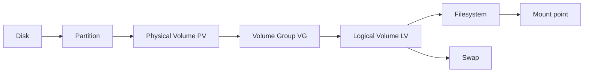

# 10 Storage, Partitions, LVM, and Swap

> By the end of this lesson you can find free space safely, partition a disk, build and extend LVM storage, add swap, and make it all survive a reboot.

!!! example "Try it now (2 minutes)"
    ```bash
    lsblk -o NAME,SIZE,TYPE,FSTYPE,MOUNTPOINTS
    ```
    ```text title="Example output"
    NAME          SIZE TYPE FSTYPE      MOUNTPOINTS
    vda            10G disk
    |-vda1          1M part
    |-vda2        200M part vfat        /boot/efi
    |-vda3          1G part xfs         /boot
    `-vda4        8.8G part xfs         /
    vdb             2G disk
    vdc             2G disk
    ```
    <!-- VERIFY: exact partition layout of the vda system disk on the RHEL 10 lab image -->
    Notice that `vdb` and `vdc` have no partitions, no filesystem and no mount point. That means they are free. By the end of this lesson you will know how to prove that before you touch anything, and what to build on them.

## Why it matters

Storage is one of the most important RHCSA topics. A typical task reads "add a 512 MiB logical volume, put a filesystem on it, mount it at boot, and add some swap". Each piece is easy, but one wrong device name can destroy data, so you must work carefully, verify every step, and understand what persists after a reboot. In real life, admins add disks, carve logical volumes for applications, grow storage when it fills up, and configure swap to keep a system stable.

**Objectives covered:**

- List, create, and delete partitions on GPT disks
- Create and remove physical volumes
- Assign physical volumes to volume groups
- Create and delete logical volumes
- Configure systems to mount file systems at boot by universally unique ID (UUID) or label
- Add new partitions and logical volumes, and swap to a system non-destructively

**Prereqs:** [01 Shell Basics and Command Syntax](01-shell-basics-and-command-syntax.md) and [02 Files, Directories, and Text Editing](02-files-directories-and-text-editing.md) · **Time:** about 8 h

**Tools used:** `lsblk`, `blkid`, `parted`, `fdisk`, `partprobe`, `udevadm`, `pvcreate`, `pvs`, `vgcreate`, `vgextend`, `vgs`, `lvcreate`, `lvextend`, `lvs`, `lvremove`, `vgremove`, `pvremove`, `mkswap`, `swapon`, `swapoff`, `free`, `findmnt`

**Offline help for this topic:** `man lsblk`, `man parted`, `man pvcreate`, `man vgcreate`, `man lvcreate`, `man mkswap`, `man swapon`

!!! note "Supporting skill (not a listed RHEL 10 objective)"
    The official RHEL 10 list names **GPT** disks only. MBR (DOS) partitioning with `fdisk` is kept in this course as a supporting skill, because older systems and some practice material still use it. Learn GPT first.

## How it works

Think of a warehouse. The **disk** is the empty building. A **partition** is a fenced-off section of it. LVM (Logical Volume Manager) lets you pour several sections into one big **pool** and then cut flexible **shelves** out of the pool, which you can make bigger later without moving anything.

- **PV (physical volume):** a disk or partition handed over to LVM. One section of floor.
- **VG (volume group):** a pool made from one or more PVs. The whole warehouse floor.
- **LV (logical volume):** a slice of the pool that looks like a normal block device. A shelf. You put a filesystem or swap on it.
- **Extent:** the unit LVM allocates in. It is 4 MiB by default, so every LV size is rounded up to a multiple of it.



Basic storage stack:

1. disk
2. partition or whole device
3. physical volume (`PV`)
4. volume group (`VG`)
5. logical volume (`LV`)
6. filesystem or swap

### Why LVM matters

LVM makes storage easier to resize and manage than fixed plain partitions alone. A plain partition cannot grow if the next section is taken. An LV can grow by adding another disk to the VG.

### Safe workflow

For storage tasks, slow down. A good sequence is:

1. inspect devices
2. confirm target disk
3. create partition if needed
4. build PV, VG, LV in order
5. create filesystem or swap
6. verify
7. configure persistence where needed

## Commands, step by step

### 1. Inspect, and find free space first (non-destructive)

Before you add anything, prove what is free. These commands only read.

```bash
lsblk -f
sudo blkid
sudo wipefs /dev/vdb
sudo parted /dev/vdb print free
sudo vgs
df -h
```

```text title="Example output"
$ sudo blkid
/dev/vda2: UUID="7B77-95E7" BLOCK_SIZE="512" TYPE="vfat" PARTUUID="..."
/dev/vda3: UUID="1c5c0a4e-0f3b-4f0e-9a58-2f3d6a7a9b11" BLOCK_SIZE="512" TYPE="xfs" PARTUUID="..."
/dev/vda4: UUID="c0a7a3a2-6b1d-4a43-8d1c-5f6d52f6c6a0" BLOCK_SIZE="512" TYPE="xfs" PARTUUID="..."

$ sudo parted /dev/vdb print free
Error: /dev/vdb: unrecognised disk label
Model: Virtio Block Device (virtblk)
Disk /dev/vdb: 2147MB
Sector size (logical/physical): 512B/512B
Partition Table: unknown
Disk Flags:
```
<!-- VERIFY: exact system-disk entries on the RHEL 10 lab image (the UUIDs and the vda layout are illustrative) -->

| Command | What it tells you |
|---|---|
| `lsblk -f` | Tree of disks and partitions with filesystem type, label, UUID and mount point |
| `blkid` | Filesystem type, UUID and label of each formatted device. A blank disk prints nothing |
| `wipefs /dev/vdb` | Lists leftover signatures without erasing anything (only `-a` erases) |
| `parted /dev/vdb print free` | Partition table plus unused gaps on the disk |
| `vgs` | The `VFree` column is free space already inside a VG |
| `df -h` | Space on mounted filesystems |

A disk is safe to use only when it has no partitions, no filesystem and no mount point. If `parted` says "unrecognised disk label", the disk is blank. If it already has partitions, **do not run `mklabel`**: it wipes the table. Add new partitions in the gaps shown by `print free` instead.

### 2. Create a GPT partition with `parted`

`parted` works on both **GPT** (the modern default) and MBR. You pick the table type with `mklabel gpt` or `mklabel msdos`. Unlike `fdisk`, `parted` writes every change **immediately**; there is no `w` to save.

You can run it interactively:

```bash
sudo parted /dev/vdb
```

Common interactive steps:

- `mklabel gpt`
- `mkpart primary 1MiB 1GiB`
- `set 1 lvm on` to flag partition 1 for LVM
- `rm 1` to delete partition 1 when practicing on a disposable lab disk
- `print`
- `quit`

Or do it non-interactively with `--script`, which is faster and exam-friendly:

```bash
sudo parted --script /dev/vdb mklabel gpt
sudo parted --script /dev/vdb mkpart primary 1MiB 1025MiB
sudo parted --script /dev/vdb set 1 lvm on
sudo parted /dev/vdb print
```

After creating partitions, force the kernel to re-read the partition table so the new device node (for example `/dev/vdb1`) appears. Without this, `pvcreate` may fail with "device not found":

```bash
sudo partprobe /dev/vdb
sudo udevadm settle
lsblk
```

`udevadm settle` waits until udev has finished creating the device nodes.

### 3. Create an MBR partition with `fdisk` (supporting skill)

For an MBR (DOS) layout you can use `parted --script /dev/vdb mklabel msdos`, or `fdisk`:

```bash
sudo fdisk /dev/vdb
```

Inside `fdisk`, the key single-letter commands are:

- `o` create a new empty **DOS/MBR** partition table (or `g` for GPT)
- `n` new partition (accept defaults, or give start/size like `+1G`)
- `t` change the partition type code (`8e` = Linux LVM, `82` = Linux swap)
- `p` print the table
- `w` write changes and exit (`q` quits without saving)

`fdisk` writes and re-reads the table on `w`, but run `sudo partprobe` afterward if the new node does not appear. The codes `8e` and `82` are for MBR. On a GPT label, `fdisk`'s `t` command uses different type names (aliases such as `lvm` and `swap`; type `L` lists them).

### 4. Create LVM objects

```bash
sudo pvcreate /dev/vdb1
sudo vgcreate vgdata /dev/vdb1
sudo lvcreate -n lvfiles -L 400M vgdata
sudo pvs
sudo vgs
sudo lvs
```

```text title="Example output"
  PV         VG     Fmt  Attr PSize    PFree
  /dev/vdb1  vgdata lvm2 a--  1020.00m 620.00m

  VG     #PV #LV #SN Attr   VSize    VFree
  vgdata   1   1   0 wz--n- 1020.00m 620.00m

  LV      VG     Attr       LSize   Pool Origin Data%  Meta%  Move Log Cpy%Sync Convert
  lvfiles vgdata -wi-a----- 400.00m
```

The first LVM command on a fresh system may also print `Creating devices file /etc/lvm/devices/system.devices`. That is normal.

The LV appears as `/dev/vgdata/lvfiles`, and also as `/dev/mapper/vgdata-lvfiles` (the form `df` and `mount` show).

To see the extent size, which matters when a task asks for "N extents" or a custom `-s` value:

```bash
sudo vgs -o +vg_extent_size
sudo vgdisplay vgdata
```

`vgcreate -s` sets the extent size when you create the VG, for example `sudo vgcreate -s 8M vgdata /dev/vdb1` for 8 MiB extents. You cannot pick it later without recreating the VG, so only do this when a task asks for it.

Sizing logical volumes: exam tasks phrase size in three ways.

```bash
sudo lvcreate -n lvfiles -L 400M vgdata       # absolute size (M is MiB in LVM)
sudo lvcreate -n lvfiles -l 50 vgdata         # 50 extents (-l, lowercase)
sudo lvcreate -n lvfiles -l 100%FREE vgdata   # all remaining free space in the VG
```

- `-L` (capital) takes a size like `500M` or `2G`. LVM treats these as binary units (MiB and GiB).
- `-l` (lowercase) takes a number of **extents**, or a percentage such as `100%FREE`. A task that says "use all remaining space" means `-l 100%FREE`; one that says "use 50 extents" means `-l 50`.

### 5. Extend a volume group and a logical volume

Two separate jobs, and the exam often asks for both: **add space to the VG**, then **grow the LV and its filesystem**.


```bash
# 1. Is there already free space in the VG? Look at VFree.
sudo vgs vgdata

# 2. If not, make a new PV and add it to the VG
sudo parted --script /dev/vdc mklabel gpt mkpart primary 1MiB 1025MiB set 1 lvm on
sudo partprobe /dev/vdc; sudo udevadm settle
sudo pvcreate /dev/vdc1
sudo vgextend vgdata /dev/vdc1

# 3. Grow the LV and its filesystem in one step
sudo lvextend -r -L 1200M /dev/vgdata/lvfiles
```

`-r` (`--resizefs`) resizes the filesystem right after the LV. Without `-r`, grow the filesystem yourself:

| Filesystem | Command | Notes |
|---|---|---|
| XFS | `sudo xfs_growfs /data/files` | Takes the **mount point**. XFS can grow but never shrink |
| ext4 | `sudo resize2fs /dev/vgdata/lvfiles` | Takes the device. Works while mounted when growing |

`-L 1200M` means "make it 1200M in total". `-L +500M` means "add 500M". `-l +100%FREE` grows into all remaining space.

### 6. Make a filesystem, then mount it by UUID or label

An LV is still empty until you format it.

```bash
sudo mkfs.xfs -L files /dev/vgdata/lvfiles
sudo mkdir -p /data/files
sudo blkid /dev/vgdata/lvfiles
```

```text title="Example output"
/dev/vgdata/lvfiles: LABEL="files" UUID="3f1e9a64-7c1d-4c58-b0a2-9f4a5d1b6e21" BLOCK_SIZE="512" TYPE="xfs"
```

The UUID is illustrative; the field order (`LABEL`, `UUID`, `BLOCK_SIZE`, `TYPE`) is what `blkid` prints.

Device names such as `/dev/vdb` can change between boots. A UUID or label does not, so use one of them in `/etc/fstab`:

```text
UUID=3f1e9a64-7c1d-4c58-b0a2-9f4a5d1b6e21  /data/files  xfs  defaults  0 0
LABEL=files                                /data/files  xfs  defaults  0 0
```

The six fields, left to right:

| Field | Meaning |
|---|---|
| 1 | What to mount: `UUID=...`, `LABEL=...` or a device path |
| 2 | Where: the mount point (must exist) |
| 3 | Filesystem type (`xfs`, `ext4`, `swap`) |
| 4 | Options (`defaults` is normal) |
| 5 | `dump` flag, almost always `0` |
| 6 | `fsck` order: `0` for XFS, `2` for other data filesystems, `1` only for `/` |

To set or change a label on an existing filesystem:

```bash
sudo xfs_admin -L files /dev/vgdata/lvfiles   # XFS (unmount first)
sudo e2label /dev/vgdata/lvfiles files        # ext2/3/4
```

XFS labels are limited to 12 characters. **Validate before you reboot**, because a bad fstab line can drop the machine into emergency mode:

```bash
sudo systemctl daemon-reload
sudo mount -a
findmnt --verify
findmnt /data/files
df -h /data/files
```

```text title="Example output"
Success, no errors or warnings detected
TARGET      SOURCE                     FSTYPE OPTIONS
/data/files /dev/mapper/vgdata-lvfiles xfs    rw,relatime,inode64,logbufs=8,logbsize=32k,noquota
Filesystem                  Size  Used Avail Use% Mounted on
/dev/mapper/vgdata-lvfiles  336M   27M  310M   8% /data/files
```

A fresh 400M XFS shows about 336M in `df -h`, because XFS reserves space for its log and metadata. A clean `findmnt --verify` prints `Success, no errors or warnings detected`.

`daemon-reload` makes systemd re-read `/etc/fstab` (systemd generates the mount units from it). `mount -a` mounts everything in fstab that is not mounted yet. If it prints an error, fix the line now. Lesson 11 covers filesystems and mounts in more depth.

### 7. Create swap (partition, LV, then persist)

Swap is disk space the kernel uses when RAM runs short. It needs a **swap signature** (`mkswap`) and must be **activated** (`swapon`).

**Swap partition on `/dev/vdb2`:**

```bash
sudo parted --script /dev/vdb mkpart swap linux-swap 1025MiB 1537MiB
sudo partprobe /dev/vdb; sudo udevadm settle
sudo mkswap /dev/vdb2
sudo swapon /dev/vdb2
swapon --show
free -h
```

```text title="Example output"
NAME      TYPE      SIZE USED PRIO
/dev/vdb2 partition 512M   0B   -1
```

With `fdisk` on MBR, set the type with `t` and `82`. On GPT use `fdisk`'s `t` with the `swap` alias. (`gdisk` was not available in the AlmaLinux 10 repositories this course was checked against, so rely on `parted` or `fdisk`.) The type code is only a hint; `mkswap` is what makes it swap.

**Swap on an LV** works the same way, which makes it easy to resize later:

```bash
sudo lvcreate -n lvswap -L 512M vgdata
sudo mkswap /dev/vgdata/lvswap
sudo swapon /dev/vgdata/lvswap
```

**Make swap persistent** with its UUID in `/etc/fstab`:

```bash
sudo blkid /dev/vdb2
```

```text
UUID=<uuid-from-blkid>  none  swap  defaults  0 0
```

Test it without rebooting: `sudo systemctl daemon-reload && sudo swapoff -a && sudo swapon -a && swapon --show`.

**Remove swap safely:**

```bash
sudo swapoff /dev/vdb2
# delete the swap line from /etc/fstab, then
sudo systemctl daemon-reload
```

If you leave the fstab line behind, the device is still requested at every boot.

### 8. Remove LVM objects safely

Delete in reverse order, and unmount and remove the fstab line first:

```bash
sudo umount /data/files
sudo lvremove /dev/vgdata/lvfiles
sudo vgremove vgdata
sudo pvremove /dev/vdb1
```

## Worked examples

### Worked example 1: Inspect disks safely

```bash
lsblk
blkid
```

Verification: identify which device is new and unused before making changes.

### Worked example 2: Build a small LVM stack

```bash
sudo pvcreate /dev/vdb1
sudo vgcreate vgexam /dev/vdb1
sudo lvcreate -n lvexam -L 256M vgexam
sudo lvs
```

Verification: `lvs` should show the new logical volume.

### Worked example 3: Create and activate swap

```bash
sudo mkswap /dev/vdb2
sudo swapon /dev/vdb2
swapon --show
free -h
```

Verification: swap should appear in `swapon --show`.

### Worked example 4: Remove a throwaway LVM lab stack

```bash
sudo lvremove /dev/vgexam/lvexam
sudo vgremove vgexam
sudo pvremove /dev/vdb1
```

Verification: `lvs`, `vgs`, and `pvs` should no longer show the removed lab objects.

## Common mistakes

- **Mistake:** Editing the wrong disk. **Recovery:** inspect with `lsblk` before every destructive step, and note the target disk name.
- **Mistake:** Forgetting to inspect the current layout before changes. **Recovery:** run `lsblk -f` and `parted <disk> print free` first.
- **Mistake:** Creating a filesystem or swap on the wrong device, for example on the whole disk instead of the intended partition or LV. **Recovery:** stop and verify device names before proceeding further.
- **Mistake:** Removing the VG before the LV. **Recovery:** delete in reverse dependency order: LV, then VG, then PV.
- **Mistake:** Making storage changes but forgetting the persistent mount or swap configuration. **Recovery:** add the fstab line, run `mount -a` or `swapon -a`, and verify after a reboot.
- **Mistake:** Not verifying active swap. **Recovery:** check with `swapon --show`.
- **Mistake:** Extending the LV but not the filesystem. **Recovery:** `sudo xfs_growfs <mountpoint>` or `sudo resize2fs <device>`, or use `lvextend -r` next time.

### Troubleshooting

| Problem | Cause | Fix |
|---|---|---|
| `Device or resource busy` | The device is mounted, active as swap, or in use by LVM | Unmount, switch off swap, or deactivate the LV (`umount`, `swapoff`, `lvchange -an`) before removing it |
| `pvcreate` fails | Wrong device, partition table not re-read, or device already in use | Check `lsblk` and `blkid`, run `partprobe` and `udevadm settle` |
| Swap works now but not after reboot | No persistent entry configured | Add the `UUID=... none swap defaults 0 0` line to `/etc/fstab` and verify after reboot |
| Wrong size calculations | MB and MiB confusion or a typing error | Inspect the real result with `lsblk` and `lvs` (LVM `M` means MiB) |
| `vgextend` says the PV is not found | `pvcreate` was skipped or the partition node is missing | Run `pvcreate` on the new partition first; check `lsblk` |

## Hands-on lab

**Setup:** shared lab environment, `servera`, user `student`, spare disks `/dev/vdb` and `/dev/vdc` (2 GiB each, empty). If the disks were used before, reset them first (below; the reset also cleans `/etc/fstab`). Never practice on a disk that contains important data.

??? warning "Disk reset"
    Destroys everything on the disk. Run the block once for `/dev/vdb`, then run it again with `vdb` replaced by `vdc`. It also removes the `/etc/fstab` lines this course's drills create, so a half-finished drill cannot send the next reboot into emergency mode. This lesson mounts at `/data/files`, so that path is added to the list.
    ```bash
    sudo umount /data/files /data /par1 /record /datasource /mnt/lvapp 2>/dev/null; sudo swapoff -a
    sudo vgremove -ff -y vgdata vgexam vgapp vgfs datacontainer 2>/dev/null
    sudo wipefs -a /dev/vdb[0-9]* 2>/dev/null; sudo wipefs -a /dev/vdb; sudo partprobe /dev/vdb; sudo udevadm settle
    sudo sed -i -E '\#[[:space:]]/(data|data/files|par1|record|datasource|mnt/lvapp)[[:space:]]#d; /\/dev\/vdb|vg(data|app|fs)-/d' /etc/fstab
    for s in $(awk '$1~/^(UUID|LABEL)=/{print $1}' /etc/fstab); do sudo blkid -t "$s" >/dev/null || sudo sed -i "\#^$s[[:space:]]#d" /etc/fstab; done
    sudo systemctl daemon-reload; sudo swapon -a
    ```

**Task:**

- [ ] Identify the two spare disks with `lsblk` and prove they are blank (`blkid`, `wipefs`).
- [ ] On `/dev/vdb`, create a GPT label, partition 1 (1 GiB, `lvm` flag) and partition 2 (512 MiB, swap).
- [ ] Re-read the table and confirm `/dev/vdb1` and `/dev/vdb2` appear in `lsblk`.
- [ ] Create a PV on `/dev/vdb1`, a VG named `vgdata`, and a 400 MiB LV named `lvfiles`.
- [ ] Put an XFS filesystem with label `files` on it, and mount it at `/data/files` through `/etc/fstab` by UUID.
- [ ] Create swap on `/dev/vdb2`, activate it, and make it persistent by UUID.
- [ ] Grow `lvfiles` to 1200 MiB with its filesystem. The VG has only about 620 MiB free, so first add a 1 GiB LVM partition on `/dev/vdc` to `vgdata`.
- [ ] Validate with `mount -a`, `findmnt --verify`, then reboot and check everything is still in place.

??? question "Hint 1"
    You cannot create a 1200 MiB LV from a pool with 1020 MiB in total. Check `VFree` in `vgs` and decide what the pool needs before the LV can grow.

??? question "Hint 2"
    Order for the growth: `pvcreate` on the new partition, then `vgextend`, then `lvextend` with the resize-filesystem option. For fstab you need the UUIDs from `blkid`.

??? success "Solution"
    ```bash
    lsblk
    sudo blkid /dev/vdb /dev/vdc          # no output: blank disks
    sudo parted --script /dev/vdb mklabel gpt
    sudo parted --script /dev/vdb mkpart primary 1MiB 1025MiB
    sudo parted --script /dev/vdb set 1 lvm on
    sudo parted --script /dev/vdb mkpart swap linux-swap 1025MiB 1537MiB
    sudo partprobe /dev/vdb
    sudo udevadm settle
    lsblk /dev/vdb

    sudo pvcreate /dev/vdb1
    sudo vgcreate vgdata /dev/vdb1
    sudo lvcreate -n lvfiles -L 400M vgdata
    sudo mkfs.xfs -L files /dev/vgdata/lvfiles
    sudo mkdir -p /data/files
    sudo mkswap /dev/vdb2
    sudo blkid /dev/vgdata/lvfiles /dev/vdb2    # copy both UUIDs
    ```
    Edit `/etc/fstab` (use `sudo vi /etc/fstab`) and add, with the real UUIDs from `blkid`:
    ```text
    UUID=<uuid-of-lvfiles>  /data/files  xfs   defaults  0 0
    UUID=<uuid-of-vdb2>     none         swap  defaults  0 0
    ```
    ```bash
    sudo systemctl daemon-reload
    sudo mount -a
    sudo swapon -a

    # extend: add vdc, grow the VG, then grow the LV and the filesystem
    sudo parted --script /dev/vdc mklabel gpt mkpart primary 1MiB 1025MiB set 1 lvm on
    sudo partprobe /dev/vdc; sudo udevadm settle
    sudo pvcreate /dev/vdc1
    sudo vgextend vgdata /dev/vdc1
    sudo lvextend -r -L 1200M /dev/vgdata/lvfiles

    findmnt --verify
    ```
    **Verify:** `lsblk -f` shows `xfs` on the LV mounted at `/data/files` and `swap` on `vdb2`. `sudo vgs` lists `#PV` 2. `sudo lvs` shows `lvfiles` at 1.17g (1200 MiB). `df -h /data/files` shows roughly 1.2G. `swapon --show` lists `/dev/vdb2`. Reboot and repeat the checks.

## More practice

1. List current block devices and explain what each major device is used for.
2. Create a new GPT partition on a spare disk.
3. Turn one spare partition into a PV.
4. Add that PV to a new or existing VG.
5. Create a 200M LV.
6. Activate a swap device and verify it.
7. Remove an LV, then remove the VG and PV in the correct order in a throwaway lab setup.

### Exam-style task 1

On an unused disk, create a GPT partition for LVM, create a volume group named `vgexam`, and create a logical volume named `lvexam` of the size requested by your lab scenario.

**Grader mindset checklist:**

- [ ] correct disk and partition must exist
- [ ] PV, VG, and LV must exist
- [ ] names and sizes must match the task

??? success "Solution"
    ```bash
    lsblk
    sudo parted --script /dev/vdb mklabel gpt
    sudo parted --script /dev/vdb mkpart primary 1MiB 1025MiB
    sudo parted --script /dev/vdb set 1 lvm on
    sudo partprobe /dev/vdb
    sudo udevadm settle
    sudo pvcreate /dev/vdb1
    sudo vgcreate vgexam /dev/vdb1
    sudo lvcreate -n lvexam -L 512M vgexam
    sudo lvs
    ```

### Exam-style task 2

Add a new swap area on an unused partition, activate it, and make it persistent through `/etc/fstab`.

**Grader mindset checklist:**

- [ ] swap signature must exist
- [ ] swap must be active now
- [ ] UUID should be identifiable for persistent configuration
- [ ] must still work after reboot once persistence is configured

??? success "Solution"
    ```bash
    sudo mkswap /dev/vdb2
    sudo swapon /dev/vdb2
    swapon --show
    sudo blkid /dev/vdb2
    ```
    Add `UUID=<uuid-from-blkid>  none  swap  defaults  0 0` to `/etc/fstab`, then check with `sudo systemctl daemon-reload && sudo swapoff -a && sudo swapon -a && swapon --show`.

## Exam tips

!!! tip "What the exam expects"
    The exact device, partition, VG, LV and swap names and sizes from the task exist and are active now, and the mounts and swap are still correct after a reboot. Slow down, check the target disk name twice, and verify each layer with its own command: `pvs`, `vgs`, `lvs`.

!!! warning "Must survive reboot"
    | Change | Persistent? | Make it persist with |
    |---|---|---|
    | Partition table (`parted`, `fdisk`) | Yes | Nothing, it is on disk |
    | PV, VG, LV | Yes | Nothing, the metadata is on disk |
    | `mount /dev/vgdata/lvfiles /data/files` | No | an fstab line (UUID or label), then `mount -a` |
    | `swapon /dev/vdb2` | No | an fstab line, then `swapon -a` |
    | `mkswap` signature | Yes | Nothing, but swap is still not active at boot without fstab |

**Verify like a grader:**

1. Check device names carefully before creation or deletion.
2. Check each layer with the matching command: `lsblk -f`, `pvs`, `vgs`, `lvs`.
3. Check swap with both `swapon --show` and `free -h`.
4. Run `sudo mount -a` and `findmnt --verify` with no errors.
5. Reboot, then run `lsblk -f`, `df -h`, `swapon --show` again.
6. When removing lab storage, verify each layer is gone in reverse order.

## Quiz

1. What is the order from PV to VG to LV?
2. What command shows logical volumes?
3. What command activates a swap device now?
4. What command shows current swap usage?
5. Why is `lsblk` important before storage changes?
6. Why are storage tasks especially dangerous if rushed?
7. In what order should you remove LV, VG, and PV objects?
8. Which command re-reads the partition table so a new partition node appears?
9. How do you create a logical volume that uses all remaining free space in a volume group?
10. Which tool creates an MBR partition, and what type code marks a partition as Linux LVM?
11. What two commands add a new partition to an existing VG, in order?
12. How do you grow an LV and its XFS filesystem in one command?

??? success "Answers"
    1. Physical volume, then volume group, then logical volume.
    2. `lvs`
    3. `swapon`
    4. `free -h` or `swapon --show`
    5. It shows actual device layout so you do not edit the wrong disk.
    6. Because the wrong command can destroy data.
    7. Remove the LV first, then the VG, then the PV.
    8. `partprobe` (run `sudo partprobe /dev/vdb`).
    9. `sudo lvcreate -n NAME -l 100%FREE VGNAME`.
    10. `fdisk` creates MBR partitions; type code `8e` marks Linux LVM (`82` marks swap).
    11. `pvcreate /dev/vdc1`, then `vgextend VGNAME /dev/vdc1`.
    12. `sudo lvextend -r -L <size> /dev/VG/LV` (XFS is grown with `xfs_growfs` behind the scenes).

## Summary

- inspect first with `lsblk`, and prove space is free before you add anything
- partitions live on disks (`parted` for GPT, `fdisk` for MBR); run `partprobe` afterward so the node appears
- LVM stack is PV then VG then LV; `vgextend` adds space to the pool, `lvextend -r` grows the LV and its filesystem
- `-L` is a size, `-l` is extents or `100%FREE`
- swap uses `mkswap` and `swapon`
- verify every layer separately
- persistence depends on correct `/etc/fstab` entries, tested with `mount -a`

| Task | Command |
|---|---|
| Show devices | `lsblk -f`, `blkid` |
| GPT partition | `parted --script /dev/vdb mklabel gpt mkpart primary 1MiB 1025MiB set 1 lvm on` |
| Re-read table | `partprobe /dev/vdb; udevadm settle` |
| PV / VG / LV | `pvcreate /dev/vdb1`, `vgcreate vgdata /dev/vdb1`, `lvcreate -n lvdata -L 500M vgdata` |
| LV from all free space | `lvcreate -n lvall -l 100%FREE vgdata` |
| Extend VG | `pvcreate /dev/vdc1; vgextend vgdata /dev/vdc1` |
| Extend LV + filesystem | `lvextend -r -L +500M /dev/vgdata/lvdata` |
| Show LVM | `pvs`, `vgs`, `lvs`, `vgs -o +vg_extent_size` |
| Make swap | `mkswap /dev/vdb2; swapon /dev/vdb2` |
| Stop swap | `swapoff /dev/vdb2` (and remove its fstab line) |
| Check fstab | `mount -a`, `findmnt --verify` |
| MBR partition (supporting) | `fdisk /dev/vdb` |

**Previous:** [09 Boot Targets, Processes, Logs, and Tuning](09-boot-targets-processes-logs-and-tuning.md) · **Next:** [11 Filesystems, Mounts, NFS, and Autofs](11-filesystems-mounts-nfs-and-autofs.md): now that storage exists, you learn the filesystem types and mount options it relies on, plus network mounts.
