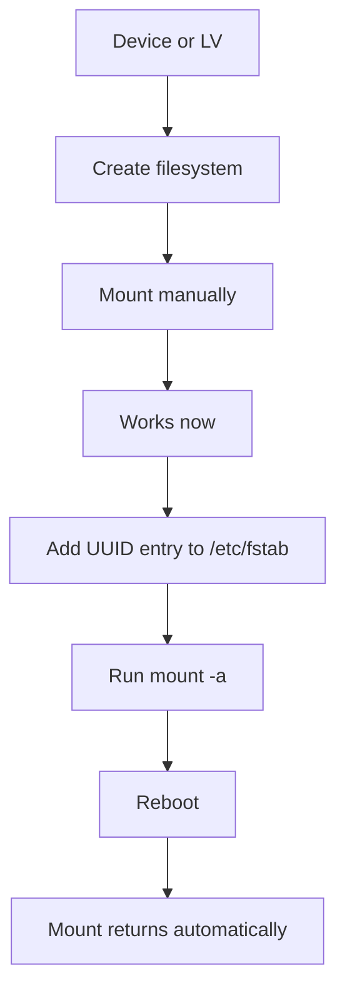
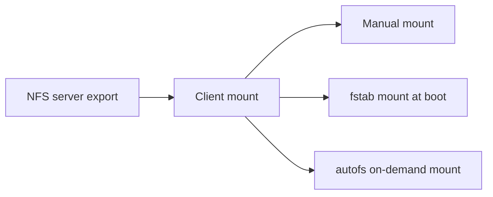
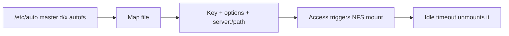

# 11 Filesystems, Mounts, NFS, and Autofs

> By the end of this lesson you can put a filesystem on a device, mount it now and at every boot, grow it, mount an NFS share from another server, and make that share appear on demand with autofs.

!!! example "Try it now (2 minutes)"
    ```bash
    findmnt -t xfs,ext4,vfat
    ```
    ```text title="Example output"
    TARGET     SOURCE                FSTYPE OPTIONS
    /          /dev/vda4             xfs    rw,relatime,seclabel,attr2,inode64,logbufs=8,logbsize=32k,noquota
    /boot      /dev/vda3             xfs    rw,relatime,seclabel,attr2,inode64,logbufs=8,logbsize=32k,noquota
    /boot/efi  /dev/vda2             vfat   rw,relatime,fmask=0077,dmask=0077,codepage=437,iocharset=ascii,shortname=winnt,errors=remount-ro
    ```
    <!-- VERIFY: exact devices and mount options on the RHEL 10 lab image -->
    Each line is one **filesystem** attached to one **directory**. Notice that `/dev/vdb` and `/dev/vdc` are missing: they hold nothing yet. By the end of this lesson you will have put filesystems on them, mounted them, and made the mounts survive a reboot.

## Why it matters

A partition or logical volume is useless until it has a filesystem and a mount point. Exam tasks say things like "create an ext4 filesystem on this volume, mount it at `/data` at boot by UUID, then mount the NFS share from `serverb` on demand". In real life admins attach application volumes, grow them when they fill up, and use NFS and autofs so users see shared data without every server mounting everything all day.

**Objectives covered:**

- Create, mount, unmount, and use VFAT, ext4, and XFS file systems
- Configure systems to mount file systems at boot by universally unique ID (UUID) or label
- Mount and unmount network file systems using NFS
- Configure autofs
- Extend existing logical volumes
- Diagnose and correct file permission problems

**Prereqs:** [10 Storage, Partitions, LVM, and Swap](10-storage-partitions-lvm-and-swap.md) (fstab fields, LVM) and [06 Links, Permissions, and Default Permissions](06-links-permissions-and-default-permissions.md) (permission diagnosis) · **Time:** about 8 h

**Tools used:** `mkfs.xfs`, `mkfs.ext4`, `mkfs.vfat`, `mount`, `umount`, `findmnt`, `blkid`, `lsblk`, `lvextend`, `xfs_growfs`, `resize2fs`, `showmount`, `systemctl`, `namei`, `fuser`

**Offline help for this topic:** `man mount`, `man umount`, `man fstab`, `man mkfs.xfs`, `man mkfs.ext4`, `man nfs`, `man 5 autofs`, `man 5 auto.master`

!!! note "Supporting skill (not a listed RHEL 10 objective)"
    Setting up an NFS **server** (`/etc/exports`, `exportfs`) is not an RHCSA objective (the objectives name the NFS **client** side). Expect a server that already exports a directory, and be ready to mount it as the client. This lesson shows the few server commands only in the lab **Setup**, so you have something to mount. Do not spend study time on server tuning.

## How it works

A **filesystem** is the structure (inodes, directories, free-space maps) written onto a device so files can live there. A **mount** attaches that filesystem to a **mount point**, which is just an existing, empty directory. Think of a filing cabinet: `mkfs` builds the drawers, `mount` wheels the cabinet up to a spot in the office, and `/etc/fstab` is the note that says "put it back there every morning".

Manual mount: works now, disappears after reboot. Persistent mount: defined in `/etc/fstab`, returns after reboot if the line is correct.



Three filesystem types matter here:

| Type | Create with | Typical use | Notes |
|---|---|---|---|
| XFS | `mkfs.xfs` | RHEL default for everything | Can grow, never shrink. Label max 12 characters |
| ext4 | `mkfs.ext4` | General purpose | Can grow online, shrink only offline |
| VFAT | `mkfs.vfat` | USB sticks, the EFI partition | No Unix owners or permissions. Label max 11 characters |

For a network filesystem the "device" is a path on another machine. **NFS** (Network File System) makes a directory on a server appear at a local path. **autofs** mounts it only while someone is using it.



### Safe `/etc/fstab` rule

systemd turns `/etc/fstab` lines into mount units. After editing it on a running system, reload and test **before** rebooting:

```bash
sudo systemctl daemon-reload
sudo mount -a
```

`daemon-reload` makes systemd re-read `/etc/fstab`; `mount -a` mounts everything not yet mounted. If `mount -a` prints an error, fix it now: a bad `/etc/fstab` entry can stop the next boot. The six fstab fields are explained in lesson 10 ([fstab fields](10-storage-partitions-lvm-and-swap.md#6-make-a-filesystem-then-mount-it-by-uuid-or-label)); this lesson uses them.

## Commands, step by step

### 1. Create a filesystem

Always confirm the target first. `mkfs` destroys whatever was there.

```bash
lsblk -f /dev/vdb
sudo mkfs.xfs -L xfsdata /dev/vdb1
sudo mkfs.ext4 -L extdata /dev/vdb2
sudo mkfs.vfat -n FATDATA /dev/vdb3
```

```text title="Example output"
meta-data=/dev/vdb1              isize=512    agcount=4, agsize=32768 blks
         =                       sectsz=512   attr=2, projid32bit=1
data     =                       bsize=4096   blocks=131072, imaxpct=25
naming   =version 2              bsize=4096   ascii-ci=0, ftype=1
log      =internal log           bsize=4096   blocks=16384, version=2
realtime =none                   extsz=4096   blocks=0, rtextents=0
```
<!-- VERIFY: mkfs.xfs figures depend on partition size; mkfs.vfat is in the dosfstools package, confirm it is installed by default on RHEL 10 -->

| Option | Meaning |
|---|---|
| `mkfs.xfs -L NAME` | Set a label while formatting (max 12 characters) |
| `mkfs.ext4 -L NAME` | Set a label (max 16 characters) |
| `mkfs.vfat -n NAME` | Set a label (max 11 characters, usually upper case) |
| `-f` | Force `mkfs.xfs` to overwrite an existing filesystem. Only if you are sure |

Existing filesystems can be relabelled later with `xfs_admin -L` (XFS, unmounted) or `e2label` (ext4). Read UUID and label back with `blkid` and `lsblk -f`:

```bash
sudo blkid /dev/vdb1 /dev/vdb2 /dev/vdb3
```
```text title="Example output"
/dev/vdb1: LABEL="xfsdata" UUID="9d3b6a1e-52c4-4f0e-8a1b-0c7d5e4f3a21" TYPE="xfs" PARTLABEL="xfsdata" PARTUUID="..."
/dev/vdb2: LABEL="extdata" UUID="4a7e2c90-1b3d-4e6f-9c58-7d2a1f0b8e34" TYPE="ext4" PARTLABEL="extdata" PARTUUID="..."
/dev/vdb3: LABEL="FATDATA" UUID="3C2A-9F1B" TYPE="vfat" PARTLABEL="fatdata" PARTUUID="..."
```
<!-- VERIFY: blkid field order on RHEL 10; all UUIDs above are illustrative -->

Note the VFAT "UUID" is a short serial like `3C2A-9F1B`. XFS and ext4 UUIDs are 36 characters. A short ID such as `1234-abcd` is only valid for a VFAT filesystem, so **never copy an example UUID**: look the real one up with `blkid`.

### 2. Mount and unmount

```bash
sudo mkdir -p /mnt/xfsdata
sudo mount /dev/vdb1 /mnt/xfsdata
findmnt /mnt/xfsdata
df -h /mnt/xfsdata
sudo umount /mnt/xfsdata
```
```text title="Example output"
TARGET        SOURCE    FSTYPE OPTIONS
/mnt/xfsdata  /dev/vdb1 xfs    rw,relatime,seclabel,attr2,inode64,logbufs=8,logbsize=32k,noquota

Filesystem      Size  Used Avail Use% Mounted on
/dev/vdb1       460M   28M  433M   6% /mnt/xfsdata
```
<!-- VERIFY: sizes are approximate for a 512 MiB XFS -->

| Command or option | Meaning |
|---|---|
| `mount DEVICE DIR` | Attach the filesystem; the type is detected automatically |
| `mount -t TYPE` | Force the type (needed for NFS: `-t nfs`) |
| `mount -o OPTIONS` | Comma-separated options such as `ro`, `noexec`, `uid=1000` |
| `umount DIR` | Detach. Use the directory (or the device), never both |
| `findmnt DIR` | Show what is mounted at `DIR`, with type and options |

Useful mount options (also valid in the fstab options field):

| Option | Effect |
|---|---|
| `defaults` | `rw,suid,dev,exec,auto,nouser,async`: a sensible normal set |
| `ro` / `rw` | Read-only / read-write |
| `noexec` | Programs on this filesystem cannot be run |
| `nosuid` | Ignore set-UID/set-GID bits |
| `nofail` | A failed mount does not stop the boot (useful for removable or network disks) |
| `_netdev` | Marks a device that needs the network. systemd already treats `nfs` as a network filesystem, so it is not required for NFS; it is harmless and matters for things like iSCSI. |

If `umount` says `target is busy`, something is using it, often your own shell sitting inside the directory:

```bash
cd /
sudo fuser -vm /mnt/xfsdata      # who is using it
sudo umount /mnt/xfsdata
```

### 3. Make mounts persistent by UUID or label

Device names like `/dev/vdb1` can change between boots; UUIDs and labels do not. Build each fstab line from a real `blkid` lookup so you never paste a made-up value:

```bash
echo "UUID=$(sudo blkid -s UUID -o value /dev/vdb1)  /mnt/xfsdata  xfs   defaults  0 0" | sudo tee -a /etc/fstab
echo "LABEL=extdata  /mnt/extdata  ext4  defaults  0 0" | sudo tee -a /etc/fstab
sudo mkdir -p /mnt/xfsdata /mnt/extdata
tail -n 2 /etc/fstab
```
```text title="Example output"
UUID=9d3b6a1e-52c4-4f0e-8a1b-0c7d5e4f3a21  /mnt/xfsdata  xfs   defaults  0 0
LABEL=extdata  /mnt/extdata  ext4  defaults  0 0
```

`blkid -s UUID -o value DEVICE` prints only the UUID, which is why it is safe inside `$( )`. You can type the lines in `vi` instead; the point is that the value comes from `blkid`, not from a book. Then test (the safe rule above):

```bash
sudo systemctl daemon-reload
sudo mount -a
findmnt --verify
findmnt /mnt/xfsdata
```
```text title="Example output"
   Success, no errors or warnings detected
```
<!-- VERIFY: exact findmnt --verify wording on RHEL 10 -->

`findmnt --verify` checks the syntax and targets of every fstab line without mounting.

### 4. Extend an existing logical volume

Growing storage is two steps: enlarge the LV (block layer), then grow the filesystem on top. If the VG has no free space, add a PV first (`pvcreate`, `vgextend`; covered in [lesson 10](10-storage-partitions-lvm-and-swap.md#5-extend-a-volume-group-and-a-logical-volume)).

```bash
sudo vgs vgfs                                  # check VFree first
sudo lvextend -r -L +200M /dev/vgfs/lvapp      # grow LV and filesystem together
df -h /mnt/lvapp
```
```text title="Example output"
  Size of logical volume vgfs/lvapp changed from 400.00 MiB (100 extents) to 600.00 MiB (150 extents).
  Logical volume vgfs/lvapp successfully resized.
meta-data=/dev/mapper/vgfs-lvapp isize=512    agcount=4, agsize=25600 blks
...
data blocks changed from 102400 to 153600
Filesystem               Size  Used Avail Use% Mounted on
/dev/mapper/vgfs-lvapp   560M   26M  535M   5% /mnt/lvapp
```
<!-- VERIFY: exact lvextend -r output wording on RHEL 10 -->

Without `-r` you grow the filesystem yourself, and the tool depends on the type:

| Filesystem | Command | Takes |
|---|---|---|
| XFS | `sudo xfs_growfs /mnt/lvapp` | the **mount point** |
| ext4 | `sudo resize2fs /dev/vgfs/lvapp` | the **device** |

Remember `-L 600M` means "make it 600M in total" while `-L +200M` means "add 200M". XFS can only grow; `resize2fs` can also shrink, but only offline after a filesystem check, so do not shrink on an exam.

### 5. Mount an NFS share (client side)

The client package is `nfs-utils`. Look at what a server offers, then mount it:

```bash
sudo dnf install -y nfs-utils
showmount -e serverb.lab.example
sudo mkdir -p /mnt/nfsdata
sudo mount -t nfs serverb.lab.example:/export/data /mnt/nfsdata
findmnt /mnt/nfsdata
ls /mnt/nfsdata
```
```text title="Example output"
Export list for serverb.lab.example:
/export/team 192.168.122.0/24
/export/data 192.168.122.0/24

TARGET        SOURCE                            FSTYPE OPTIONS
/mnt/nfsdata  serverb.lab.example:/export/data  nfs4   rw,relatime,vers=4.2,rsize=262144,wsize=262144,namlen=255,hard,proto=tcp,timeo=600,retrans=2,sec=sys,clientaddr=192.168.122.10,local_lock=none,addr=192.168.122.11

hello.txt
```
<!-- VERIFY: showmount depends on rpcbind/mountd (NFSv3 path) being reachable on the server; the nfs4 option string is approximate -->

If `showmount` fails but you know the export path, skip it: the NFSv4 mount above only needs port 2049 and the exact path. An NFSv4 mount can be forced with `-o vers=4.2`.

To make it persistent, add an fstab line. NFS fields 5 and 6 are `0 0` (nothing to dump or fsck):

```text
serverb.lab.example:/export/data  /mnt/nfsdata  nfs  defaults  0 0
```

Then `sudo systemctl daemon-reload && sudo mount -a`. Add `nofail` if you do not want an unreachable server to hold up the boot. To unmount, `sudo umount /mnt/nfsdata`.

### 6. Autofs: mount on demand

A mount sitting there all day for a share nobody uses wastes a network connection. **autofs** watches a directory and mounts the share only when something accesses it, then unmounts it after an idle timeout. Two kinds of file work together: the **master map** says which directory autofs watches and which map file to use; the **map file** says what to mount for each name inside.



Install autofs first (the `/etc/auto.master.d/` directory comes with it), then write the master drop-in (a file ending in `.autofs`) and the map file, and only then enable and restart the service. `enable --now` on its own does not make an already-running autofs re-read changed maps, so use `enable` and `restart`.

```bash
sudo dnf install -y autofs
```

**Indirect map** (most common): autofs owns a base directory and creates a subdirectory per key.

`/etc/auto.master.d/nfsdata.autofs`:

```text
/mnt/auto   /etc/auto.nfsdata
```

`/etc/auto.nfsdata` (key, options, `server:/path`):

```text
data   -rw   serverb.lab.example:/export/data
```

```bash
sudo systemctl enable autofs
sudo systemctl restart autofs
ls /mnt/auto
ls /mnt/auto/data
findmnt /mnt/auto/data
```
```text title="Example output"
$ ls /mnt/auto
$ ls /mnt/auto/data
hello.txt
$ findmnt /mnt/auto/data
TARGET          SOURCE                            FSTYPE OPTIONS
/mnt/auto/data  serverb.lab.example:/export/data  nfs4   rw,relatime,vers=4.2,...
```

The first `ls /mnt/auto` prints **nothing**: `data` does not exist until you access it by its full path. This surprises everyone once.

**Wildcard map**: one line serves every subdirectory. `*` matches any key and `&` repeats it, so `/mnt/team/a` mounts `serverb:/export/team/a` and `/mnt/team/b` mounts `.../b` with no extra lines. This is how home directories are usually automounted.

`/etc/auto.master.d/team.autofs`:

```text
/mnt/team   /etc/auto.team
```

`/etc/auto.team`:

```text
*   -rw   serverb.lab.example:/export/team/&
```

**Direct map**: the key is a full absolute path, and the master entry uses the special directory `/-`.

`/etc/auto.master.d/direct.autofs`:

```text
/-   /etc/auto.direct
```

`/etc/auto.direct`:

```text
/mnt/direct/shared   -rw   serverb.lab.example:/export/data
```

| Map type | Master entry | Map line | Use when |
|---|---|---|---|
| Indirect | `/mnt/auto /etc/auto.nfsdata` | `data -rw server:/export/data` | Several shares under one base directory |
| Wildcard | `/mnt/team /etc/auto.team` | `* -rw server:/export/team/&` | One share per user or name |
| Direct | `/- /etc/auto.direct` | `/mnt/direct/shared -rw server:/export/data` | The mount point is an exact path outside any autofs-owned directory |

After changing a master file, restart: `sudo systemctl restart autofs`. Add `--timeout=60` after the map name in the master file (for example `/mnt/auto /etc/auto.nfsdata --timeout=60`) to unmount after 60 seconds idle.

!!! note "Supporting skill (not a listed RHEL 10 objective)"
    If an autofs map serves user home directories over NFS, SELinux blocks logins until you run `sudo setsebool -P use_nfs_home_dirs on` (see [15 SELinux, SSH Keys, and Security](15-selinux-ssh-keys-and-security.md)). <!-- VERIFY: boolean name and default on RHEL 10 -->

### 7. Diagnose and correct file permission problems

A mounted filesystem is only useful if the right users can read and write it. A new XFS or ext4 filesystem is owned by `root` with mode `755`, so a normal user gets `Permission denied`. The full diagnosis workflow lives in [lesson 06](06-links-permissions-and-default-permissions.md); in short, **read the error, then look at who you are and who owns what**:

```bash
touch /mnt/xfsdata/note.txt          # as student
id
namei -l /mnt/xfsdata/note.txt
```
```text title="Example output"
touch: cannot touch '/mnt/xfsdata/note.txt': Permission denied
uid=1000(student) gid=1000(student) groups=1000(student),10(wheel)
f: /mnt/xfsdata/note.txt
dr-xr-xr-x root    root    /
drwxr-xr-x root    root    mnt
drwxr-xr-x root    root    xfsdata
```
<!-- VERIFY: namei -l output layout; the last path element is missing because the file does not exist yet -->

`student` is not the owner and "others" have only `r-x`, so writing is denied. Correct it on the directory, not by weakening everything:

```bash
sudo chown student:student /mnt/xfsdata
touch /mnt/xfsdata/note.txt
ls -l /mnt/xfsdata
```
```text title="Example output"
-rw-r--r--. 1 student student 0 Oct 27 09:12 note.txt
```

Two special cases on this lesson's filesystems:

- **VFAT has no Unix owners.** `chown` fails with `Operation not permitted`. Set ownership at mount time: `mount -o uid=1000,gid=1000 /dev/vdb3 /mnt/fatdata` (or the same options in fstab).
- **NFS permissions are decided on the server** using the numeric UID. A file owned by UID 1000 on the client is the same UID 1000 on the server. If the export is read-only or the directory is not writable for that UID, no client change fixes it. `root` on the client is mapped to `nobody` by default (root squash).

## Common mistakes

- **Mistake:** Formatting the wrong device. **Recovery:** run `lsblk -f` first and confirm the target has no filesystem or data you need.
- **Mistake:** Mounting successfully now but forgetting `/etc/fstab`. **Recovery:** add the line, then `systemctl daemon-reload`, `mount -a`, and reboot to prove it.
- **Mistake:** Using `/dev/vdb1` directly in `/etc/fstab` instead of a UUID or label. **Recovery:** prefer `UUID=` or `LABEL=` for persistence; get the value from `blkid`.
- **Mistake:** Pasting an example UUID into fstab. **Recovery:** read the real one with `blkid -s UUID -o value DEVICE`. A short ID like `3C2A-9F1B` is only VFAT.
- **Mistake:** Editing `/etc/fstab` and rebooting immediately, or not testing it safely. **Recovery:** always `mount -a` and `findmnt --verify` first.
- **Mistake:** Forgetting to create the mount point directory. **Recovery:** `sudo mkdir -p /mnt/xxx` before mounting.
- **Mistake:** Forgetting `systemctl daemon-reload` after editing `/etc/fstab`. **Recovery:** run it, then `mount -a`.
- **Mistake:** Growing the LV but not the filesystem. **Recovery:** extend both layers: `xfs_growfs MOUNTPOINT` or `resize2fs DEVICE`, or use `lvextend -r` next time.
- **Mistake:** Writing an NFS fstab line that stops the boot when the server is down. **Recovery:** test a manual `mount -t nfs` first, then add `nofail`. `_netdev` is optional for NFS (systemd already knows `nfs` is a network filesystem) but harmless.
- **Mistake:** Expecting `ls /mnt/auto` to show the autofs key. **Recovery:** access the full path (`ls /mnt/auto/data`); the directory is created on demand.
- **Mistake:** Changing a master map and nothing happens. **Recovery:** `sudo systemctl restart autofs`.

### Troubleshooting

| Problem | Cause | Fix |
|---|---|---|
| `wrong fs type, bad option, bad superblock` | Wrong filesystem type, wrong device, or a damaged filesystem | Check the real type with `lsblk -f` or `blkid` |
| System fails to mount after reboot (emergency mode) | Bad `/etc/fstab` entry | Boot to rescue or emergency mode, fix `/etc/fstab`, `mount -a`; next time test before rebooting |
| `target is busy` on `umount` | A process (or your shell) is inside the mount | `cd /`, `fuser -vm DIR`, then `umount` |
| NFS share not mounting | Wrong server or export path, `nfs-utils` missing, network down, server firewall blocking | `showmount -e SERVER`, check the directory exists, try a manual `mount -t nfs`, then fstab |
| NFS mounts manually but not at boot | Server unreachable early in boot, or fstab typo | Check `journalctl -b -u remote-fs.target`; consider `nofail`; see [lesson 13](13-networking-hostname-resolution-and-firewalld.md) for name resolution <!-- VERIFY: unit name for the failing mount in journalctl on RHEL 10 --> |
| `Permission denied` writing to a mount | Ownership or mode on the directory | `id`, `namei -l PATH`, then `chown`/`chmod` (see lesson 06); on NFS fix it on the server |
| autofs path does not trigger a mount | Map syntax, wrong path, or service not running | Review the `.autofs` drop-in and map file, `systemctl restart autofs`, `systemctl status autofs`, access the full path |

## Hands-on lab

**Setup:** shared lab environment. Work on `servera` as `student`. `serverb.lab.example` plays the NFS server. Expect the server to be prepared for you in an exam; here you prepare it yourself first.

**1. Disks on servera.** If `/dev/vdb` or `/dev/vdc` were used before, reset them first (the reset also cleans `/etc/fstab`).

??? warning "Disk reset"
    Destroys everything on the disk. Run it on `servera` once for `/dev/vdb`, then again with `vdb` replaced by `vdc`. It also removes the `/etc/fstab` lines this course's drills create, so a half-finished drill cannot send the next reboot into emergency mode. This lesson mounts at `/mnt/xfsdata`, `/mnt/extdata`, `/mnt/fatdata` and `/data` as well, so those paths are added to the list.
    ```bash
    sudo umount /mnt/xfsdata /mnt/extdata /mnt/fatdata /data /par1 /record /datasource /mnt/lvapp 2>/dev/null; sudo swapoff -a
    sudo vgremove -ff -y vgdata vgexam vgapp vgfs datacontainer 2>/dev/null
    sudo wipefs -a /dev/vdb[0-9]* 2>/dev/null; sudo wipefs -a /dev/vdb; sudo partprobe /dev/vdb; sudo udevadm settle
    sudo sed -i -E '\#[[:space:]]/(mnt/xfsdata|mnt/extdata|mnt/fatdata|data|par1|record|datasource|mnt/lvapp)[[:space:]]#d; /\/dev\/vdb|vg(data|app|fs)-/d' /etc/fstab
    sudo systemctl daemon-reload; sudo swapon -a
    ```

**2. Name resolution on servera.** Make sure `serverb` resolves (lesson 13 explains `/etc/hosts`):

```bash
getent hosts serverb.lab.example || echo '192.168.122.11 serverb.lab.example serverb' | sudo tee -a /etc/hosts
```

**3. Prepare the NFS server on `serverb`.** Log in to `serverb` and run:

```bash
sudo dnf install -y nfs-utils
sudo mkdir -p /export/data /export/team/a /export/team/b
echo 'hello from serverb' | sudo tee /export/data/hello.txt
echo 'team a' | sudo tee /export/team/a/readme.txt
echo 'team b' | sudo tee /export/team/b/readme.txt
sudo chmod 1777 /export/data
printf '/export/data 192.168.122.0/24(rw,sync)\n/export/team 192.168.122.0/24(ro,sync)\n' | sudo tee /etc/exports
sudo systemctl enable --now nfs-server
sudo exportfs -rav
sudo firewall-cmd --permanent --add-service=nfs --add-service=mountd --add-service=rpc-bind
sudo firewall-cmd --reload
```

**Task** (back on `servera` unless stated):

- [ ] On `/dev/vdb` create a GPT label and three partitions: `vdb1` 512 MiB, `vdb2` 256 MiB, `vdb3` 128 MiB.
- [ ] Format `vdb1` as XFS (label `xfsdata`), `vdb2` as ext4 (label `extdata`), `vdb3` as VFAT (label `FATDATA`).
- [ ] Mount `vdb1` at `/mnt/xfsdata` by UUID, `vdb2` at `/mnt/extdata` by label, `vdb3` at `/mnt/fatdata` by UUID, all through `/etc/fstab`. Test with `mount -a`.
- [ ] As `student` try `touch /mnt/xfsdata/note.txt`. Diagnose the failure and correct it so `student` owns the directory.
- [ ] On `/dev/vdc` make a 1 GiB LVM partition, a VG `vgfs`, a 400 MiB LV `lvapp` with XFS, mounted at `/mnt/lvapp` through `/etc/fstab` by UUID. Then grow `lvapp` by 200 MiB, filesystem included.
- [ ] Mount `serverb.lab.example:/export/data` at `/mnt/nfsdata` persistently through `/etc/fstab`, and write a file there as `student`.
- [ ] Configure autofs: an indirect map so `/mnt/auto/data` mounts `/export/data`, a wildcard map so `/mnt/team/a` and `/mnt/team/b` mount `/export/team/a` and `/b`, and a direct map for `/mnt/direct/shared`.
- [ ] Run `findmnt --verify`, reboot, and check everything is still in place.

??? question "Hint 1"
    `blkid` tells you the UUID and label of each new filesystem. Create the mount point directories before `mount -a`. A new filesystem is owned by `root`, which is why `student` is denied.

??? question "Hint 2"
    Use `blkid -s UUID -o value DEVICE` inside `$( )` to build fstab lines. For the LV, `lvextend` has an option that also grows the filesystem. For autofs the three master drop-ins live in `/etc/auto.master.d/` and end in `.autofs`; the wildcard key is `*` and its target ends in `&`.

??? success "Solution"
    Local filesystems:
    ```bash
    sudo parted --script /dev/vdb mklabel gpt
    sudo parted --script /dev/vdb mkpart xfsdata xfs 1MiB 513MiB
    sudo parted --script /dev/vdb mkpart extdata ext4 513MiB 769MiB
    sudo parted --script /dev/vdb mkpart fatdata fat32 769MiB 897MiB
    sudo partprobe /dev/vdb && sudo udevadm settle
    sudo mkfs.xfs -L xfsdata /dev/vdb1
    sudo mkfs.ext4 -L extdata /dev/vdb2
    sudo mkfs.vfat -n FATDATA /dev/vdb3
    sudo mkdir -p /mnt/xfsdata /mnt/extdata /mnt/fatdata
    echo "UUID=$(sudo blkid -s UUID -o value /dev/vdb1)  /mnt/xfsdata  xfs   defaults  0 0" | sudo tee -a /etc/fstab
    echo "LABEL=extdata  /mnt/extdata  ext4  defaults  0 0" | sudo tee -a /etc/fstab
    echo "UUID=$(sudo blkid -s UUID -o value /dev/vdb3)  /mnt/fatdata  vfat  defaults  0 0" | sudo tee -a /etc/fstab
    sudo systemctl daemon-reload
    sudo mount -a
    findmnt --verify
    ```
    Permission problem (diagnose with `id` and `namei -l`, as in step 7):
    ```bash
    touch /mnt/xfsdata/note.txt         # Permission denied
    namei -l /mnt/xfsdata/note.txt
    sudo chown student:student /mnt/xfsdata
    touch /mnt/xfsdata/note.txt
    ```
    LVM, then extend:
    ```bash
    sudo parted --script /dev/vdc mklabel gpt mkpart primary 1MiB 1025MiB set 1 lvm on
    sudo partprobe /dev/vdc && sudo udevadm settle
    sudo pvcreate /dev/vdc1
    sudo vgcreate vgfs /dev/vdc1
    sudo lvcreate -n lvapp -L 400M vgfs
    sudo mkfs.xfs /dev/vgfs/lvapp
    sudo mkdir -p /mnt/lvapp
    echo "UUID=$(sudo blkid -s UUID -o value /dev/vgfs/lvapp)  /mnt/lvapp  xfs  defaults  0 0" | sudo tee -a /etc/fstab
    sudo systemctl daemon-reload
    sudo mount -a
    sudo lvextend -r -L +200M /dev/vgfs/lvapp
    ```
    NFS and autofs:
    ```bash
    sudo dnf install -y nfs-utils autofs
    showmount -e serverb.lab.example
    sudo mkdir -p /mnt/nfsdata
    echo "serverb.lab.example:/export/data  /mnt/nfsdata  nfs  defaults  0 0" | sudo tee -a /etc/fstab
    sudo systemctl daemon-reload
    sudo mount -a
    touch /mnt/nfsdata/from-servera.txt

    echo '/mnt/auto   /etc/auto.nfsdata' | sudo tee /etc/auto.master.d/nfsdata.autofs
    echo 'data   -rw   serverb.lab.example:/export/data' | sudo tee /etc/auto.nfsdata
    echo '/mnt/team   /etc/auto.team' | sudo tee /etc/auto.master.d/team.autofs
    echo '*   -rw   serverb.lab.example:/export/team/&' | sudo tee /etc/auto.team
    echo '/-   /etc/auto.direct' | sudo tee /etc/auto.master.d/direct.autofs
    echo '/mnt/direct/shared   -rw   serverb.lab.example:/export/data' | sudo tee /etc/auto.direct
    sudo systemctl enable autofs
    sudo systemctl restart autofs
    ls /mnt/auto/data /mnt/team/a /mnt/team/b /mnt/direct/shared
    ```
    The wildcard export `/export/team` is read-only on purpose, so `-rw` still mounts but writing fails with a read-only error. That is correct.

    **Verify:** `for m in /mnt/xfsdata /mnt/extdata /mnt/fatdata /mnt/lvapp /mnt/nfsdata; do findmnt "$m"; done` lists all five. `df -h /mnt/lvapp` shows about 560M. `ls -l /mnt/xfsdata` shows `note.txt` owned by `student`. `findmnt -t autofs,nfs4` shows the autofs mounts and their NFS children after you accessed each path. `sudo mount -a` and `findmnt --verify` are clean. Reboot and repeat; the fstab mounts are back, and the autofs paths mount again on first access.
    <!-- VERIFY: lvapp size after XFS overhead; findmnt -t autofs,nfs4 layout -->

## Exam tips

!!! tip "What the exam expects"
    The filesystem has the type, label and size the task states, is mounted at the exact path given, comes back after a reboot by UUID or label, and (for NFS and autofs) the remote data is readable at the stated path with correct permissions.

!!! warning "Must survive reboot"
    | Change | Persistent? | Make it persist with |
    |---|---|---|
    | `mkfs.xfs` / `mkfs.ext4` / `mkfs.vfat` | Yes | Nothing, it is on disk |
    | `mount DEV DIR` | No | an fstab line (UUID or label), then `mount -a` |
    | `mount -t nfs SERVER:/path DIR` | No | an fstab line with type `nfs`, then `mount -a` |
    | `lvextend -r` | Yes | Nothing, the new size is on disk |
    | autofs map files | Yes | `systemctl enable autofs`, then `systemctl restart autofs` after any map change |
    | `chown` / `chmod` on the mounted directory | Yes | Nothing, ownership is stored in the filesystem (VFAT excepted: use mount options) |

**Verify like a grader:**

1. `findmnt --verify` and `sudo mount -a` print no errors.
2. `findmnt MOUNTPOINT` shows the right source and type. `lsblk -f` shows the right filesystem, label and UUID.
3. For autofs, access the path first (`ls /mnt/auto/data`), then `findmnt` it; also `systemctl is-enabled autofs`.
4. Write a test file as the user the task names.
5. Reboot, then run the same checks again. Full persistence matrix: [16 Persistence, Reboot Checks, and Troubleshooting](16-persistence-reboot-checks-and-troubleshooting.md).

### Exam-style task 1: local filesystem

Create a filesystem on the specified device or LV, mount it at `/data`, and configure it to mount automatically at boot using UUID. Verify before and after reboot.

**Grader mindset checklist:**

- [ ] filesystem must exist
- [ ] mount point must exist
- [ ] `/etc/fstab` entry must be correct
- [ ] `mount -a` should succeed
- [ ] mount must return automatically after reboot

??? success "Solution"
    Example with the LV `/dev/vgfs/lvapp` from the lab (use the device the task names):
    ```bash
    sudo umount /mnt/lvapp
    sudo sed -i '\#[[:space:]]/mnt/lvapp[[:space:]]#d' /etc/fstab
    sudo systemctl daemon-reload
    sudo mkfs.xfs -f /dev/vgfs/lvapp
    sudo mkdir -p /data
    sudo mount /dev/vgfs/lvapp /data
    echo "UUID=$(sudo blkid -s UUID -o value /dev/vgfs/lvapp)  /data  xfs  defaults  0 0" | sudo tee -a /etc/fstab
    sudo systemctl daemon-reload
    sudo mount -a
    findmnt /data
    sudo reboot
    ```
    After the reboot, `findmnt /data` still shows the filesystem. This example reuses the lab LV, which is still mounted at `/mnt/lvapp`, so the first three commands unmount it, delete its fstab line and reload systemd (`mkfs.xfs` refuses a mounted device, and the old line would point at a UUID that `mkfs` is about to replace). On a fresh device skip them, and drop `-f`.

### Exam-style task 2: NFS client and autofs

The server `serverb.lab.example` exports `/export/data`. As the client, mount it persistently at `/mnt/nfsdata`. Then configure autofs so that `/mnt/auto/data` mounts the same export on demand.

**Grader mindset checklist:**

- [ ] the client mount exists at `/mnt/nfsdata` and is in `/etc/fstab`
- [ ] the autofs service is enabled and running
- [ ] `ls /mnt/auto/data` shows the exported files
- [ ] both survive a reboot

??? success "Solution"
    ```bash
    sudo dnf install -y nfs-utils autofs
    showmount -e serverb.lab.example
    sudo mkdir -p /mnt/nfsdata
    grep -q ' /mnt/nfsdata ' /etc/fstab || echo "serverb.lab.example:/export/data  /mnt/nfsdata  nfs  defaults  0 0" | sudo tee -a /etc/fstab
    sudo systemctl daemon-reload
    sudo mount -a
    findmnt /mnt/nfsdata

    echo '/mnt/auto   /etc/auto.nfsdata' | sudo tee /etc/auto.master.d/nfsdata.autofs
    echo 'data   -rw   serverb.lab.example:/export/data' | sudo tee /etc/auto.nfsdata
    sudo systemctl enable autofs
    sudo systemctl restart autofs
    ls /mnt/auto/data
    findmnt /mnt/auto/data
    ```

## Quiz

1. What file controls normal persistent mounts at boot?
2. Why is UUID usually safer than `/dev/vdb1` in `/etc/fstab`?
3. What command tests `/etc/fstab` entries without rebooting?
4. What command shows current mounts clearly?
5. What does autofs do?
6. Which command shows NFS exports from a server?
7. Why run `systemctl daemon-reload` after editing `/etc/fstab`?
8. What does the `_netdev` option do, and is it required for an NFS line?
9. What single `lvextend` option extends the LV and grows the filesystem together?
10. How do you read an ext4 filesystem's real UUID so you can use it in fstab?
11. What do `*` and `&` mean in an autofs map line?
12. A normal user gets `Permission denied` on a newly mounted XFS filesystem. What are the first two commands you run?

??? success "Answers"
    1. `/etc/fstab`
    2. Device names may change; UUID is more stable.
    3. `mount -a` (plus `findmnt --verify`)
    4. `findmnt`
    5. It mounts filesystems automatically when accessed, and unmounts them when idle.
    6. `showmount -e server`
    7. So systemd re-reads `/etc/fstab` and regenerates its mount units; otherwise a running system may not see the change.
    8. It marks a mount as needing the network. For NFS it is not required, because systemd already treats `nfs` as a network filesystem; it is harmless.
    9. `lvextend -r` (`--resizefs`).
    10. `blkid DEVICE`, or `blkid -s UUID -o value DEVICE` for just the value.
    11. `*` matches any key; `&` is replaced by the matched key, so one line serves every subdirectory.
    12. `id` (who am I?) and `namei -l PATH` (who owns each path element?), then fix with `chown` or `chmod`.

## Summary

- filesystem first, mount second
- manual mount is temporary
- `/etc/fstab` makes it persistent; run `daemon-reload` then `mount -a`
- take UUIDs from `blkid`, never from an example
- grow storage in two layers: `lvextend` then grow FS (or `lvextend -r`)
- reboot to verify
- the RHCSA objective is the NFS client; autofs mounts on demand via `/etc/auto.master.d/`

| Task | Command |
|---|---|
| Make filesystem | `mkfs.xfs -L name DEV`, `mkfs.ext4 -L name DEV`, `mkfs.vfat -n NAME DEV` |
| Show UUID / label | `blkid`, `lsblk -f`, `blkid -s UUID -o value DEV` |
| Mount / unmount | `mount DEV DIR`, `umount DIR` |
| Show mounts | `findmnt DIR`, `df -h DIR` |
| Test fstab | `systemctl daemon-reload`, `mount -a`, `findmnt --verify` |
| Grow LV + filesystem | `lvextend -r -L +200M /dev/vg/lv` |
| Grow filesystem by hand | `xfs_growfs MOUNTPOINT`, `resize2fs DEVICE` |
| List NFS exports | `showmount -e server` |
| Mount NFS | `mount -t nfs server:/export /mnt/point` |
| autofs | `/etc/auto.master.d/x.autofs`, map file, `systemctl enable autofs`, `systemctl restart autofs` |
| Permission problem | `id`, `namei -l PATH`, `chown`/`chmod` |

**Previous:** [10 Storage, Partitions, LVM, and Swap](10-storage-partitions-lvm-and-swap.md) · **Next:** [12 Scheduling, Services, Time, and Bootloader](12-scheduling-services-time-and-bootloader.md): with storage mounted, you learn to automate work with cron, at and timers, and to manage services, time and the bootloader.
