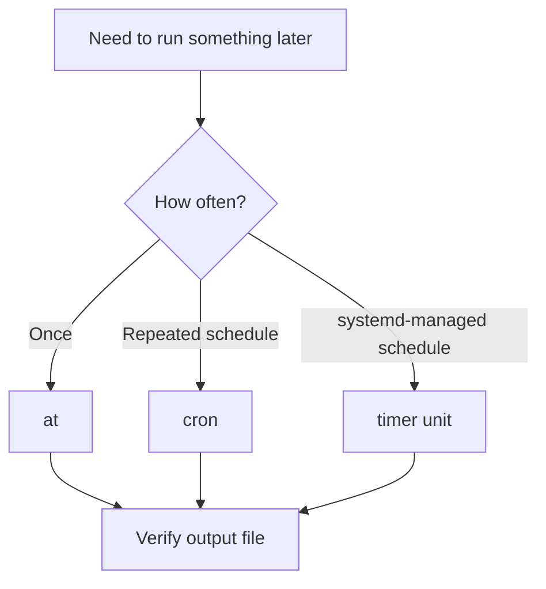
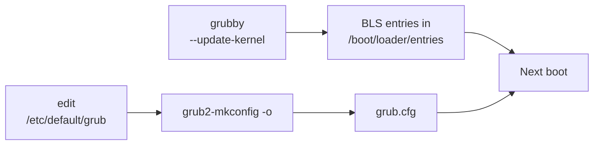

# 12 Scheduling, Services, Time, and Bootloader

> By the end of this lesson you can run work later or on a schedule, make services and the boot target survive a reboot, point a machine at a time source, and change bootloader settings without breaking boot.

!!! example "Try it now (2 minutes)"
    ```bash
    systemctl list-timers --no-pager
    ```
    ```text title="Example output"
    NEXT                        LEFT          LAST                        PASSED       UNIT                         ACTIVATES
    Tue 2026-10-27 10:41:55 UTC 33min left    Tue 2026-10-27 09:08:12 UTC 59min ago    dnf-makecache.timer          dnf-makecache.service
    Wed 2026-10-28 00:00:00 UTC 13h left      Tue 2026-10-27 00:00:00 UTC 10h ago      logrotate.timer              logrotate.service
    Wed 2026-10-28 09:23:40 UTC 23h left      Tue 2026-10-27 09:23:40 UTC 36min ago    systemd-tmpfiles-clean.timer systemd-tmpfiles-clean.service

    3 timers listed.
    ```
    <!-- VERIFY: which timers exist by default on the RHEL 10 lab image, and exact column layout -->
    Notice that the system already runs scheduled jobs you never created. Each timer (when) triggers a service (what). By the end of this lesson you will write your own pair.

## Why it matters

These are direct exam objectives and they are strongly tied to persistence. A task that works now but not later is not enough. Admins schedule reports and maintenance jobs, make sure services start automatically, keep clocks correct, and adjust bootloader behaviour when required.

**Objectives covered:**

- Schedule tasks using at, cron and systemd timer units
- Start and stop services and configure services to start automatically at boot
- Configure systems to boot into a specific target automatically
- Configure time service clients
- Modify the system bootloader

**Prereqs:** [09 Boot Targets, Processes, Logs, and Tuning](09-boot-targets-processes-logs-and-tuning.md) and [08 Shell Scripting Basics](08-shell-scripting-basics.md) · **Time:** about 6 h

**Tools used:** `at`, `atq`, `atrm`, `crontab`, `systemctl`, `systemd-analyze`, `timedatectl`, `chronyc`, `grubby`, `grub2-mkconfig`

**Offline help for this topic:** `man at`, `man 5 crontab`, `man systemd.timer`, `man systemd.time`, `man timedatectl`, `man chrony.conf`, `man chronyc`, `man grubby`

!!! note "Supporting skill (not a listed RHEL 10 objective)"
    `/etc/cron.hourly|daily|weekly|monthly` scripts and `anacron`, `/etc/at.allow` and `/etc/cron.allow` access control, `systemd-run` one-off timers, and `systemctl mask` are not named in the official list. They are short and appear in real work, so they are kept here as extras.

## How it works

Scheduling tools let the system run commands later or repeatedly. Think of three kinds of alarm clock: `at` is a one-shot alarm, `cron` is a repeating alarm, and a systemd timer is a repeating alarm that also gets logging, dependencies and status for free.



| Tool | Runs | Daemon | Where the schedule lives |
|---|---|---|---|
| `at` | once | `atd` | queue in `/var/spool/at` |
| `cron` | repeatedly | `crond` | `/var/spool/cron/USER`, `/etc/crontab`, `/etc/cron.d/` |
| systemd timer | once or repeatedly | `systemd` itself | `NAME.timer` plus `NAME.service` in `/etc/systemd/system/` |

A timer never runs a command directly. It **activates a service of the same name**. The timer says *when*, the service says *what*.


For services the rule is simple: `start` affects **now**, `enable` affects **boot**. Time matters for logs, security, scheduled jobs and distributed systems; RHEL uses `chronyd` for time synchronisation. For the bootloader, two paths exist and the modern one is `grubby`:



Safe bootloader habits:

1. inspect the current state first
2. record the original setting before changing it
3. make one change at a time
4. reboot only after you know how to verify the result
5. avoid unnecessary bootloader edits during the exam

## Commands, step by step

### 1. One-time jobs with `at`

`atd` must be running. `at` reads the command from standard input (or interactively, finishing with Ctrl-D) and runs it once with `/bin/sh`.

```bash
systemctl is-active atd
echo "hostname > /var/tmp/at-host.txt" | at now + 2 minutes
atq
```

```text title="Example output"
active
warning: commands will be executed using /bin/sh
job 4 at Tue Oct 27 10:02:00 2026
4	Tue Oct 27 10:02:00 2026 a student
```
<!-- VERIFY: atd is installed and enabled by default on the RHEL 10 lab image (otherwise: sudo dnf install at; sudo systemctl enable --now atd) -->

| Command | Meaning |
|---|---|
| `at now + 5 minutes` | Time forms: `now + N minutes/hours/days`, `10:30 tomorrow`, `noon`, `midnight`, `teatime` |
| `atq` (or `at -l`) | List your queued jobs: job number, run time, queue, user. `sudo atq` shows everyone's jobs |
| `at -c 4` | Print job 4 in full (environment plus the command at the end) |
| `atrm 4` (or `at -r 4`) | Remove queued job 4 |

After the time passes, `/var/tmp/at-host.txt` should exist. The job is gone from `atq` once it has run. If the job never ran, check `atd`, the time you gave, and the command syntax.

### 2. Repeating jobs with cron

Each user has a **crontab** (cron table). Edit your own with `crontab -e` (opens `vi` unless `EDITOR` is set), list it with `crontab -l`, and remove it entirely with `crontab -r` (no confirmation, so take care). As root you can manage another user's table with `-u`:

```bash
crontab -e
crontab -l
sudo crontab -e -u alice
sudo crontab -l -u alice
```

The second pair edits `alice`'s cron table, not root's. Always check which user you are before editing.

A cron line has five time fields, then the command:

```text
minute hour day-of-month month day-of-week command
```

| Field | Allowed values |
|---|---|
| minute | `0-59` |
| hour | `0-23` |
| day-of-month | `1-31` |
| month | `1-12` or names |
| day-of-week | `0-7` (`0` and `7` are Sunday) or names |

Special characters: `*` every value, `,` a list (`1,15`), `-` a range (`1-5`), `/` a step (`*/10`). Read these lines:

| Line | Meaning |
|---|---|
| `*/10 * * * * /usr/bin/echo hello >> /var/tmp/cron-hello.txt` | every 10 minutes |
| `0 2 * * * /usr/bin/date >> /var/tmp/nightly.txt` | every day at `02:00` (minute 0, hour 2, any day, any month, any weekday) |
| `30 8 * * 1-5 /usr/local/bin/report.sh` | 08:30 Monday to Friday |
| `0 0 1,15 * * /usr/local/bin/twice-monthly.sh` | midnight on the 1st and 15th |
| `@reboot /bin/bash /usr/local/bin/startup-check.sh` | once each time the system boots |

Use `@reboot` when the question clearly asks for a cron-managed job that runs at boot. If the task is really about managing a service, `systemctl enable` is usually the better fit.

!!! tip "What the exam expects"
    Cron runs with a small environment and a short `PATH` (`/usr/bin:/bin`), not your login shell. Use full command paths whenever the command lives elsewhere (`/usr/sbin`, `/usr/local/bin`, your own scripts). A plain `echo` or `date` works because they live in `/usr/bin`, so the full path there is a good habit rather than a fix.

**The `%` trap.** In a crontab, an unescaped `%` means "newline", so `date +%F` is cut in half and the job fails. Escape it with a backslash:

```text
*/2 * * * * /usr/bin/date +\%F-\%T >> /var/tmp/repeat.txt
```

**System-wide cron files.** Besides per-user tables, cron reads `/etc/crontab` and every file in `/etc/cron.d/`. These have a **sixth field, the user to run as**, between the schedule and the command:

```bash
echo '*/10 * * * * root /usr/bin/logger -t labcron heartbeat' | sudo tee /etc/cron.d/lab-heartbeat
```

Check that cron ran your job, and see its output (cron mails output to the user if a mailer exists, so redirect to a file):

```bash
systemctl status crond --no-pager
sudo journalctl -u crond --since "10 minutes ago" --no-pager
```

```text title="Example output"
Oct 27 10:04:01 servera.lab.example CROND[2331]: (student) CMD (/usr/bin/date +%F-%T >> /var/tmp/repeat.txt)
Oct 27 10:10:01 servera.lab.example CROND[2402]: (root) CMD (/usr/bin/logger -t labcron heartbeat)
```
<!-- VERIFY: cron log lines in the journal on RHEL 10; /var/log/cron exists only if rsyslog is installed -->

### 3. Create a systemd timer

Two files in `/etc/systemd/system/`, one `.service` and one `.timer` with the same base name. First the service. `Type=oneshot` means "run the command and exit". `ExecStart` needs an absolute path, and shell features such as `>>` need `bash -c`:

```bash
sudo tee /etc/systemd/system/lab-note.service <<'EOF'
[Unit]
Description=Append a timestamp to /var/tmp/lab-timer.txt

[Service]
Type=oneshot
ExecStart=/usr/bin/bash -c '/usr/bin/date >> /var/tmp/lab-timer.txt'
EOF
```

Then the timer. `OnCalendar=` is the schedule, and `[Install]` is what `enable` uses:

```bash
sudo tee /etc/systemd/system/lab-note.timer <<'EOF'
[Unit]
Description=Run lab-note every 2 minutes

[Timer]
OnCalendar=*:0/2
Persistent=true

[Install]
WantedBy=timers.target
EOF
```

Check the schedule expression before relying on it:

```bash
systemd-analyze calendar "*:0/2"
```

```text title="Example output"
  Original form: *:0/2
Normalized form: *-*-* *:00/2:00
    Next elapse: Tue 2026-10-27 10:06:00 UTC
       (in UTC): Tue 2026-10-27 10:06:00 UTC
       From now: 1min 38s left
```
<!-- VERIFY: exact systemd-analyze calendar output on RHEL 10 -->

Now load, enable **the timer** (not the service) and start it in one go:

```bash
sudo systemctl daemon-reload
sudo systemctl enable --now lab-note.timer
systemctl list-timers lab-note.timer --no-pager
```

```text title="Example output"
Created symlink '/etc/systemd/system/timers.target.wants/lab-note.timer' -> '/etc/systemd/system/lab-note.timer'.
NEXT                        LEFT      LAST PASSED UNIT            ACTIVATES
Tue 2026-10-27 10:06:00 UTC 1min 12s  -    -      lab-note.timer  lab-note.service

1 timers listed.
```
<!-- VERIFY: enable output wording and quote style on RHEL 10's systemd -->

| Setting | Meaning |
|---|---|
| `OnCalendar=` | Wall-clock schedule, like cron: `*:0/2` every 2 min, `daily`, `Mon..Fri *-*-* 08:30:00`, `*-*-* 02:00:00` |
| `OnBootSec=5min` | 5 minutes after boot (a monotonic timer, no calendar needed) |
| `OnUnitActiveSec=1h` | 1 hour after the service last ran |
| `Persistent=true` | With `OnCalendar`, run once at next start if a run was missed while the machine was off |
| `WantedBy=timers.target` | Makes `enable` start the timer at boot |

Use `systemd-analyze calendar` to test any `OnCalendar=` value. In unit files a literal `%` must be written `%%`, because `%` starts a specifier. After editing a unit file, run `systemctl daemon-reload` again.

Once it has fired, `cat /var/tmp/lab-timer.txt` shows a timestamp per run, and `sudo journalctl -u lab-note.service --no-pager` shows each run in the log. Remove it with `sudo systemctl disable --now lab-note.timer`, then delete both unit files and run `daemon-reload`.

### 4. Services: start, stop and enable at boot

```bash
sudo systemctl enable --now chronyd
systemctl is-active chronyd
systemctl is-enabled chronyd
sudo systemctl disable --now lab-note.timer
systemctl status crond --no-pager
```

```text title="Example output"
active
enabled
● crond.service - Command Scheduler
     Loaded: loaded (/usr/lib/systemd/system/crond.service; enabled; preset: enabled)
     Active: active (running) since Tue 2026-10-27 09:01:44 UTC; 1h 2min ago
```
<!-- VERIFY: status wording on RHEL 10 -->

| Command | Effect |
|---|---|
| `systemctl start NAME` / `stop NAME` | Now only. Lost at reboot |
| `systemctl restart NAME` / `reload NAME` | Restart, or re-read config without restarting (if the service supports it) |
| `systemctl enable NAME` / `disable NAME` | Boot only. Does not change what is running now |
| `systemctl enable --now NAME` | Both: enable at boot and start now |
| `systemctl disable --now NAME` | Both: disable at boot and stop now |
| `systemctl is-active NAME` | Running now? |
| `systemctl is-enabled NAME` | Starts at boot? |
| `systemctl mask NAME` / `unmask NAME` | Supporting: block a service from starting at all, even by hand |

Both checks matter: a service can be active but not enabled (it dies at reboot), or enabled but not active (it will start at boot, but not now). The scheduler daemons are `crond` and `atd`; timers need no daemon of their own.

### 5. Boot into a specific target automatically

A **target** groups units into a boot state. The default target is a symlink, `/etc/systemd/system/default.target`. Lesson 09 explains targets in depth and how to boot into one manually from GRUB; here is the persistent part.

```bash
systemctl get-default
sudo systemctl set-default multi-user.target
systemctl get-default
```

```text title="Example output"
graphical.target
Removed '/etc/systemd/system/default.target'.
Created symlink '/etc/systemd/system/default.target' -> '/usr/lib/systemd/system/multi-user.target'.
multi-user.target
```
<!-- VERIFY: the default target of the lab image, and set-default output wording on RHEL 10 -->

`set-default` takes effect at the next boot. `systemctl isolate multi-user.target` switches the running system right now but does **not** persist. Use both only when you need both.

### 6. Time service clients with chrony

`chronyd` is the time daemon; `chronyc` is its client. `timedatectl` is the quick overall status view.

```bash
timedatectl
chronyc sources -v
chronyc tracking
```

```text title="Example output"
               Local time: Tue 2026-10-27 10:00:12 UTC
           Universal time: Tue 2026-10-27 10:00:12 UTC
                 RTC time: Tue 2026-10-27 10:00:12
                Time zone: UTC (UTC, +0000)
System clock synchronized: yes
              NTP service: active
          RTC in local TZ: no

MS Name/IP address         Stratum Poll Reach LastRx Last sample
===============================================================================
^* 192.168.122.1                 3   6   377    41   +112us[ +145us] +/-   18ms

Reference ID    : C0A87A01 (192.168.122.1)
Stratum         : 4
Leap status     : Normal
```
<!-- VERIFY: timedatectl and chronyc output layout on RHEL 10; the explanatory header of chronyc sources -v is omitted here -->

In `chronyc sources`, the first column is the source type (`^` server) and state: `*` is the source in use, `+` is a good backup, `?` means unreachable or unusable. `Reach` is an octal history of the last 8 polls; `377` means all succeeded. Healthy means `System clock synchronized: yes`, a `*` source, and `Leap status: Normal`.

**Configure the client.** Time sources are `server` or `pool` lines in `/etc/chrony.conf`. The shipped file usually has a `pool ... iburst` line; `iburst` makes the first sync fast.

```bash
sudo cp -a /etc/chrony.conf /root/chrony.conf.orig
sudo vi /etc/chrony.conf
sudo systemctl enable --now chronyd
sudo systemctl restart chronyd
chronyc sources -v
```

```text title="Example /etc/chrony.conf change"
# pool 2.rhel.pool.ntp.org iburst
server 192.168.122.1 iburst
```

| Task | Command |
|---|---|
| Set time zone | `timedatectl list-timezones \| grep Karachi`, then `sudo timedatectl set-timezone Asia/Karachi` |
| Turn NTP sync on or off | `sudo timedatectl set-ntp true` (on RHEL this drives `chronyd`) |
| Step the clock now | `sudo chronyc makestep` |
| Per-source statistics | `chronyc sourcestats` |

Expect the task to name the time server. Add exactly that `server` line, restart `chronyd`, and confirm it is listed in `chronyc sources`. Config edits only take effect after the restart, and the `*` can take a few seconds to appear.

### 7. Modify the bootloader

RHEL 10 uses GRUB2 with **BLS (Boot Loader Specification)** entries: one small file per installed kernel in `/boot/loader/entries/`, each holding that kernel's command line. `grubby` edits those entries and is the main tool. Inspect first:

```bash
sudo grubby --default-kernel
sudo grubby --info=DEFAULT
sudo cat /proc/cmdline
```

```text title="Example output"
/boot/vmlinuz-6.12.0-55.el10.x86_64
index=0
kernel="/boot/vmlinuz-6.12.0-55.el10.x86_64"
args="ro crashkernel=2G-64G:256M rhgb quiet"
root="/dev/mapper/rhel-root"
initrd="/boot/initramfs-6.12.0-55.el10.x86_64.img"
title="Red Hat Enterprise Linux (6.12.0-55.el10.x86_64) 10.0"
id="..."
BOOT_IMAGE=(hd0,gpt2)/vmlinuz-6.12.0-55.el10.x86_64 root=/dev/mapper/rhel-root ro rhgb quiet
```
<!-- VERIFY: kernel version, args and title on the RHEL 10 lab image -->

`/proc/cmdline` is what the **running** kernel booted with; `grubby --info` is what is **configured** for the next boot. Compare them after every change and reboot.

**Change the kernel command line for every installed kernel:**

```bash
sudo grubby --info=ALL
sudo grubby --update-kernel=ALL --args="loglevel=5"
sudo grubby --info=DEFAULT | grep args
sudo grubby --update-kernel=ALL --remove-args="loglevel=5"
```

| Option | Meaning |
|---|---|
| `--info=ALL` / `--info=DEFAULT` | Show every entry, or only the default one |
| `--default-kernel` | Print the path of the default kernel |
| `--set-default /boot/vmlinuz-...` | Make that kernel the default |
| `--set-default-index=N` | Same, by the `index=` number from `--info=ALL` |
| `--update-kernel=ALL` | Apply to every entry (use a path or `DEFAULT` for just one) |
| `--args="a=1 b"` | Add or replace arguments |
| `--remove-args="a b"` | Remove arguments |

Pick a test argument that is **not** already present. Adding `quiet` to a line that already contains it does nothing, which makes a poor check. Booting once with a temporary edit (press `e` in the GRUB menu) is not persistent; see lesson 09.

**Menu timeout and defaults: `/etc/default/grub`.** This file holds settings such as `GRUB_TIMEOUT=5` and `GRUB_CMDLINE_LINUX="..."`. After editing, regenerate the config file:

```bash
sudo vi /etc/default/grub
ls /sys/firmware/efi >/dev/null 2>&1 && echo UEFI || echo BIOS
sudo grub2-mkconfig -o /boot/grub2/grub.cfg
sudo grep -n 'timeout=' /boot/grub2/grub.cfg
```

```text title="Example output"
BIOS
Generating grub configuration file ...
Adding boot menu entry for UEFI Firmware Settings ...
done
```
<!-- VERIFY: output of grub2-mkconfig on RHEL 10 -->
<!-- VERIFY: whether editing GRUB_CMDLINE_LINUX plus grub2-mkconfig updates existing BLS entries or only entries for newly installed kernels; grubby is the safe method for existing kernels -->

Use `grubby` for the kernel command line of existing kernels. Use `/etc/default/grub` plus `grub2-mkconfig` for menu behaviour such as the timeout. Never edit `grub.cfg` by hand: it is regenerated.

On RHEL 9 and later the target is `/boot/grub2/grub.cfg` for both BIOS and UEFI machines. Do not overwrite `/boot/efi/EFI/redhat/grub.cfg` (the UEFI path used on RHEL 8): on UEFI it is only a small stub that points at the real file.

## Common mistakes

- **Mistake:** Scheduling a job and never verifying it ran. **Recovery:** always create a visible proof file in labs and check it, and check `atq`, `crontab -l` or `systemctl list-timers`.
- **Mistake:** Editing the wrong user's crontab, or root's when you meant your own. **Recovery:** verify the active user with `whoami`, and use `sudo crontab -l -u USER` to see which table you are in.
- **Mistake:** Starting a service but forgetting to enable it. **Recovery:** `sudo systemctl enable --now NAME`, then check `is-enabled` and `is-active`.
- **Mistake:** Changing boot behaviour temporarily instead of persistently (GRUB `e`, `systemctl isolate`). **Recovery:** use `grubby` and `systemctl set-default`, then reboot and check.
- **Mistake:** Not checking time synchronisation status after configuration. **Recovery:** `timedatectl` and `chronyc sources -v`; restart `chronyd` after editing `chrony.conf`.
- **Mistake:** Assuming scheduling tools share the same syntax. **Recovery:** treat `at`, `cron` and timers as three separate tools.
- **Mistake:** Making a bootloader change without recording the original state. **Recovery:** save `grubby --info=ALL` output and back up `/etc/default/grub` before changes.
- **Mistake:** Not verifying scheduled output. **Recovery:** always create a visible proof file in labs.
- **Mistake:** Using `date +%F` unescaped in a crontab. **Recovery:** write `\%`.
- **Mistake:** Enabling `lab-note.service` instead of `lab-note.timer`, or forgetting `daemon-reload` after writing the unit files. **Recovery:** `sudo systemctl daemon-reload; sudo systemctl enable --now lab-note.timer`.

### Troubleshooting

| Problem | Cause | Fix |
|---|---|---|
| `at` job never ran | `atd` not running, wrong time, or syntax error in the job | `systemctl is-active atd`, then inspect `atq` and `at -c N` |
| Cron job exists but the output file is empty | Command path issue, permissions, unescaped `%`, or environment difference | Use full paths, escape `%`, check `journalctl -u crond` |
| Timer never fires | Timer not enabled or started, or no matching `.service` | `systemctl list-timers --all`, `systemctl status NAME.timer`, `daemon-reload` |
| Service runs now but not after reboot | Forgot `enable` | `systemctl enable NAME` |
| Time appears wrong | Sync service disabled, bad source, or time zone confusion | `timedatectl`, `chronyc sources -v`, `systemctl status chronyd` |
| Bootloader change had unexpected effects | Argument added to the wrong entry, wrong syntax, or not verified | `grubby --info=ALL` again, remove the bad argument, keep a record of the original |

## Hands-on lab

**Setup:** shared lab environment, `servera`, logged in as `student`. Create the second user that the lab edits and note the starting state of the default target and kernel arguments:

```bash
sudo useradd alice
systemctl get-default > /var/tmp/default-target.orig
sudo grubby --info=DEFAULT > /var/tmp/grubby.orig
```

If `atd` is not installed, run `sudo dnf install -y at` first (needs a repository) and `sudo systemctl enable --now atd`. Proof files go in `/var/tmp`, which (unlike `/tmp`) is meant to survive a reboot; nothing here touches the spare disks.

**Task:**

- [ ] As `student`, queue an `at` job in 2 minutes that writes the hostname to `/var/tmp/once.txt`. Then queue a second job for 1 hour from now and remove it with `atrm`.
- [ ] As `student`, add a cron job that appends the date as `YYYY-MM-DD-HH:MM:SS` to `/var/tmp/repeat.txt` every 2 minutes.
- [ ] As root, create `/etc/cron.d/lab-heartbeat` that runs `logger -t labcron heartbeat` as root every 10 minutes.
- [ ] Give user `alice` a cron job that runs `/usr/bin/id >> /var/tmp/alice-cron.txt` at 02:00 Monday to Friday.
- [ ] Add one `@reboot` cron entry for `student` that writes `boot at $(date)` to `/var/tmp/boot-marker.txt`.
- [ ] Create `lab-note.service` and `lab-note.timer` so a timestamp is appended to `/var/tmp/lab-timer.txt` every 2 minutes. Enable and start the timer.
- [ ] Check that `crond` and `atd` are active, and that `chronyd` is active and enabled.
- [ ] In `/etc/chrony.conf`, replace the `pool` line with `server 192.168.122.1 iburst`, restart `chronyd`, and read `chronyc sources -v`. The task is to configure the client; if the source shows `?` because your lab host does not serve time, the configuration is still correct.
- [ ] Set the default target to `multi-user.target`, then verify it.
- [ ] Add the kernel argument `loglevel=5` to all kernels with `grubby`, set `GRUB_TIMEOUT=10` in `/etc/default/grub`, and regenerate `/boot/grub2/grub.cfg`.
- [ ] Reboot and verify: timers, crontabs, `/proc/cmdline` and the default target.

??? question "Hint 1"
    Cron needs `%` escaped, and `@reboot` goes in the same crontab as the other `student` lines. Files in `/etc/cron.d/` need a user field, user crontabs do not. A timer needs two files with the same base name.

??? question "Hint 2"
    Tools: `at` with `atq` and `atrm`; `crontab -e` and `sudo crontab -e -u alice`; `systemctl enable --now` on the `.timer`; `chronyc sources`; `systemctl set-default`; `grubby --update-kernel`; `grub2-mkconfig -o`.

??? success "Solution"
    ```bash
    # at
    echo "hostname > /var/tmp/once.txt" | at now + 2 minutes
    echo "date > /var/tmp/cancel-me.txt" | at now + 1 hour
    atq
    atrm 2          # use the job number of the 1-hour job from atq

    # cron for student
    crontab -e
    ```
    Add these two lines in the editor, then save:
    ```text
    */2 * * * * /usr/bin/date +\%F-\%T >> /var/tmp/repeat.txt
    @reboot /usr/bin/bash -c '/usr/bin/echo "boot at $(/usr/bin/date)" >> /var/tmp/boot-marker.txt'
    ```
    ```bash
    crontab -l

    # system cron file and alice's table
    echo '*/10 * * * * root /usr/bin/logger -t labcron heartbeat' | sudo tee /etc/cron.d/lab-heartbeat
    echo '0 2 * * 1-5 /usr/bin/id >> /var/tmp/alice-cron.txt' | sudo crontab -u alice -
    sudo crontab -l -u alice

    # systemd timer
    sudo tee /etc/systemd/system/lab-note.service <<'EOF'
    [Unit]
    Description=Append a timestamp to /var/tmp/lab-timer.txt

    [Service]
    Type=oneshot
    ExecStart=/usr/bin/bash -c '/usr/bin/date >> /var/tmp/lab-timer.txt'
    EOF
    sudo tee /etc/systemd/system/lab-note.timer <<'EOF'
    [Unit]
    Description=Run lab-note every 2 minutes

    [Timer]
    OnCalendar=*:0/2
    Persistent=true

    [Install]
    WantedBy=timers.target
    EOF
    sudo systemctl daemon-reload
    sudo systemctl enable --now lab-note.timer

    # services and time
    systemctl is-active crond atd chronyd
    systemctl is-enabled chronyd
    sudo cp -a /etc/chrony.conf /root/chrony.conf.orig
    sudo sed -i 's/^pool /#pool /' /etc/chrony.conf
    echo 'server 192.168.122.1 iburst' | sudo tee -a /etc/chrony.conf
    sudo systemctl restart chronyd
    chronyc sources -v
    timedatectl

    # default target
    sudo systemctl set-default multi-user.target
    systemctl get-default

    # bootloader
    sudo grubby --update-kernel=ALL --args="loglevel=5"
    sudo grubby --info=DEFAULT | grep args
    sudo sed -i 's/^GRUB_TIMEOUT=.*/GRUB_TIMEOUT=10/' /etc/default/grub
    sudo grub2-mkconfig -o /boot/grub2/grub.cfg
    sudo grep -n 'timeout=' /boot/grub2/grub.cfg

    sudo reboot
    ```
    **Verify:** after the wait, `cat /var/tmp/once.txt` shows `servera.lab.example`, `cat /var/tmp/repeat.txt` and `cat /var/tmp/lab-timer.txt` grow every 2 minutes, `atq` no longer lists the 1-hour job, and `sudo journalctl -u crond | grep labcron` shows the heartbeat. After the reboot: `systemctl list-timers lab-note.timer`, `crontab -l`, `cat /var/tmp/boot-marker.txt`, `grep loglevel /proc/cmdline`, `systemctl get-default` (`multi-user.target`) and `systemctl is-enabled chronyd` all succeed. Compare with `/var/tmp/default-target.orig` and `/var/tmp/grubby.orig`.
    <!-- VERIFY: sed line for GRUB_TIMEOUT works if the line already exists in /etc/default/grub on RHEL 10; if absent, append GRUB_TIMEOUT=10 -->

??? warning "Cleanup (restore the machine)"
    ```bash
    sudo systemctl disable --now lab-note.timer
    sudo rm /etc/systemd/system/lab-note.{service,timer} /etc/cron.d/lab-heartbeat
    sudo systemctl daemon-reload
    crontab -r
    sudo userdel -r alice
    sudo cp -a /root/chrony.conf.orig /etc/chrony.conf && sudo systemctl restart chronyd
    sudo systemctl set-default "$(cat /var/tmp/default-target.orig)"
    sudo grubby --update-kernel=ALL --remove-args="loglevel=5"
    sudo sed -i 's/^GRUB_TIMEOUT=.*/GRUB_TIMEOUT=5/' /etc/default/grub
    sudo grub2-mkconfig -o /boot/grub2/grub.cfg
    ```

## More practice

1. Create an `at` job that writes the hostname to a file.
2. Remove a queued `at` job.
3. Add a cron job and verify it appears in `crontab -l`.
4. Edit another user's crontab with `sudo crontab -e -u USER` and verify it with `sudo crontab -l -u USER`.
5. Add an `@reboot` cron line that writes to a lab file.
6. Inspect existing systemd timers, and check one with `systemctl status NAME.timer`.
7. Enable a service at boot and verify it with `is-enabled`.
8. Check time synchronisation state with `timedatectl`.
9. Inspect the current bootloader settings with `grubby --info=ALL`.
10. Add and then remove a harmless kernel argument in a disposable lab, documenting the before and after state.
11. Write a timer that runs 3 minutes after boot (`OnBootSec=3min`) and one that runs Monday to Friday at 08:30, and test the second with `systemd-analyze calendar`.

### Exam-style task 1

Schedule a one-time job that creates `/var/tmp/once.txt`, and configure a recurring job that appends the date to `/var/tmp/repeat.txt`.

**Grader mindset checklist:**

- [ ] one-time job must be queued or completed successfully
- [ ] recurring job must exist in the correct crontab or timer configuration
- [ ] output files should appear as expected

??? success "Solution"
    ```bash
    echo "date > /var/tmp/once.txt" | at now + 1 minute
    crontab -e
    crontab -l
    ```
    Example cron line:
    ```text
    */5 * * * * /usr/bin/date >> /var/tmp/repeat.txt
    ```
    **Verify:** `atq`, then after the minute `cat /var/tmp/once.txt`; `crontab -l`; wait for the next 5-minute mark and `cat /var/tmp/repeat.txt`.

### Exam-style task 2

Configure the time synchronisation client and verify that it is enabled at boot and active now.

**Grader mindset checklist:**

- [ ] time service must be active
- [ ] time service must be enabled
- [ ] time sync status should show healthy operation
- [ ] configuration must persist after reboot

??? success "Solution"
    ```bash
    sudo systemctl enable --now chronyd
    sudo vi /etc/chrony.conf        # add the server line the task names, e.g. server 192.168.122.1 iburst
    sudo systemctl restart chronyd
    systemctl is-active chronyd
    systemctl is-enabled chronyd
    timedatectl
    chronyc sources -v
    ```
    **Verify:** `active`, `enabled`, `System clock synchronized: yes`, and the named server appears in `chronyc sources`.

### Exam-style task 3

Make the system boot into `multi-user.target` and add the kernel argument `audit=1` to all installed kernels, both persistently.

**Grader mindset checklist:**

- [ ] `systemctl get-default` prints `multi-user.target`
- [ ] `grubby --info=ALL` shows the argument on every entry
- [ ] after a reboot, `/proc/cmdline` contains the argument

??? success "Solution"
    ```bash
    sudo systemctl set-default multi-user.target
    sudo grubby --update-kernel=ALL --args="audit=1"
    systemctl get-default
    sudo grubby --info=ALL | grep -E '^(kernel|args)'
    sudo reboot
    ```
    After reboot: `grep audit=1 /proc/cmdline`.

## Exam tips

!!! tip "What the exam expects"
    The job exists in the right place and produces its output, the service is both active and enabled, the time client names the right server and is synchronising, and the target and kernel arguments are still correct after a reboot. Create a visible proof file for every scheduled job.

!!! warning "Must survive reboot"
    | Change | Persistent? | Make it persist with |
    |---|---|---|
    | `at` job | Stored on disk | Nothing, but it is a one-time job; do not rely on it for repeated work |
    | `crontab -e`, `/etc/cron.d/` file | Yes | Nothing, the file is on disk (`crond` must be enabled, which it is by default) |
    | `.service` and `.timer` files | Files persist, but the timer is not active | `systemctl enable --now NAME.timer` |
    | `systemctl start NAME` | No | `systemctl enable NAME` |
    | `systemctl isolate TARGET` | No | `systemctl set-default TARGET` |
    | `/etc/chrony.conf` edit | Yes, but not applied until restart | `systemctl restart chronyd` and `enable` |
    | `timedatectl set-timezone` | Yes | Nothing |
    | `grubby --update-kernel` | Yes | Nothing |
    | `e` in the GRUB menu | No | `grubby`, or `/etc/default/grub` plus `grub2-mkconfig -o` |

**Verify like a grader:**

1. One-time jobs: `atq` and the result file.
2. Cron: `crontab -l` (and `sudo crontab -l -u USER`), then the output file.
3. Timers: `systemctl list-timers`, `systemctl is-enabled NAME.timer`.
4. Services: `systemctl is-active` and `systemctl is-enabled`.
5. Time client: `timedatectl` and `chronyc sources -v`.
6. Boot target and kernel arguments: `systemctl get-default`, `grubby --info=ALL`.
7. Reboot, then run all of the above again, plus `cat /proc/cmdline`. See the [persistence matrix in lesson 16](16-persistence-reboot-checks-and-troubleshooting.md).

## Quiz

1. What tool runs a job one time in the future?
2. What command lists your current cron jobs?
3. What command lists active timers?
4. What is the difference between `systemctl start` and `systemctl enable`?
5. What service commonly handles time sync on RHEL systems?
6. Why should bootloader changes be verified carefully?
7. What command can show the current default kernel on systems using `grubby`?
8. A cron line contains `date +%F`. Why does it fail and how do you fix it?
9. Which two files make up a systemd timer job, and which one do you `enable`?
10. Which command checks an `OnCalendar=` expression before you use it?
11. Which command makes the system boot into `multi-user.target` every time?
12. Which command regenerates `grub.cfg` after editing `/etc/default/grub`?

??? success "Answers"
    1. `at`
    2. `crontab -l`
    3. `systemctl list-timers`
    4. `start` runs now. `enable` starts at boot.
    5. `chronyd`
    6. Because bad changes can affect system boot.
    7. `grubby --default-kernel`
    8. Cron treats an unescaped `%` as a newline. Write `date +\%F`.
    9. A `.service` (what to run) and a `.timer` (when). Enable the `.timer`.
    10. `systemd-analyze calendar "EXPRESSION"`
    11. `sudo systemctl set-default multi-user.target`
    12. `sudo grub2-mkconfig -o /boot/grub2/grub.cfg` (the same path on BIOS and UEFI machines, RHEL 9 and later; never write to `/boot/efi/EFI/redhat/grub.cfg`, which is only a stub).
    <!-- VERIFY: RHEL 10 keeps /boot/grub2/grub.cfg for both BIOS and UEFI, as RHEL 9 does -->

## Summary

- `at` once, `cron` repeated, timers are systemd scheduled jobs (timer = when, service = what)
- start now is not enable at boot
- time sync must be active and enabled
- bootloader changes require caution: inspect, record, change one thing, verify after reboot
- a task that works now but not later is not enough

| Task | Command |
|---|---|
| One-time job | `echo "command" \| at now + 5 minutes` |
| List / remove at jobs | `atq`, `atrm JOBID` |
| Edit / list cron | `crontab -e`, `crontab -l`, `sudo crontab -e -u USER` |
| Run at boot (cron) | `@reboot /bin/bash /usr/local/bin/startup-check.sh` |
| Check a schedule | `systemd-analyze calendar "*:0/2"` |
| Enable a timer | `systemctl daemon-reload; systemctl enable --now NAME.timer` |
| List timers | `systemctl list-timers` |
| Service now + boot | `systemctl enable --now NAME` |
| Boot target | `systemctl get-default`, `systemctl set-default multi-user.target` |
| Time status | `timedatectl`, `chronyc sources -v`, `chronyc tracking` |
| Kernel args | `grubby --info=ALL`, `grubby --update-kernel=ALL --args="x=1"` |
| Regenerate GRUB config | `grub2-mkconfig -o /boot/grub2/grub.cfg` |

**Previous:** [11 Filesystems, Mounts, NFS, and Autofs](11-filesystems-mounts-nfs-and-autofs.md) · **Next:** [13 Networking, Hostname Resolution, and firewalld](13-networking-hostname-resolution-and-firewalld.md): schedules and services are in place, so next you give the machine a persistent network identity and open its firewall.
