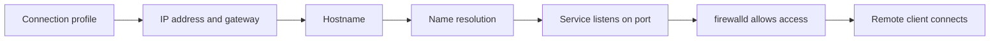
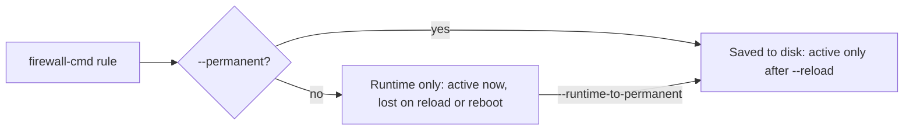

# 13 Networking, Hostname Resolution, and firewalld

> By the end of this lesson you can give a machine a persistent IPv4 and IPv6 address, make names resolve, and open exactly the network access a service needs, all of it surviving a reboot.

!!! example "Try it now (2 minutes)"
    ```bash
    ip -br addr
    nmcli connection show
    ```
    ```text title="Example output"
    $ ip -br addr
    lo               UNKNOWN        127.0.0.1/8 ::1/128
    enp1s0           UP             192.168.122.10/24 fe80::5054:ff:fe12:3456/64

    $ nmcli connection show
    NAME      UUID                                  TYPE      DEVICE
    enp1s0    5f1b3a2c-8a4e-4c55-9a53-2d7e1c9b6f10  ethernet  enp1s0
    lo        0b7a9c1e-3f52-4d6f-a2f4-7c1d5e8a9b33  loopback  lo
    ```
    <!-- VERIFY: default profile name on a RHEL 10 KVM guest (enp1s0 vs "Wired connection 1") -->
    Notice that there are two different lists. `ip` shows **devices** (interfaces) and their addresses. `nmcli connection show` shows **connection profiles**, which hold the configuration. Here both happen to be called `enp1s0`, but that is not guaranteed. By the end of this lesson you will know why that difference causes the most common networking mistake.

## Why it matters

Networking tasks are frequent on RHCSA and in real administration. A service that works on the machine itself but not from another machine almost always fails for one of three reasons: the address is wrong, the name does not resolve, or the firewall blocks the port. Admins assign addresses, fix connectivity, set hostnames, and open only the access a service needs, and they must make it all survive a reboot.

**Objectives covered:**

- Configure IPv4 and IPv6 addresses
- Configure hostname resolution
- Configure network services to start automatically at boot
- Restrict network access using firewalld and firewall-cmd
- Configure firewall settings using firewall-cmd/firewalld

**Prereqs:** [01 Shell Basics and Command Syntax](01-shell-basics-and-command-syntax.md), [05 SSH Login, Switching Users, and Remote Workflows](05-ssh-login-switching-users-and-remote-workflows.md), [09 Boot Targets, Processes, Logs, and Tuning](09-boot-targets-processes-logs-and-tuning.md) and [12 Scheduling, Services, Time, and Bootloader](12-scheduling-services-time-and-bootloader.md) (for `systemctl`) · **Time:** about 6 h

**Tools used:** `ip`, `nmcli`, `hostnamectl`, `ping`, `ss`, `getent`, `firewall-cmd`, `systemctl`, `cat`

**Offline help for this topic:** `man ip`, `man nmcli`, `man nmcli-examples`, `man hostnamectl`, `man hosts`, `man nsswitch.conf`, `man firewalld`, `man firewall-cmd`, `nmcli --help`

!!! note "Supporting skill (not a listed RHEL 10 objective)"
    `nmtui` (a text menu for NetworkManager) and `dig`/`host` (DNS lookups, package `bind-utils`) are not named in the official objectives. They are useful for checking your work, so they appear in small notes below. `nmcli` is the tool to learn for the exam.

## How it works

Network setup has two halves: how this system reaches the network, and which incoming connections it allows.



### Connection profile vs device name (read this first)

Think of a device as a **wall socket** and a profile as the **instruction card** that says what to plug into it. `nmcli` edits the card, not the socket.

- The **device** is the kernel's name for the hardware: `ens160`, `enp1s0`, `eth0`. See it with `nmcli device status` or `ip addr`.
- The **connection profile** is what NetworkManager stores the settings in. It may be named after the device (`enp1s0`) or something else such as `Wired connection 1`. See it with `nmcli connection show`.

**Always look up the real profile name before modifying it.** Never assume it is `eth0`; this is a very common networking mistake. The examples use a shell variable so you copy the name once:

```bash
nmcli connection show        # find the NAME in the first column
CON="enp1s0"                 # set CON to YOUR profile name (quote it if it has spaces)
```

Or let the shell find the active Ethernet profile for you, so nothing is hardcoded:

```bash
CON=$(nmcli -t -f NAME,TYPE con show --active | awk -F: '$2=="802-3-ethernet"{print $1;exit}')
echo "$CON"
```

On RHEL 10 NetworkManager stores profiles as **keyfiles**, one file per profile in `/etc/NetworkManager/system-connections/` (named `<profile>.nmconnection`, readable by root only). Older releases used `ifcfg-*` files under `/etc/sysconfig/network-scripts/` and profile names like `System ens160`; on RHEL 10 do not expect those. <!-- VERIFY: keyfile-only storage and default profile name on RHEL 10 -->

### What persists

`nmcli connection modify` writes the keyfile, so it **persists**, but it does not change the running interface until you bring the profile up again. `ip addr add` changes the running interface only and is lost at reboot or when the profile is re-activated. For firewalld the same split exists: **runtime** rules apply now and vanish on reload or reboot, **permanent** rules are saved but do not apply until reload.



### Hostname resolution

When a program asks for the address of a name, the C library follows the order in `/etc/nsswitch.conf`. The `hosts:` line normally tries local files first (`/etc/hosts`) and DNS after that, so a line in `/etc/hosts` wins over DNS.

```text title="Example output"
$ grep '^hosts' /etc/nsswitch.conf
hosts:      files myhostname dns
```
<!-- VERIFY: exact hosts: line on RHEL 10 (may include "resolve [!UNAVAIL=return]") -->

On RHEL, `/etc/resolv.conf` is generated by NetworkManager from the profile's DNS settings. Set DNS through the profile (`ipv4.dns`, `ipv6.dns`); a hand edit is overwritten the next time the profile is activated. <!-- VERIFY: resolv.conf still generated by NetworkManager (not systemd-resolved) on RHEL 10 -->

Each line of `/etc/hosts` is: address, then the full name, then optional short aliases.

```text title="/etc/hosts"
127.0.0.1        localhost localhost.localdomain
192.168.122.10   servera.lab.example servera
192.168.122.11   serverb.lab.example serverb
```

### Firewall zones

firewalld is a **zone-based** firewall. A zone is a named set of rules. The analogy is a building with different entrances: the public door lets few things in, the staff door lets more in. Each interface or source address is assigned to one zone, and that zone's rules decide what is allowed in. Anything not explicitly allowed is refused.

| Zone | Typical use |
|---|---|
| `public` | Default zone on RHEL. Untrusted networks; only listed services allowed |
| `internal`, `work`, `home` | More trusted networks |
| `trusted` | Everything allowed |
| `drop`, `block` | Everything refused (`drop` silently, `block` with a reply) |

A **service** is a named bundle of ports (for example `http` means TCP 80). A **port** rule opens a single port or range directly.

## Commands, step by step

### 1. Look at the current state

```bash
ip addr
ip route
nmcli device status        # device (interface) names + state
nmcli connection show      # connection PROFILE names
```

```text title="Example output"
$ ip route
default via 192.168.122.1 dev enp1s0 proto static metric 100
192.168.122.0/24 dev enp1s0 proto kernel scope link src 192.168.122.10 metric 100

$ nmcli device status
DEVICE  TYPE      STATE                   CONNECTION
enp1s0  ethernet  connected               enp1s0
lo      loopback  connected (externally)  lo
```

Record the active device **and** the profile name. They may differ.

### 2. Configure a static IPv4 address

Set all the keys in one `modify`, then activate. The keys are separate settings, so order does not matter, but `ipv4.method manual` must be set or NetworkManager keeps using DHCP and ignores the address.

```bash
CON="enp1s0"       # replace with YOUR profile name from nmcli connection show
sudo nmcli connection modify "$CON" \
    ipv4.method manual \
    ipv4.addresses 192.168.122.10/24 \
    ipv4.gateway 192.168.122.1 \
    ipv4.dns 192.168.122.1
sudo nmcli connection up "$CON"
```

```text title="Example output"
Connection successfully activated (D-Bus active path: /org/freedesktop/NetworkManager/ActiveConnection/4)
```

| Key | Meaning |
|---|---|
| `ipv4.method` | `manual` = static address, `auto` = DHCP, `disabled` = no IPv4 |
| `ipv4.addresses` | Address plus prefix length (`/24`). `nmcli` takes a prefix, not a netmask |
| `ipv4.gateway` | Default route. Must be inside the address's subnet |
| `ipv4.dns` | DNS server list, space or comma separated |
| `ipv4.dns-search` | Domain appended to short names, for example `lab.example` |
| `connection.autoconnect` | `yes` = activate this profile at boot (the default) |

The `+` and `-` prefixes **add to** or **remove from** a list instead of replacing it. Without `+`, the new value replaces everything.

```bash
sudo nmcli connection modify "$CON" +ipv4.dns 8.8.8.8        # add a second DNS server
sudo nmcli connection modify "$CON" -ipv4.dns 8.8.8.8        # remove it again
sudo nmcli connection modify "$CON" +ipv4.addresses 192.168.122.20/24   # add a second address
```

!!! warning "Do not cut your own branch"
    On a remote (SSH) session, changing the address of the interface you are logged in through drops your session when you run `nmcli connection up`. You may well be on the console, but the habit matters: if you must do it over SSH, keep the old address in the list (`+ipv4.addresses`) until the new one is proven.

### 3. Configure a static IPv6 address

The keys mirror IPv4 with the `ipv6.` prefix.

```bash
sudo nmcli connection modify "$CON" \
    ipv6.method manual \
    ipv6.addresses 2001:db8:0:1::10/64 \
    ipv6.gateway 2001:db8:0:1::1
sudo nmcli connection up "$CON"
ip -6 addr
```

```text title="Example output"
2: enp1s0: <BROADCAST,MULTICAST,UP,LOWER_UP> mtu 1500 state UP qlen 1000
    inet6 2001:db8:0:1::10/64 scope global
       valid_lft forever preferred_lft forever
    inet6 fe80::5054:ff:fe12:3456/64 scope link
       valid_lft forever preferred_lft forever
```

`2001:db8::/32` is a documentation prefix: fine for practice, never routed on a real network. `fe80::` is the automatic link-local address and is always present.

### 4. Create a new profile with `nmcli connection add`

Use `add` when a task says "create a new connection". A **dummy** device is a software-only interface, safe to experiment on because it cannot cut off your session. <!-- VERIFY: dummy kernel module present in the default RHEL 10 kernel packages -->

```bash
sudo nmcli connection add type dummy ifname dummy0 con-name lab-dummy \
    ipv4.method manual ipv4.addresses 10.99.0.1/24 \
    ipv6.method manual ipv6.addresses fd00:99::1/64
```

```text title="Example output"
Connection 'lab-dummy' (c1d2e3f4-5a6b-4c7d-8e9f-0a1b2c3d4e5f) successfully added.
```

For a real Ethernet profile the form is `nmcli connection add type ethernet ifname enp1s0 con-name static-lab ipv4.method manual ipv4.addresses ...`.

### 5. Bring connections up and down, and make them start at boot

```bash
sudo nmcli connection down lab-dummy
sudo nmcli connection up lab-dummy
nmcli -g connection.autoconnect connection show lab-dummy
sudo nmcli connection modify lab-dummy connection.autoconnect yes
```

```text title="Example output"
Connection 'lab-dummy' successfully deactivated (D-Bus active path: /org/freedesktop/NetworkManager/ActiveConnection/5)
Connection successfully activated (D-Bus active path: /org/freedesktop/NetworkManager/ActiveConnection/6)
yes
```

"Configure network services to start automatically at boot" has two parts here. The profile must be set to autoconnect, and the services behind it must be enabled:

```bash
systemctl is-enabled NetworkManager firewalld sshd
sudo systemctl enable --now firewalld
```

```text title="Example output"
enabled
enabled
enabled
```

`enable` makes a unit start at boot, `--now` also starts it immediately. The full `systemctl` toolkit is in [12 Scheduling, Services, Time, and Bootloader](12-scheduling-services-time-and-bootloader.md).

### 6. Check DNS and name resolution

```bash
nmcli -g ipv4.dns connection show "$CON"
cat /etc/resolv.conf
getent hosts serverb.lab.example
```

```text title="Example output"
192.168.122.1
# Generated by NetworkManager
search lab.example
nameserver 192.168.122.1
192.168.122.11  serverb.lab.example serverb
```

`getent hosts name` asks the system the same way programs do (through `nsswitch.conf`, so it sees `/etc/hosts`). That is why it is the right check. `dig` and `host` talk to DNS only and ignore `/etc/hosts`, so they can say "not found" for a name that works fine.

### 7. Set and read the hostname

```bash
sudo hostnamectl set-hostname servera.lab.example
hostnamectl
cat /etc/hostname
```

```text title="Example output"
 Static hostname: servera.lab.example
       Icon name: computer-vm
         Chassis: vm
      Machine ID: 3f1a8c0d5e7b4a9c8d2e6f1b0a4c7d9e
         Boot ID: 7c2d9e1f3a5b4c6d8e0f1a2b3c4d5e6f
 Operating System: Red Hat Enterprise Linux 10.0 (Coughlan)
```
<!-- VERIFY: hostnamectl field layout and OS line on RHEL 10 -->

The **static** hostname is the one stored in `/etc/hostname`, which survives reboot. A **transient** hostname is set by DHCP or `hostname`, and is lost at reboot. `hostnamectl set-hostname` sets the static one. Setting a hostname does **not** create a DNS or `/etc/hosts` entry: the name resolves only if you add one.

### 8. firewalld: inspect

```bash
sudo firewall-cmd --state
sudo firewall-cmd --get-default-zone
sudo firewall-cmd --get-active-zones
sudo firewall-cmd --list-all
```

```text title="Example output"
running
public
public
  interfaces: enp1s0
public (active)
  target: default
  icmp-block-inversion: no
  interfaces: enp1s0
  sources:
  services: cockpit dhcpv6-client ssh
  ports:
  protocols:
  forward: yes
  masquerade: no
  forward-ports:
  source-ports:
  icmp-blocks:
  rich rules:
```
<!-- VERIFY: default services of the public zone and the "forward:" line on RHEL 10 -->

### 9. firewalld: runtime vs permanent

```bash
sudo firewall-cmd --add-service=http                  # runtime only, active now
sudo firewall-cmd --add-service=http --permanent      # saved, active after reload
sudo firewall-cmd --reload                            # load saved rules, drops runtime-only ones
sudo firewall-cmd --list-services
```

```text title="Example output"
success
success
success
cockpit dhcpv6-client http ssh
```

The two reliable patterns:

1. **Permanent first, then reload:** `--add-service=X --permanent` followed by `--reload`. Safe and the one to default to.
2. **Runtime first, then save:** test with plain `--add-service=X`, and when it works run `sudo firewall-cmd --runtime-to-permanent`. This copies the **entire** current runtime state to disk, including any experiments you forgot about.

| Option | Meaning |
|---|---|
| `--permanent` | Change the saved configuration; does not touch the running firewall |
| `--reload` | Re-read saved config into runtime; unsaved runtime rules are discarded |
| `--runtime-to-permanent` | Save the current runtime config to disk |
| `--zone=NAME` | Act on that zone instead of the default zone |
| `--timeout=60` | Runtime rule that removes itself after 60 seconds (handy for testing) |

### 10. firewalld: services, ports, removal

```bash
sudo firewall-cmd --permanent --add-port=8888/tcp
sudo firewall-cmd --permanent --add-port=9000-9010/tcp      # a range
sudo firewall-cmd --reload
sudo firewall-cmd --list-ports

sudo firewall-cmd --permanent --remove-service=http
sudo firewall-cmd --permanent --remove-port=8888/tcp
sudo firewall-cmd --reload
```

```text title="Example output"
8888/tcp 9000-9010/tcp
```

| Command | Meaning |
|---|---|
| `--get-services` | List all known service names |
| `--info-service=http` | Show which ports a service name covers |
| `--query-service=http` | Prints `yes` or `no`; handy in scripts and for checking |
| `--add-service` / `--remove-service` | Allow or stop allowing a named service |
| `--add-port=PORT/PROTO` / `--remove-port=...` | Allow or stop allowing a port (`tcp` or `udp`) |
| `--list-services`, `--list-ports` | Show only that part of the zone |

Services like `http` need a name known to firewalld; use a port rule for an unusual port. Opening the firewall does not start the service or fix its SELinux port label: see [15 SELinux, SSH Keys, and Security](15-selinux-ssh-keys-and-security.md).

### 11. firewalld: zones and sources (restricting access)

Allowing a service for everybody is the broad option. To **restrict** access, bind a trusted source address to a zone that allows more, and leave the default zone strict.

```bash
sudo firewall-cmd --permanent --zone=internal --add-source=192.168.122.11/32
sudo firewall-cmd --permanent --zone=internal --add-service=http
sudo firewall-cmd --reload
sudo firewall-cmd --get-active-zones
sudo firewall-cmd --zone=internal --list-all
```

```text title="Example output"
internal
  sources: 192.168.122.11/32
public
  interfaces: enp1s0
internal (active)
  target: default
  sources: 192.168.122.11/32
  services: dhcpv6-client http mdns samba-client ssh
```

Now `serverb` (`192.168.122.11`) is handled by the `internal` zone and may use `http`, while every other address still falls under `public`. To change the default zone for interfaces that have no explicit zone, use `sudo firewall-cmd --set-default-zone=internal` (this one is saved at once, no `--permanent`). To move an interface: `sudo firewall-cmd --permanent --zone=internal --change-interface=enp1s0`.

!!! warning "Do not lock yourself out"
    Never remove the `ssh` service from the zone you are connected through. If you do, you lose your session and may not get back in.

## Common mistakes

- **Mistake:** Changing the wrong network connection profile (or using `eth0`). **Recovery:** run `nmcli connection show`, copy the real NAME, and redo the change on that profile.
- **Mistake:** Forgetting to bring the connection back up after `nmcli connection modify`. **Recovery:** `sudo nmcli connection up "$CON"`, then check with `ip addr`.
- **Mistake:** Setting `ipv4.addresses` but not `ipv4.method manual`, so DHCP keeps winning. **Recovery:** `sudo nmcli connection modify "$CON" ipv4.method manual`, then `up`.
- **Mistake:** Testing only by IP and not by name. **Recovery:** also run `getent hosts name` and test the real service port, not just `ping`.
- **Mistake:** Relying on `ping` alone for application testing. **Recovery:** test the actual service port too (`ss -tuln` on the server, `curl` or `nc` from the client).
- **Mistake:** Making a runtime firewall change but not a permanent one. **Recovery:** repeat with `--permanent` and `--reload`, or run `--runtime-to-permanent`.
- **Mistake:** Making a `--permanent` change and forgetting `--reload`, so nothing seems to happen. **Recovery:** `sudo firewall-cmd --reload` and verify again.
- **Mistake:** Opening the wrong service or port (typo, wrong protocol, wrong zone). **Recovery:** `firewall-cmd --list-all` and `--zone=NAME --list-all`, remove the wrong rule with `--remove-*`, add the right one.
- **Mistake:** Changing the hostname without checking name resolution. **Recovery:** check both `hostnamectl` and `getent hosts`; add an `/etc/hosts` line if needed.
- **Mistake:** Editing `/etc/resolv.conf` by hand. **Recovery:** set `ipv4.dns` on the profile and `nmcli connection up`; the manual edit will be overwritten.

### Troubleshooting

| Problem | Cause | Fix |
|---|---|---|
| Interface changes do not take effect | Profile not brought up again after `modify` | `sudo nmcli connection up "$CON"` |
| Hostname resolves incorrectly | Bad `/etc/hosts` entry or DNS issue | Inspect `/etc/hosts`, test with `getent hosts` |
| Service still unreachable after opening the firewall | Service not running, wrong port, wrong zone, or SELinux | `systemctl status`, `ss -tuln`, `firewall-cmd --list-all`, then see lesson 15 |
| Rule disappears after reboot | Runtime-only change | Re-add with `--permanent` and `--reload`, or `--runtime-to-permanent` |
| `nmcli` says "Connection ... not found" | Wrong profile name or missing quotes around a name with spaces | `nmcli connection show` and quote the name |
| `ping` works but `curl` does not connect | Port closed in firewalld or nothing listening | `ss -tuln`, `firewall-cmd --list-ports --list-services` |

## Hands-on lab

**Setup:** shared lab environment, `servera` as user `student`, `serverb` reachable at `192.168.122.11`. The lab uses a software `dummy0` interface so you cannot lose your SSH session, and a throwaway `lab-dummy` profile. First check there is nothing left from an earlier run:

```bash
sudo nmcli connection delete lab-dummy 2>/dev/null
sudo firewall-cmd --permanent --zone=internal --remove-source=192.168.122.11/32 2>/dev/null
sudo firewall-cmd --permanent --remove-service=http 2>/dev/null
sudo firewall-cmd --permanent --zone=internal --remove-service=http 2>/dev/null
sudo firewall-cmd --permanent --remove-port=8888/tcp 2>/dev/null
sudo firewall-cmd --permanent --zone=internal --remove-port=8888/tcp 2>/dev/null
sudo firewall-cmd --reload
sudo sed -i '/dummy\.lab\.example/d' /etc/hosts
```

**Task:**

- [ ] Record the real device name and profile name of servera's Ethernet connection (`nmcli device status`).
- [ ] Create profile `lab-dummy` on interface `dummy0` with static IPv4 `10.99.0.1/24` and static IPv6 `fd00:99::1/64`, set to autoconnect.
- [ ] Add DNS server `192.168.122.1` and search domain `lab.example` to `lab-dummy`; add a second DNS `8.8.8.8` with `+ipv4.dns`, then remove it again.
- [ ] Set the static hostname to `servera.lab.example`.
- [ ] Add `/etc/hosts` lines mapping `192.168.122.11` to `serverb.lab.example serverb` and `10.99.0.1` to `dummy.lab.example dummy`. Prove both with `getent hosts`.
- [ ] Make sure `NetworkManager` and `firewalld` are enabled and running.
- [ ] Permanently allow service `http` and TCP port `8888` in the `public` zone.
- [ ] Permanently restrict: bind source `192.168.122.11/32` to zone `internal` and allow `http` there.
- [ ] Remove the `http` rule from `public` again, keeping `8888/tcp`.
- [ ] Reload, verify, reboot, and verify again.

??? question "Hint 1"
    The profile and the interface need different names here (`lab-dummy` vs `dummy0`). Check `nmcli connection show` and `ip -br addr` both. For the firewall, remember that a `--permanent` change does nothing until `--reload`.

??? question "Hint 2"
    Use `nmcli connection add type dummy` with `ipv4.*` and `ipv6.*` keys, `nmcli connection modify` with a `+` prefix for the extra DNS, `hostnamectl set-hostname`, `vi /etc/hosts` (or `tee -a`), and `firewall-cmd --permanent` with `--zone`, `--add-source`, `--add-service`, `--add-port`, `--remove-service`.

??? success "Solution"
    ```bash
    nmcli device status
    sudo nmcli connection add type dummy ifname dummy0 con-name lab-dummy \
        ipv4.method manual ipv4.addresses 10.99.0.1/24 \
        ipv6.method manual ipv6.addresses fd00:99::1/64 \
        connection.autoconnect yes
    sudo nmcli connection modify lab-dummy ipv4.dns 192.168.122.1 ipv4.dns-search lab.example
    sudo nmcli connection modify lab-dummy +ipv4.dns 8.8.8.8
    sudo nmcli connection modify lab-dummy -ipv4.dns 8.8.8.8
    sudo nmcli connection up lab-dummy

    sudo hostnamectl set-hostname servera.lab.example
    grep -q 'serverb\.lab\.example' /etc/hosts || echo '192.168.122.11  serverb.lab.example serverb' | sudo tee -a /etc/hosts
    grep -q 'dummy\.lab\.example' /etc/hosts || echo '10.99.0.1       dummy.lab.example dummy' | sudo tee -a /etc/hosts
    getent hosts serverb.lab.example dummy.lab.example

    sudo systemctl enable --now NetworkManager firewalld
    sudo firewall-cmd --permanent --add-service=http
    sudo firewall-cmd --permanent --add-port=8888/tcp
    sudo firewall-cmd --permanent --zone=internal --add-source=192.168.122.11/32
    sudo firewall-cmd --permanent --zone=internal --add-service=http
    sudo firewall-cmd --permanent --remove-service=http
    sudo firewall-cmd --reload
    ```
    **Verify:** `ip -br addr show dummy0` lists `10.99.0.1/24` and `fd00:99::1/64`. `ping -c2 10.99.0.1` and `ping -6 -c2 fd00:99::1` answer. `nmcli -g ipv4.dns,ipv4.dns-search connection show lab-dummy` shows `192.168.122.1` and `lab.example`. `hostnamectl --static` prints `servera.lab.example`. `getent hosts serverb.lab.example` prints `192.168.122.11  serverb.lab.example serverb`. `sudo firewall-cmd --list-all` shows `ports: 8888/tcp` and no `http`. `sudo firewall-cmd --zone=internal --list-all` shows source `192.168.122.11/32` and `http`. Reboot and repeat these checks; everything must still be there.

    Optional reachability test (VERIFY that `python3` is installed on the lab image). Serverb's address `192.168.122.11` is now bound to the `internal` zone, and `internal` does not allow `8888/tcp`, so a test from serverb is rejected even though `public` allows the port. Either run the test before you bind the source, or allow the port in `internal` too:

    ```bash
    sudo firewall-cmd --permanent --zone=internal --add-port=8888/tcp && sudo firewall-cmd --reload
    python3 -m http.server 8888            # on servera; leave it running
    curl -sI http://192.168.122.10:8888/   # from serverb: answers 200
    ```

    Stop the server with Ctrl+C, then remove the port rule (from `public`, and from `internal` if you added it) and `curl` fails at once with `No route to host`. A firewalld reject answers immediately; it does not hang until a timeout (only a `drop` zone does that).

    Clean up when finished: `sudo nmcli connection delete lab-dummy`, remove the firewall rules with the same commands as in Setup, and delete only the `dummy.lab.example` line from `/etc/hosts` (keep the `serverb` line if it was there before you started).
    <!-- VERIFY: dummy0 interface creation via nmcli on RHEL 10 -->

## More practice

1. List active interfaces and addresses with `ip -br addr`.
2. Configure a static IPv4 address on a lab interface (with the console open, not over SSH).
3. Configure an IPv6 address on the same profile.
4. Set a hostname and verify it with `hostnamectl` and `/etc/hostname`.
5. Add a host entry in `/etc/hosts` and test it with `getent hosts`.
6. Open a firewall service permanently, then close it again.
7. Open a custom TCP port permanently.
8. Reboot and verify the settings remain.

### Exam-style task 1

Configure the network profile on `servera` with static IPv4 `192.168.122.10/24`, gateway `192.168.122.1`, DNS `192.168.122.1`, and static IPv6 `2001:db8:0:1::10/64`. Verify connectivity and persistence after a reboot.

**Grader mindset checklist:**

- [ ] correct IP settings are applied to the correct profile
- [ ] `ipv4.method` and `ipv6.method` are `manual`
- [ ] interface must be up
- [ ] settings must survive reboot
- [ ] connectivity checks should succeed

??? success "Solution"
    ```bash
    nmcli connection show                        # find the real profile NAME
    CON="enp1s0"                                 # replace with your profile name
    sudo nmcli connection modify "$CON" \
        ipv4.method manual ipv4.addresses 192.168.122.10/24 \
        ipv4.gateway 192.168.122.1 ipv4.dns 192.168.122.1 \
        ipv6.method manual ipv6.addresses 2001:db8:0:1::10/64
    sudo nmcli connection up "$CON"
    ip addr
    ping -c2 192.168.122.1
    sudo reboot
    ```
    After the reboot, run `ip addr` and `ip route` again.

### Exam-style task 2

Allow network access to the `http` service and TCP port `8888` using `firewall-cmd`, and verify the rules now and after reboot.

**Grader mindset checklist:**

- [ ] correct service and port are allowed in the right zone
- [ ] rule is permanent
- [ ] firewall reload succeeds
- [ ] access should still work after reboot

??? success "Solution"
    ```bash
    sudo firewall-cmd --add-service=http --permanent
    sudo firewall-cmd --add-port=8888/tcp --permanent
    sudo firewall-cmd --reload
    sudo firewall-cmd --list-all
    ```
    **Verify:** `--list-all` shows `http` under services and `8888/tcp` under ports. After a reboot the same output appears.

## Exam tips

!!! tip "What the exam expects"
    The address, gateway, DNS, hostname and firewall rules from the task are in place **after a reboot**, on the correct profile and zone. Expect the end state to be what is checked, and configurations must persist after a reboot without intervention.

!!! warning "Must survive reboot"
    | Change | Persistent? | Make it persist with |
    |---|---|---|
    | `nmcli connection modify ...` | Yes (written to the keyfile) | `nmcli connection up` to apply it now |
    | `nmcli device modify ...`, `ip addr add` | No | Use `nmcli connection modify` instead |
    | `hostnamectl set-hostname` | Yes (`/etc/hostname`) | Nothing more |
    | Line in `/etc/hosts` | Yes | Nothing more |
    | `firewall-cmd --add-service=X` (no `--permanent`) | No | `--permanent` + `--reload`, or `--runtime-to-permanent` |
    | `firewall-cmd --permanent ...` | Saved, but not active yet | `firewall-cmd --reload` |
    | `systemctl start firewalld` | No | `systemctl enable --now firewalld` |
    | `nmcli connection.autoconnect no` | Yes (it stays off) | Set it back to `yes` |

**Verify like a grader:**

1. `ip addr` and `ip route` show the right address and gateway.
2. `nmcli -g ipv4.method,ipv4.addresses,ipv4.gateway,ipv4.dns connection show "$CON"` matches the task.
3. `getent hosts name` resolves the names the task mentions.
4. `sudo firewall-cmd --list-all` (and `--zone=NAME --list-all`) shows the service, port and source.
5. `systemctl is-enabled NetworkManager firewalld` prints `enabled` twice.
6. Reboot, and run the same checks again.

## Quiz

1. What command shows current IP addresses?
2. What tool commonly manages network connections on RHEL systems?
3. What command changes the system hostname?
4. What is the difference between runtime and permanent firewall rules?
5. What command reloads firewalld permanent changes into runtime?
6. What file can provide simple local hostname mappings?
7. Why should you run `nmcli connection show` before modifying a connection?
8. Which `nmcli` keys set an IPv6 address and switch it to static?
9. On RHEL, how do you set DNS servers, and why not edit `/etc/resolv.conf` directly?
10. What does the `+` in `+ipv4.dns 8.8.8.8` do?
11. Which command checks name resolution the way programs do, including `/etc/hosts`?
12. A `--permanent` rule is added but the service is still blocked. What is missing?

??? success "Answers"
    1. `ip addr` (or `ip -br addr`).
    2. `nmcli` (NetworkManager).
    3. `hostnamectl set-hostname`.
    4. Runtime affects now. Permanent survives reload and reboot.
    5. `firewall-cmd --reload`.
    6. `/etc/hosts`.
    7. The connection profile name is often not the interface name (and not `eth0`); modifying the wrong name fails or has no effect.
    8. `ipv6.addresses` and `ipv6.method manual` (mirror of the `ipv4.` keys).
    9. Set `ipv4.dns`/`ipv6.dns` on the connection profile; `/etc/resolv.conf` is managed by NetworkManager and hand edits get overwritten.
    10. It adds a value to the list instead of replacing it (`-` removes one).
    11. `getent hosts name`. `dig` and `host` ignore `/etc/hosts`.
    12. `sudo firewall-cmd --reload` (the permanent rule is not in runtime until reloaded).

## Summary

- inspect with `ip` and `nmcli`
- find the real profile name with `nmcli connection show`; it is not `eth0`
- `nmcli modify` persists, `nmcli up` applies; set `ipv4.method manual` for a static address
- IPv6 keys mirror IPv4 (`ipv6.addresses`, `ipv6.method`)
- set DNS via `ipv4.dns`, not by editing `/etc/resolv.conf`
- set hostname with `hostnamectl`; use `/etc/hosts` for simple local name mapping and `getent hosts` to test it
- firewall runtime is temporary; `--permanent` is reboot-safe but needs `--reload`
- always verify after reload and reboot

| Task | Command |
|---|---|
| Show addresses | `ip addr`, `ip -br addr`, `ip route` |
| Show profiles and devices | `nmcli connection show`, `nmcli device status` |
| Static IPv4 | `nmcli connection modify "$CON" ipv4.method manual ipv4.addresses 192.168.122.10/24 ipv4.gateway 192.168.122.1 ipv4.dns 192.168.122.1` |
| Static IPv6 | `nmcli connection modify "$CON" ipv6.method manual ipv6.addresses 2001:db8:0:1::10/64` |
| Add / remove a DNS server | `nmcli connection modify "$CON" +ipv4.dns 8.8.8.8` / `-ipv4.dns 8.8.8.8` |
| New profile | `nmcli connection add type ethernet ifname enp1s0 con-name NAME ...` |
| Apply / stop a profile | `nmcli connection up NAME`, `nmcli connection down NAME` |
| Autoconnect | `nmcli connection modify NAME connection.autoconnect yes` |
| Hostname | `hostnamectl set-hostname host.lab.example` |
| Test resolution | `getent hosts name` |
| Allow service / port permanently | `firewall-cmd --permanent --add-service=http`, `firewall-cmd --permanent --add-port=8888/tcp`, then `firewall-cmd --reload` |
| Remove a rule | `firewall-cmd --permanent --remove-service=http` (or `--remove-port=...`), then `--reload` |
| Save runtime rules | `firewall-cmd --runtime-to-permanent` |
| Restrict by source | `firewall-cmd --permanent --zone=internal --add-source=192.168.122.11/32` |
| Show firewall | `firewall-cmd --list-all`, `firewall-cmd --get-active-zones` |
| Enable at boot | `systemctl enable --now firewalld` |

**Previous:** [12 Scheduling, Services, Time, and Bootloader](12-scheduling-services-time-and-bootloader.md) · **Next:** [14 Users, Groups, Passwords, and sudo](14-users-groups-passwords-and-sudo.md): with the network and firewall in place, you manage who can log in and what they may do.
