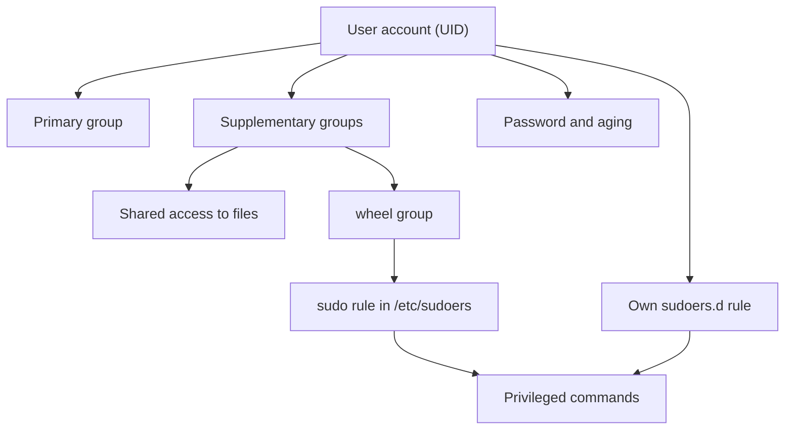

# 14 Users, Groups, Passwords, and Sudo

> By the end of this lesson you can create, change and remove local users and groups, set passwords and aging rules, and grant sudo access without risking a broken sudoers file.

!!! example "Try it now (2 minutes)"
    ```bash
    id
    getent passwd student
    sudo grep '^%wheel' /etc/sudoers
    ```
    ```text title="Example output"
    uid=1000(student) gid=1000(student) groups=1000(student),10(wheel)
    student:x:1000:1000:student:/home/student:/bin/bash
    %wheel	ALL=(ALL)	ALL
    ```
    <!-- VERIFY: group list of the student user on the RHEL 10 lab image -->
    Notice three things. `id` shows your user ID, your primary group and your extra groups. `getent passwd` shows one account as seven colon-separated fields. And the `%wheel` line says "everyone in the group `wheel` may run any command as any user". That is why `student` can use `sudo`. By the end of this lesson you will know how to build all three yourself.

## Why it matters

User administration is a core RHCSA skill, and many other tasks depend on it: ownership, group access, scheduled jobs and service accounts all assume the right users exist. A typical task reads "create the user `dev1` with UID 3101 in the group `appadmins`, force a password change every 90 days, and let the group use sudo". In real life, admins onboard people, give teams shared access through groups, expire contractor accounts, and delegate administrator rights through `sudo` instead of sharing the root password.

**Objectives covered:**

- Create, delete, and modify local user accounts
- Change passwords and adjust password aging for local user accounts
- Create, delete, and modify local groups and group memberships
- Configure privileged access

**Prereqs:** [01 Shell Basics and Command Syntax](01-shell-basics-and-command-syntax.md) and [06 Links, Permissions, and Default Permissions](06-links-permissions-and-default-permissions.md) · **Time:** about 6 h

**Tools used:** `useradd`, `usermod`, `userdel`, `passwd`, `chpasswd`, `chage`, `groupadd`, `groupmod`, `groupdel`, `gpasswd`, `id`, `groups`, `getent`, `sudo`, `visudo`

**Offline help for this topic:** `man useradd`, `man usermod`, `man userdel`, `man passwd`, `man chage`, `man groupadd`, `man gpasswd`, `man sudoers`, `man visudo`, `man 5 passwd`, `man 5 shadow`

!!! note "Supporting skill (not a listed RHEL 10 objective)"
    A few extras are kept because they come up in real work and make the listed objectives easier to understand: `newgrp` (switch your active primary group for one shell), `find / -nouser` (hunt for files left behind by a deleted user), and the `/var/log/secure` sudo log. Learn the four listed objectives first.

## How it works

A **user account** is a name plus a number. The kernel only cares about the number, the **UID** (user ID). A **group** is a named collection of users, also stored as a number, the **GID**. Think of a building: the UID is a person's badge, groups are the departments whose doors the badge opens, and `sudo` is a controlled key to the maintenance room that the building manager (root) hands out by name.

Every user has one **primary group** (the group given to files the user creates) and any number of **supplementary groups** (extra doors). Account data lives in three plain text files:

| File | Holds | Who can read it |
|---|---|---|
| `/etc/passwd` | One line per user: `name:x:UID:GID:comment:home:shell` | Everyone |
| `/etc/shadow` | Password hash and aging data: `name:hash:lastchange:min:max:warn:inactive:expire` | Root only |
| `/etc/group` | One line per group: `name:x:GID:member1,member2` | Everyone |

The `x` in `/etc/passwd` means "the real hash is in `/etc/shadow`". Never edit these files by hand; the tools below keep the three files consistent.



### Password aging in plain words

Password aging controls how long a password may live. All values are counted in days:

| Setting | `chage` option | Meaning |
|---|---|---|
| Minimum age | `-m` | Days the user must wait before changing the password again |
| Maximum age | `-M` | Days after which the password must be changed |
| Warning | `-W` | Days before expiry that the user starts seeing a warning |
| Inactive | `-I` | Days after the password expires before the account is locked for good |
| Last change | `-d` | Date of the last change; `-d 0` means "must change at next login" |
| Account expiry | `-E` | Date after which the **whole account** is disabled |

Do not confuse the two kinds of expiry. A **password** that expires can be renewed by the user at login. An **account** that expires is dead until an admin changes the date.

### Privileged access

Best practice: work as a regular user and elevate only for the command that needs it. On RHEL, membership in the group **`wheel`** is the standard way to grant that, because `/etc/sudoers` already contains the `%wheel` rule you saw above. For anything more specific (a different group, a single command, no password prompt) you add a small file under `/etc/sudoers.d/`. Switching to another user with `su - user`, `sudo -i` or `sudo -u user` is taught in [01 Shell Basics and Command Syntax](01-shell-basics-and-command-syntax.md); this lesson links to it rather than repeating it.

## Commands, step by step

### 1. Create and inspect users

```bash
sudo useradd alice
id alice
getent passwd alice
```

```text title="Example output"
uid=1001(alice) gid=1001(alice) groups=1001(alice)
alice:x:1001:1001::/home/alice:/bin/bash
```
<!-- VERIFY: first free UID on the lab image; may be 1001 or 1002 -->

On RHEL, `useradd` creates a home directory (copied from `/etc/skel`) and a private group with the same name by default, taking the next free UID from 1000 upward. The account has **no usable password** yet, so nobody can log in as it until you set one.

Common options, and the choices a task usually asks about:

```bash
sudo groupadd developers
sudo useradd -u 1500 -g users -G wheel,developers -c "App Service" -s /bin/bash -d /home/carol -m carol
```

| Option | Meaning |
|---|---|
| `-u 1500` | Set a specific UID instead of the next free one |
| `-g users` | Set the **primary** group (name or GID). Without it, a new group named after the user is created |
| `-G wheel,developers` | Set **supplementary** groups at creation. Each group must already exist, or `useradd` fails |
| `-c "App Service"` | Comment (GECOS) field, shown by `finger` and in `/etc/passwd` |
| `-s /bin/bash` | Login shell. Use `-s /sbin/nologin` for a service account nobody should log in as |
| `-d /home/carol` | Home directory path (default is `/home/NAME`) |
| `-m` | Create the home directory. Already the RHEL default, but explicit is safe |
| `-e 2026-12-31` | Account expiry date, as an alternative to `chage -E` |
| `-r` | Create a **system** account (low UID, no aging, no home by default) |

System-wide defaults come from two files. `useradd -D` prints the values from `/etc/default/useradd` only (default shell, home base, skeleton directory). The UID ranges and the password aging defaults for new accounts come from `/etc/login.defs`:

```bash
useradd -D
grep -E '^(UID_MIN|UID_MAX|PASS_MAX_DAYS|PASS_MIN_DAYS|PASS_WARN_AGE|CREATE_HOME)' /etc/login.defs
```

```text title="Example output"
GROUP=100
GROUPS=
HOME=/home
INACTIVE=-1
EXPIRE=
SHELL=/bin/bash
SKEL=/etc/skel
USRSKEL=/usr/etc/skel
CREATE_MAIL_SPOOL=yes
LOG_INIT=yes
PASS_MAX_DAYS	99999
PASS_MIN_DAYS	0
PASS_WARN_AGE	7
UID_MIN                  1000
UID_MAX                 60000
CREATE_HOME	yes
```

Changing `PASS_MAX_DAYS` in `/etc/login.defs` affects **new** accounts only. Existing users keep what is already in `/etc/shadow`; change those with `chage`.

### 2. Modify and delete users

`usermod` takes the same style of options as `useradd` and changes an existing account. The examples assume `alice` and `dana` already exist (`sudo useradd alice; sudo useradd dana`):

```bash
sudo usermod -c "Alice Ops" -s /bin/bash alice     # comment and shell
sudo usermod -g developers alice                     # primary group
sudo usermod -aG wheel alice                         # APPEND a supplementary group
sudo usermod -l dana2 dana                           # rename (login name only)
sudo usermod -d /home/dana2 -m dana2                 # move home directory
```

| Option | Meaning |
|---|---|
| `-aG group` | **Append** to supplementary groups. Always use `-a` together with `-G` |
| `-G group,...` (no `-a`) | **Replace** all supplementary groups with this list. This silently removes the user from every other group |
| `-g group` | Change the primary group |
| `-l new old` | Rename the login. The home directory is not renamed unless you also use `-d -m` |
| `-L` / `-U` | Lock / unlock the password |
| `-e date` | Account expiry date |

Delete an account with `userdel`:

```bash
sudo userdel dana2          # removes the account, KEEPS /home/dana2 and the mail spool
sudo userdel -r dana2       # removes the account AND its home directory and mail spool (use one or the other)
```

Without `-r` the home directory stays, owned by a bare number (the old UID). Decide first whether the data should be kept. To find such leftovers later: `sudo find / -xdev -nouser 2>/dev/null`. You cannot delete a user who is logged in.

### 3. Create and manage groups

```bash
sudo groupadd -g 3000 ops
sudo groupadd developers
sudo groupmod -n devs developers      # rename
sudo groupmod -g 3050 devs            # change GID
sudo groupdel devs
getent group ops
```

```text title="Example output"
ops:x:3000:
```

Add and remove members without touching their other groups:

```bash
sudo usermod -aG ops alice       # add alice to ops
sudo gpasswd -a bob ops          # add bob to ops (same effect; create bob first)
sudo gpasswd -d bob ops          # remove bob from ops
sudo gpasswd -M alice,bob ops    # set the complete member list (replaces)
id alice
groups alice
```

```text title="Example output"
uid=2001(alice) gid=3000(ops) groups=3000(ops),3001(developers)
alice : ops developers
```

How to read `id`: `uid=` is the user number, `gid=` is the **primary** group, and `groups=` lists **all** groups including the primary one. `groups alice` shows names only.

`groupdel` refuses to remove a group that is still the **primary** group of an existing user; delete or change those users first. Group membership is read at login, so a user who is already logged in must log out and back in before a new group takes effect.

### 4. Set passwords

Interactively, the safe way to set your own or another user's password:

```bash
sudo passwd alice
```

```text title="Example output"
New password:
Retype new password:
passwd: password updated successfully
```

Exam tasks usually say "set the password to X", so you need a **non-interactive** way. Both of these take the password from standard input:

```bash
echo 'Lab-Pass-2026' | sudo passwd --stdin alice
echo 'alice:Lab-Pass-2026' | sudo chpasswd
```

Both print nothing when they succeed (check the exit status with `echo $?`, or log in). Use single quotes around the password so the shell does not interpret `!` or `$`. `chpasswd` reads `user:password` lines, so one command can set many accounts.

As root, a weak password is **warned about, not refused**: `echo 'Passw0rd1' | sudo passwd --stdin alice` prints `BAD PASSWORD: The password fails the dictionary check - it is based on a dictionary word` and still sets it. Treat that line as a warning, and use the exact password the task gives.

Other `passwd` options you may need:

| Command | Effect |
|---|---|
| `passwd -l alice` / `passwd -u alice` | Lock / unlock (same as `usermod -L` / `-U`) |
| `passwd -e alice` | Force a password change at next login |
| `passwd -S alice` | One-line status |
| `passwd -n 7 -x 90 -w 14 alice` | Minimum, maximum and warning days (same as `chage -m -M -W`) |

Read the status line:

```bash
sudo passwd -S alice
```

```text title="Example output"
alice P 2026-10-27 0 99999 7 -1
```

The second field is the state: `P` usable password, `L` locked, `NP` no password. A brand-new account from `useradd` shows `L` until you set a password. The numbers are last change, minimum, maximum, warning and inactive.

### 5. Password aging with `chage`

```bash
sudo chage -M 90 -m 7 -W 14 alice
sudo chage -l alice
```

```text title="Example output"
Last password change					: Oct 27, 2026
Password expires					: Jan 25, 2027
Password inactive					: never
Account expires						: never
Minimum number of days between password change		: 7
Maximum number of days between password change		: 90
Number of days of warning before password expires	: 14
```

More forms you will need:

```bash
sudo chage -d 0 alice                       # force a change at the next login
sudo chage -I 5 alice                       # lock 5 days after the password expires
sudo chage -E "$(date -d '+30 days' +%F)" alice   # account expires in 30 days
sudo chage -E -1 alice                      # remove the account expiry (never)
```

`date -d '+30 days' +%F` prints a date such as `2026-11-26` in the `YYYY-MM-DD` form that `chage` and `usermod -e` accept, so your commands never go stale. A task may also hand you a fixed date; use it as written.

### 6. Lock, unlock and expire accounts

```bash
sudo usermod -L alice               # lock the password (a "!" is put in front of the hash)
sudo usermod -U alice               # unlock it
sudo chage -E 0 alice               # expire the account right now (date 1970-01-01)
sudo usermod -s /sbin/nologin alice # refuse interactive logins
```

- **Locking** (`usermod -L`, `passwd -l`) disables password logins and keeps the account. It does **not** stop someone who already has an SSH key from logging in.
- **Expiring** (`chage -E`, `usermod -e`) disables the whole account after a date. This is the right tool for temporary or contractor accounts.
- `/sbin/nologin` as the shell blocks interactive logins entirely and is the normal setting for service accounts.

### 7. Configure privileged access

**Option A: the `wheel` group.** The simplest and most common method on RHEL:

```bash
sudo usermod -aG wheel alice
id alice
```

Alice logs in again, and `sudo` now works for her after she types her own password. No file editing, no syntax risk.

**Option B: a drop-in file in `/etc/sudoers.d/`** for a different group, a single user or a restricted command. Always edit with `visudo`, which checks the syntax **before** it saves. For a drop-in, use `-f`:

```bash
sudo visudo -f /etc/sudoers.d/ops
```

Type this one line in the editor (vi keys, see [02 Files, Directories, and Text Editing](02-files-directories-and-text-editing.md)), save and quit:

```text
%ops ALL=(ALL) ALL
```

If the syntax is wrong, `visudo` offers to re-edit instead of saving a broken file. `visudo -f` creates a new file with mode `0640`, and `visudo -c` then reports `/etc/sudoers.d/ops: bad permissions, should be mode 0440`. Set the mode, then check everything:

```bash
sudo chmod 0440 /etc/sudoers.d/ops
sudo visudo -c
sudo ls -l /etc/sudoers.d/ops
sudo -l -U anna
```

```text title="Example output"
/etc/sudoers: parsed OK
/etc/sudoers.d/ops: parsed OK
-r--r----- 1 root root 19 Oct 27 10:12 /etc/sudoers.d/ops
User anna may run the following commands on servera:
    (ALL) ALL
```

If `anna` is in the group `ops`, the `sudo -l -U` output starts with a long `Matching Defaults entries for anna` block; the `User anna may run...` part below it is what you read. A user with no rights gets `User anna is not allowed to run sudo on servera.`

How to read the rule `%ops ALL=(ALL) ALL`:

| Part | Meaning |
|---|---|
| `%ops` | The subject. `%` means a **group**; without it the word is a user name |
| first `ALL` | On which hosts the rule applies (any) |
| `(ALL)` | Which target users the commands may run as (any) |
| last `ALL` | Which commands are allowed (any) |

Narrower rules, in the same file format:

```text
bob ALL=(ALL) /usr/bin/systemctl restart sshd
%developers ALL=(ALL) NOPASSWD: /usr/bin/systemctl status *
```

`NOPASSWD:` skips the password prompt for those commands only. Use full command paths, as `which systemctl` reports them. Drop-in file names must not contain a `.` or end in `~`, or sudo ignores the file, and the file mode should be `0440` (`sudo chmod 0440 FILE`, because `visudo -f` creates it as `0640`).

!!! warning "Never write a sudoers file with `echo ... | tee`"
    `echo '%ops ALL=(ALL) ALL' | sudo tee /etc/sudoers.d/ops` writes the line **before** anything checks it. A typo then breaks `sudo` for everyone, and you may have no way back in except the root password. Use `sudo visudo -f FILE`. If you must script it, write to a temporary file, run `sudo visudo -cf /tmp/ops.tmp`, and only then copy it with `sudo install -m 0440 /tmp/ops.tmp /etc/sudoers.d/ops`.

Test as the real user with `su - anna` then `sudo -l`; see [01 Shell Basics and Command Syntax](01-shell-basics-and-command-syntax.md) for `su -`, `sudo -i` and `sudo -u`. Every sudo use is logged. On the journal: `sudo journalctl _COMM=sudo -n 5`. <!-- VERIFY: /var/log/secure exists on RHEL 10 only if rsyslog is installed; the journal always works -->

## Worked examples

### Worked example 1: Create a user with a supplementary group

```bash
sudo groupadd developers
sudo useradd -m alice
sudo usermod -aG developers alice
id alice
```

Verification: `developers` should appear in the `groups=` list of `id alice`.

### Worked example 2: Set password aging

```bash
sudo chage -M 60 -m 5 -W 7 alice
sudo chage -l alice
```

Verification: the three "days" lines in the output show 5, 60 and 7.

### Worked example 3: Create a temporary account that expires

```bash
sudo useradd -u 1600 -c "Contractor" -s /bin/bash -m temp1
sudo chage -E "$(date -d '+30 days' +%F)" temp1
sudo chage -l temp1
```

Verification: `chage -l temp1` shows "Account expires" 30 days from today, and `id temp1` shows UID 1600.

### Worked example 4: Grant sudo through a drop-in file

```bash
sudo visudo -f /etc/sudoers.d/developers      # type: %developers ALL=(ALL) ALL
sudo chmod 0440 /etc/sudoers.d/developers
sudo visudo -c
sudo -l -U alice
```

Verification: the syntax check reports `parsed OK` and `sudo -l -U alice` lists `(ALL) ALL` (alice is in `developers` from example 1).

## Common mistakes

- **Mistake:** Creating a user but forgetting its primary or supplementary groups. **Recovery:** `sudo usermod -aG group user`, then `id user`.
- **Mistake:** Mixing group membership replacement with group membership append, for example `usermod -G wheel alice`, which removes alice from every other supplementary group. **Recovery:** always `usermod -aG`; re-add the lost groups with `-aG`.
- **Mistake:** Passing `-G` a group that does not exist. **Recovery:** `sudo groupadd name` first, then rerun the command.
- **Mistake:** Deleting a user without deciding what to do with the home directory (deleting user data too quickly). **Recovery:** decide whether `userdel` or `userdel -r` fits the task; find leftovers with `sudo find / -xdev -nouser`.
- **Mistake:** Editing `sudoers` directly, or with a normal editor or `echo | tee`, instead of `visudo`. **Recovery:** `sudo visudo -f /etc/sudoers.d/NAME`, and check with `sudo visudo -c`. If sudo is already broken, log in as root with `su -` (lab root password `redhat`) and fix the file.
- **Mistake:** Changing passwords without verifying account state, or creating accounts without verifying them. **Recovery:** run `id user` and `passwd -S user` immediately.
- **Mistake:** Thinking `usermod -L` stops all logins. **Recovery:** it only blocks the password; use `chage -E 0` or `-s /sbin/nologin` to stop key-based logins too.
- **Mistake:** Testing a new group membership in a session that was already open. **Recovery:** log out and back in (or use a fresh `su - user`), then check `id`.
- **Mistake:** Changing `/etc/login.defs` and expecting existing users to change. **Recovery:** it affects new accounts only; use `chage` on existing ones.

### Troubleshooting

| Problem | Cause | Fix |
|---|---|---|
| User missing from expected group | Forgot `-a` with `usermod -G`, or the user has not logged in again | `usermod -aG group user`; log in again |
| `sudo` broken after an edit | Syntax error in a sudoers file | `su -` as root, then `visudo -f FILE` to fix; always run `visudo -c` |
| Password aging not applied | Wrong user, wrong options, or only `login.defs` changed | Inspect with `chage -l user` and set it with `chage` |
| Home directory missing | Account created without `-m`, or the directory was removed | Rebuild it from the skeleton: `sudo mkdir /home/user; sudo cp -a /etc/skel/. /home/user/; sudo chown -R user:user /home/user; sudo chmod 700 /home/user` |
| `useradd: group 'x' does not exist` | `-g` or `-G` named a missing group | `groupadd x` first |
| `userdel: user alice is currently used by process` | Alice is logged in or has running processes | Log her out or `sudo pkill -u alice`, then retry |
| sudo file ignored | File name contains a `.` or ends in `~` | Rename it to a plain name like `ops` |

## Hands-on lab

**Setup:** shared lab environment, `servera`, logged in as `student` (sudo). Nothing in this lab touches disks. If you have run this lab before, reset it first.

??? warning "Lab reset"
    Removes everything this lab creates. Errors for missing items are harmless.
    ```bash
    sudo userdel -r anna 2>/dev/null
    sudo userdel -r ben 2>/dev/null
    sudo userdel -r temp1 2>/dev/null
    sudo rm -f /etc/sudoers.d/ops
    sudo groupdel developers 2>/dev/null
    sudo groupdel ops 2>/dev/null
    ```

**Task:**

- [ ] Create the groups `ops` (GID 3000) and `developers`.
- [ ] Create `anna` (UID 2001, comment `Anna Ops`, shell `/bin/bash`, primary group `ops`, supplementary group `developers`) and `ben` (UID 2002, supplementary group `ops`, home directory created).
- [ ] Set both passwords to `Lab-Pass-2026` without being prompted.
- [ ] Set aging for `anna`: minimum 7 days, maximum 90 days, warning 14 days. Force `ben` to change his password at first login.
- [ ] Let the group `ops` use sudo through the drop-in file `/etc/sudoers.d/ops` and validate the syntax.
- [ ] Prove with a command that `anna` may use sudo but `ben` only gets it through `ops`, then take `ben` out of `ops` and prove he lost it.
- [ ] Create `temp1` expiring 30 days from now, lock it, then delete it together with its home directory.
- [ ] Reboot and confirm everything except `temp1` is still there.

??? question "Hint 1"
    Groups must exist before `useradd` can use them. Create the groups first, then the users, then do the passwords and aging as separate commands.

??? question "Hint 2"
    Use `useradd` with `-u -c -s -g -G`, `passwd --stdin` (or `chpasswd`), `chage` for aging, `visudo -f` for the drop-in and `sudo -l -U NAME` to read what a user may run. `gpasswd -d` removes a member.

??? success "Solution"
    ```bash
    sudo groupadd -g 3000 ops
    sudo groupadd developers

    sudo useradd -u 2001 -c "Anna Ops" -s /bin/bash -g ops -G developers -m anna
    sudo useradd -u 2002 -G ops -m ben

    echo 'Lab-Pass-2026' | sudo passwd --stdin anna
    echo 'Lab-Pass-2026' | sudo passwd --stdin ben

    sudo chage -m 7 -M 90 -W 14 anna
    sudo chage -d 0 ben

    sudo visudo -f /etc/sudoers.d/ops      # type: %ops ALL=(ALL) ALL
    sudo chmod 0440 /etc/sudoers.d/ops
    sudo visudo -c

    sudo -l -U anna          # (ALL) ALL
    sudo -l -U ben           # (ALL) ALL, through ops
    sudo gpasswd -d ben ops
    sudo -l -U ben           # "User ben is not allowed to run sudo on servera."

    sudo useradd -m -e "$(date -d '+30 days' +%F)" temp1
    sudo usermod -L temp1
    sudo passwd -S temp1     # L
    sudo userdel -r temp1
    ```
    **Verify:**

    ```bash
    id anna
    id ben
    sudo chage -l anna
    sudo chage -l ben
    sudo passwd -S anna
    getent group ops
    sudo visudo -c
    ```
    `id anna` shows `uid=2001(anna) gid=3000(ops) groups=3000(ops),3001(developers)` (the `developers` GID may differ). `chage -l ben` shows "Last password change : password must be changed". `getent group ops` ends with an empty member list: `anna` is not listed because `ops` is her primary group, and `ben` was removed. `id ben` shows only his own group. `getent passwd temp1` prints nothing and `/home/temp1` does not exist. After a reboot the same commands give the same answers.

## More practice

1. Create a new user with a Bash shell.
2. Create a group and add an existing user to it.
3. Change a user's comment field or shell.
4. Set and inspect password aging for a user.
5. Remove a user while keeping the home directory.
6. Remove a user and home directory in a throwaway lab case.
7. Configure a sudoers drop-in file and verify its syntax.

### Exam-style task 1

On `servera`, create the group `appadmins` (GID 3100) and the user `dev1` (UID 3101) with `appadmins` as a supplementary group and `/bin/bash` as shell. Set the password `Passw0rd1`, a maximum password age of 90 days, a minimum of 7 days and a warning of 14 days.

**Grader mindset checklist:**

- [ ] user must exist with UID 3101
- [ ] group must exist with GID 3100
- [ ] membership must be correct
- [ ] password aging values must match the task
- [ ] configuration must persist after reboot

??? success "Solution"
    ```bash
    sudo groupadd -g 3100 appadmins
    sudo useradd -u 3101 -G appadmins -s /bin/bash -m dev1
    echo 'Passw0rd1' | sudo passwd --stdin dev1
    sudo chage -M 90 -m 7 -W 14 dev1
    id dev1
    sudo chage -l dev1
    ```

### Exam-style task 2

Give all members of `appadmins` full sudo rights using a drop-in file named `appadmins`, without editing `/etc/sudoers` itself, and validate the configuration.

**Grader mindset checklist:**

- [ ] sudo rule must exist
- [ ] syntax check must succeed
- [ ] access rule must match the requested scope (the group, not just one user)
- [ ] configuration must still work after reboot

??? success "Solution"
    ```bash
    sudo visudo -f /etc/sudoers.d/appadmins     # type: %appadmins ALL=(ALL) ALL
    sudo chmod 0440 /etc/sudoers.d/appadmins
    sudo visudo -c
    sudo -l -U dev1
    ```

## Exam tips

!!! tip "What the exam expects"
    Exact names, UIDs, GIDs, shell, group membership and aging values from the task exist; the password works; the sudo rule is in a valid drop-in with mode `0440` (or the user is in `wheel`); and all of it is still true after a reboot. Read whether the task says primary or supplementary group, and whether to keep or remove a home directory.

!!! warning "Must survive reboot"
    | Change | Persistent? | Make it persist with |
    |---|---|---|
    | `useradd`, `usermod`, `groupadd`, `gpasswd` | Yes | Nothing, they write `/etc/passwd`, `/etc/shadow`, `/etc/group` |
    | `passwd`, `chage`, `usermod -L`, `usermod -e` | Yes | Nothing, they write `/etc/shadow` |
    | `/etc/sudoers.d/NAME` and `wheel` membership | Yes | Nothing, but a syntax error breaks sudo at once: check with `visudo -c` |
    | `PASS_MAX_DAYS` etc. in `/etc/login.defs` | Yes | Nothing, but it only applies to accounts created **afterwards** |
    | A new group membership in an already open session | No | Log out and back in |

**Verify like a grader:**

1. `id user` and `getent passwd user` show the right UID, GID, groups, home and shell.
2. `getent group groupname` shows the right GID and members.
3. `sudo passwd -S user` shows `P` (password set), not `NP` or `L`.
4. `sudo chage -l user` shows the requested aging values and expiry.
5. `sudo visudo -c` reports every file as parsed OK, and `sudo -l -U user` shows the expected rights.
6. Test a real login: `sudo -iu user id` (see [01 Shell Basics and Command Syntax](01-shell-basics-and-command-syntax.md) for user switching).
7. Reboot, then repeat steps 1 to 5.

## Quiz

1. What command creates a user?
2. What does `usermod -aG` do?
3. What command shows password aging information?
4. What tool should you use to validate sudoers syntax?
5. What is the difference between `userdel user` and `userdel -r user`?
6. Why is `sudo` often preferred over constant root login?
7. How do you create a user with a specific UID and a supplementary group in one command?
8. What is the difference between locking an account (`usermod -L`) and expiring it (`chage -E`)?
9. Which files hold the system-wide defaults for new user accounts?
10. How do you set a password without being prompted?
11. Why should you edit a sudoers drop-in with `visudo -f` instead of `echo ... | tee`?
12. Which group gives a user sudo rights on a default RHEL install?
13. What does `chage -d 0 user` do?

??? success "Answers"
    1. `useradd`
    2. It appends the user to supplementary groups without removing existing ones.
    3. `chage -l username`
    4. `visudo -c` (or `visudo -cf FILE` for one file).
    5. `-r` also removes the home directory and mail spool.
    6. It limits elevated access to needed commands, keeps a log of who ran what, and avoids sharing the root password.
    7. `sudo useradd -u 1500 -G groupname username` (`-u` sets the UID, `-G` adds supplementary groups; the group must exist).
    8. Locking disables the password but keeps the account (key logins still work); expiring disables the whole account after a date.
    9. `/etc/login.defs` (UID ranges, aging defaults) and `/etc/default/useradd` (shell, home base, skeleton; view with `useradd -D`).
    10. `echo 'pw' | sudo passwd --stdin user` or `echo 'user:pw' | sudo chpasswd`.
    11. `visudo` checks the syntax before saving; `tee` writes first, so a typo can break sudo for everyone.
    12. `wheel`.
    13. It forces the user to choose a new password at the next login.

## Summary

- `useradd` creates, `usermod` changes, `userdel` removes; `groupadd` manages groups
- `usermod -aG` appends; `usermod -G` alone replaces. Mixing them up is the classic mistake
- `passwd --stdin` or `chpasswd` set passwords non-interactively; `usermod -L`/`-U` lock and unlock
- `chage` manages aging; `chage -E` / `usermod -e` expire accounts; `chage -l` shows the result
- `useradd -u` sets UID, `-G` adds groups at creation; defaults live in `/etc/login.defs`
- `wheel` is the easy sudo group; anything else goes in `/etc/sudoers.d/` edited with `visudo -f`
- verify every account change

| Task | Command |
|---|---|
| Create user | `useradd -u 1500 -c "Comment" -s /bin/bash -g pri -G grp1,grp2 -m user` |
| Defaults | `useradd -D`, `/etc/login.defs` |
| Append group | `usermod -aG group user` |
| Remove from group | `gpasswd -d user group` |
| Lock / unlock | `usermod -L user`, `usermod -U user` |
| Account expiry | `usermod -e 2026-12-31 user`, `chage -E 2026-12-31 user` |
| Delete user | `userdel user`, `userdel -r user` |
| Group | `groupadd group`, `groupmod -n new old`, `groupdel group` |
| Set password | `echo 'pw' \| passwd --stdin user`, `passwd user` |
| Aging | `chage -M 90 -m 7 -W 14 user`, `chage -d 0 user`, `chage -l user` |
| Status | `passwd -S user`, `id user`, `groups user` |
| Sudo via wheel | `usermod -aG wheel user` |
| Sudo drop-in | `visudo -f /etc/sudoers.d/name`, `chmod 0440 /etc/sudoers.d/name`, `visudo -c`, `sudo -l -U user` |

**Previous:** [13 Networking, Hostname Resolution, and firewalld](13-networking-hostname-resolution-and-firewalld.md) · **Next:** [15 SELinux, SSH Keys, and Security](15-selinux-ssh-keys-and-security.md): with accounts in place, you protect them with SELinux contexts and key-based SSH logins.
