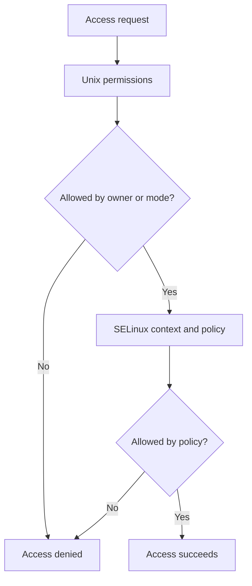
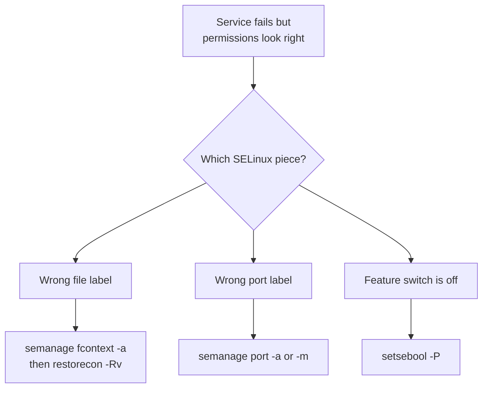
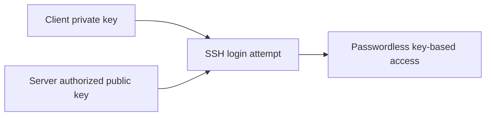

# 15 SELinux, SSH Keys, and Security

> By the end of this lesson you can tell when SELinux is the reason something is blocked, fix it with the right tool (label, port or boolean) instead of switching SELinux off, and log in over SSH with a key.

!!! example "Try it now (2 minutes)"
    ```bash
    getenforce
    id -Z
    ls -Z /etc/passwd /etc/shadow
    ```
    ```text title="Example output"
    Enforcing
    unconfined_u:unconfined_r:unconfined_t:s0-s0:c0.c1023
    system_u:object_r:passwd_file_t:s0 /etc/passwd
    system_u:object_r:shadow_t:s0 /etc/shadow
    ```
    <!-- VERIFY: exact context strings on the RHEL 10 lab image -->
    Notice the odd text with colons in front of every file name. That is the **SELinux label**. Two files with ordinary owners and modes get different labels, and the label decides which programs may touch them. By the end of this lesson you will read these labels and change them.

## Why it matters

SELinux is behind the classic exam trap: a service looks correctly configured, file permissions are fine, and it still fails. The answer is almost always a wrong file label, a missing port label or a switched-off boolean. SSH key login is the other half of this lesson: admins use keys instead of passwords for every remote login and for scripts. In real life, nobody keeps a server secure by disabling SELinux, so the skill is working with it.

**Objectives covered:**

- Configure key-based authentication for SSH
- Set enforcing and permissive modes for SELinux
- List and identify SELinux file and process context
- Restore default file contexts
- Manage SELinux port labels
- Use Boolean settings to modify system SELinux settings

**Prereqs:** [05 SSH, Login Control, and Remote Workflows](05-ssh-login-switching-users-and-remote-workflows.md), [06 Links, Permissions, and Default Permissions](06-links-permissions-and-default-permissions.md) and [13 Networking, Hostname Resolution, and firewalld](13-networking-hostname-resolution-and-firewalld.md) · **Time:** about 8 h

**Tools used:** `getenforce`, `setenforce`, `sestatus`, `ls -Z`, `ps -eZ`, `id -Z`, `restorecon`, `chcon`, `semanage`, `getsebool`, `setsebool`, `ssh-keygen`, `ssh-copy-id`, `ssh`, `sshd -t`

**Offline help for this topic:** `man selinux`, `man getenforce`, `man restorecon`, `man semanage-fcontext`, `man semanage-port`, `man semanage-boolean`, `man setsebool`, `man ssh-keygen`, `man ssh-copy-id`, `man sshd_config`

!!! note "Supporting skill (not a listed RHEL 10 objective)"
    Reading SELinux denials (`ausearch -m avc`, `sealert`) and using `chcon` are **not** on the RHEL 10 objective list; they do not appear in the official list. They are kept here because they show you *which* of the three fixes (label, port, boolean) you need. Firewall rules and default permissions (`umask`) are also objectives under "Manage security", but they are taught in [13](13-networking-hostname-resolution-and-firewalld.md) and [06](06-links-permissions-and-default-permissions.md). Both labs here assume you have read them.

## How it works

Linux checks access in two layers. First the normal **Unix permissions** (owner, group, mode bits). Only if those allow it does **SELinux** get a vote. SELinux compares the **label** on the process with the label on the target file, port or setting, and asks its policy whether that pairing is allowed. Think of a building with two doors: the key (permissions) opens the first, and a badge scanner (SELinux) guards the second. A perfect key does not help if the badge is wrong.



### Modes

| Mode | What SELinux does |
|---|---|
| `enforcing` | Rules are applied; violations are blocked and logged |
| `permissive` | Violations are only logged, not blocked. Good for testing "is it SELinux?" |
| `disabled` | SELinux off |

For RHCSA, learn to work with SELinux, not around it.

### A label has four fields

```text
unconfined_u : object_r : httpd_sys_content_t : s0
   user         role          TYPE              level
```

For this course only the third field, the **type**, matters. Rules read like "a process of type `httpd_t` may read files of type `httpd_sys_content_t`". The server program `httpd` runs as `httpd_t`, so a web page labelled with any other type is invisible to it.

### Three things can be wrong



### Key-based SSH in one picture



The private key never leaves the client. The public key goes into `~/.ssh/authorized_keys` on the server. The server proves you hold the private key without you typing a password. Overview and first steps are in [05](05-ssh-login-switching-users-and-remote-workflows.md); this lesson covers the permission and SELinux side.

### What persists

- `setenforce` changes now only
- `/etc/selinux/config` controls the boot mode
- `setsebool -P` persists booleans; `setsebool` without `-P` does not
- `semanage fcontext` and `semanage port` rules are stored in policy, so they persist
- `chcon` labels are lost on the next relabel
- SSH keys remain usable after reboot if installed with correct modes and labels

## Commands, step by step

### 1. Check and set the SELinux mode

```bash
getenforce
sestatus
sudo setenforce 0        # permissive now (temporary)
getenforce
sudo setenforce 1        # enforcing now (temporary)
```

```text title="Example output"
Enforcing
SELinux status:                 enabled
SELinuxfs mount:                /sys/fs/selinux
SELinux root directory:         /etc/selinux
Loaded policy name:             targeted
Current mode:                   enforcing
Mode from config file:          enforcing
Policy MLS status:              enabled
Policy deny_unknown status:     allowed
Max kernel policy version:      33
```
<!-- VERIFY: sestatus field list and policy version number on RHEL 10 -->

`setenforce` only changes the running system and is gone after a reboot. To change the mode that applies at boot, edit the `SELINUX=` line in `/etc/selinux/config`:

```bash
sudo vi /etc/selinux/config
```

```ini
# valid values: enforcing, permissive, disabled
SELINUX=enforcing
SELINUXTYPE=targeted
```

| Item | Meaning |
|---|---|
| `getenforce` | Prints the current mode only |
| `sestatus` | Shows current mode **and** "Mode from config file" so you can compare runtime with boot |
| `setenforce 0` / `1` | Permissive / enforcing, now, temporary. Cannot reach `disabled` |
| `SELINUX=` | The boot-time mode. Use `enforcing` or `permissive` |
| `SELINUXTYPE=targeted` | Which policy is loaded. Leave it as `targeted` |

- Verify the configured value with `sestatus`: both lines should match the mode the task asks for.
- You can force permissive for one boot from GRUB by appending `enforcing=0` to the kernel line. That is useful for recovery.
- Switching enforcing and permissive needs no relabel. If a system was ever `disabled`, files created in that time may be unlabeled, and going straight to `enforcing` can leave services denied or the boot stuck. Re-enable in two steps: set `SELINUX=permissive` in `/etc/selinux/config`, run `sudo touch /.autorelabel`, and reboot (the whole disk is relabeled on that boot, which is slow on big disks). Once the system is up and `sestatus` shows `permissive`, set `SELINUX=enforcing`, run `sudo setenforce 1`, and check `getenforce`. The relabel is **not** automatic: without the flag file nothing is relabeled. <!-- VERIFY: Red Hat's documented order for re-enabling SELinux from disabled on RHEL 10 (permissive + /.autorelabel, reboot, then enforcing); recent kernels no longer allow runtime disable, and selinux=0 on the kernel command line is the supported way to truly disable. Exam tasks only need enforcing/permissive. -->

### 2. Inspect contexts

```bash
ls -Zd /etc/shadow /home/student /var/log
ps -eZ | grep sshd
id -Z
```

```text title="Example output"
system_u:object_r:shadow_t:s0         /etc/shadow
unconfined_u:object_r:user_home_dir_t:s0 /home/student
system_u:object_r:var_log_t:s0        /var/log
system_u:system_r:sshd_t:s0-s0:c0.c1023 1043 ?      00:00:00 sshd
unconfined_u:unconfined_r:unconfined_t:s0-s0:c0.c1023
```
<!-- VERIFY: label values and column spacing; PIDs are illustrative -->

| Command | What it shows |
|---|---|
| `ls -Z` / `ls -Zd dir` | Label of files (or of the directory itself with `-d`) |
| `ps -eZ` | Label of every process; the type ends in `_t` |
| `id -Z` | The label of your own login shell |

### 3. Restore default labels with `restorecon`

`restorecon` resets a file to the **default** label the policy has for its path.

```bash
sudo restorecon -Rv /var/www/html
sudo restorecon -Rnv /var/www/html     # -n = dry run, show what would change
```

```text title="Example output"
Relabeled /var/www/html/index.html from unconfined_u:object_r:user_home_t:s0 to unconfined_u:object_r:httpd_sys_content_t:s0
```

| Option | Meaning |
|---|---|
| `-R` | Recurse into the directory |
| `-v` | Print each file whose label changed (without it, silence even when it works) |
| `-n` | Dry run: change nothing, report only |

If `restorecon` prints nothing, either the label is already correct or the policy has no rule for the path.

### 4. Give a custom path a persistent label

`restorecon` alone cannot help a custom path like `/web`: it has no default rule, so it stays `default_t`. Record the rule with `semanage fcontext`, then apply it:

```bash
sudo mkdir /web
echo 'hello from /web' | sudo tee /web/index.html
ls -Zd /web /web/index.html
sudo semanage fcontext -a -t httpd_sys_content_t "/web(/.*)?"
sudo restorecon -Rv /web
ls -Zd /web /web/index.html
```

```text title="Example output"
unconfined_u:object_r:default_t:s0 /web
unconfined_u:object_r:default_t:s0 /web/index.html
Relabeled /web from unconfined_u:object_r:default_t:s0 to unconfined_u:object_r:httpd_sys_content_t:s0
Relabeled /web/index.html from unconfined_u:object_r:default_t:s0 to unconfined_u:object_r:httpd_sys_content_t:s0
unconfined_u:object_r:httpd_sys_content_t:s0 /web
unconfined_u:object_r:httpd_sys_content_t:s0 /web/index.html
```

| Form | Use |
|---|---|
| `semanage fcontext -a -t TYPE "path(/.*)?"` | Add a new rule |
| `semanage fcontext -m -t TYPE "path(/.*)?"` | Modify a rule that already exists for that path |
| `semanage fcontext -d "path(/.*)?"` | Delete your rule |
| `semanage fcontext -l -C` | List only the rules **you** added |

- The regular expression `"/web(/.*)?"` means the directory itself plus everything under it. Always quote it so the shell does not expand it.
- To copy the label style of an existing directory, find its type with `ls -Zd /var/www/html` first.
- `chcon -t httpd_sys_content_t /web/index.html` also sets a label, but it is **not persistent**: the next relabel or `restorecon` undoes it. Prefer `semanage fcontext` + `restorecon`.

**Moving versus copying.** A file keeps the label it already had when you `mv` it, because the file is not recreated. A copy is a new file and takes the label of its destination.

```bash
echo 'moved' > ~/moved.html
ls -Z ~/moved.html
sudo mv ~/moved.html /web/
ls -Z /web/moved.html
sudo restorecon -v /web/moved.html
```

```text title="Example output"
unconfined_u:object_r:user_home_t:s0 /home/student/moved.html
unconfined_u:object_r:user_home_t:s0 /web/moved.html
Relabeled /web/moved.html from unconfined_u:object_r:user_home_t:s0 to unconfined_u:object_r:httpd_sys_content_t:s0
```
<!-- VERIFY: mv keeps user_home_t when /home and /web are on the same or different filesystems on the lab image -->

The same thing explains "I moved my site into `/var/www/html` and got 403": after a move, always run `restorecon -Rv` on the destination. (`cp -a` also keeps the old label; plain `cp` does not.)

### 5. Manage port labels

A service may only bind to ports whose label it is allowed to use. `httpd_t` can use `http_port_t`; any other port needs relabeling.

```bash
sudo semanage port -l | grep -w http_port_t
sudo semanage port -l | grep -w 8888
sudo semanage port -a -t http_port_t -p tcp 8888
sudo semanage port -l | grep -w http_port_t
sudo semanage port -l -C
```

```text title="Example output"
http_port_t                    tcp      80, 81, 443, 488, 8008, 8009, 8443, 9000
http_port_t                    tcp      8888, 80, 81, 443, 488, 8008, 8009, 8443, 9000
tcp   8888   http_port_t
```
<!-- VERIFY: default http_port_t list; that tcp/8888 has no label in the RHEL 10 policy (the second command printed nothing above) -->

| Form | Use |
|---|---|
| `-a -t TYPE -p tcp PORT` | **Add** a port that has no label yet |
| `-m -t TYPE -p tcp PORT` | **Modify** a port that already has a label (change its type) |
| `-d -t TYPE -p tcp PORT` | **Delete** a rule you added. Ports defined by the base policy cannot be deleted |
| `-l` / `-l -C` | List all / list only local changes |

!!! warning "Add fails if the port is already labelled"
    `tcp/8080` is already `http_cache_port_t` in policy. `semanage port -a -t http_port_t -p tcp 8080` fails with `ValueError: Port tcp/8080 already defined`. Use `-m`: `sudo semanage port -m -t http_port_t -p tcp 8080`. Always run `semanage port -l | grep -w PORT` first: if it prints a line the port is labelled and you need `-m`; if it prints nothing you need `-a`.

A port label only lets the service **bind**. It does not open the firewall. If remote clients must reach it, also add the port in `firewalld` as in [13](13-networking-hostname-resolution-and-firewalld.md).

### 6. Use booleans

A boolean is a built-in on/off switch for a common policy choice, so you do not need to write policy.

```bash
getsebool -a | grep httpd_can_network
sudo semanage boolean -l | grep httpd_can_network_connect
sudo setsebool -P httpd_can_network_connect on
getsebool httpd_can_network_connect
sudo semanage boolean -l -C
```

```text title="Example output"
httpd_can_network_connect --> off
httpd_can_network_connect_db --> off
httpd_can_network_connect          (off  ,  off)  Allow httpd to can network connect
httpd_can_network_connect --> on
httpd_can_network_connect          (on   ,   on)  Allow httpd to can network connect
```
<!-- VERIFY: semanage boolean -l column layout and description text; setsebool -P can take several seconds -->

| Command | Meaning |
|---|---|
| `getsebool -a` | All booleans and their current state |
| `semanage boolean -l` | Same, plus (current, default) state and a description of each |
| `setsebool name on` | Change now only; lost at reboot |
| `setsebool -P name on` | Change now **and** make permanent |

### 7. Supporting skill: read an SELinux denial

When SELinux blocks something, the kernel logs an **AVC** (access vector cache) denial in the audit log. Read it to learn whether the problem is a label, a port or a boolean.

```bash
sudo ausearch -m avc -ts recent
sudo grep AVC /var/log/audit/audit.log
sudo sealert -a /var/log/audit/audit.log
```

```text title="Example output"
type=AVC msg=audit(1767.123:210): avc:  denied  { name_bind } for  pid=2210 comm="httpd" src=8888 scontext=system_u:system_r:httpd_t:s0 tcontext=system_u:object_r:unreserved_port_t:s0 tclass=tcp_socket permissive=0
```
<!-- VERIFY: exact AVC wording and timestamp; sealert needs the setroubleshoot-server package -->

How to read it:

| Part | Meaning |
|---|---|
| `denied { name_bind }` | The action refused: binding to a port |
| `comm="httpd"` / `scontext=...httpd_t` | The program (source) |
| `tcontext=...unreserved_port_t` | The label of the thing it touched (target) |
| `tclass=tcp_socket` | The kind of object (a port; for files you see `file` or `dir`) |

A `name_bind` denial on a tcp socket means port label. A `read` or `getattr` on `file` or `dir` means file label. A denial that mentions a networking action by a web server (for example `name_connect`) suggests a boolean. `sealert -a` goes one step further and prints the suggested fix. If `ausearch` or `sealert` is missing, install `audit` and `setroubleshoot-server`. If `semanage` is missing, install `policycoreutils-python-utils` (find the package for any missing command with `dnf provides '*/semanage'`).

Do **not** use `audit2allow` to generate rules for the exam: it hides the problem by allowing it.

### 8. Create an SSH key pair and install it

Do the steps in order on the **client** (`servera`). `ssh-copy-id` copies a key that must already exist.

```bash
ssh-keygen -t ed25519
ssh-copy-id student@serverb.lab.example
ssh student@serverb.lab.example hostname
```

```text title="Example output"
Generating public/private ed25519 key pair.
Enter file in which to save the key (/home/student/.ssh/id_ed25519):
Enter passphrase (empty for no passphrase):
Your identification has been saved in /home/student/.ssh/id_ed25519
Your public key has been saved in /home/student/.ssh/id_ed25519.pub
The key fingerprint is:
SHA256:EkQfJY/S4GJvRaEEM5PXY/EMKsXH3nB+prPDFHxQMh8 student@servera.lab.example
The key's randomart image is:
+--[ED25519 256]--+
|    ==*oB++.E    |
|    .OoBBOo+ .   |
|    +.*+=B+..    |
|   . + +. = +    |
|      + S  *     |
|     . .  +      |
|         o o     |
|          +      |
|           .     |
+----[SHA256]-----+

Number of key(s) added: 1

serverb.lab.example
```
<!-- VERIFY: ssh-copy-id wording on RHEL 10 (the ssh-keygen prompts and randomart block were observed; the key itself and fingerprint are illustrative) -->

| Option / prompt | Meaning |
|---|---|
| `-t ed25519` | Key type. A modern strong default (it is also what `ssh-keygen` creates if you give no `-t`) |
| `-f path` | Where to write the key (default `~/.ssh/id_ed25519`) |
| `-N ''` | Empty passphrase, no prompt (fine for the lab; a passphrase is safer at work) |
| passphrase prompt | Encrypts the private key on disk. Press Enter for none |
| `ssh-copy-id user@host` | Appends your **public** key to the server's `authorized_keys` and fixes its modes |

Never copy the private key (`id_ed25519`) to a server. Only the `.pub` file goes there.

**Installing a key by hand** (when `ssh-copy-id` is unavailable) must produce the same result:

```bash
ssh student@serverb.lab.example 'mkdir -p ~/.ssh && chmod 700 ~/.ssh'
cat ~/.ssh/id_ed25519.pub | ssh student@serverb.lab.example 'cat >> ~/.ssh/authorized_keys && chmod 600 ~/.ssh/authorized_keys'
```

### 9. SSH files need the right modes and labels

`sshd` refuses keys from files that other users could change. On the **server**:

| Path | Mode | Label (type) |
|---|---|---|
| `~/.ssh/` | `700` | `ssh_home_t` |
| `~/.ssh/authorized_keys` | `600` | `ssh_home_t` |
| `~` (home directory) | not writable by group or others | `user_home_dir_t` |

```bash
ls -ld ~ ~/.ssh ~/.ssh/authorized_keys
ls -Zd ~/.ssh ~/.ssh/authorized_keys
chmod 700 ~/.ssh
chmod 600 ~/.ssh/authorized_keys
restorecon -Rv ~/.ssh
```

```text title="Example output"
drwx------. 2 student student 29 Oct 27 10:02 /home/student/.ssh
-rw-------. 1 student student 96 Oct 27 10:02 /home/student/.ssh/authorized_keys
unconfined_u:object_r:ssh_home_t:s0 /home/student/.ssh
unconfined_u:object_r:ssh_home_t:s0 /home/student/.ssh/authorized_keys
```

`ssh-copy-id` sets these for you, and files created inside a correctly labelled `~/.ssh` inherit `ssh_home_t`. An `authorized_keys` that was created elsewhere and moved in keeps its old label, so run `restorecon -R ~/.ssh` as the safe fix. <!-- VERIFY: whether a mislabeled authorized_keys is denied to sshd_t on RHEL 10 policy; the restorecon step is harmless either way -->

When key login still asks for a password, look on the server in the journal:

```bash
sudo journalctl -u sshd -n 5
```

```text title="Example output"
Oct 27 10:05:11 serverb sshd[2301]: Authentication refused: bad ownership or modes for directory /home/student/.ssh
```
<!-- VERIFY: exact sshd log wording on RHEL 10 -->

### 10. `sshd_config` switches

The server settings live in `/etc/ssh/sshd_config` (and drop-in files in `/etc/ssh/sshd_config.d/`).

| Setting | Meaning |
|---|---|
| `PubkeyAuthentication yes` | Allow key login (normally the default) |
| `PasswordAuthentication yes\|no` | Allow or forbid password login. Set `no` only after key login works |
| `PermitRootLogin no\|prohibit-password\|yes` | Whether root may log in over SSH, and how. The built-in default is `prohibit-password` (key only); `sshd -T` prints it as `without-password`, the old name for the same thing |

!!! warning "Drop-ins in `/etc/ssh/sshd_config.d/` are read first, and the first value wins"
    The main file includes `/etc/ssh/sshd_config.d/*.conf` **before** its own settings. For each setting, sshd keeps the **first** value it reads. So a line in `sshd_config` is silently ignored if a drop-in already set the same option (for example a cloud image's `50-cloud-init.conf` setting `PasswordAuthentication yes`). RHEL 10 itself ships two drop-ins, `40-redhat-crypto-policies.conf` and `50-redhat.conf`; the `Include` line sits near the top of `sshd_config`, and with no other drop-in the defaults are `PasswordAuthentication yes` and `PermitRootLogin prohibit-password`. Do not trust the file you edited; ask sshd what it actually uses:

    ```bash
    ls /etc/ssh/sshd_config.d/
    sudo sshd -T | grep -iE 'permitrootlogin|passwordauthentication'
    ```

    Change the value in the drop-in that sets it, or create an earlier-sorting drop-in of your own (for example `/etc/ssh/sshd_config.d/00-lab.conf`), then re-run the `sshd -T` check. <!-- VERIFY: extra drop-ins that Red Hat's installer or cloud images add (for example 01-permitrootlogin.conf, 50-cloud-init.conf); the two RHEL drop-ins and the early Include were observed -->

```bash
sudo vi /etc/ssh/sshd_config.d/00-lab.conf     # for example: PasswordAuthentication no
sudo sshd -t
sudo sshd -T | grep -iE 'permitrootlogin|passwordauthentication'
sudo systemctl reload sshd
```

`sshd -t` checks the syntax and prints nothing when it is fine. Run it before every restart or reload, and reload only after it passes. Keep your current session open while you test a second login, so a mistake cannot lock you out.

## Common mistakes

- **Mistake:** Disabling SELinux instead of understanding the real issue. **Recovery:** switch to permissive (`setenforce 0`) only to test; if that fixes it, re-enable (`setenforce 1`) and fix the label, port or boolean.
- **Mistake:** Using `setenforce 0` and forgetting it is temporary (or thinking it is permanent). **Recovery:** `getenforce` now, `sestatus` for the boot value. Only `/etc/selinux/config` persists.
- **Mistake:** Changing file permissions when the real problem is the label. **Recovery:** check both `ls -l` and `ls -Z`; trusting normal file permissions alone misses the SELinux layer.
- **Mistake:** Moving content to a non-standard path without relabeling. **Recovery:** `semanage fcontext -a ...` then `restorecon -Rv path`. A moved file keeps its old label.
- **Mistake:** Using `chcon` and thinking it is permanent. **Recovery:** it is lost on relabel; use `semanage fcontext` + `restorecon`.
- **Mistake:** Temporary boolean change when persistence is required. **Recovery:** add `-P`: `setsebool -P name on`.
- **Mistake:** `semanage port -a` on a port that already has a label (for example 8080). **Recovery:** check with `semanage port -l | grep -w PORT`; use `-m` to change an existing label.
- **Mistake:** Thinking the port label opens the firewall. **Recovery:** it does not. Add the port in `firewalld` too ([13](13-networking-hostname-resolution-and-firewalld.md)).
- **Mistake:** Generating SSH keys but not copying the public key correctly. **Recovery:** `ssh-copy-id user@host`, then test with `ssh user@host hostname`.
- **Mistake:** Copying the private key instead of the public key. **Recovery:** only install the `.pub` key on the server; if the private one was copied to a shared place, generate a new pair.
- **Mistake:** `~/.ssh` or `authorized_keys` left group-writable. **Recovery:** `chmod 700 ~/.ssh; chmod 600 ~/.ssh/authorized_keys`, then `restorecon -R ~/.ssh`.
- **Mistake:** Setting `PasswordAuthentication no` before key login works. **Recovery:** keep a second session open, test a key login first, and keep console access.

### Troubleshooting

| Problem | Cause | Fix |
|---|---|---|
| Service still denied after permissions were fixed | SELinux label, port or boolean | Check `ls -Z`, `semanage port -l`, `getsebool -a`; read `ausearch -m avc -ts recent` |
| `setenforce 0` fixed the issue | Confirms SELinux is involved, but does not solve the root cause | `setenforce 1`, then fix the label, boolean or port label |
| SSH key login still asks for a password | Key not copied, wrong user, wrong modes or label on `~/.ssh`, or server SSH settings | Check `ls -ld ~ ~/.ssh`, `ls -Z ~/.ssh`, `restorecon -R ~/.ssh`, `journalctl -u sshd` on the server |
| `semanage: command not found` | The SELinux policy management tools are not installed | `sudo dnf install policycoreutils-python-utils` |
| `ValueError: Port tcp/NNNN already defined` | The port already has a label | Use `semanage port -m` instead of `-a` |
| `restorecon` changes nothing on a custom path | No rule exists for that path | Add one with `semanage fcontext -a`, then `restorecon -Rv` |

## Hands-on lab

### Lab A: label, port and boolean fix on a web server

**Setup:** shared lab environment, `servera`, user `student`. Install a web server that will be configured to use a custom directory and a custom port. Run once:

```bash
sudo dnf install -y httpd policycoreutils-python-utils curl
# clear anything an earlier run left behind, so a rerun starts from the same state
sudo systemctl stop httpd 2>/dev/null
sudo semanage port -d -t http_port_t -p tcp 8888 2>/dev/null
sudo semanage fcontext -d "/web(/.*)?" 2>/dev/null
sudo setsebool -P httpd_can_network_connect off
sudo rm -rf /web /etc/httpd/conf.d/lab.conf
sudo mkdir -p /web
echo 'hello from /web' | sudo tee /web/index.html
sudo tee /etc/httpd/conf.d/lab.conf >/dev/null <<'EOF'
Listen 8888
DocumentRoot "/web"
<Directory "/web">
    Require all granted
</Directory>
EOF
sudo httpd -t
```
<!-- VERIFY: the conf.d DocumentRoot/Listen override works with the RHEL 10 httpd package; Syntax OK expected -->

**Task:**

- [ ] Confirm SELinux is `Enforcing` with `getenforce` and `sestatus`.
- [ ] Start `httpd`. It fails to start. Prove that SELinux caused it (`ausearch -m avc -ts recent`), then label tcp port 8888 as `http_port_t` and start it.
- [ ] `curl http://localhost:8888/` returns `403 Forbidden`. Find the label problem on `/web` and fix it persistently so the page is served.
- [ ] Create `~/moved.html` containing `moved`, `sudo mv` it into `/web/`, show that its label stayed `user_home_t`, and repair it.
- [ ] Set boolean `httpd_can_network_connect` to `on` permanently and prove it is saved (`semanage boolean -l -C`).
- [ ] Switch to permissive with `setenforce 0`, confirm `sestatus` still says `enforcing` for the config file, then switch back to enforcing.
- [ ] Make `httpd` start at boot and reboot. After the reboot, the page, port label, fcontext rule and boolean must all still work.

??? question "Hint 1"
    The start failure and the 403 are two different SELinux problems: one is about the **port**, one is about the **files**. Read the `tcontext` in the AVC message and the label of `/web` in `ls -Zd /web`.

??? question "Hint 2"
    Port: `semanage port` with `-a`, after checking whether 8888 already has a type. Files: `semanage fcontext` with the web content type, then `restorecon`. Boolean: `setsebool` with `-P`. Persistence for the service itself: `systemctl enable`.

??? success "Solution"
    ```bash
    getenforce; sestatus
    sudo systemctl start httpd              # fails: cannot bind 8888
    sudo ausearch -m avc -ts recent         # name_bind denied, tcontext unreserved_port_t
    sudo semanage port -l | grep -w 8888    # no output: use -a (if it printed a type, use -m)
    sudo semanage port -a -t http_port_t -p tcp 8888
    sudo systemctl start httpd

    curl -s -o /dev/null -w '%{http_code}\n' http://localhost:8888/    # 403
    ls -Zd /web                              # default_t
    sudo semanage fcontext -a -t httpd_sys_content_t "/web(/.*)?"
    sudo restorecon -Rv /web
    curl http://localhost:8888/              # hello from /web

    echo moved > ~/moved.html
    sudo mv ~/moved.html /web/
    ls -Z /web/moved.html                    # user_home_t
    curl -s -o /dev/null -w '%{http_code}\n' http://localhost:8888/moved.html    # 403
    sudo restorecon -v /web/moved.html
    curl http://localhost:8888/moved.html    # moved

    sudo setsebool -P httpd_can_network_connect on
    getsebool httpd_can_network_connect
    sudo semanage boolean -l -C

    sudo setenforce 0; getenforce; sestatus | grep -i mode
    sudo setenforce 1; getenforce

    sudo systemctl enable httpd
    sudo reboot
    ```
    **Verify after reboot:** `getenforce` prints `Enforcing`, `systemctl is-active httpd` prints `active`, `curl http://localhost:8888/` returns the page, `semanage port -l -C` and `semanage fcontext -l -C` list your two rules, and `getsebool httpd_can_network_connect` is `on`.
    <!-- VERIFY: curl status codes 403 on default_t content and httpd start failure text on RHEL 10 -->

    **Clean up (optional):** `sudo semanage port -d -t http_port_t -p tcp 8888; sudo semanage fcontext -d "/web(/.*)?"; sudo setsebool -P httpd_can_network_connect off; sudo systemctl disable --now httpd; sudo rm /etc/httpd/conf.d/lab.conf`

### Lab B: SSH key login and the permission check

**Setup:** `servera` is the client and `serverb` is the server, both with user `student` and `sshd` running. Start clean:

```bash
# on servera
rm -f ~/.ssh/id_ed25519 ~/.ssh/id_ed25519.pub
# on serverb
rm -f ~/.ssh/authorized_keys
systemctl is-active sshd          # must print: active
```

**Task:**

- [ ] On `servera`, as `student`, create an ed25519 key pair with an empty passphrase at the default path.
- [ ] Install the public key for `student` on `serverb`, using `ssh-copy-id`.
- [ ] Prove that key login works without trying a password: `ssh -o PasswordAuthentication=no student@serverb.lab.example hostname`.
- [ ] On `serverb`, break it on purpose with `chmod 775 ~/.ssh`. Show that the same test now fails, find the reason in the journal on `serverb`, and fix it.
- [ ] On `serverb`, check the labels of `~/.ssh` and `authorized_keys` and make sure they are `ssh_home_t`.
- [ ] Test again. Reboot `serverb` and confirm the key still works.

??? question "Hint 1"
    With `-o PasswordAuthentication=no`, a refused key gives `Permission denied (publickey...)`. The reason is not shown to the client; it is in the **server's** log.

??? question "Hint 2"
    `journalctl -u sshd` on `serverb` names the bad directory. Modes: `chmod` for the directory (`700`) and the file (`600`). Labels: `ls -Z`, then `restorecon -R`.

??? success "Solution"
    ```bash
    # servera
    ssh-keygen -t ed25519 -N '' -f ~/.ssh/id_ed25519
    ssh-copy-id student@serverb.lab.example
    ssh -o PasswordAuthentication=no student@serverb.lab.example hostname   # serverb.lab.example

    # serverb
    chmod 775 ~/.ssh                                                        # break it
    # servera
    ssh -o PasswordAuthentication=no student@serverb.lab.example hostname   # Permission denied (publickey,...)
    # serverb
    sudo journalctl -u sshd -n 5            # bad ownership or modes for directory
    chmod 700 ~/.ssh; chmod 600 ~/.ssh/authorized_keys
    ls -Zd ~/.ssh ~/.ssh/authorized_keys
    restorecon -Rv ~/.ssh
    # servera
    ssh -o PasswordAuthentication=no student@serverb.lab.example hostname   # works again
    ```
    **Verify:** after `sudo reboot` on `serverb`, the last command works again with no password prompt.
    <!-- VERIFY: first failure text; "Authentication refused: bad ownership or modes" appears in the server journal on RHEL 10 -->

## More practice

1. Show SELinux mode and full status, and compare the runtime mode to the configured boot mode.
2. List the contexts of a service directory and of running processes.
3. Restore contexts on a directory tree, using the dry run first.
4. List the SELinux booleans for `httpd` or another service, with descriptions.
5. Add and then delete a port label in a throwaway case.
6. Generate an SSH key and use it to log in to a second host.

### Exam-style task 1

Configure SSH key-based authentication for `student` from `servera` to `serverb` and verify passwordless login using the key.

**Grader mindset checklist:**

- [ ] key pair must exist
- [ ] public key must be installed for the target user
- [ ] SSH login with public key should succeed
- [ ] setup must still work after reboot

??? success "Solution"
    ```bash
    ssh-keygen -t ed25519 -N '' -f ~/.ssh/id_ed25519
    ssh-copy-id student@serverb.lab.example
    ssh -o PasswordAuthentication=no student@serverb.lab.example hostname
    ```

### Exam-style task 2

**Setup:** `sudo mkdir -p /data/web; echo ok | sudo tee /data/web/index.html; sudo dnf install -y policycoreutils-python-utils`.

Fix the SELinux settings for a web server **without disabling SELinux**: files under `/data/web` must be labelled for `httpd` to serve, tcp port 8765 must be allowed for `httpd`, and `httpd` must be allowed to make outbound network connections. All changes must survive a reboot.

**Grader mindset checklist:**

- [ ] SELinux still `Enforcing`
- [ ] `/data/web` and its files have type `httpd_sys_content_t`, and a rule for it exists
- [ ] tcp port 8765 is labelled `http_port_t`
- [ ] `httpd_can_network_connect` is `on` permanently
- [ ] still correct after reboot

??? success "Solution"
    ```bash
    sudo semanage fcontext -a -t httpd_sys_content_t "/data/web(/.*)?"
    sudo restorecon -Rv /data/web
    sudo semanage port -l | grep -w 8765      # no output: use -a; if a type is shown, use -m
    sudo semanage port -a -t http_port_t -p tcp 8765
    sudo setsebool -P httpd_can_network_connect on
    ```
    **Verify:** `ls -Zd /data/web`, `sudo semanage port -l -C`, `getsebool httpd_can_network_connect`, `sudo semanage fcontext -l -C`, `getenforce`. If a denial is reported by the task, find the failing piece first with `sudo ausearch -m avc -ts recent`.
    <!-- VERIFY: tcp/8765 has no label in the RHEL 10 policy -->

## Exam tips

!!! tip "What the exam expects"
    SELinux stays in the mode the task asks for (normally enforcing). The right label, port label or boolean is set so the service works, and the change is **persistent**. For SSH, the key pair exists, the public key is installed for the named user, and key login works without a password after a reboot.

!!! warning "Must survive reboot"
    | Change | Persistent? | Make it persist with |
    |---|---|---|
    | `setenforce 0` / `1` | No | `SELINUX=` line in `/etc/selinux/config` |
    | `setsebool name on` | No | `setsebool -P name on` |
    | `chcon -t ...` | No (lost on relabel) | `semanage fcontext -a ...` then `restorecon -Rv` |
    | `semanage fcontext -a` rule | Yes (policy) | The label on disk needs `restorecon -Rv` once to be applied |
    | `semanage port -a/-m` | Yes (policy) | Nothing more; the firewall is separate |
    | `~/.ssh/authorized_keys` | Yes (a file) | Keep modes `700` / `600` and label `ssh_home_t` |
    | Edit to `sshd_config` | Yes (a file) | `sshd -t` then `systemctl reload sshd` |

**Verify like a grader:** `getenforce` and `sestatus` (runtime and config), `ls -Zd` on the target path, `semanage port -l -C`, `getsebool`, `ssh -o PasswordAuthentication=no user@host hostname`, then reboot and check again.

## Quiz

1. What are the common SELinux modes?
2. What command shows SELinux mode quickly?
3. What command restores default file contexts?
4. What option makes `setsebool` persistent?
5. What command generates an SSH key pair?
6. Why might a correct file permission still not allow service access?
7. Which file controls SELinux mode at boot?
8. How do you give a custom path like `/web` a persistent SELinux type?
9. Which commands let you read SELinux denials (AVC) from the audit log?
10. Why prefer `semanage fcontext` + `restorecon` over `chcon`?
11. A port is already labelled `http_cache_port_t` and you need `http_port_t`. Which `semanage port` option do you use?
12. After `mv ~/page.html /web/`, which label does the file have and why?
13. Which modes must `~/.ssh` and `authorized_keys` have?
14. How do you check an `sshd_config` change before applying it, and how do you apply it?

??? success "Answers"
    1. Enforcing, permissive, and disabled.
    2. `getenforce` (or `sestatus` for more).
    3. `restorecon` (usually `sudo restorecon -Rv path`).
    4. `-P`
    5. `ssh-keygen` (for example `ssh-keygen -t ed25519`).
    6. Because SELinux may deny access based on context or policy.
    7. `/etc/selinux/config`
    8. `sudo semanage fcontext -a -t TYPE "/web(/.*)?"` then `sudo restorecon -Rv /web`.
    9. `ausearch -m avc -ts recent`, `grep AVC /var/log/audit/audit.log`, or `sealert -a /var/log/audit/audit.log`.
    10. `chcon` is lost on the next relabel; `semanage fcontext` stores the rule so `restorecon` re-applies it permanently.
    11. `-m` (modify): `sudo semanage port -m -t http_port_t -p tcp 8080`. `-a` would fail.
    12. It keeps its old label (for example `user_home_t`), because `mv` does not recreate the file. Run `restorecon -v` on it.
    13. `700` for `~/.ssh` and `600` for `authorized_keys`.
    14. `sudo sshd -t` to check, `sudo systemctl reload sshd` to apply.

## Summary

- SELinux adds another access layer: normal permissions first, then labels and policy
- `getenforce` checks mode; `/etc/selinux/config` sets the boot mode
- `restorecon` fixes default labels; `semanage fcontext` defines a new default; `mv` keeps the old label
- `semanage port -a` for an unlabelled port, `-m` for one that already has a label
- `setsebool -P` persists booleans; without `-P` they are gone at reboot
- diagnose denials with `ausearch -m avc` or `sealert` (supporting skill), never by disabling SELinux
- SSH keys use a private client key plus a public server key, with `700` / `600` modes and `ssh_home_t` labels

| Task | Command |
|---|---|
| Show / change mode now | `getenforce`, `sestatus`, `setenforce 0\|1` |
| Set boot mode | edit `SELINUX=` in `/etc/selinux/config` |
| Show labels | `ls -Z path`, `ps -eZ`, `id -Z` |
| Restore labels | `restorecon -Rv path` |
| New persistent file label | `semanage fcontext -a -t TYPE "/path(/.*)?"` then `restorecon -Rv /path` |
| Port label | `semanage port -l`, `-a`/`-m -t TYPE -p tcp PORT` |
| Booleans | `getsebool -a`, `semanage boolean -l`, `setsebool -P name on` |
| Read denials (supporting) | `ausearch -m avc -ts recent`, `sealert -a /var/log/audit/audit.log` |
| SSH key | `ssh-keygen -t ed25519`, `ssh-copy-id user@host` |
| Fix SSH file modes/labels | `chmod 700 ~/.ssh; chmod 600 ~/.ssh/authorized_keys; restorecon -R ~/.ssh` |
| Apply `sshd_config` | `sshd -t; systemctl reload sshd` |

**Previous:** [14 Users, Groups, Passwords, and Sudo](14-users-groups-passwords-and-sudo.md) · **Next:** [15a Containers With Podman](15a-containers-with-podman.md): an optional chapter on running containers, which uses the SELinux labels you just learned.
