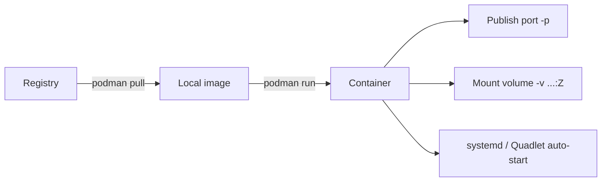
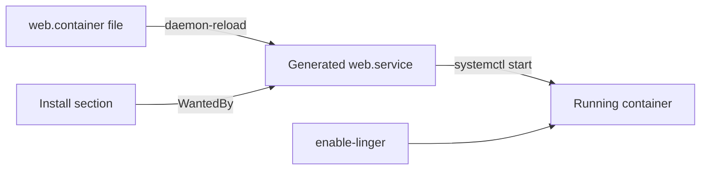

# 15a Containers With Podman

> By the end of this lesson you can find and pull an image, run a service in a container, give it persistent storage, and make it start by itself through systemd.

!!! info "Optional chapter"
    Containers are **not on the RHEL 10 EX200 objective list**. They were part of the RHEL 9 RHCSA and they are everywhere in real RHEL work, so this chapter is kept as a useful extra. If you are short of time before the exam, skip it and come back later. Every image, port and path below is a lab value, not an official requirement.

!!! example "Try it now (2 minutes)"
    ```bash
    podman --version
    podman images
    ```
    ```text title="Example output"
    podman version 5.8.2
    REPOSITORY  TAG         IMAGE ID    CREATED     SIZE
    ```
    <!-- VERIFY: the version number depends on the RHEL 10 minor release (5.8.2 is what the AlmaLinux 10.2 repository offers); the empty image list assumes a fresh student account -->
    Notice that no daemon is running and you did not need `sudo`. Podman runs as a normal user. By the end of this lesson you will know why that matters and what it changes.

## Why it matters

Admins package and run services in containers for isolation and easy deployment. On RHEL, `podman` runs containers without a background daemon, and a normal (rootless) user can run them. The tasks you will practise are the classic ones: pull an image, run a service and publish its port, attach storage that survives, and make the container start on its own after a reboot.

**Objectives covered:** none from the RHEL 10 EX200 list. This chapter covers the container skills that were in the RHEL 9 RHCSA.

**Prereqs:** [09 Boot, Targets, Processes, Logs, and Tuning](09-boot-targets-processes-logs-and-tuning.md) (systemd services), [11 Filesystems, Mounts, NFS, and Autofs](11-filesystems-mounts-nfs-and-autofs.md) (mounts and storage ideas), [15 SELinux, SSH Keys, and Security](15-selinux-ssh-keys-and-security.md) (SELinux volume labels) · **Time:** about 6 h

**Tools used:** `podman`, `podman images`, `podman pull`, `podman search`, `podman login`, `podman run`, `podman ps`, `podman exec`, `podman logs`, `podman stop`, `podman rm`, `podman rmi`, `podman inspect`, `skopeo`, `systemctl --user`, `loginctl`, `machinectl`

**Offline help for this topic:** `man podman`, `man podman-run`, `man podman-pull`, `man podman-login`, `man podman-systemd.unit` (Quadlet `.container` files), `man containers.conf`, `podman --help`, `podman run --help`

!!! note "Supporting skill (not a listed RHEL 10 objective)"
    Everything in this lesson is a supporting skill: containers, registries, SELinux volume labels for containers, and Quadlet. The exam may or may not touch it. It reuses skills that are on the list: systemd ([09](09-boot-targets-processes-logs-and-tuning.md)), SELinux labels ([15](15-selinux-ssh-keys-and-security.md)) and firewall ports ([13](13-networking-hostname-resolution-and-firewalld.md)).

## How it works

A **container image** is a packaged, read-only filesystem plus metadata for a program. A **container** is a running (or stopped) instance of an image. Think of the image as a recipe card and the container as the meal cooked from it: you can cook many meals from one card, and throwing a meal away does not touch the card.

`podman` is the RHEL tool to manage both. It is command-compatible with `docker`, needs no daemon, and can run as a normal user.



### Rootless vs rootful

- **Rootless:** you run `podman` as a normal user. The container runs with your privileges, which is safer. It is the default unless a task says otherwise. Rootless containers cannot publish ports below 1024 by default, so use a high host port such as `8080`.
- **Rootful:** you run `podman` with `sudo`. Use it only when a task explicitly needs it.

Rootless and rootful keep **separate** image stores and container lists. An image you pulled as `student` is invisible to `sudo podman images`, and the other way round. Many "my container vanished" moments are just the wrong one of the two.

### Images and registries

- Images live in **registries** such as `registry.access.redhat.com` or `quay.io`.
- `podman pull` downloads an image; `podman images` lists local ones.
- Some registries need a login (`registry.redhat.io` does). `registry.access.redhat.com` does not for UBI images.
- A lab or exam machine may have no internet. Then you pull from a **registry the task provides** (configured in `/etc/containers/registries.conf`, or per user in `~/.config/containers/registries.conf`), or the image is already local.

### Persistent storage

Containers are disposable; their internal changes vanish when removed. To keep data, **bind-mount a host directory** into the container with `-v /host/path:/container/path:Z`. The `:Z` tells SELinux to relabel the host directory so the container can use it.

### Auto-start with systemd (Quadlet)

The modern way to auto-start a container is a **Quadlet** file: a small `.container` file that a systemd generator turns into a normal service at `daemon-reload` time.



- Rootful: `/etc/containers/systemd/NAME.container`, managed with `systemctl`.
- Rootless: `~/.config/containers/systemd/NAME.container`, managed with `systemctl --user`, plus `loginctl enable-linger USER` so it runs without an active login.

!!! note "Old tutorials"
    You may see `podman generate systemd` in older guides. It is deprecated. Use Quadlet.

## Commands, step by step

All examples are rootless as `student` on `servera.lab.example`.

!!! warning "Log in properly for `systemctl --user`"
    User services need the user's own systemd session. Log in as `student` directly (console, or `ssh student@servera.lab.example`). If you arrive with `su - student` or `sudo -u student`, `systemctl --user` fails with `Failed to connect to bus`. See the troubleshooting table, and [01 Shell Basics](01-shell-basics-and-command-syntax.md) for how user switching works.

### 1. Find and pull images

```bash
podman search ubi10                  # search configured registries (needs a reachable registry)
podman pull registry.access.redhat.com/ubi10/ubi
podman images
skopeo inspect docker://registry.access.redhat.com/ubi10/ubi    # inspect without pulling
```

```text title="Example output"
$ podman pull registry.access.redhat.com/ubi10/ubi
Trying to pull registry.access.redhat.com/ubi10/ubi:latest...
Getting image source signatures
Copying blob 6f1c2e3b4a5d done   |
Copying config 9a8b7c6d5e done   |
Writing manifest to image destination
9a8b7c6d5e4f3a2b1c0d9e8f7a6b5c4d3e2f1a0b9c8d7e6f5a4b3c2d1e0f9a8b

$ podman images
REPOSITORY                             TAG         IMAGE ID      CREATED      SIZE
registry.access.redhat.com/ubi10/ubi   latest      9a8b7c6d5e4f  2 weeks ago  222 MB
```

| Command | What it does |
|---|---|
| `podman search TERM` | Searches the registries listed in `registries.conf` |
| `podman pull IMAGE` | Downloads an image. Use the full name (registry/path/name) to avoid short-name prompts |
| `podman images` | Lists local images |
| `skopeo inspect docker://IMAGE` | Shows an image's metadata (tags, labels, architecture) without downloading it |
| `podman rmi IMAGE` | Removes a local image (no container may still use it) |
| `podman login REGISTRY` | Stores credentials for a registry that needs them (see below) |

Registries such as `registry.redhat.io` require a login before you can pull:

```bash
podman login registry.redhat.io
```
```text title="Example output"
Username: myaccount
Password:
Login Succeeded!
```

Credentials are stored under `$XDG_RUNTIME_DIR/containers/auth.json` for rootless users. `podman logout REGISTRY` removes them.
<!-- VERIFY: exact credential file location on RHEL 10 -->

### 2. Run and manage containers

For a web server we use the Red Hat Apache image. It runs **unprivileged and listens on 8080 inside the container**, so the port mapping is `8080:8080` (host port : container port).

```bash
podman run -d --name web -p 8080:8080 registry.access.redhat.com/ubi10/httpd-24
podman ps
curl -s http://localhost:8080 | head -3
```

```text title="Example output"
$ podman ps
CONTAINER ID  IMAGE                                          COMMAND               CREATED         STATUS         PORTS                   NAMES
3d9c1f2a7b4e  registry.access.redhat.com/ubi10/httpd-24:latest  /usr/bin/run-http...  5 seconds ago   Up 5 seconds   0.0.0.0:8080->8080/tcp  web
```

| Option | Meaning |
|---|---|
| `-d` | Run detached (in the background) |
| `--name web` | Give the container a name you can use in later commands |
| `-p 8080:8080` | Publish: host port 8080 is forwarded to container port 8080 |
| `-v HOST:CTR:Z` | Bind-mount a host directory, with an SELinux private relabel |
| `-e NAME=value` | Set an environment variable inside the container |
| `--rm` | Delete the container as soon as it exits |
| `-it` | Interactive terminal, used with a shell |

Day-to-day management:

```bash
podman ps -a                    # all containers, including stopped
podman logs web                 # container output
podman exec -it web /bin/bash   # shell inside the container
podman stop web
podman start web
podman rm web                   # remove a stopped container (podman rm -f web forces it)
podman inspect web              # full JSON details
```

`podman ps` shows only running containers. A container you stopped is still there, and it still owns its name, until you `podman rm` it. That is why starting a second container named `web` fails.

### 3. Run a one-off command and pass variables

```bash
podman run --rm registry.access.redhat.com/ubi10/ubi cat /etc/os-release
podman run --rm -e COURSE=rhcsa registry.access.redhat.com/ubi10/ubi printenv COURSE
```
```text title="Example output"
rhcsa
```

`--rm` deletes the container as soon as it exits, which is good for quick checks. `-e` is how most images are configured (database passwords, modes, and so on).

### 4. Persistent storage with a volume

```bash
mkdir -p ~/webcontent
echo "hello from a container" > ~/webcontent/index.html
podman rm -f web 2>/dev/null
podman run -d --name web -p 8080:8080 \
  -v ~/webcontent:/var/www/html:Z \
  registry.access.redhat.com/ubi10/httpd-24
curl http://localhost:8080
ls -Zd ~/webcontent
```
```text title="Example output"
hello from a container
system_u:object_r:container_file_t:s0:c212,c787 /home/student/webcontent
```
<!-- VERIFY: docroot of the ubi10/httpd-24 image is /var/www/html; category numbers (c212,c787) are random per container -->

The `:Z` relabels `~/webcontent` as `container_file_t` with a private category pair. Without it, SELinux blocks the container and you see "Permission denied" or a 403 page. `:z` (lower case) uses a shared label for a directory several containers use. Never put `:Z` on a system directory such as `/etc` or on your whole home directory.

The files in `~/webcontent` must also be readable by "other" (mode 644, directory 755), because inside a rootless container the web server runs as a different user ID than you.
<!-- VERIFY: with default umask 022 the httpd-24 user reads the bind mount without :U; use :U or podman unshare chown if it does not -->

### 5. Auto-start a rootless container with Quadlet

Create `~/.config/containers/systemd/web.container`:

```ini
[Unit]
Description=Web container

[Container]
ContainerName=web
Image=registry.access.redhat.com/ubi10/httpd-24
PublishPort=8080:8080
Volume=%h/webcontent:/var/www/html:Z

[Service]
Restart=always

[Install]
WantedBy=default.target
```

Then, with the manually started container removed so the name is free:

```bash
podman rm -f web
loginctl enable-linger $USER          # let user services run without an active login
systemctl --user daemon-reload        # turn the .container file into a service
systemctl --user start web.service    # the service name = file name
systemctl --user status web.service
```
```text title="Example output"
● web.service - Web container
     Loaded: loaded (/home/student/.config/containers/systemd/web.container; generated)
     Active: active (running) since Tue 2026-10-27 10:12:44 UTC; 3s ago
   Main PID: 4421 (conmon)
```
<!-- VERIFY: status wording for a generated user unit on RHEL 10 -->

| Quadlet line | Meaning |
|---|---|
| `ContainerName=web` | The container's name. Without it Podman names it `systemd-web` |
| `Image=` | Image to run |
| `PublishPort=8080:8080` | Same as `-p` |
| `Volume=%h/...:Z` | Same as `-v`. `%h` expands to your home directory |
| `Restart=always` | systemd restarts the container if it dies |
| `WantedBy=default.target` | Start it when the user's session manager starts (rootless). Use `multi-user.target` for rootful |

**You cannot `systemctl enable` a Quadlet service.** The unit is generated, not a file on disk, so this fails:

```bash
systemctl --user enable web.service
```
```text title="Example output"
Failed to enable unit: Unit /run/user/1000/systemd/generator/web.service is transient or generated.
```
<!-- VERIFY: exact error wording -->

Enabling is done by the `[Install]` section, which the generator honours when it runs. So the recipe is `[Install]` section, `daemon-reload`, then `start`. After a reboot, with linger on, the service is started automatically.

**Rootful variant** (runs as root, starts at boot without any linger):

```bash
sudo vi /etc/containers/systemd/website.container      # same file, WantedBy=multi-user.target
sudo systemctl daemon-reload
sudo systemctl start website.service
```

To reach the container from another machine (for example `curl http://servera.lab.example:8080` from `serverb`), the firewall must allow the port too: see [13 Networking and firewalld](13-networking-hostname-resolution-and-firewalld.md).

## Common mistakes

- **Mistake:** Trying to pull from the internet on the exam instead of the provided registry. **Recovery:** read `/etc/containers/registries.conf`, use the registry the task names, and check `podman images` in case the image is already local.
- **Mistake:** Mapping `-p 8080:80` for an image that listens on 8080 inside. **Recovery:** check what the image listens on (`podman inspect IMAGE`, the image docs) and map to that port: `-p 8080:8080`.
- **Mistake:** Forgetting `:Z` on a bind-mounted volume, so SELinux blocks the container. **Recovery:** remove the container and re-run it with `:Z` on the volume option (`-v /path:/ctr/path:Z`). Do not reach for `restorecon`: it resets the directory to its default home label (`user_home_t`), which is exactly what blocks the container.
- **Mistake:** Running as root when the task asks for a rootless (user) container. **Recovery:** run `podman` as the normal user, without `sudo`, and check you are in the right store (`podman ps`).
- **Mistake:** Using a host port below 1024 for a rootless container. **Recovery:** use a high port such as `8080`.
- **Mistake:** Editing a Quadlet file and expecting it to take effect immediately. **Recovery:** `systemctl --user daemon-reload` first, then restart the service.
- **Mistake:** Starting a rootless service but not enabling linger. **Recovery:** `loginctl enable-linger $USER`, then confirm with `loginctl show-user "$USER" | grep Linger`.
- **Mistake:** Running `systemctl --user enable web.service`. **Recovery:** do not. Put `[Install]` / `WantedBy=` in the `.container` file, `daemon-reload`, and `start` it.
- **Mistake:** Using `su - student` or `sudo -u student` and then `systemctl --user`. **Recovery:** log in with `ssh student@servera.lab.example` or use `sudo machinectl shell student@`.
<!-- VERIFY: machinectl shell student@ gives a working user bus on RHEL 10 -->
- **Mistake:** Trying to start a second container with a name that already exists. **Recovery:** `podman ps -a` shows the old one; `podman rm -f NAME` frees the name.

### Troubleshooting

| Problem | Cause | Fix |
|---|---|---|
| `podman pull` fails or times out | No internet, or the registry is not configured | On the exam use the provided registry; check `/etc/containers/registries.conf`; the image may already be local (`podman images`) |
| `Permission denied` or 403 reading a mounted volume | SELinux blocks access because the host directory was not relabeled | Re-run the container with `:Z` on the volume; verify with `ls -Zd` that the label is `container_file_t` |
| `curl` gives "connection reset" or "empty reply" | Wrong container port in `-p` | Map to the port the image really listens on (`-p 8080:8080` for httpd-24) |
| Rootless container does not start after reboot | Linger not enabled, so user services stop at logout | `loginctl enable-linger $USER`; check `loginctl show-user "$USER" \| grep Linger` |
| Quadlet service not found | File in the wrong directory, or `daemon-reload` not run | Rootless path is `~/.config/containers/systemd/NAME.container`; run `systemctl --user daemon-reload`; the service is `NAME.service` |
| `Failed to connect to bus` | You switched user with `su`/`sudo -u`, so there is no user session | Log in directly with `ssh`, or use `machinectl shell student@` |
| Container name already in use | An old (stopped) container holds the name | `podman rm -f NAME` |

## Hands-on lab

**Setup:** `servera`, user `student`, rootless, logged in directly (not via `su`). No spare disk is used. Start clean and create the content directory:

```bash
podman rm -f web website 2>/dev/null
mkdir -p ~/webcontent
echo "RHCSA container test" > ~/webcontent/index.html
```

You need a reachable registry (or an image already local) for the pull steps. Confirm Podman is installed with `podman --version`.

**Task:**

- [ ] List local images with `podman images`.
- [ ] Pull `registry.access.redhat.com/ubi10/ubi` and confirm it is listed.
- [ ] Run a one-off container with `--rm` that prints `/etc/os-release`.
- [ ] Run a detached container named `web` from `registry.access.redhat.com/ubi10/httpd-24`, publishing host port `8080`, with `~/webcontent` mounted at `/var/www/html` with `:Z`.
- [ ] Verify it serves your file with `curl http://localhost:8080`, and read its output with `podman logs web`.
- [ ] Write `~/.config/containers/systemd/web.container` describing the same container (name `web`, same image, port, volume, `Restart=always`, `WantedBy=default.target`).
- [ ] Remove the manually started `web` container so the name is free.
- [ ] Enable linger, `daemon-reload`, start `web.service`, and verify with `systemctl --user status web.service` and `curl`.
- [ ] Reboot, log back in as `student`, and confirm the container is running again without you starting it.

??? question "Hint 1"
    Two things are the same in the manual command and the Quadlet file: the image and the port mapping. Which port does the image listen on inside, and what must the left and right numbers of `-p` be?

??? question "Hint 2"
    Use `podman run` with `-d`, `--name`, `-p` and `-v`. For auto-start use `loginctl enable-linger`, then `systemctl --user daemon-reload`, then `start`. There is no `enable` step for a Quadlet service.

??? success "Solution"
    ```bash
    podman images
    podman pull registry.access.redhat.com/ubi10/ubi
    podman run --rm registry.access.redhat.com/ubi10/ubi cat /etc/os-release

    podman run -d --name web -p 8080:8080 \
      -v ~/webcontent:/var/www/html:Z \
      registry.access.redhat.com/ubi10/httpd-24
    curl http://localhost:8080
    podman logs web
    podman inspect web | head -20

    mkdir -p ~/.config/containers/systemd
    cat > ~/.config/containers/systemd/web.container <<'EOF'
    [Unit]
    Description=Web container

    [Container]
    ContainerName=web
    Image=registry.access.redhat.com/ubi10/httpd-24
    PublishPort=8080:8080
    Volume=%h/webcontent:/var/www/html:Z

    [Service]
    Restart=always

    [Install]
    WantedBy=default.target
    EOF

    podman rm -f web
    loginctl enable-linger "$USER"
    systemctl --user daemon-reload
    systemctl --user start web.service
    systemctl --user status web.service
    curl http://localhost:8080
    ```
    **Verify:** `curl` prints `RHCSA container test`. `podman ps` lists `web` with `0.0.0.0:8080->8080/tcp`. `systemctl --user status web.service` shows `active (running)`. `loginctl show-user "$USER" | grep Linger` prints `Linger=yes`. After a reboot, `podman ps` shows `web` up again.

## More practice

1. Pull an image and confirm it appears in `podman images`.
2. Run a detached named container and publish a port.
3. Exec into the container and read a file inside it.
4. Bind-mount a host directory with `:Z` and serve a file from it.
5. Stop, start, and remove a container, checking state with `podman ps -a`.
6. Pass a value with `-e` and print it from inside a one-off container.
7. Write a Quadlet `.container` file and start it with `systemctl --user`.
8. Enable linger and confirm a rootless container survives a reboot.

### Exam-style task 1

Run a detached web container named `website` from the provided registry (use `registry.access.redhat.com/ubi10/httpd-24` in this lab), publish it on host port `8080`, and serve content from a host directory you create. Verify with `curl`.

**Grader mindset checklist:**

- [ ] container is running and named `website`
- [ ] host port `8080` reaches the container
- [ ] a host directory is mounted with the SELinux relabel (`:Z`)
- [ ] `curl http://localhost:8080` returns your content

??? success "Solution"
    ```bash
    mkdir -p ~/webcontent
    echo "exam content" > ~/webcontent/index.html
    podman run -d --name website -p 8080:8080 \
      -v ~/webcontent:/var/www/html:Z \
      registry.access.redhat.com/ubi10/httpd-24
    podman ps
    curl http://localhost:8080
    ```

### Exam-style task 2

Configure the `website` container to start automatically as a rootless systemd service that survives logout and reboot.

**Grader mindset checklist:**

- [ ] a Quadlet `.container` file exists under `~/.config/containers/systemd/`
- [ ] the user service is active (`systemctl --user status`)
- [ ] linger is enabled for the user
- [ ] the container is named `website` and is running again after a reboot

??? success "Solution"
    ```bash
    mkdir -p ~/.config/containers/systemd
    cat > ~/.config/containers/systemd/website.container <<'EOF'
    [Unit]
    Description=Website container

    [Container]
    ContainerName=website
    Image=registry.access.redhat.com/ubi10/httpd-24
    PublishPort=8080:8080
    Volume=%h/webcontent:/var/www/html:Z

    [Service]
    Restart=always

    [Install]
    WantedBy=default.target
    EOF

    podman rm -f website
    loginctl enable-linger "$USER"
    systemctl --user daemon-reload
    systemctl --user start website.service
    systemctl --user status website.service
    podman ps --filter name=website
    curl http://localhost:8080
    ```
    `ContainerName=website` matters: without it the container is called `systemd-website` and a name check fails.

## Exam tips

!!! tip "What the exam expects"
    The container is running with the exact name, image, published port and volume the task gives, the content is reachable with `curl`, and a task that says "start automatically" still works after a reboot. Pull from the registry the task provides, not from the internet.

!!! warning "Must survive reboot"
    | Change | Persistent? | Make it persist with |
    |---|---|---|
    | `podman run -d ...` | No (the container is gone or stopped after reboot) | a Quadlet `.container` file with `[Install]`, then `daemon-reload` and `start` |
    | Rootless service without linger | No (stops at logout, no start at boot) | `loginctl enable-linger USER` |
    | Quadlet file edit | Not until reloaded | `systemctl --user daemon-reload`, then restart |
    | `:Z` relabel of the volume | Yes (stored in the file's label) | Nothing |
    | Images pulled and `podman login` | Images yes; login tokens are in the runtime directory and may not survive a reboot | Log in again if the task needs a protected registry |
    <!-- VERIFY: whether podman login credentials survive a reboot on RHEL 10 (auth.json under /run/user) -->

    For the full persistence matrix across every lesson, see [16 Persistence, Reboot Checks, and Troubleshooting](16-persistence-reboot-checks-and-troubleshooting.md).

**Verify like a grader:**

1. `podman images` shows the image.
2. `podman ps` shows the running container with the right name and ports, and `podman ps -a` shows any stopped one.
3. `curl http://localhost:8080` returns the expected content; `ss -tuln | grep 8080` shows the listener.
<!-- VERIFY: ss shows a LISTEN on 8080 for a rootless container (the rootless networking helper holds the port) -->
4. `ls -Zd ~/webcontent` shows `container_file_t`.
5. `systemctl --user status NAME.service` and `loginctl show-user "$USER" | grep Linger`.
6. Reboot, log in, and check `podman ps` again.

## Quiz

1. What is the difference between a container image and a container?
2. Which command pulls an image, and which lists local images?
3. Why use a high host port like 8080 for a rootless container?
4. What does `:Z` do on a `-v` volume mount?
5. Where does a rootless Quadlet `.container` file go, and how do you start it?
6. What does `loginctl enable-linger` do and why is it needed?
7. How do you run a single command in a container and have it removed afterward?
8. Why does `systemctl --user enable web.service` fail for a Quadlet service, and what makes it start at boot instead?
9. How do you pass an environment variable to a container?
10. `podman run -p 8080:80` shows an empty reply for an image that listens on 8080. What is wrong?

??? success "Answers"
    1. An image is the packaged read-only template; a container is a running or stopped instance of it.
    2. `podman pull` pulls; `podman images` lists local images.
    3. Rootless containers cannot bind privileged ports below 1024 by default.
    4. It relabels the host directory's SELinux context so the container can access it (private relabel).
    5. `~/.config/containers/systemd/NAME.container`; run `systemctl --user daemon-reload` then `systemctl --user start NAME.service`.
    6. It lets a user's systemd services keep running without an active login session, so rootless containers survive logout and reboot.
    7. `podman run --rm IMAGE COMMAND`.
    8. The unit is generated from the `.container` file, so it cannot be enabled. The `[Install]` section with `WantedBy=default.target` does it, after `daemon-reload` and `start`.
    9. `-e NAME=value` on `podman run`, or `Environment=NAME=value` in the Quadlet `[Container]` section.
    10. The container port is wrong. Map to the port the image listens on: `-p 8080:8080`.

## Summary

- image = template, container = running instance
- `podman pull`, then `podman run -d --name NAME -p 8080:8080 IMAGE` (check which port the image listens on)
- inspect with `podman ps`, `podman logs`, `podman inspect`
- persist data with `-v /host:/ctr:Z` (the `:Z` is for SELinux; `restorecon` is not the fix)
- rootless uses high ports and `systemctl --user`
- auto-start = Quadlet `.container` with `[Install]` + `daemon-reload` + `start` + `enable-linger`; you cannot `enable` it
- on the exam, pull from the provided registry, not the internet

| Task | Command |
|---|---|
| List images | `podman images` |
| Pull an image | `podman pull registry.access.redhat.com/ubi10/ubi` |
| One-off command | `podman run --rm IMAGE COMMAND` |
| Web container with data | `podman run -d --name web -p 8080:8080 -v ~/webcontent:/var/www/html:Z IMAGE` |
| Environment variable | `podman run -e NAME=value IMAGE` |
| Running / all containers | `podman ps` / `podman ps -a` |
| Logs and shell | `podman logs web`, `podman exec -it web /bin/bash` |
| Stop, start, remove | `podman stop web`, `podman start web`, `podman rm web` |
| Remove an image | `podman rmi IMAGE` |
| Quadlet auto-start | `~/.config/containers/systemd/web.container`, then `loginctl enable-linger "$USER"`, `systemctl --user daemon-reload`, `systemctl --user start web.service` |

**Previous:** [15 SELinux, SSH Keys, and Security](15-selinux-ssh-keys-and-security.md) · **Next:** [16 Persistence, Reboot Checks, and Troubleshooting](16-persistence-reboot-checks-and-troubleshooting.md): finish with the persistence matrix and break/fix scenarios that tie every lesson together.
