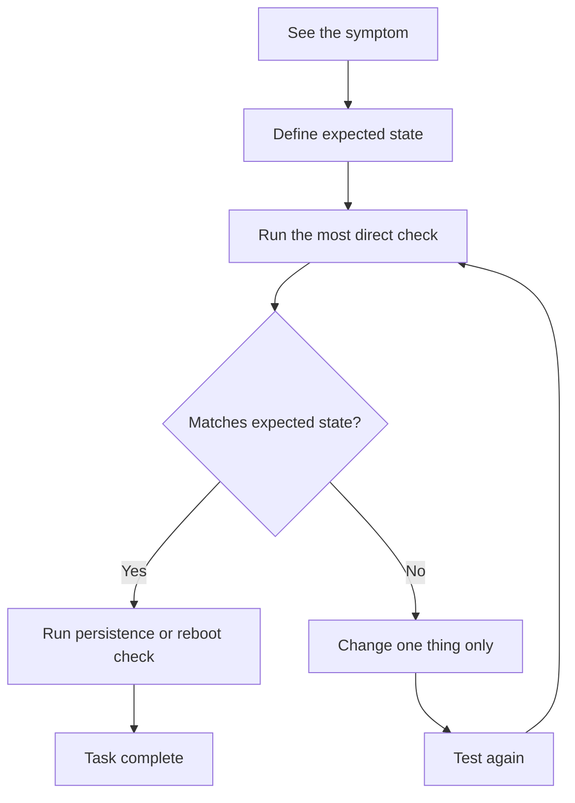
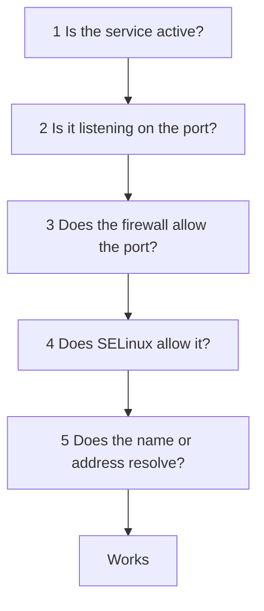

# 16 Persistence, Reboot Checks, and Troubleshooting

> By the end of this lesson you can prove a task is truly finished (now and after a reboot), and you can find and fix a broken system by following evidence instead of guessing.

!!! example "Try it now (2 minutes)"
    ```bash
    systemctl is-active sshd
    systemctl is-enabled sshd
    ```
    ```text title="Example output"
    active
    enabled
    ```
    Two commands, two different questions. `is-active` asks "is it running **right now**?" and `is-enabled` asks "will it start **at the next boot**?". A service can be `active` and `disabled` at the same time, and that is exactly the trap this lesson is about. By the end you will know how to check this for every kind of change in the course.

## Why it matters

Red Hat's exam page says configurations must persist after reboot without intervention. Many students can make things work once. Fewer can prove the system still works after restart. Expect the result to be judged as the machine looks after a reboot, so be ready for a fix that lives only in memory to score nothing. In real life, administrators are trusted because their fixes remain stable. Temporary success without persistence is unreliable operations.

**Objectives covered:** this lesson ties together objectives from every other lesson. The ones it practises directly are:

- Boot, reboot, and shut down a system normally
- Interrupt the boot process in order to gain access to a system
- Locate and interpret system log files and journals
- Start, stop, and check the status of network services
- Start and stop services and configure services to start automatically at boot
- Configure systems to mount file systems at boot by universally unique ID (UUID) or label
- Configure network services to start automatically at boot

**Prereqs:** all earlier lessons, [00 Study Skills and Offline Help](00-study-skills-and-offline-help.md) through [15a Containers With Podman](15a-containers-with-podman.md). The matrix below points back to them. **Time:** about 5 h

**Tools used:** `systemctl`, `findmnt`, `mount -a`, `lsblk`, `blkid`, `ip`, `nmcli`, `firewall-cmd`, `getenforce`, `restorecon`, `journalctl`, `ss`, `curl`, `id`, `visudo`

**Offline help for this topic:** `man systemctl`, `man fstab`, `man journalctl`, `man firewall-cmd`, `man nmcli`, `man restorecon`, `apropos service`

!!! note "Study sequence"
    If you are following the beginner route, do not jump straight to file `17` just because the number comes next. After this lesson, go to the labs track in this order: `22`, `23`, `24`, `25`, `26`, then `28`.

## How it works

Every setting on a Linux system lives in one of three places:

1. **Memory** (the running state of the kernel and of processes). It disappears at shutdown.
2. **A file on disk** that is read at boot or when a service starts (`/etc/fstab`, a NetworkManager profile, `/etc/selinux/config`). It survives, but only if the right file was changed.
3. **A boot-time link** that decides what starts automatically (the `enable` symlinks that systemd reads).

Think of a whiteboard and a notebook. Running a command is writing on the whiteboard: it is visible and it works, but it is wiped when the power goes off. Persistence means copying the answer into the notebook. Your job is to know, for each topic, which command writes where.

A configuration is only complete when:

1. the target state exists now
2. the related commands work now
3. the state survives reboot if persistence is required
4. you can explain how you verified it



### A simple troubleshooting loop

1. Define the exact symptom.
2. Identify the expected state.
3. Check the most direct evidence.
4. Change one thing.
5. Test again.

### Reboot categories

Ask which category the task belongs to:

- file exists only now
- service runs only now
- service runs now and at boot
- mount works now
- mount works now and at boot
- firewall works now
- firewall works now and after reboot

### Check the layers in order

"Everything looks right but I cannot reach it" almost always means one layer is blocking the rest. Work from the bottom up and stop at the first layer that fails.



| Layer | Question | Command |
|---|---|---|
| 1 Service | Is it running, and enabled? | `systemctl is-active X`, `systemctl is-enabled X` |
| 2 Socket | Is anything listening on the port? | `sudo ss -tlnp` |
| 3 Firewall | Is the port or service allowed (runtime and permanent)? | `sudo firewall-cmd --list-all` |
| 4 SELinux | Are the file labels and port labels right? | `getenforce`, `ls -Z`, `sudo semanage port -l` |
| 5 Name/address | Does the name resolve to the right address? | `getent hosts NAME`, `ip addr` |

## The persistence matrix

This is the central table of the course. "Persists" means **survives a reboot with no further action**. Where the answer is No, the last column is what you must also do. Lesson numbers show where the topic is taught.

| Lesson | Change | Persists? | Make it persist with / prove it with |
|---|---|---|---|
| [00](00-study-skills-and-offline-help.md) | `mandb` man page index | Yes | Nothing, it is a cache on disk |
| [01](01-shell-basics-and-command-syntax.md) | `su -` or `sudo -i` shell, `cd`, shell variables | No | Nothing needed; add variables to `~/.bashrc` |
| [01](01-shell-basics-and-command-syntax.md) | Files in `/tmp` | No (cleaned automatically) | Store required files elsewhere unless the task names `/tmp` |
| [02](02-files-directories-and-text-editing.md) | Files and directories you create, copy, move | Yes | Nothing; unsaved `vi` edits are lost, so `:wq` |
| [03](03-redirection-pipes-grep-and-regex.md) | `>`, `>>`, `tee`, `sed -i` output files | Yes | Nothing; pipe output on screen is not stored |
| [04](04-archives-compression-and-secure-file-transfer.md) | Archives, copied files, `known_hosts` entries | Yes | Nothing; they are ordinary files |
| [05](05-ssh-login-switching-users-and-remote-workflows.md) | `authorized_keys` entry | Yes | Nothing; keep `~/.ssh` `700` and `authorized_keys` `600` |
| [05](05-ssh-login-switching-users-and-remote-workflows.md) | `sshd` running; `sshd_config` edit | Running: No. Edit: Yes in the file | `systemctl enable --now sshd`; `sshd -t` then `systemctl reload sshd` |
| [06](06-links-permissions-and-default-permissions.md) | `chmod`, `chown`, `chgrp`, `ln`, setgid, ACLs | Yes | Nothing; stored with the file |
| [06](06-links-permissions-and-default-permissions.md) | `umask 027` typed at a prompt | No | `umask` line in `~/.bashrc` or a file in `/etc/profile.d/` |
| [07](07-software-management-rpm-repos-and-flatpak.md) | `dnf install/remove`, `.repo` files, Flatpak remotes and apps | Yes | Nothing; `--enablerepo` on the command line is not persistent |
| [08](08-shell-scripting-basics.md) | Script file and its `chmod +x` | Yes | Nothing; variables set in a shell are lost |
| [09](09-boot-targets-processes-logs-and-tuning.md) | `systemctl set-default TARGET` | Yes | Nothing; `systemctl isolate` and GRUB `e` edits last for one boot only |
| [09](09-boot-targets-processes-logs-and-tuning.md) | `kill`, `renice`, `top` actions | No | Nothing to save; a restarted process starts fresh |
| [09](09-boot-targets-processes-logs-and-tuning.md) | Persistent journal | Yes once configured | Drop-in `/etc/systemd/journald.conf.d/persistent.conf` with `[Journal]` and `Storage=persistent`, then `systemctl restart systemd-journald`; check with `systemd-analyze cat-config systemd/journald.conf` and, after a reboot, `journalctl --list-boots` <!-- VERIFY: journald drop-in directory and Storage=persistent creating /var/log/journal on RHEL 10 --> |
| [09](09-boot-targets-processes-logs-and-tuning.md) | `tuned-adm profile NAME` | Yes | Nothing; confirm with `tuned-adm active` <!-- VERIFY: tuned stores the active profile across reboot (/etc/tuned/active_profile) --> |
| [09](09-boot-targets-processes-logs-and-tuning.md) | Root password reset with `rd.break` | Yes | Also run `touch /.autorelabel` before reboot |
| [10](10-storage-partitions-lvm-and-swap.md) | Partitions, PV, VG, LV, `mkfs`, `mkswap`, `lvextend` | Yes | Nothing; the metadata is on disk |
| [10](10-storage-partitions-lvm-and-swap.md) | `mount` and `swapon` | No | `/etc/fstab` line (UUID or label), then `mount -a` or `swapon -a` |
| [11](11-filesystems-mounts-nfs-and-autofs.md) | NFS mount typed by hand | No | `server:/export /mnt nfs defaults 0 0` in `/etc/fstab`, test with `mount -a` |
| [11](11-filesystems-mounts-nfs-and-autofs.md) | autofs maps | Maps: Yes. Service: needs enable | `systemctl enable --now autofs`; `systemctl restart autofs` after map edits |
| [12](12-scheduling-services-time-and-bootloader.md) | `crontab -e`, `/etc/cron.d` files | Yes | Nothing, if `crond` is enabled (it is by default) |
| [12](12-scheduling-services-time-and-bootloader.md) | `at` jobs | Queued jobs are on disk | `atd` must be enabled; remove with `atrm` <!-- VERIFY: at jobs queued before reboot still run on RHEL 10 --> |
| [12](12-scheduling-services-time-and-bootloader.md) | New `.service` or `.timer` file | Not active by itself | `systemctl daemon-reload`, then `systemctl enable --now NAME.timer` |
| [12](12-scheduling-services-time-and-bootloader.md) | `systemctl enable` / `disable` | Yes | This is the persistence step for any service |
| [12](12-scheduling-services-time-and-bootloader.md) | `chrony.conf` edit, `timedatectl set-timezone` | Yes | `systemctl restart chronyd` to apply; `date -s` is not a lasting fix |
| [12](12-scheduling-services-time-and-bootloader.md) | Bootloader change | `grubby --update-kernel` Yes | If you edit `/etc/default/grub`, also run `grub2-mkconfig -o` (path differs for BIOS and UEFI) |
| [13](13-networking-hostname-resolution-and-firewalld.md) | `ip addr add`, `hostname NAME` | No | `nmcli con mod ...` then `nmcli con up`; `hostnamectl set-hostname NAME` |
| [13](13-networking-hostname-resolution-and-firewalld.md) | `nmcli con mod` | Yes (writes the profile) | `nmcli con up PROFILE` to apply it now |
| [13](13-networking-hostname-resolution-and-firewalld.md) | `/etc/hosts` line | Yes | Nothing; check with `getent hosts NAME` |
| [13](13-networking-hostname-resolution-and-firewalld.md) | `firewall-cmd --add-service=X` | No (runtime only) | `--permanent` then `--reload`, or `firewall-cmd --runtime-to-permanent` |
| [13](13-networking-hostname-resolution-and-firewalld.md) | `firewalld` service itself | Needs enable | `systemctl enable --now firewalld` |
| [14](14-users-groups-passwords-and-sudo.md) | `useradd`, `usermod`, `passwd`, `chage`, `groupadd` | Yes | Nothing; the files under `/etc` are the persistence |
| [14](14-users-groups-passwords-and-sudo.md) | Sudo rule in `/etc/sudoers.d/` | Yes | Create it with `sudo visudo -f /etc/sudoers.d/NAME`, check with `sudo visudo -c` |
| [15](15-selinux-ssh-keys-and-security.md) | `setenforce 0` / `1` | No | `SELINUX=` in `/etc/selinux/config` |
| [15](15-selinux-ssh-keys-and-security.md) | `chcon`, or a file moved with `mv` | No (lost on relabel; `mv` keeps the old label) | `semanage fcontext -a ...` then `restorecon -Rv` |
| [15](15-selinux-ssh-keys-and-security.md) | `setsebool X on` | No | `setsebool -P X on` |
| [15](15-selinux-ssh-keys-and-security.md) | `semanage port -a` / `-m` | Yes | Nothing; check with `semanage port -l` |
| [15a](15a-containers-with-podman.md) | `podman run` container | No (does not come back at boot) | A Quadlet `.container` file with `[Install]`, then `daemon-reload` and start. Rootless units also need `loginctl enable-linger USER` <!-- VERIFY: Quadlet generated units cannot be enabled directly; linger requirement for rootless --> |

!!! note "Supporting skill (not a listed RHEL 10 objective)"
    Kernel settings follow the same rule. `sysctl -w net.ipv4.ip_forward=1` is runtime only. To keep it, put the line in a file such as `/etc/sysctl.d/90-lab.conf` and load it with `sudo sysctl --system`. Kernel tuning is not a listed objective, but the "runtime versus file" idea is the same as everywhere else in this table.

## Commands, step by step

### 1. Services: now and at boot

```bash
systemctl is-active httpd
systemctl is-enabled httpd
systemctl status httpd --no-pager
systemctl --failed
```

```text title="Example output"
active
disabled
● httpd.service - The Apache HTTP Server
     Loaded: loaded (/usr/lib/systemd/system/httpd.service; disabled; preset: disabled)
     Active: active (running) since Tue 2026-10-27 09:14:02 UTC; 3min ago
...
  UNIT LOAD ACTIVE SUB DESCRIPTION
0 loaded units listed.
```
<!-- VERIFY: exact status wording and preset text on RHEL 10 -->

| Command | What it tells you |
|---|---|
| `systemctl is-active X` | Running now? (`active`, `inactive`, `failed`) |
| `systemctl is-enabled X` | Starts at boot? (`enabled`, `disabled`, `static`, `masked`) |
| `systemctl enable --now X` | Does both: enable at boot and start now |
| `systemctl --failed` | Lists units that failed since boot |
| `systemctl reset-failed` | Clears the failed state after you fix the cause |
| `systemctl daemon-reload` | Re-reads unit files and `/etc/fstab` after you edit them |

### 2. Mounts: now and at boot

```bash
findmnt /data
grep /data /etc/fstab
sudo mount -a
findmnt --verify
```

```text title="Example output"
TARGET SOURCE    FSTYPE OPTIONS
/data  /dev/vdb1 xfs    rw,relatime,seclabel,attr2,inode64,logbufs=8,logbsize=32k,noquota

UUID=2f7b3c1e-8d4a-4c5e-9b0a-6e1d7f3a2c11  /data  xfs  defaults  0 0

Success, no errors or warnings detected
```
<!-- VERIFY: exact findmnt options and the findmnt --verify success line on RHEL 10 -->

`mount -a` tries every `/etc/fstab` line that is not mounted yet, so it is the safest way to test a new line before a reboot. If it prints an error, fix it now. The fstab fields are explained in [10 Storage, Partitions, LVM, and Swap](10-storage-partitions-lvm-and-swap.md).

### 3. Network and firewall: runtime versus permanent

```bash
nmcli connection show
ip -br addr
sudo firewall-cmd --list-services
sudo firewall-cmd --permanent --list-services
```

```text title="Example output"
NAME    UUID                                  TYPE      DEVICE
enp1s0  5f1c6c0e-4b8e-4d6c-9a0a-3c2f6d9b7e21  ethernet  enp1s0

enp1s0           UP             192.168.122.10/24 fe80::5054:ff:fe12:3456/64

cockpit dhcpv6-client ssh http

cockpit dhcpv6-client ssh
```
<!-- VERIFY: default NetworkManager profile name on the RHEL 10 lab image (shown here as enp1s0); output format of ip -br -->

The last two lines are the trap: `http` is in the runtime set but not in the permanent set. It works now and disappears after `firewall-cmd --reload` or a reboot. Fix it with `sudo firewall-cmd --runtime-to-permanent`.

### 4. SELinux and permissions

```bash
getenforce
ls -Z /var/www/html
sudo grep SELINUX= /etc/selinux/config
```

```text title="Example output"
Enforcing
unconfined_u:object_r:httpd_sys_content_t:s0 index.html
SELINUX=enforcing
```

`getenforce` is the running mode, the config file is the boot mode. Both must say what the task asks.

### 5. Users and sudo

```bash
id webadmin
sudo -l -U webadmin
sudo visudo -c
```

```text title="Example output"
uid=1002(webadmin) gid=1002(webadmin) groups=1002(webadmin)
User webadmin may run the following commands on servera:
    (root) /usr/bin/systemctl restart httpd
/etc/sudoers: parsed OK
/etc/sudoers.d/webadmin: parsed OK
```

### 6. Logs: let the system tell you what is wrong

```bash
sudo journalctl -b -p err
sudo journalctl -u httpd -b --no-pager
sudo journalctl --list-boots
```

```text title="Example output"
Oct 27 09:20:11 servera.lab.example systemd[1]: Failed to start httpd.service - The Apache HTTP Server.
Oct 27 09:20:11 servera.lab.example httpd[1544]: AH00072: make_sock: could not bind to address 0.0.0.0:80
```
<!-- VERIFY: sample wording only; real message depends on the fault -->

| Option | Meaning |
|---|---|
| `-b` | Only the current boot. `-b -1` is the previous boot (needs a persistent journal, see lesson 09) |
| `-p err` | Only messages at priority "err" and worse |
| `-u UNIT` | Only messages from that unit |
| `-x` | Add explanatory text where the log has it (`journalctl -xe` jumps to the end) |

### 7. Reboot, then prove it rebooted

```bash
sudo systemctl reboot
```

After you log in again:

```bash
uptime -s
journalctl --list-boots | tail -2
```

`uptime -s` shows when the machine last started. If that time is older than your reboot, you did not actually reboot.

## Worked break/fix scenarios

Each scenario follows the same pattern: symptom, diagnosis, fix, verification.

### Scenario 1: service works now but not after reboot

**Symptom:** the web page loads before the reboot and is gone after it.

**Diagnosis:**

```bash
systemctl is-active httpd
systemctl is-enabled httpd
```

```text title="Example output"
inactive
disabled
```

**Fix and verify:**

```bash
sudo systemctl enable --now httpd
systemctl is-active httpd
systemctl is-enabled httpd
```

Then reboot and recheck both.

### Scenario 2: bad `/etc/fstab` line puts the machine in emergency mode

**Symptom:** after reboot the console shows:

```text title="Example output"
You are in emergency mode. After logging in, type "journalctl -xb" to view
system logs, "systemctl reboot" to reboot, or "exit"
to boot into default mode.
Give root password for maintenance
(or press Control-D to continue):
```
<!-- VERIFY: exact emergency mode banner wording on RHEL 10 -->

**Why:** a local filesystem in `/etc/fstab` is required for boot. If it cannot be mounted (wrong filesystem type, a UUID that does not exist, a typo in the options), systemd stops and gives you a rescue shell. This is the most common way to lose a reboot, and the reason you always run `mount -a` before rebooting.

**Diagnosis and fix:**

```bash
# log in with the root password (redhat in the lab)
journalctl -xb | grep -i -e fstab -e "dependency failed" -e /data
mount -o remount,rw /
vi /etc/fstab
systemctl daemon-reload
mount -a
findmnt --verify
systemctl reboot
```

In emergency mode the root filesystem is mounted read-only, so `mount -o remount,rw /` is needed before `vi` can save. If the data disk is not critical for boot, adding `nofail` to its options (`defaults,nofail`) lets the machine boot even when the mount fails.

### Scenario 3: a broken NFS entry looks different

Local and network mounts fail in different ways. Suppose `/etc/fstab` has a typo in the server name:

```text title="Example output"
servrb.lab.example:/export/share  /mnt/share  nfs  defaults  0 0
```

NFS entries have the form `server:/path  mountpoint  nfs  options`. They contain no UUID, so there is nothing to correct except the server name, the exported path and the type.

**Diagnosis:**

```bash
sudo mount -a
```

```text title="Example output"
mount.nfs: Failed to resolve server servrb.lab.example: Name or service not known
```

**Fix:** correct `servrb` to `serverb`, then `sudo mount -a` and `findmnt /mnt/share`. A failed network mount normally does not stop the machine from booting, because remote filesystems are not required for the local boot. <!-- VERIFY: a failing NFS fstab entry does not drop RHEL 10 into emergency mode without x-systemd.required-by -->

### Scenario 4: wrong SELinux context

**Symptom:** the file exists, permissions are `644`, httpd runs, yet `curl` returns `403 Forbidden`.

**Diagnosis:**

```bash
ls -lZ /var/www/html/page.html
```

```text title="Example output"
-rw-r--r--. 1 root root unconfined_u:object_r:user_home_t:s0 6 Oct 27 09:31 /var/www/html/page.html
```

The label is `user_home_t` because the file was moved with `mv` from a home directory, and `mv` keeps the old label.

**Fix and verify:**

```bash
sudo restorecon -v /var/www/html/page.html
curl -s http://localhost/page.html
```

```text title="Example output"
Relabeled /var/www/html/page.html from unconfined_u:object_r:user_home_t:s0 to unconfined_u:object_r:httpd_sys_content_t:s0
moved
```

For a non-default directory, make the rule permanent with `semanage fcontext -a -t httpd_sys_content_t "/srv/web(/.*)?"` and then `restorecon -Rv /srv/web`. Details are in [15 SELinux, SSH Keys, and Security](15-selinux-ssh-keys-and-security.md).

### Scenario 5: missing firewall port

**Symptom:** `curl http://localhost` works on `servera` but `curl http://servera.lab.example` from `serverb` hangs or says "No route to host".

**Diagnosis:** the service is fine locally, so check the firewall.

```bash
sudo ss -tlnp | grep ':80 '
sudo firewall-cmd --list-services
sudo firewall-cmd --permanent --list-services
```

**Fix and verify:**

```bash
sudo firewall-cmd --permanent --add-service=http
sudo firewall-cmd --reload
sudo firewall-cmd --list-services
```

### Scenario 6: a typo in sudoers locks out sudo

**Symptom:** every `sudo` command fails, even for `student`:

```text title="Example output"
sudo: /etc/sudoers.d/webadmin:1:35: syntax error
sudo: no valid sudoers sources found, quitting
sudo: unable to initialize policy plugin
```
<!-- VERIFY: exact sudo parse-error wording on RHEL 10 -->

**Why:** the file was written with `echo ... | sudo tee`, which saves it **before** anyone checks it. `visudo` checks the syntax first and refuses to save a broken file.

**Fix:** switch to root without sudo, repair the file, and validate it. User switching is covered in [01 Shell Basics and Command Syntax](01-shell-basics-and-command-syntax.md).

```bash
su -
visudo -f /etc/sudoers.d/webadmin
visudo -c
exit
```

### Scenario 7: network settings gone after reboot

**Symptom:** the static address worked yesterday and `ip -br addr` after reboot shows the DHCP address, or nothing.

**Diagnosis:** the address was added with `ip addr add`, which changes memory only. Or the profile exists but is not set to start.

```bash
nmcli -f connection.autoconnect,ipv4.method,ipv4.addresses connection show enp1s0
```

```text title="Example output"
connection.autoconnect:                 no
ipv4.method:                            auto
ipv4.addresses:                         --
```

**Fix:**

```bash
sudo nmcli connection modify enp1s0 ipv4.method manual ipv4.addresses 192.168.122.10/24 ipv4.gateway 192.168.122.1 ipv4.dns 192.168.122.1 connection.autoconnect yes
sudo nmcli connection up enp1s0
```

Careful on the console: if you are connected over SSH on that interface, the session drops while it comes up. Do this from the VM console.

### Boot-failure recovery map

| Situation | What you see | Recovery |
|---|---|---|
| Bad fstab line | Emergency mode prompt | Scenario 2 |
| Forgotten root password | Cannot log in as root | `rd.break` at GRUB, then `touch /.autorelabel`; steps in [09 Boot, Targets, Processes, Logs, and Tuning](09-boot-targets-processes-logs-and-tuning.md) |
| Need a shell with fewer services | Normal boot is broken | At GRUB press `e`, append `systemd.unit=rescue.target` (or `emergency.target`) to the `linux` line, then `Ctrl+x`. This change lasts one boot |
| Service fails at boot | Boot completes, service down | `systemctl --failed`, `journalctl -u X -b`, fix, `systemctl reset-failed X` |
| After an unlabelled file edit, logins or services are denied | SELinux denials in the journal | `touch /.autorelabel` and reboot, or `restorecon -Rv` on the path |

## Common mistakes

- **Mistake:** declaring a task done after one successful command. **Recovery:** run the matching check from the matrix, then the persistence check, then reboot.
- **Mistake:** rebooting without a test plan, or using reboot as the first troubleshooting step. **Recovery:** test the current state first so you know what changed, and write down the checks you will repeat after the reboot.
- **Mistake:** changing several things at once while troubleshooting. **Recovery:** slow down and change one variable at a time, so you know which change caused the result.
- **Mistake:** ignoring logs and guessing. **Recovery:** `journalctl -u SERVICE -b` and `journalctl -b -p err` before you change anything.
- **Mistake:** forgetting whether the issue is current-state or boot-state. **Recovery:** ask "does it work now?" and "is it saved?" as two separate questions.
- **Mistake:** not recording the original state. **Recovery:** note key outputs (`lsblk -f`, `nmcli con show`, `firewall-cmd --list-all`) before changes.
- **Mistake:** trusting `status` output without a functional test. **Recovery:** use a real verification command too, for example `curl`.
- **Mistake:** assuming "started" equals "reachable". **Recovery:** test the actual service path or port from the other machine.
- **Mistake:** editing a config file and expecting the running service to notice. **Recovery:** restart or reload it, then verify again.
- **Mistake:** editing `/etc/fstab` and rebooting without testing. **Recovery:** `sudo mount -a` and `findmnt --verify` first; fix any error before the reboot.
- **Mistake:** `firewall-cmd --add-service` without `--permanent`. **Recovery:** `sudo firewall-cmd --runtime-to-permanent` or repeat with `--permanent` and `--reload`.

## Hands-on lab

**Setup:** shared lab environment, `servera` with `serverb` as the client, user `student`, spare disk `/dev/vdb` (2 GiB, empty). Take a VM snapshot first if you can, because Part 3 deliberately breaks boot. If `/dev/vdb` was used before, reset it and remove its old `/etc/fstab` lines.

??? warning "Disk reset (destroys everything on the disk)"
    ```bash
    sudo umount /data /par1 /record /datasource /mnt/lvapp 2>/dev/null; sudo swapoff -a
    sudo vgremove -ff -y vgdata vgexam vgapp vgfs datacontainer 2>/dev/null
    sudo wipefs -a /dev/vdb[0-9]* 2>/dev/null; sudo wipefs -a /dev/vdb; sudo partprobe /dev/vdb
    sudo sed -i -E '\#[[:space:]]/(data|par1|record|datasource|mnt/lvapp)[[:space:]]#d; /\/dev\/vdb|vg(data|app|fs)-/d' /etc/fstab
    for s in $(awk '$1~/^(UUID|LABEL)=/{print $1}' /etc/fstab); do sudo blkid -t "$s" >/dev/null || sudo sed -i "\#^$s[[:space:]]#d" /etc/fstab; done
    sudo systemctl daemon-reload; sudo swapon -a
    ```

**Part 1: build it (and make it persist):**

- [ ] Install `httpd`, create `/var/www/html/index.html` containing `servera web OK`, and make `httpd` active now and enabled at boot.
- [ ] Allow `http` through firewalld, permanently, and make the running firewall match.
- [ ] Create a 512 MiB GPT partition on `/dev/vdb`, put an XFS filesystem labelled `persist` on it, and mount it at `/data` through `/etc/fstab` by UUID.
- [ ] Create the user `webadmin` (password `Redhat123`) with a sudo rule that allows only `/usr/bin/systemctl restart httpd`, created with `visudo -f`.
- [ ] Write the verification commands for each item into `/home/student/proof.txt` (the commands, then their output).

**Part 2: prove it now and after a reboot:**

- [ ] Run your checks, then `sudo systemctl reboot`, then run the **same** checks and compare.
- [ ] From `serverb`, `curl http://servera.lab.example` must print `servera web OK`.

**Part 3: break it, then repair it from evidence only (do one fault at a time, reboot or test between):**

- [ ] Fault A: `sudo systemctl disable httpd`, then reboot. Find and fix it.
- [ ] Fault B: `sudo firewall-cmd --permanent --remove-service=http` and `sudo firewall-cmd --reload`. From `serverb`, `curl` now fails. Find and fix it.
- [ ] Fault C: `echo moved > ~/page.html; sudo mv ~/page.html /var/www/html/page.html`. `curl http://localhost/page.html` returns 403. Find and fix it.
- [ ] Fault D: in `/etc/fstab`, change `xfs` to `xsf` on the `/data` line, run `sudo systemctl daemon-reload`, and **reboot** (the machine will land in emergency mode). Recover and boot normally.

??? question "Hint 1"
    For every fault ask the layer questions in order: is the service active, enabled, listening, allowed by the firewall, allowed by SELinux? The first "no" is your fault.

??? question "Hint 2"
    Tools to reach for: `systemctl is-enabled`, `firewall-cmd --list-all` against `--permanent --list-all`, `ls -lZ` with `restorecon`, and `journalctl -xb` plus `mount -o remount,rw /` in emergency mode.

??? success "Solution"
    Part 1:
    ```bash
    sudo dnf install -y httpd
    echo "servera web OK" | sudo tee /var/www/html/index.html
    sudo systemctl enable --now httpd
    sudo firewall-cmd --permanent --add-service=http
    sudo firewall-cmd --reload

    sudo parted --script /dev/vdb mklabel gpt mkpart primary 1MiB 513MiB
    sudo partprobe /dev/vdb
    sudo udevadm settle
    sudo mkfs.xfs -L persist /dev/vdb1
    sudo mkdir -p /data
    sudo blkid /dev/vdb1          # copy the UUID
    ```
    Add this line with `sudo vi /etc/fstab`, using the real UUID:
    ```text
    UUID=<uuid-of-vdb1>  /data  xfs  defaults  0 0
    ```
    ```bash
    sudo systemctl daemon-reload
    sudo mount -a
    findmnt --verify

    id webadmin &>/dev/null || sudo useradd webadmin
    echo 'webadmin:Redhat123' | sudo chpasswd
    sudo visudo -f /etc/sudoers.d/webadmin
    ```
    In the editor type `webadmin ALL=(root) /usr/bin/systemctl restart httpd`, save and quit. Then:
    ```bash
    sudo visudo -c
    {
      systemctl is-active httpd; systemctl is-enabled httpd
      sudo firewall-cmd --list-services; sudo firewall-cmd --permanent --list-services
      findmnt /data; grep /data /etc/fstab
      sudo -l -U webadmin
    } > ~/proof.txt 2>&1
    ```
    Part 2: `sudo systemctl reboot`, log in, rerun the block above (append with `>>`), and `curl http://servera.lab.example` from `serverb`.

    Part 3 repairs:
    ```bash
    # A  service not enabled
    sudo systemctl enable --now httpd

    # B  firewall permanent entry removed
    sudo firewall-cmd --permanent --add-service=http && sudo firewall-cmd --reload

    # C  wrong SELinux label after mv
    sudo restorecon -v /var/www/html/page.html

    # D  emergency mode: root password redhat
    mount -o remount,rw /
    vi /etc/fstab                 # change xsf back to xfs
    systemctl daemon-reload
    mount -a
    findmnt --verify
    systemctl reboot
    ```
    **Verify:** after fault D is fixed and the machine has rebooted, `findmnt /data` shows `/dev/vdb1` as `xfs`, `systemctl is-enabled httpd` says `enabled`, and `curl` from `serverb` works. <!-- VERIFY: fault D with an invalid fs type makes RHEL 10 stop in emergency mode as described -->

### Exam-style task 1: prove a service, a mount and a firewall rule

Take the `httpd` service, the `/data` mount and the `http` firewall rule from the lab. For each, prove both current functionality and persistence after reboot.

**Grader checklist:**

- [ ] each item has a command proving current state
- [ ] each persistent item still works after reboot
- [ ] evidence is command-based

??? success "Solution"
    Use a proof log such as:
    ```bash
    systemctl is-active httpd
    systemctl is-enabled httpd
    findmnt /data
    grep /data /etc/fstab
    sudo firewall-cmd --list-all
    sudo firewall-cmd --permanent --list-all
    sudo systemctl reboot
    # after the reboot
    systemctl is-active httpd
    findmnt /data
    sudo firewall-cmd --list-all
    ```

### Exam-style task 2: document one repair

Break one thing in the lab (use Part 3), and write down: symptom, likely cause, command used to confirm, fix, final verification.

**Grader checklist:**

- [ ] the diagnosis matches the evidence
- [ ] the fix addresses the real cause
- [ ] the final verification proves success

??? success "Solution"
    Example pattern, using a local filesystem with the wrong type:
    ```text
    Symptom: machine boots into emergency mode after reboot
    Cause: bad /etc/fstab entry (filesystem type xsf instead of xfs)
    Confirm: journalctl -xb shows the failed /data mount; mount -a returns an error
    Fix: remount / read-write, correct the type in /etc/fstab, daemon-reload
    Verify: mount -a succeeds and findmnt /data shows xfs after a reboot
    ```
    An NFS example would instead read: "Cause: wrong server name or path in the `server:/path` field (NFS entries have no UUID). Confirm: `mount -a` reports it cannot resolve the server. Fix: correct the name, then `mount -a`."

## Exam tips

!!! tip "What the exam expects"
    Red Hat's page says configurations must persist after reboot without intervention, so expect the end state to be judged as the machine looks after a reboot: it must come from files and enabled units, not from commands left in memory. Evidence comes from commands, not from memory: for each task have one command that proves it, and run it again after the reboot.

!!! warning "Must survive reboot"
    | Change | Persistent? | Make it persist with |
    |---|---|---|
    | `systemctl start X` | No | `systemctl enable --now X` |
    | `mount` / `swapon` | No | `/etc/fstab` line, then `mount -a` / `swapon -a` |
    | `firewall-cmd --add-...` | No | `--permanent` and `--reload`, or `--runtime-to-permanent` |
    | `ip addr add`, `hostname` | No | `nmcli con mod`, `hostnamectl` |
    | `setenforce`, `setsebool`, `chcon` | No | `/etc/selinux/config`, `setsebool -P`, `semanage fcontext` + `restorecon` |
    | `useradd`, `chage`, `visudo -f` | Yes | Nothing, but validate with `visudo -c` |

    The complete table for every lesson is [The persistence matrix](#the-persistence-matrix) above.

**Verify like a grader:**

1. Check the current state of every item with its own command.
2. Check the boot state: `systemctl is-enabled`, `grep` in `/etc/fstab`, `firewall-cmd --permanent --list-all`, `/etc/selinux/config`, `nmcli con show`.
3. Run `sudo mount -a` and `sudo visudo -c` with no errors.
4. Reboot with `sudo systemctl reboot`.
5. Repeat the checks and compare. Use the journal, not guesses, when anything differs.
6. Confirm the fix solves the original symptom, not only one side effect.

## Quiz

1. Why is `systemctl is-enabled` different from `systemctl is-active`?
2. What command should you run after editing `/etc/fstab` and before reboot?
3. Why should you change only one thing at a time during troubleshooting?
4. What tool helps you inspect service errors from the current boot?
5. What is the difference between runtime firewall state and permanent firewall state?
6. Why is a reboot check part of exam preparation?
7. A local filesystem line in `/etc/fstab` has a wrong type. What happens at boot, and how do you get back in?
8. An NFS line in `/etc/fstab` fails. What do you correct, and why is there no UUID to fix?
9. `curl` from another machine times out but works locally. Which layers do you check, and in what order?
10. Which command safely creates and validates a sudoers rule?

??? success "Answers"
    1. One checks current state (running now). The other checks boot persistence (starts automatically).
    2. `sudo mount -a` (and `findmnt --verify`).
    3. So you know which change caused the result.
    4. `journalctl` (for example `journalctl -u SERVICE -b`).
    5. Runtime affects now. Permanent survives reload and reboot.
    6. Because RHCSA tasks must persist without manual intervention.
    7. The machine stops in emergency mode. Log in as root, `mount -o remount,rw /`, fix the line, `systemctl daemon-reload`, `mount -a`, reboot.
    8. The `server:/path` field and the `nfs` type. NFS entries identify a remote export by name and path, so there is no filesystem UUID.
    9. Service active, listening (`ss -tlnp`), firewall (runtime and permanent), SELinux, then name resolution.
    10. `sudo visudo -f /etc/sudoers.d/NAME`, then `sudo visudo -c`.

## Summary

- current state is not enough
- persistent state must survive reboot
- verify every task with commands
- troubleshoot by evidence, not panic
- logs are part of the fix process

| Task | Command |
|---|---|
| Service now / at boot | `systemctl is-active X`, `systemctl is-enabled X` |
| Start and enable | `systemctl enable --now X` |
| Failed units | `systemctl --failed`, `systemctl reset-failed` |
| Test fstab | `mount -a`, `findmnt --verify` |
| Network profile | `nmcli connection show` |
| Firewall runtime vs saved | `firewall-cmd --list-all`, `firewall-cmd --permanent --list-all` |
| Save runtime firewall | `firewall-cmd --runtime-to-permanent` |
| SELinux | `getenforce`, `ls -Z`, `restorecon -Rv` |
| Sudo check | `visudo -c` |
| Errors this boot | `journalctl -b -p err` |
| Reboot | `systemctl reboot` |

**Previous:** [15a Containers With Podman](15a-containers-with-podman.md) · **Next:** [17 Final Review and Cheat Sheets](17-final-review-cheat-sheets.md): collects the commands and checks into review sheets. Beginners should first work through the labs track (`22`, `23`, `24`, `25`, `26`, then `28`) and return to `17a` and `17` after the mixed practice bank.
