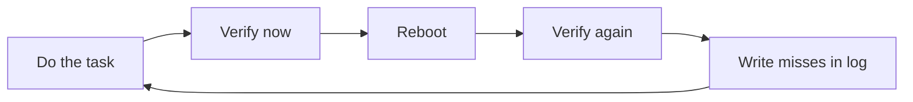

# 17 Final Week Plan and Review Circuit

> By the end of this page you have a day-by-day plan for your last week, a 10-minute review circuit to find weak spots, and a checklist for the day before and the morning of your exam.

!!! example "Try it now (2 minutes)"
    ```bash
    id
    systemctl is-enabled sshd
    lsblk
    getenforce
    ```
    How many of these did you type without looking anything up? Four out of four is a good start. Anything you hesitated on goes into your mistake log (see Day 1). By the end of this page you will have a plan to turn every hesitation into a command you type without thinking.

## Why it matters

Fast recall matters in a timed hands-on exam. You should be able to remember the tool family, the likely config file, and the right verification command quickly. The official objectives page says you must be able to do the tasks without assistance and that configurations must persist after reboot without intervention, so the last week is for retyping and re-verifying, not for reading.

In real life, admins build compact mental checklists so they can work faster under pressure without skipping validation.

**Objectives covered:** the whole course. The ten official RHEL 10 EX200 objective groups:

- Understand and use essential tools
- Manage software
- Create simple shell scripts
- Operate running systems
- Configure local storage
- Create and configure file systems
- Deploy, configure, and maintain systems
- Manage basic networking
- Manage users and groups
- Manage security

**Prereqs:** lessons [00](00-study-skills-and-offline-help.md) through [16](16-persistence-reboot-checks-and-troubleshooting.md), and the labs `22` to `26` plus [28 Mixed Practice Bank](28-rhcsa-10-mixed-practice-bank.md) · **Time:** 7 days, about 1.5 to 2 h per day (this course's own suggestion, not an official figure)

!!! note "Study order"
    The file number of this page is lower than the lab files, but the study order is not. If you are following the beginner route, finish labs `22-26` and [28](28-rhcsa-10-mixed-practice-bank.md) first, then use this page. If you have not, stop here and go back to [22 Labs Track and Skill Check Guide](22-labs-track-and-skill-check-guide.md).

## How it works: the 7-day plan

The plan is a loop, not a reading list. Each day you retype, verify, and reboot at least once.



Keep one plain text file, `~/mistake-log.txt`, open all week. Every command you hesitate on, every verification you forgot, every task that failed after a reboot goes in it. On the last day, that file is your cheat sheet.

Use the [17a Command Reference Cheat Sheet](17a-rhcsa-command-reference-cheat-sheet.md) as a lookup while you practice, then close it and redo the task from memory. Do not use it as a substitute for labs.

| Day | Focus | Lessons | Practice | Done when |
|---|---|---|---|---|
| 1 | Baseline and essential tools, software, scripts | 00-08 | [23](23-vm-lab-setup-and-baseline-checks.md), [24](24-foundations-labs.md), review circuit below | Mistake log started, lab VMs reset |
| 2 | Operate running systems | 09, 12 (boot, bootloader) | [24](24-foundations-labs.md), [25](25-administration-core-labs.md) | Targets, processes, journal, tuning done from memory |
| 3 | Local storage and file systems | 10, 11 | [25](25-administration-core-labs.md) storage drills | LVM, swap, NFS, autofs survive a reboot |
| 4 | Scheduling, services, time, networking | 12, 13 | [25](25-administration-core-labs.md), [26](26-networking-users-and-security-labs.md) | Timers, chrony, nmcli, firewalld verified after reboot |
| 5 | Users, sudo, security, persistence | 14, 15, 16 | [26](26-networking-users-and-security-labs.md) | SELinux, SSH keys, sudo verified after reboot |
| 6 | Mock Exam 1, timed by you | all | [18](18-mock-exam-1.md), grade with [19](19-mock-exam-1-solutions.md) | Every missed task redone and understood |
| 7 | Mock Exam 2, then rest | all | [20](20-mock-exam-2.md), grade with [21](21-mock-exam-2-solutions.md), then the day-before checklist; [31](31-mock-exam-3.md) with [32](32-mock-exam-3-solutions.md) only if you have a spare day | Mistake log read once, then stop |

### Day 1: Baseline, essential tools, software, scripts

- [ ] Rebuild or reset both lab machines using [23 VM Lab Setup and Baseline Checks](23-vm-lab-setup-and-baseline-checks.md).
- [ ] Run the guided review circuit below and start `~/mistake-log.txt`.
- [ ] Redo one drill from each of lessons [01](01-shell-basics-and-command-syntax.md) to [08](08-shell-scripting-basics.md) without notes (shell, files, redirection and grep, archives, SSH, permissions, RPM and Flatpak, scripts).
- [ ] Work through [24 Foundations Labs](24-foundations-labs.md).
- [ ] Look up: [17a, Core: Essential Tools](17a-rhcsa-command-reference-cheat-sheet.md#core-essential-tools) and [17a, Software Management](17a-rhcsa-command-reference-cheat-sheet.md#software-management).

### Day 2: Operate running systems

- [ ] Boot into `rescue.target` and back to `multi-user.target` by hand ([09](09-boot-targets-processes-logs-and-tuning.md)).
- [ ] Set the default target, change a process priority with `nice`/`renice`, kill a runaway process, switch a `tuned` profile.
- [ ] Preserve the journal across reboots (drop-in with `Storage=persistent`, then `sudo journalctl --flush`) and read the previous boot with `journalctl -b -1`.
- [ ] Redo the bootloader change from [12](12-scheduling-services-time-and-bootloader.md) and the root-password reset pattern.
- [ ] Work through the running-systems drills in [25 Administration Core Labs](25-administration-core-labs.md).
- [ ] Look up: [17a, Boot, Targets, Processes, and Logs](17a-rhcsa-command-reference-cheat-sheet.md#boot-targets-processes-and-logs).

### Day 3: Local storage and file systems

- [ ] Reset `/dev/vdb` and `/dev/vdc` (see the disk reset block in the lab below), then build partition, PV, VG, LV, filesystem and swap from memory ([10](10-storage-partitions-lvm-and-swap.md)).
- [ ] Mount by UUID in `/etc/fstab`, run `sudo mount -a`, then reboot and check.
- [ ] Extend a logical volume and its filesystem in one command.
- [ ] Mount an NFS share and configure an autofs map, including the wildcard form ([11](11-filesystems-mounts-nfs-and-autofs.md)).
- [ ] Work through the storage and filesystem drills in [25](25-administration-core-labs.md).
- [ ] Look up: [17a, Storage, Partitions, LVM, and Swap](17a-rhcsa-command-reference-cheat-sheet.md#storage-partitions-lvm-and-swap).

### Day 4: Scheduling, services, time, networking

- [ ] Schedule one job with `at`, one with `cron`, and one with a `systemd` timer ([12](12-scheduling-services-time-and-bootloader.md)).
- [ ] Start, stop and enable a service, and prove both states.
- [ ] Point `chronyd` at a time source and verify with `chronyc sources`.
- [ ] Set a static IPv4 address and an IPv6 address with `nmcli`, set the hostname, edit `/etc/hosts` ([13](13-networking-hostname-resolution-and-firewalld.md)).
- [ ] Open a service and a port permanently in `firewalld`, reload, and verify.
- [ ] Work through the networking drills in [26 Networking, Users, and Security Labs](26-networking-users-and-security-labs.md).

### Day 5: Users, sudo, security, persistence

- [ ] Create users and groups, set password aging with `chage`, write a sudoers drop-in with `visudo -f` ([14](14-users-groups-passwords-and-sudo.md)).
- [ ] Set SELinux mode, add a file context with `semanage fcontext` and `restorecon`, add a port label ([15](15-selinux-ssh-keys-and-security.md)).
- [ ] Create an SSH key and copy it with `ssh-copy-id`.
- [ ] Reboot and run the full verification table in [16 Persistence, Reboot Checks, and Troubleshooting](16-persistence-reboot-checks-and-troubleshooting.md).
- [ ] Look up: [17a, Users, Groups, Passwords, and Sudo](17a-rhcsa-command-reference-cheat-sheet.md#users-groups-passwords-and-sudo) and [17a, SELinux and SSH Keys](17a-rhcsa-command-reference-cheat-sheet.md#selinux-and-ssh-keys).

### Day 6: Mock Exam 1

- [ ] Reset both VMs. Do [18 Mock Exam 1](18-mock-exam-1.md) in one sitting, with a timer you choose yourself and no notes.
- [ ] Reboot at the end and re-verify everything.
- [ ] Grade with [19 Mock Exam 1 Solutions](19-mock-exam-1-solutions.md). Redo every missed task with the solution closed.
- [ ] Fill gaps with tasks from [28](28-rhcsa-10-mixed-practice-bank.md) or [30 RHEL 9 Book Exercise Adaptation Bank](30-rhel9-book-exercise-adaptation-bank.md).

### Day 7: Mock Exam 2, then stop

- [ ] Reset both VMs. Do [20 Mock Exam 2](20-mock-exam-2.md) the same way.
- [ ] Grade with [21 Mock Exam 2 Solutions](21-mock-exam-2-solutions.md) and redo only the misses.
- [ ] Read `~/mistake-log.txt` once, then work through the **Day before** checklist below.
- [ ] Spare day available (for example, you started the plan a day early)? Do [31 Mock Exam 3](31-mock-exam-3.md) before Day 7 and grade it with [32 Mock Exam 3 Solutions](32-mock-exam-3-solutions.md). It covers objectives Mocks 1 and 2 touch lightly. Do not start it on the day before the exam.
- [ ] Containers are optional: if you have time, [15a Containers with Podman](15a-containers-with-podman.md) is bonus material and is not on the RHEL 10 objective list.

## Commands, step by step

This section is the compressed review set. For the full tables and every option, use [17a](17a-rhcsa-command-reference-cheat-sheet.md); the blocks here use short generic names so you can type them from memory.

### 1. Essential shell

```bash
pwd
ls -la
cd
whoami
id
type cd
```

More in [17a, Shell and Offline Help](17a-rhcsa-command-reference-cheat-sheet.md#shell-and-offline-help).

### 2. Files and text

```bash
cp file file.bak
mv old new
rm -r dir
cat file
less file
```

More in [17a, Files, Directories, and Text Viewing](17a-rhcsa-command-reference-cheat-sheet.md#files-directories-and-text-viewing).

### 3. Search and redirection

```bash
grep root /etc/passwd
grep -E 'bash$|nologin$' /etc/passwd
command > out.txt 2> err.txt
command1 | command2
```

More in [17a, Redirection, Pipes, Search, and Text Processing](17a-rhcsa-command-reference-cheat-sheet.md#redirection-pipes-search-and-text-processing).

### 4. Services and logs

```bash
systemctl status service
systemctl is-enabled service
journalctl -u service -b
```

The fuller verification table is [17a, Fast systemd Verification Pattern](17a-rhcsa-command-reference-cheat-sheet.md#fast-systemd-verification-pattern).

### 5. Storage and mounts

```bash
lsblk
blkid
findmnt /data
sudo mount -a
```

### 6. Networking and firewall

```bash
ip addr
nmcli connection show
firewall-cmd --list-all
```

### 7. Users and security

```bash
id user
chage -l user
getenforce
ls -Z path
ssh-copy-id user@host
```

### Worked example 1: verify a service fast

```bash
systemctl is-active sshd
systemctl is-enabled sshd
journalctl -u sshd -b | tail
```

`is-active` proves it runs now. `is-enabled` proves it starts at boot. The journal tail proves it is not complaining.

### Worked example 2: verify a persistent mount fast

```bash
findmnt /data
grep /data /etc/fstab
sudo mount -a
```

`findmnt` proves it is mounted now. `grep` proves the line exists in `/etc/fstab`. `sudo mount -a` proves the line is valid. If `/data` is not a mount on your machine yet, `findmnt /data` prints nothing: use `findmnt /boot` and `grep /boot /etc/fstab` to practice the same three steps.

### Worked example 3: verify a user and sudo rule fast

**Setup:** `sudo useradd -m alice`

```bash
id alice
sudo chage -l alice
sudo visudo -c
```

`id` proves the user and groups. `chage -l` proves the aging policy. `visudo -c` proves the sudoers files have valid syntax.

### Offline help for this page

| Command | Use |
|---|---|
| `man -k keyword` | Search manual page titles when you know the topic, not the command |
| `apropos keyword` | Same as `man -k` |
| `type` | Is it a builtin, alias or program? |
| `help builtin` | Help for shell builtins such as `cd` |
| `/usr/share/doc` | Packaged documentation and examples |

## Common mistakes

- **Mistake:** memorizing command names without knowing how to verify results. **Recovery:** for every command card, write the verification command next to it.
- **Mistake:** reviewing passively instead of retyping commands. **Recovery:** close the notes and type; reading feels familiar and runs slowly.
- **Mistake:** studying weak topics last minute instead of repeating them earlier. **Recovery:** Days 1 to 5 each cover one group; anything weak gets redone on Day 6.
- **Mistake:** using cheat sheets as a substitute for labs. **Recovery:** use them only as compression after practice.
- **Mistake:** reviewing only favorite topics. **Recovery:** spend extra time on storage, networking, SELinux, and persistence.
- **Mistake:** ignoring repeated mistakes. **Recovery:** keep a mistake log and review it daily this week, not just weekly.

## Hands-on lab: the 10-minute review circuit

**Setup:** shared lab environment, `servera`, user `student`. Open a shell and keep a note file of commands you could not remember immediately: `touch ~/mistake-log.txt`.

**Task:**

- [ ] Verify your identity and current directory.
- [ ] Search `/etc/passwd` for users with Bash shells.
- [ ] Query one installed package (`bash`).
- [ ] Check the active and enabled states of `sshd`.
- [ ] Inspect current block devices.
- [ ] Check one persistent mount (`/boot`).
- [ ] Check one network interface and one firewall rule.
- [ ] Check the group membership of `student`.
- [ ] Check the SELinux mode.
- [ ] Record any command you hesitated on in `~/mistake-log.txt`.

**Expected result:** you identify weak recall areas before the mock exams.

??? question "Hint 1"
    Each step is one command from the "Commands, step by step" section above. If you cannot name the command family, that is exactly what goes in the log.

??? question "Hint 2"
    Use `rpm -q` for packages, `systemctl is-enabled` for boot state, `findmnt` for mounts, `firewall-cmd --list-all` for firewall rules.

??? success "Solution"
    ```bash
    whoami
    pwd
    grep 'bash$' /etc/passwd
    rpm -q bash
    systemctl is-active sshd
    systemctl is-enabled sshd
    lsblk
    findmnt /boot
    grep /boot /etc/fstab
    ip addr
    sudo firewall-cmd --list-all
    id student
    getenforce
    echo "hesitated on: <command>" >> ~/mistake-log.txt
    ```
    **Verify:** `rpm -q bash` prints a package version, `systemctl is-enabled sshd` prints `enabled`, `getenforce` prints `Enforcing`, and `~/mistake-log.txt` exists (`ls -l ~/mistake-log.txt`). Every command you had to look up is in the log.

## Independent practice

Do each of these from memory, then check yourself against the answer.

- [ ] Rebuild a one-page command summary from memory.
- [ ] Explain the difference between start and enable.
- [ ] Explain the difference between mount now and mount at boot.
- [ ] Explain the difference between Unix permissions and SELinux.
- [ ] Practice one command from each course lesson without notes.

??? success "Solution"
    - Start runs the service now; enable makes it start at boot. Prove both: `systemctl is-active SERVICE` and `systemctl is-enabled SERVICE`. `systemctl enable --now SERVICE` does both.
    - A mount made with `mount` is gone after a reboot. A line in `/etc/fstab` (checked with `sudo mount -a`) mounts it at boot.
    - Unix permissions (`ls -l`, `chmod`, `chown`) decide access by user, group and other. SELinux (`ls -Z`, `getenforce`) adds a second check on labels and ports. A request must pass both.

### Verification steps

1. Time yourself on common checks.
2. Verify whether you can choose the right command without guessing.
3. Revisit weak topics immediately.

## Troubleshooting

**Problem: review feels familiar but execution is slow.**
Fix: stop rereading; start retyping and redoing labs.

**Problem: you remember concepts but forget syntax.**
Fix: build short command cards with one verification command each.

**Problem: mock exam performance collapses under pressure.**
Fix: practice task breakdown and verification, not just commands.

## The day before and exam morning

### Day before

- [ ] No new topics. Redo your three weakest tasks from `~/mistake-log.txt` once, with notes closed.
- [ ] Re-read the official objective groups listed at the top of this page and tick each one you can do without help.
- [ ] Practice finding documentation offline: `man -k`, `info`, and `/usr/share/doc` ([00](00-study-skills-and-offline-help.md)). Do not rely on a search engine.
- [ ] Read the instructions from the exam provider about identification and system checks, and do any checks they allow ahead of time. This course cannot tell you what they require.
- [ ] Stop studying early and sleep.

### Exam morning

- [ ] Eat and drink something. Have your own plan for breaks.
- [ ] Do not cram new commands. Skim your mistake log once.
- [ ] Read each task completely before typing. Note what must be true at the end.
- [ ] After each task, run one verification command before moving on.
- [ ] Reboot before you finish, if the environment allows it, and re-check everything that must persist. If you cannot reboot, at least run the non-reboot checks below.

!!! warning "Must survive reboot"
    | Change | Persistent? | Make it persist with |
    |---|---|---|
    | `systemctl start SERVICE` | No | `systemctl enable SERVICE` (or `enable --now`) |
    | `mount /dev/... /data` | No | a UUID or label line in `/etc/fstab`, then `sudo mount -a` |
    | `swapon /dev/vdb2` | No | an fstab line, then `sudo swapon -a` |
    | `firewall-cmd --add-service=http` | No | add `--permanent`, then `sudo firewall-cmd --reload` |
    | `setenforce 0` / `setenforce 1` | No | edit `SELINUX=` in `/etc/selinux/config` |
    | `chcon` | No (lost on relabel) | `semanage fcontext -a` + `restorecon -Rv` |
    | `nmcli connection modify` | Yes, but not applied yet | `nmcli connection up NAME` |
    | `hostnamectl set-hostname` | Yes | nothing more; check `hostname` |

After a reboot, run this checklist for every area the tasks touched:

| Area | After-reboot check |
|---|---|
| Services | `systemctl is-active SERVICE` and `systemctl is-enabled SERVICE` |
| Mounts | `findmnt MOUNTPOINT`, `swapon --show` |
| LVM | `lsblk`, `sudo lvs` |
| Firewall | `sudo firewall-cmd --list-all` |
| SELinux | `getenforce`, `ls -Zd PATH` |
| Network | `ip addr`, `hostname`, `getent hosts HOST` |
| Users | `id USER`, `sudo chage -l USER` |
| Target | `systemctl get-default` |

The full list is also in [17a, Verification Commands You Should Use Constantly](17a-rhcsa-command-reference-cheat-sheet.md#verification-commands-you-should-use-constantly) and [17a, Exam Habits for Using This Sheet](17a-rhcsa-command-reference-cheat-sheet.md#exam-habits-for-using-this-sheet).

## Exam tips

!!! tip "What the exam expects"
    The end state a grader checks: the thing works now, the thing works after a reboot, and the thing is configured the way the task said. A task that works now but not later is not enough.

**Verify like a grader:** one check for the live state, one for the config, then reboot and check again.

## Exam-style tasks

These are self-assessment tasks, in the style of the objectives. They have no official status.

### Task 1: build your own one-page sheet

**Setup:** none. Use a plain text file and a live shell on `servera`.

**Task:**

- [ ] Create `~/final-sheet.txt` from memory. Close all notes while you write it.
- [ ] Group the commands by objective group (at least: services, mounts, packages, users, network, SELinux).
- [ ] Put at least one verification command in every group.
- [ ] Run every command on a live system and fix any that fail.

??? question "Hint 1"
    Use the headings of the "Commands, step by step" section as your skeleton, then add what you are weakest on.

??? success "Solution"
    Include at least:

    - service checks: `systemctl is-active/is-enabled SERVICE`
    - mount checks: `findmnt`, `grep /etc/fstab`, `sudo mount -a`
    - package checks: `rpm -q PKG`, `dnf info PKG`
    - user checks: `id USER`, `sudo chage -l USER`
    - network checks: `ip addr`, `nmcli connection show`, `sudo firewall-cmd --list-all`
    - SELinux checks: `getenforce`, `ls -Z PATH`, `ss -tuln`

    **Verify:** every line runs without a "command not found" or syntax error, and every group has at least one check.

### Task 2: three timed tasks from your weakest topics

**Setup:** pick three rows from the table below. Give yourself 10 minutes per row, no notes, then verify.

| Topic | Task (exact values) | Verify |
|---|---|---|
| Services | **Setup:** `sudo dnf install -y httpd`. Start `httpd` now and at boot. | `systemctl is-active httpd`, `systemctl is-enabled httpd` |
| Users | Create user `carol` with UID `3100`, supplementary group `labteam`, password maximum age 30 days. **Setup:** `sudo groupadd labteam`. | `id carol`, `sudo chage -l carol` |
| Firewall | **Setup:** `sudo dnf install -y httpd firewalld` and `sudo systemctl enable --now httpd firewalld`. Allow the `http` service permanently. | `sudo firewall-cmd --list-services` shows `http` after `--reload` |
| SELinux | **Setup:** `sudo dnf install -y httpd policycoreutils-python-utils` and `sudo mkdir -p /srv/webcontent`. Give `/srv/webcontent` the type `httpd_sys_content_t` so it survives a relabel. | `ls -Zd /srv/webcontent` |
| LVM | Partition `/dev/vdb`: 1 GiB for LVM. Build VG `vgapp`, LV `lvapp` (512 MiB), XFS, mounted at `/data/app` by UUID, then extend `lvapp` by 256 MiB with its filesystem. | `sudo lvs`, `findmnt /data/app`, `df -h /data/app` |

??? warning "Disk reset (destroys everything on the disk)"
    Run before the LVM row. This is the course's standard reset with one extra pattern, `data/app`, for this row's mount point.
    ```bash
    sudo umount /data/app 2>/dev/null
    sudo umount /data /par1 /record /datasource /mnt/lvapp 2>/dev/null; sudo swapoff -a
    sudo vgremove -ff -y vgdata vgexam vgapp vgfs datacontainer 2>/dev/null
    sudo wipefs -a /dev/vdb[0-9]* 2>/dev/null; sudo wipefs -a /dev/vdb; sudo partprobe /dev/vdb
    sudo sed -i -E '\#[[:space:]]/(data|par1|record|datasource|mnt/lvapp|data/app)[[:space:]]#d; /\/dev\/vdb|vg(data|app|fs)-/d' /etc/fstab
    for s in $(awk '$1~/^(UUID|LABEL)=/{print $1}' /etc/fstab); do sudo blkid -t "$s" >/dev/null || sudo sed -i "\#^$s[[:space:]]#d" /etc/fstab; done
    sudo systemctl daemon-reload; sudo swapon -a
    ```

- [ ] Three tasks completed and verified.
- [ ] Each one re-verified after a reboot.
- [ ] The weak areas are written in `~/mistake-log.txt`, honestly.

??? question "Hint 1"
    Services: `systemctl enable --now`. Users: `useradd` options `-u`, `-G`, then `chage`. Firewall: `--permanent` then `--reload`. SELinux: `semanage fcontext` then `restorecon`.

??? question "Hint 2"
    LVM: `parted`, `pvcreate`, `vgcreate`, `lvcreate`, `mkfs.xfs`, `blkid`, `/etc/fstab`, then `lvextend` with `-r`.

??? success "Solution"
    **Services**
    ```bash
    sudo systemctl enable --now httpd
    systemctl is-active httpd
    systemctl is-enabled httpd
    ```

    **Users**
    ```bash
    sudo useradd -u 3100 -G labteam carol
    sudo chage -M 30 carol
    id carol
    sudo chage -l carol
    ```

    **Firewall**
    ```bash
    sudo firewall-cmd --permanent --add-service=http
    sudo firewall-cmd --reload
    sudo firewall-cmd --list-services
    ```

    **SELinux**
    ```bash
    sudo semanage fcontext -a -t httpd_sys_content_t '/srv/webcontent(/.*)?'
    sudo restorecon -Rv /srv/webcontent
    ls -Zd /srv/webcontent
    ```

    **LVM** (a 1 GiB partition leaves the VG about 1020 MiB, enough for 512 MiB plus 256 MiB)
    ```bash
    sudo parted -s /dev/vdb mklabel gpt mkpart primary 1MiB 1025MiB set 1 lvm on
    sudo pvcreate /dev/vdb1
    sudo vgcreate vgapp /dev/vdb1
    sudo lvcreate -L 512M -n lvapp vgapp
    sudo mkfs.xfs /dev/vgapp/lvapp
    sudo mkdir -p /data/app
    sudo blkid /dev/vgapp/lvapp
    echo 'UUID=<uuid-from-blkid> /data/app xfs defaults 0 0' | sudo tee -a /etc/fstab
    sudo systemctl daemon-reload
    sudo mount -a
    sudo lvextend -r -L +256M /dev/vgapp/lvapp
    sudo lvs
    findmnt /data/app
    df -h /data/app
    ```
    **Verify:** `lvs` shows `lvapp` at about 768 MiB and `df -h /data/app` shows a matching size.

    **After a reboot, re-check:** `systemctl is-active httpd`, `sudo firewall-cmd --list-services`, `ls -Zd /srv/webcontent`, `id carol`, `findmnt /data/app`.

## Quiz

1. What command proves a service is enabled at boot?
2. What command safely tests `/etc/fstab`?
3. What command lists block devices?
4. What command shows SELinux mode?
5. What command shows your current groups?
6. Which two commands prove a firewall rule survived a reboot?
7. Which command shows the default boot target?

??? success "Answers"
    1. `systemctl is-enabled service`
    2. `sudo mount -a` (and `findmnt --verify` to check the file)
    3. `lsblk`
    4. `getenforce`
    5. `id` or `groups`
    6. `sudo firewall-cmd --list-all` after the reboot, and `sudo firewall-cmd --permanent --list-all` to see the stored configuration
    7. `systemctl get-default`

## Summary

- know the command family
- know the config file
- know the verification command
- know the persistence check

| Task | Command |
|---|---|
| Find a command by topic | `type`, `apropos`, `man -k` |
| Search text | `grep` |
| Install packages | `dnf` |
| Service state and logs | `systemctl`, `journalctl` |
| Disks and mounts | `lsblk`, `blkid`, `findmnt` |
| Network and firewall | `nmcli`, `firewall-cmd` |
| Users and aging | `useradd`, `chage` |
| SELinux | `getenforce`, `restorecon` |
| SSH keys | `ssh-copy-id` |

**Previous:** [16 Persistence, Reboot Checks, and Troubleshooting](16-persistence-reboot-checks-and-troubleshooting.md) · **Reference:** [17a Command Reference Cheat Sheet](17a-rhcsa-command-reference-cheat-sheet.md) · **Next:** [18 Mock Exam 1](18-mock-exam-1.md): the first full practice run, after your labs are done.
