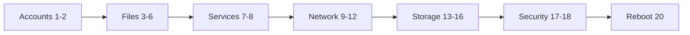

# Mock Exam 2

> A second full practice run with exact values for every task. Finish it, reboot, and grade yourself against the solutions file.

## When To Use This Mock Exam

Use this only after you have completed:

- lessons `00-16`
- labs `22-26`
- `28-rhcsa-10-mixed-practice-bank.md`
- `17a-rhcsa-command-reference-cheat-sheet.md`
- `17-final-review-cheat-sheets.md`
- `18-mock-exam-1.md`



## Instructions

- Suggested self-timer: 3 hours. This is this course's own practice limit, not a statement about the real exam.
- Work from the command line, on `servera`, as `student` with `sudo`.
- Use local help only (`man`, `--help`, `/usr/share/doc`).
- Build in your own verification steps.
- Reboot at the end (Task 20) to prove persistence.
- Do the tasks in order. Later tasks depend on earlier ones.

## Lab environment and setup

Shared lab environment: `servera.lab.example` (`192.168.122.10`, where you work) and `serverb.lab.example` (`192.168.122.11`, the remote machine). Login `student` / `student` with `sudo`, root password `redhat`. `/dev/vdb` is a 2 GiB empty spare disk on `servera`.

**Self-scoring (this course's own practice scheme):** the 19 scored tasks add up to 100 points. Task 19 is an unscored bonus. Treat 70 points as your own target, and grade yourself with the table in [21 Mock Exam 2 Solutions](21-mock-exam-2-solutions.md).

### Setup (not scored)

Run these before you start the timer. They prepare the machines so every task can be done as written.

On `servera`:

```bash
sudo dnf install -y httpd policycoreutils-python-utils nfs-utils autofs
grep -q 'serverb.lab.example' /etc/hosts || echo '192.168.122.11 serverb.lab.example serverb' | sudo tee -a /etc/hosts
```

The second line gives `servera` a local name for `serverb`, because Tasks 16 and 17 and the proof commands use the short name `serverb`.

On `serverb` (the NFS server for Task 16 and the SSH target for Task 17):

```bash
sudo dnf install -y nfs-utils
sudo mkdir -p /export/data
echo 'mock exam nfs file' | sudo tee /export/data/hello.txt
echo '/export/data 192.168.122.0/24(rw,sync)' | sudo tee /etc/exports.d/mock2.exports
sudo systemctl enable nfs-server
sudo systemctl restart nfs-server
sudo firewall-cmd --permanent --add-service={nfs,mountd,rpc-bind}
sudo firewall-cmd --reload
sudo exportfs -rav
sudo useradd -m webadmin
echo 'webadmin:webpass' | sudo chpasswd
```

The last two lines give `webadmin` on `serverb` the password `webpass`, which `ssh-copy-id` needs in Task 17.

??? warning "Reset servera (destroys the Mock 2 work and everything on /dev/vdb)"
    Run this to start over after a previous attempt. It also restores the hostname, the network profile and the disk. It keeps the `serverb` hosts line from Setup.
    ```bash
    sudo umount /webcontent /mnt/nfsdata /mnt/auto/data 2>/dev/null
    sudo systemctl disable --now autofs 2>/dev/null
    sudo sed -i '\#[[:space:]]/webcontent[[:space:]]#d;\#[[:space:]]/mnt/nfsdata[[:space:]]#d' /etc/fstab
    sudo rm -f /etc/auto.master.d/nfsdata.autofs /etc/auto.nfsdata /etc/sudoers.d/webops
    sudo sed -i '/web1.lab.example/d' /etc/hosts
    sudo hostnamectl set-hostname servera.lab.example
    sudo firewall-cmd --permanent --remove-service=http
    sudo firewall-cmd --reload
    CON=$(nmcli -t -f NAME,TYPE con show --active | awk -F: '$2=="802-3-ethernet"{print $1;exit}')
    sudo nmcli connection modify "$CON" ipv6.method auto -ipv4.addresses 192.168.122.50/24 -ipv6.addresses 2001:db8:0:1::50/64
    sudo nmcli connection up "$CON"
    sudo semanage fcontext -d "/srv/webcontent(/.*)?" 2>/dev/null
    sudo rm -rf /opt/webdata /srv/webcontent /var/tmp/webdata.tar.gz /var/tmp/sshd-boot.log /usr/local/bin/filecheck.sh
    sudo loginctl disable-linger webadmin 2>/dev/null
    sudo pkill -u webadmin 2>/dev/null
    sudo userdel -r webadmin 2>/dev/null
    sudo groupdel webops 2>/dev/null
    sudo umount /data /par1 /record /datasource /mnt/lvapp 2>/dev/null; sudo swapoff -a
    sudo vgremove -ff -y vgweb vgdata vgexam vgapp vgfs datacontainer 2>/dev/null
    sudo wipefs -a /dev/vdb[0-9]* 2>/dev/null; sudo wipefs -a /dev/vdb; sudo partprobe /dev/vdb
    sudo sed -i -E '\#[[:space:]]/(data|par1|record|datasource|mnt/lvapp)[[:space:]]#d; /\/dev\/vdb|vg(data|app|fs)-/d' /etc/fstab
    for s in $(awk '$1~/^(UUID|LABEL)=/{print $1}' /etc/fstab); do sudo blkid -t "$s" >/dev/null || sudo sed -i "\#^$s[[:space:]]#d" /etc/fstab; done
    sudo systemctl daemon-reload; sudo swapon -a
    ```

## Tasks

### Task 1 (4 points): Accounts

Create the local group `webops` with GID `3001`. Create the local user `webadmin` with UID `3002`, home directory `/home/webadmin` and shell `/bin/bash`. Add `webadmin` to `webops` as a supplementary group, and set the password of `webadmin` to `webpass`.

- [ ] `getent group webops` shows GID `3001`
- [ ] `id webadmin` shows UID `3002` and `webops` among the groups
- [ ] `webadmin` can log in with the password `webpass`

### Task 2 (6 points): Sudo

Configure a sudoers drop-in file `/etc/sudoers.d/webops` so every member of `webops` can run any command as any user, with a password. Use `visudo` to edit it.

- [ ] The file exists with owner `root`, mode `0440`
- [ ] `sudo visudo -c` reports no errors
- [ ] `sudo -l -U webadmin` shows `(ALL) ALL`

??? question "Hint"
    A group in a sudoers rule starts with `%`. `visudo` can edit a drop-in file directly, and sudo ignores or rejects drop-ins with the wrong mode.

### Task 3 (5 points): Shared directory

Create the directory `/opt/webdata` owned by user `root` and group `webops`, with mode `2775`: owner and group can write, others can only read, and new files inherit the group `webops`.

- [ ] `stat -c '%U:%G %a' /opt/webdata` prints `root:webops 2775`
- [ ] A file created by `webadmin` inside the directory has group `webops`

### Task 4 (3 points): Test page

Create `/opt/webdata/index.html` containing exactly one line: `<h1>Mock 2 test page</h1>`.

- [ ] The file exists and `cat` prints exactly that line

### Task 5 (4 points): Archive

Archive `/opt/webdata` into the gzip-compressed tar file `/var/tmp/webdata.tar.gz`.

- [ ] `tar -tzf /var/tmp/webdata.tar.gz` lists `opt/webdata/index.html`
- [ ] The file is readable by `student`

### Task 6 (8 points): Script

Create `/usr/local/bin/filecheck.sh`, owned by `root` with mode `755`, that accepts one or more file paths. For each path it prints `PATH: regular file` or `PATH: not a regular file`. With no arguments it prints `Usage: filecheck.sh FILE...` on standard error and exits with status `1`.

- [ ] `filecheck.sh /etc/hosts /nope /etc` prints `/etc/hosts: regular file`, `/nope: not a regular file`, `/etc: not a regular file`
- [ ] `filecheck.sh` with no arguments prints the usage line and `echo $?` shows `1`
- [ ] The script runs by name (it is executable and in `PATH`)

??? question "Hint"
    Count the arguments with `$#`, loop over `"$@"`, and test each path with `[ -f "$file" ]`.

### Task 7 (4 points): Time service

Make `chronyd` active now and enabled at boot.

- [ ] `systemctl is-active chronyd` prints `active`
- [ ] `systemctl is-enabled chronyd` prints `enabled`

### Task 8 (4 points): Log extract

Save the last 20 lines of the `sshd` journal messages from the current boot to `/var/tmp/sshd-boot.log`.

- [ ] The file exists and holds at most 20 lines (exactly 20 if `sshd` has logged that many since boot)
- [ ] Every line comes from the SSH daemon (a message from `sshd[` or `sshd-session[`, or a `systemd[1]` line about the unit) and from the current boot

### Task 9 (6 points): Network profile

Find the active NetworkManager connection profile of `servera`. Keep its existing address `192.168.122.10/24`, and add the secondary IPv4 address `192.168.122.50/24`, the DNS server `192.168.122.1`, and the IPv6 address `2001:db8:0:1::50/64` with `ipv6.method manual`. The profile must connect automatically at boot. Do not lose your SSH or console session.

- [ ] `ip -4 addr show` lists both `192.168.122.10/24` and `192.168.122.50/24`
- [ ] `ip -6 addr show` lists `2001:db8:0:1::50/64`
- [ ] `nmcli -g ipv4.dns connection show <profile>` contains `192.168.122.1`
- [ ] `nmcli -g connection.autoconnect connection show <profile>` prints `yes`

??? question "Hint"
    `nmcli connection show --active` gives the profile name. Use the `+` prefix (`+ipv4.addresses`) to add to a list instead of replacing it, then bring the profile up again.

### Task 10 (3 points): Hostname

Set the static hostname to `web1.lab.example`.

- [ ] `hostnamectl --static` prints `web1.lab.example`

### Task 11 (4 points): Local name resolution

Make `web1.lab.example` resolve to `192.168.122.10` through `/etc/hosts`, with the short alias `web1`.

- [ ] `getent hosts web1.lab.example` prints `192.168.122.10` and the name
- [ ] `getent hosts web1` resolves the same way

### Task 12 (5 points): Firewall

Configure `firewalld` so the services `ssh` and `http` are allowed in the default zone, both now and after a reboot.

- [ ] `firewall-cmd --list-services` includes `ssh` and `http`
- [ ] `firewall-cmd --permanent --list-services` includes `ssh` and `http`

### Task 13 (6 points): LVM on a spare disk

On `/dev/vdb`, create a GPT label and one partition of exactly 1 GiB (from `1MiB` to `1025MiB`) with the `lvm` flag. Create the volume group `vgweb` on it and a logical volume `lvcontent` of 700 MiB.

- [ ] `lsblk /dev/vdb` shows `vdb1` of 1G
- [ ] `sudo vgs vgweb` exists
- [ ] `sudo lvs --units m -o lv_name,lv_size vgweb` shows `lvcontent` at `700.00m`

??? question "Hint"
    `parted --script` can create the label, the partition and the flag in separate calls. Run `partprobe` before `pvcreate`.

### Task 14 (6 points): Filesystem and persistent mount

Put an ext4 filesystem with the label `webcontent` on `/dev/vgweb/lvcontent`. Mount it at `/webcontent` through `/etc/fstab`, using the UUID.

- [ ] `findmnt /webcontent` shows ext4 on `/dev/mapper/vgweb-lvcontent`
- [ ] The `/etc/fstab` line starts with `UUID=`
- [ ] `sudo blkid -s LABEL -o value /dev/vgweb/lvcontent` prints `webcontent`
- [ ] `sudo mount -a` and `findmnt --verify` report no errors

### Task 15 (4 points): Grow online

Extend `lvcontent` by 100 MiB and grow the ext4 filesystem in the same step, without unmounting.

- [ ] `sudo lvs --units m -o lv_name,lv_size vgweb` shows `800.00m`
- [ ] `df -h /webcontent` shows a size just under 800M, and the mount stays active

### Task 16 (8 points): NFS client and autofs

`serverb` exports `/export/data` (prepared in Setup). On `servera`:

- (4 points) Mount `serverb:/export/data` at `/mnt/nfsdata` persistently through `/etc/fstab`, using the options `_netdev,defaults`.
- (4 points) Configure `autofs` so that `/mnt/auto/data` mounts `serverb:/export/data` on demand, read-write, and `autofs` is enabled at boot. The master drop-in file is `/etc/auto.master.d/nfsdata.autofs` and the map file is `/etc/auto.nfsdata`.

- [ ] `ls /mnt/nfsdata` shows `hello.txt`
- [ ] `ls /mnt/auto/data` shows `hello.txt`, and `findmnt /mnt/auto/data` then shows an `nfs4` mount
- [ ] `systemctl is-enabled autofs` prints `enabled`

??? question "Hint"
    Setting up an NFS server is not part of this task; you are the client. For autofs, the master line names the mount point and the map file, and the map line names the key, the options and the remote path.

### Task 17 (6 points): SSH key authentication

As `webadmin` on `servera`, create an ed25519 key pair with no passphrase, and install the public key into `webadmin` on `serverb`. After that, `webadmin` must log in to `serverb` without a password.

- [ ] `~webadmin/.ssh/id_ed25519` and `id_ed25519.pub` exist on `servera`
- [ ] `ssh -o PasswordAuthentication=no webadmin@serverb hostname` (run as `webadmin`) prints `serverb.lab.example`
- [ ] `~/.ssh` on `serverb` has mode `700` and `authorized_keys` mode `600`

??? question "Hint"
    Create the key first, then copy it. `ssh-copy-id` asks once for the `webpass` password of `webadmin` on `serverb`.

### Task 18 (6 points): SELinux file context

Create the directory `/srv/webcontent` containing `index.html` with the line `<h1>SELinux practice</h1>`. Give `/srv/webcontent` and everything under it the SELinux type `httpd_sys_content_t`, in a way that survives a relabel (not with `chcon`).

- [ ] `ls -Zd /srv/webcontent /srv/webcontent/index.html` shows `httpd_sys_content_t` for both
- [ ] `sudo semanage fcontext -l -C` lists the rule for `/srv/webcontent(/.*)?`
- [ ] `sudo restorecon -Rnv /srv/webcontent` reports nothing to change

??? question "Hint"
    A new directory under `/srv` gets the type `var_t`, not the web type. Add the rule first, then apply it.

### Task 19 (Bonus, optional, not on the RHEL 10 list; not scored): Rootless container

**Bonus (optional, not on the RHEL 10 list).** Containers are not on the RHEL 10 EX200 objective list, so this task is not counted in the 100 points. Do it only after the scored tasks. It needs the Podman chapter [15a](15a-containers-with-podman.md).

As `webadmin`, run a rootless container named `webctr` from the image `registry.access.redhat.com/ubi10/httpd-24` <!-- VERIFY: image name and tag exist, and the image serves on 8080 as a non-root user --> that publishes host port `8080` to container port `8080`, serves `/home/webadmin/webcontent` (its `index.html` contains `mock exam container`) mounted at `/var/www/html` with the correct SELinux relabel, and starts automatically as a systemd user service through a Quadlet file that survives a reboot.

- [ ] `curl http://localhost:8080` prints `mock exam container`
- [ ] `systemctl --user status webctr.service` (as `webadmin`) shows `active (running)`
- [ ] `loginctl show-user webadmin -p Linger` prints `Linger=yes`
- [ ] After the reboot in Task 20, `curl http://localhost:8080` still works

??? question "Hint"
    Test with `podman run` first. Then write `~/.config/containers/systemd/webctr.container`, remove the manual container, and let systemd run it. Linger keeps the user manager alive without a login.

### Task 20 (8 points): Reboot and re-verify

Reboot `servera` and, without changing anything, prove that these survived:

- [ ] Hostname is `web1.lab.example` and it resolves to `192.168.122.10`
- [ ] Both addresses `192.168.122.10/24` and `192.168.122.50/24` are present
- [ ] `ssh` and `http` are in the firewall services
- [ ] `/webcontent` is mounted from `vgweb-lvcontent` at 800 MiB
- [ ] `/mnt/nfsdata` is mounted, `autofs` is enabled and `/mnt/auto/data` mounts on access
- [ ] `chronyd` is active and enabled
- [ ] `/srv/webcontent` still has `httpd_sys_content_t`
- [ ] Key login to `serverb` still works for `webadmin`

## Suggested Proof Commands

```bash
id webadmin
sudo visudo -c
stat -c '%U:%G %a' /opt/webdata
tar -tzf /var/tmp/webdata.tar.gz
/usr/local/bin/filecheck.sh /etc/hosts /nope
systemctl is-enabled chronyd
cat /var/tmp/sshd-boot.log
ip -4 addr show
hostnamectl
getent hosts web1.lab.example
firewall-cmd --list-services
sudo lvs --units m -o lv_name,lv_size vgweb
findmnt /webcontent
findmnt /mnt/nfsdata
sudo -iu webadmin ssh -o PasswordAuthentication=no webadmin@serverb hostname
ls -Zd /srv/webcontent
curl http://localhost:8080
sudo -iu webadmin systemctl --user status webctr.service
```

## Continue In Order

- Grade yourself before reading the answer key
- Open [21 Mock Exam 2 Solutions](21-mock-exam-2-solutions.md) only after you are fully finished

**Previous:** [19 Mock Exam 1 Solutions](19-mock-exam-1-solutions.md) · **Next:** [21 Mock Exam 2 Solutions](21-mock-exam-2-solutions.md): the answer key, the grade-yourself table and the common failure points.
