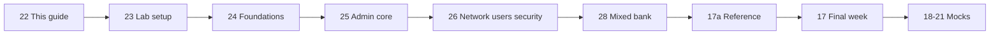

# 22 Labs Track and Skill Check Guide

> By the end of this page you will know which lab file to open next, how to score yourself honestly, and how to turn every failed task into a study target.

!!! example "Try it now (2 minutes)"
    ```bash
    mkdir -p ~/rhcsa-lab-notes && cd ~/rhcsa-lab-notes
    date > scoreboard.txt
    cat scoreboard.txt
    ```
    Notice that you just created the notes folder the whole labs track depends on. Every lab from here on ends with a score written into that folder.

## Why it matters

RHCSA is a hands-on exam. You need a way to test whether you can actually perform tasks, not just recognize them on paper. A lab track lets you measure real skill, with a clock running if you want one.

Junior administrators often inherit servers and must prove they can perform common tasks quickly. A lab checklist is a practical way to validate that skill before touching production systems.

**Objectives covered:**

- Build a repeatable lab routine
- Use section-based labs to test current skill
- Choose the right lab path based on current knowledge
- Verify work instead of assuming it is correct
- Use a question-first workflow for revision

**Prereqs:** [16 Persistence, Reboot Checks, and Troubleshooting](16-persistence-reboot-checks-and-troubleshooting.md) · **Time:** about 1.5 to 2 h

!!! note "Version watch"
    This labs track is organized for the current public `RHCSA EX200` objective set on `RHEL 10`. If your lab system is a different RHEL-compatible release, command output may vary slightly, but the task flow and verification habits remain the same.

## How it works

This labs track is for two kinds of learners:

- learners following the full course in order
- learners who already know some Linux and want to test themselves directly

If you are a total beginner, use the lesson track first and use these lab files after each section.

!!! warning "Follow the route, not the file numbers"
    The files `17-21` (cheat sheets and mock exams) have lower numbers than the lab files `22-29`, but they come after the labs. If you opened `17-21` already because you were following numbers only, stop and return here first. In the site menu the labs are also listed after the review and mock files, so use the route below instead of the order of the menu.

### The study route after lesson 16



1. [22 Labs Track and Skill Check Guide](22-labs-track-and-skill-check-guide.md) (this page)
2. [23 VM Lab Setup and Baseline Checks](23-vm-lab-setup-and-baseline-checks.md)
3. [24 Foundations Labs](24-foundations-labs.md)
4. [25 Administration Core Labs](25-administration-core-labs.md)
5. [26 Networking, Users, and Security Labs](26-networking-users-and-security-labs.md)
6. [28 RHCSA 10 Mixed Practice Bank](28-rhcsa-10-mixed-practice-bank.md)
7. [17a RHCSA Command Reference Cheat Sheet](17a-rhcsa-command-reference-cheat-sheet.md)
8. [17 Final Review and Cheat Sheets](17-final-review-cheat-sheets.md)
9. [18 Mock Exam 1](18-mock-exam-1.md) then [19 Mock Exam 1 Solutions](19-mock-exam-1-solutions.md)
10. [20 Mock Exam 2](20-mock-exam-2.md) then [21 Mock Exam 2 Solutions](21-mock-exam-2-solutions.md)

Optional side files, not part of the route:

- [29 RHCSA and RHCE Local Lab Blueprint](29-rhcsa-rhce-local-lab-blueprint.md) for a step-by-step VM build if you do not have a lab yet
- [27 Optional Topic Reinforcement Map](27-optional-topic-video-map.md) for late-stage topic reinforcement only
- [30 RHEL 9 Book Exercise Adaptation Bank](30-rhel9-book-exercise-adaptation-bank.md) for extra practice once the route is done

If you already know some Linux, start here, then move through the lab files in order. When a task feels hard or unclear, go back to the matching lesson file and study that topic in depth.

### Drill index

The three main lab files contain extra drills written in the style of the official exam objectives. Use this table to jump straight to the skill you want to test.

| File | Drill | Skill it trains | Objective group |
|---|---|---|---|
| [24 Foundations Labs](24-foundations-labs.md) | Drill 1 | ACL check on a copied system file | Permissions (ACLs are a supporting skill, not a listed objective) |
| | Drill 2 | Shared project directory with SGID | Permissions (supporting skill, not a listed objective) |
| | Drill 3 | Sticky-bit drop zone | Permissions (supporting skill, not a listed objective) |
| | Drill 4 | Text extraction speed drill | Understand and use essential tools |
| | Drills 5 to 9 | Search text, archive with gzip, `find`, grep for a string, ACLs on a home directory | Understand and use essential tools (ACLs are a supporting skill) |
| [25 Administration Core Labs](25-administration-core-labs.md) | Drills 1, 2, 8, 12 | Partitions, swap, LVM by extents, VFAT on LVM | Configure local storage; create and configure file systems |
| | Drills 3 to 5 | Script arguments, tests and loops | Create simple shell scripts |
| | Drills 6, 7 | Cron and `@reboot`, chrony client | Deploy, configure, and maintain systems |
| | Drills 9, 10 | `httpd` on a custom port and document root, autofs | Create and configure file systems; deploy and maintain systems |
| | Drills 11, 13 | Persistent journal, default boot kernel | Operate running systems; deploy and maintain systems |
| | Drill 14 | Rootless web container (bonus, not on the RHEL 10 list) | Optional |
| [26 Networking, Users, and Security Labs](26-networking-users-and-security-labs.md) | Drills 1, 7, 9 | Users, UIDs, expiry, collaborative directory | Manage users and groups; manage security (default permissions) |
| | Drills 2, 3 | NetworkManager profile, hostname and name resolution | Manage basic networking |
| | Drills 4, 5, 6, 10 | SELinux booleans, ports and file contexts | Manage security |
| | Drill 8 | ACL with mask | Permissions (supporting skill, not a listed objective) |
| [28 RHCSA 10 Mixed Practice Bank](28-rhcsa-10-mixed-practice-bank.md) | Guided lab, speed drills, exam-style tasks | Mixed, cross-topic pressure | All groups |

!!! tip "What the exam expects"
    The exam rewards the end state. Each lab file therefore finishes with a grader checklist, not a model transcript: if the checks pass now and after a reboot, the task is done.

### How each lab is built

The labs track uses a question-first design:

1. read the task
2. plan the commands
3. do the work
4. verify
5. only then compare to the answer key

This matters because RHCSA rewards execution, not recognition.

Use this lab track like a pressure test:

- can you finish the task?
- can you verify it with commands?
- can you make it survive reboot?
- can you troubleshoot when it fails?

### Recommended order inside the labs

1. build the VM baseline ([23](23-vm-lab-setup-and-baseline-checks.md))
2. build the extra VM lab from [29](29-rhcsa-rhce-local-lab-blueprint.md) if you do not have two machines yet
3. test foundations
4. test administration core
5. test networking, users, and security
6. run the mixed practice bank for cross-topic pressure
7. return to lesson files only where scores are weak

## Commands, step by step

### 1. Record a practice session

```bash
script ~/rhcsa-practice-session.txt
```

- starts a terminal transcript
- useful when reviewing mistakes after practice

### 2. Check where and who you are

```bash
pwd
whoami
hostnamectl
```

- `pwd` shows current directory
- `whoami` shows current user
- `hostnamectl` shows system identity and host details

### 3. Reboot-safe verification mindset

```bash
systemctl is-enabled sshd
systemctl is-active sshd
```

- `is-active` proves service works now
- `is-enabled` proves it is configured for boot persistence

**Commands used on this page:** `pwd`, `ls`, `hostnamectl`, `whoami`, `sudo`, `script`, `date`, `systemctl`, `reboot`, `man`

**Offline help:** `man script`, `man systemctl`, `man reboot`, `man hostnamectl`, `help`

## Worked examples

### Worked Example 1: Choose the right practice path

Situation:

- You know basic shell commands but are weak on storage and SELinux.

Correct approach:

1. Skip directly to the lab files for storage and security.
2. Attempt the questions without notes.
3. If blocked, return to the matching lesson and study only that topic.

Verification:

- you should be able to name which file you need next instead of guessing

### Worked Example 2: Score a skill honestly

Use this simple scoring model (this course's own practice scheme, not an official one):

- `2` = completed correctly without notes
- `1` = completed with help or retries
- `0` = could not complete

Verification:

- your notes should show a score beside each question or lab task

### Worked Example 3: Turn a failure into a study target

Situation:

- You could create an LVM volume but forgot how to make it mount after reboot.

Correct response:

1. mark persistence as weak
2. review `/etc/fstab`, `blkid`, and `mount -a`
3. repeat the storage lab after a reboot

Verification:

- you can explain both the temporary mount and the persistent mount workflow

## Common mistakes

- **Mistake:** jumping into hard labs without checking prerequisites. **Recovery:** finish [23 VM Lab Setup and Baseline Checks](23-vm-lab-setup-and-baseline-checks.md) first.
- **Mistake:** trying to memorize answers instead of solving tasks. **Recovery:** treat every lab as a typing exercise.
- **Mistake:** not verifying persistence after reboot. **Recovery:** reboot is part of RHCSA practice; re-check after every storage, service, firewall or SELinux task.
- **Mistake:** skipping timing practice. **Recovery:** put a timer on a drill once you can do it without notes.
- **Mistake:** looking at solutions too early. **Recovery:** struggle for a few minutes, then use offline help (`man`, `--help`), and only then open the solution.
- **Mistake:** using the labs like reading material only. **Recovery:** type every command.
- **Mistake:** not keeping a weak-topic list. **Recovery:** score every lab honestly.

### Troubleshooting the notes routine

**Problem: wrong path.** Symptom: `cat ~/rhcsa-lab-notes/scoreboard.txt` fails. Fix: run `ls -l ~/rhcsa-lab-notes` and create the file again if needed.

**Problem: permission denied.** Symptom: cannot write to a file in a protected directory. Fix: work in your home directory unless root is required; use `sudo` only when needed.

**Problem: command not found.** Symptom: terminal says `script: command not found`. Fix: `command -v script`, then `rpm -q util-linux`.

**Problem: bad syntax.** Symptom: command runs but file path or option is wrong. Fix: re-read `man` or `--help` and type the command again slowly.

**Problem: config changed but not persistent.** Symptom: something worked before reboot but not after. Fix: identify whether the task needed `/etc/fstab`, `systemctl enable`, persistent firewall rules, or SELinux persistence.

## Hands-on lab

**Setup:** a practice VM where rebooting and making changes is safe (see [23](23-vm-lab-setup-and-baseline-checks.md)), logged in as `student` on `servera`.

**Task:** set up your lab method so you can use the rest of the labs track efficiently.

- [ ] Create a directory named `~/rhcsa-lab-notes`.
- [ ] Start a transcript with `script ~/rhcsa-practice-session.txt` (type `exit` to stop it later).
- [ ] Create a plain-text file named `~/rhcsa-lab-notes/scoreboard.txt`.
- [ ] Add four headings to it: `foundations`, `software and scripting`, `systems and storage`, `networking, users, and security`.
- [ ] Write today's date in the file.
- [ ] Add a simple scoring key: `2 = strong`, `1 = partial`, `0 = review`.
- [ ] Reboot the VM once and confirm you can log back in and continue.

??? question "Hint 1"
    `date` prints today's date and `>>` appends to a file instead of replacing it.

??? question "Hint 2"
    Use `mkdir -p`, then `printf` with `\n` to write several lines at once.

??? success "Solution"
    ```bash
    mkdir -p ~/rhcsa-lab-notes
    script ~/rhcsa-practice-session.txt      # type "exit" when you are done recording
    date > ~/rhcsa-lab-notes/scoreboard.txt
    printf "foundations\nsoftware and scripting\nsystems and storage\nnetworking, users, and security\n" >> ~/rhcsa-lab-notes/scoreboard.txt
    echo "2 = strong, 1 = partial, 0 = review" >> ~/rhcsa-lab-notes/scoreboard.txt
    sudo reboot
    ```

    **Verify:**

    ```bash
    ls -ld ~/rhcsa-lab-notes
    cat ~/rhcsa-lab-notes/scoreboard.txt
    whoami
    hostnamectl
    ```

    You should see the date, the four headings and the scoring key, and the file must still be there after the reboot.

**Expected result:** you have a repeatable lab folder, a place to score weak and strong topics, and you are comfortable rebooting the lab.

**Cleanup:** keep the notes directory. It is part of your training setup.

### Independent practice

- [ ] Create a second score file named `~/rhcsa-lab-notes/mistakes.txt`.
- [ ] Write a three-line rule set for how you will verify work after every lab.
- [ ] Add one line explaining when you should reboot during practice.
- [ ] Add one line explaining when you should use `man` instead of guessing.
- [ ] Time yourself for five minutes and list all RHCSA topics you can remember without opening notes.

**Verification steps:**

1. Confirm `~/rhcsa-lab-notes` exists.
2. Confirm your scoreboard file contains at least four topic headings.
3. Confirm you can explain the difference between "works now" and "works after reboot."

### Exam-style tasks

**Task 1.** Create a personal RHCSA practice workflow in your home directory that includes a score file, a mistakes file, and a simple record of today's practice date.

- [ ] A notes directory `~/rhcsa-lab-notes` exists
- [ ] A score file `scoreboard.txt` exists
- [ ] A mistakes file `mistakes.txt` exists
- [ ] The files contain useful text, not nothing
- [ ] Your workflow is still usable after a reboot

??? success "Solution"
    ```bash
    mkdir -p ~/rhcsa-lab-notes
    date > ~/rhcsa-lab-notes/scoreboard.txt
    printf "foundations\nsoftware-and-scripting\nsystems-and-storage\nnetworking-users-security\n" >> ~/rhcsa-lab-notes/scoreboard.txt
    printf "mistakes log\n" > ~/rhcsa-lab-notes/mistakes.txt
    ```

    **Verify:** `ls -l ~/rhcsa-lab-notes` shows both files with a size above zero; reboot and run it again.

**Task 2.** Create a short self-grading checklist in plain text named `~/rhcsa-lab-notes/self-checklist.txt` that answers: how to test current state, how to test persistence, how to identify weak topics.

- [ ] The checklist file exists
- [ ] It contains at least three practical checks
- [ ] It is readable with `cat`
- [ ] It is useful without internet

??? success "Solution"
    ```bash
    cat > ~/rhcsa-lab-notes/self-checklist.txt <<'EOF'
    1. Verify current state with commands such as systemctl is-active, id, rpm -q, findmnt, ss -tuln.
    2. Verify persistence with commands such as systemctl is-enabled, grep in /etc/fstab, firewall-cmd --list-all, cat /etc/selinux/config.
    3. Mark weak topics with 0, partial topics with 1, and strong topics with 2.
    EOF
    cat ~/rhcsa-lab-notes/self-checklist.txt
    ```

    **Verify:** `cat` prints three numbered lines.

## Exam tips

!!! warning "Must survive reboot"
    | Change | Persistent? | Make it persist with |
    |---|---|---|
    | Service started with `systemctl start` | No | `systemctl enable --now` |
    | Mount made with `mount` | No | an `/etc/fstab` line, then `mount -a` |
    | Rule added with `firewall-cmd` | No | add `--permanent` and `firewall-cmd --reload` |
    | SELinux label set with `chcon` | No | `semanage fcontext` then `restorecon` |

**Verify like a grader:** run the current-state check, run the persistence check, then `sudo reboot` and run both again.

## Quiz

1. Why is a question-first lab useful for RHCSA?
2. What does `systemctl is-enabled` prove?
3. What should you do if you fail a storage lab because of persistence?
4. Why should you keep a mistakes file?
5. When should you look at the solution section?

??? success "Answers"
    1. Because RHCSA tests execution, not recognition.
    2. It proves a service is configured to start at boot.
    3. Review persistence commands, then repeat the lab after reboot.
    4. So you can turn repeated failures into a study plan.
    5. Only after attempting the task honestly.

## Summary

- labs are for proving skill, not reading theory
- verify current state and persistence separately
- score weak topics honestly
- reboot is part of RHCSA practice

| Task | Command |
|---|---|
| Make the notes folder | `mkdir -p ~/rhcsa-lab-notes` |
| Record a session | `script ~/rhcsa-practice-session.txt` |
| Check who and where you are | `whoami`, `hostnamectl` |
| Prove a service works now | `systemctl is-active sshd` |
| Prove it survives reboot | `systemctl is-enabled sshd` |
| Read your score | `cat ~/rhcsa-lab-notes/scoreboard.txt` |

**Previous:** [16 Persistence, Reboot Checks, and Troubleshooting](16-persistence-reboot-checks-and-troubleshooting.md) · **Next:** [23 VM Lab Setup and Baseline Checks](23-vm-lab-setup-and-baseline-checks.md): make sure the lab is stable before starting section labs.
