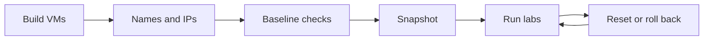

# 23 VM Lab Setup and Baseline Checks

> By the end of this page your two practice VMs match the shared lab environment, pass a baseline check, and can be rolled back in minutes.

!!! example "Try it now (2 minutes)"
    ```bash
    hostnamectl --static
    ip -br addr
    lsblk -o NAME,SIZE,TYPE,MOUNTPOINTS
    ```
    Notice the hostname, the `192.168.122.x` address and two empty 2 GiB disks `vdb` and `vdc`. If any of those are missing, this page tells you how to fix them.

## Why it matters

You need a repeatable environment where you can break, fix, reboot, and re-test systems without fear. Good lab setup makes the rest of your practice realistic, and a lab that behaves the same every time lets you trust your scores.

Administrators often use virtual machines to test package changes, boot settings, storage changes, firewall rules, and service behavior before touching important systems.

**Objectives covered:** this page supports every objective group; it does not train one by itself. It sets up:

- one or two practice VMs with fixed names and addresses
- spare disks for the storage objectives
- a baseline checklist before advanced labs
- reboot, sudo, networking, and package manager basics

**Prereqs:** [22 Labs Track and Skill Check Guide](22-labs-track-and-skill-check-guide.md) · **Time:** about 2 to 3 h

!!! note "Subscription and offline notes"
    You can use a free Red Hat Developer subscription for RHEL, or a compatible
    rebuild such as **AlmaLinux** or **Rocky Linux** if you cannot register;
    the RHCSA skills are identical. Internet is only needed at **setup time**
    (downloading the image, first package install). Practice as if there is no
    internet once your lab works: rely on `man`, `--help`, and local
    repositories rather than online searches.

## How it works

Your lab should be safe, repeatable, and boring in a good way. You want a system you can rebuild, reboot, and damage without risk.

### The shared lab environment

Every lesson, lab and mock exam in this course uses the same machines, so state never has to be guessed.

| Item | Value |
|---|---|
| Hosts | `servera.lab.example` (main), `serverb.lab.example` (client/remote) |
| Network | `192.168.122.0/24`, servera `192.168.122.10`, serverb `192.168.122.11` |
| Login | user `student` (sudo, password `student`), root password `redhat` (lab only) |
| Spare disks | `/dev/vdb` and `/dev/vdc` on servera, 2 GiB each, empty |
| OS | RHEL 10 (or a compatible clone) |

- `servera` is used for most administration work.
- `serverb` is used for SSH, remote copy, NFS, and client-server tasks.
- The `192.168.122.0/24` network is the default libvirt network, so a KVM host gives you the right range for free. Any other hypervisor works if you give the guests these addresses.

Minimum useful setup:

- 2 CPUs and 2 to 4 GB RAM for each VM
- one main system disk
- two extra empty 2 GiB disks on `servera` (they show up as `/dev/vdb` and `/dev/vdc` when the disk bus is virtio)
- local network connectivity between the two VMs
- snapshot ability before dangerous labs

Need to build the VMs from scratch? Follow the step-by-step build in [29 RHCSA and RHCE Local Lab Blueprint](29-rhcsa-rhce-local-lab-blueprint.md), then come back here for the baseline checks.

Do not wait until the storage or SELinux lessons to discover that your VM cannot reboot correctly or cannot talk to another host.



## Commands, step by step

### 1. Set or inspect hostname

```bash
hostnamectl
sudo hostnamectl set-hostname servera.lab.example
```

On `serverb` use `serverb.lab.example`.

### 2. Make the two names resolve

The labs use `ping serverb`, `ssh serverb` and NFS by name, so both VMs need the same two entries in `/etc/hosts`. Run this on both machines (the `grep` makes it safe to repeat):

```bash
grep -q 'servera.lab.example' /etc/hosts || sudo tee -a /etc/hosts <<'EOF'
192.168.122.10 servera.lab.example servera
192.168.122.11 serverb.lab.example serverb
EOF
getent hosts serverb
```

```text title="Example output"
192.168.122.11  serverb.lab.example serverb
```

### 3. Create the lab user and root password (only if the installer did not)

```bash
sudo useradd -m student 2>/dev/null
echo 'student:student' | sudo chpasswd
sudo usermod -aG wheel student
echo 'root:redhat' | sudo chpasswd
id student
```

These passwords are for a throw-away lab only.

### 4. Check networking

```bash
ip -br addr
ip route
ping -c 2 serverb
```

If the VM has outside access, `ping -c 4 8.8.8.8` also confirms the internet for **setup**; the labs themselves do not require it. If you have no outbound access, ping your gateway (the `via` address in `ip route`) instead to confirm local connectivity.

### 5. Check storage layout

```bash
lsblk
df -h
```

### 6. Check package tools

```bash
dnf repolist
rpm -q bash
```

## Baseline check

Run these on `servera` and compare with the expected result. Every row must pass before you start the section labs.

| Check | Command | Expected |
|---|---|---|
| Hostname | `hostnamectl --static` | `servera.lab.example` |
| Address | `ip -br addr` | `192.168.122.10/24` on the lab interface |
| Peer | `ping -c 2 serverb` | 0% packet loss |
| Spare disks | `lsblk -d -o NAME,SIZE,TYPE` | `vdb` and `vdc`, 2G each, type `disk` |
| Disks empty | `sudo blkid /dev/vdb /dev/vdc` | no output |
| sudo | `sudo -l` | `student` may run commands as root |
| Packages | `dnf repolist` | at least one repository listed |
| SSH | `systemctl is-active sshd` and `systemctl is-enabled sshd` | `active` and `enabled` |
| Survives reboot | `sudo reboot`, log in, repeat the table | all rows still pass |

## Reset your lab disks

Storage drills in the labs and mocks assume `/dev/vdb` and `/dev/vdc` are empty. Run this block before any storage drill, and again whenever a previous drill left partitions, volume groups or swap behind. It destroys all data on the disk.

??? warning "Disk reset (destroys everything on the disk)"
    Run once per spare disk, replacing `vdb` with `vdc` for the second disk. Remove any related `/etc/fstab` lines afterwards.
    ```bash
    sudo umount /dev/vdb* 2>/dev/null
    sudo swapoff /dev/vdb* 2>/dev/null
    sudo vgremove -ff -y vgdata vgexam 2>/dev/null
    sudo wipefs -a /dev/vdb
    ```

After the reset, remove leftover lines for the disk from `/etc/fstab`, then prove the disk is blank:

```bash
sudo vi /etc/fstab        # delete lines that mention vdb, a UUID you created, or an old VG/LV
sudo systemctl daemon-reload
lsblk /dev/vdb
sudo blkid /dev/vdb       # no output means blank
```

If a drill used other VG names (for example `vgapp`), add them to the `vgremove` line before you run it.

!!! warning "Never run this on `/dev/vda`"
    `/dev/vda` is the system disk. The reset block only ever names `vdb` and `vdc`.

## Snapshot and rollback

Take one clean snapshot of each VM after the baseline check passes, so you can undo a lab that went wrong without rebuilding. Names below are examples; the idea is the same in VirtualBox, VMware, GNOME Boxes or UTM (use their snapshot menu).

On a KVM/libvirt host (shut the guest down first for the simplest, most reliable snapshot):

```bash
virsh shutdown servera
virsh snapshot-create-as servera --name baseline --description "clean lab after baseline check"
virsh snapshot-list servera
virsh start servera
```

Roll back after a lab you want to undo:

```bash
virsh shutdown servera          # or: virsh destroy servera
virsh snapshot-revert servera baseline
virsh start servera
```

<!-- VERIFY: internal qcow2 snapshots can fail on guests booted with UEFI firmware (NVRAM); if so use external snapshots (--disk-only) or a BIOS guest -->

!!! tip "Snapshot rhythm"
    Snapshot after the baseline passes and again before boot, rescue and storage labs. A snapshot is a rollback point, not a backup: delete old ones you no longer need.

## Worked examples

### Worked Example 1: Confirm the spare disks exist

```bash
lsblk
```

Expected result:

- you should see the main system disk `vda` and the extra empty disks `vdb` and `vdc`

Verification:

- storage practice will be much easier if the extra disks are visible before later labs

### Worked Example 2: Confirm hostname plan

```bash
hostnamectl
```

Expected result:

- the static hostname is `servera.lab.example`, not a random default

Verification:

- write the hostname in your notes file

### Worked Example 3: Confirm package manager works

```bash
dnf repolist
rpm -q bash
```

Verification:

- at least one repository or a known package query should work in your lab

## Common mistakes

- **Mistake:** practicing on a machine without snapshots or rollback. **Recovery:** take the `baseline` snapshot above now.
- **Mistake:** using only one VM when a second host is needed for SSH and NFS practice. **Recovery:** add `serverb` now or note which tasks need adaptation.
- **Mistake:** not checking whether networking works before later labs. **Recovery:** run the baseline table.
- **Mistake:** `ping serverb` fails with "Name or service not known". **Recovery:** add the `/etc/hosts` entries from step 2.
- **Mistake:** not recording hostnames and IP information. **Recovery:** write them in `~/rhcsa-lab-notes/scoreboard.txt`.
- **Mistake:** skipping reboot tests, or ignoring disk layout until storage practice day. **Recovery:** reboot the lab and run `lsblk` before trusting it.

### Troubleshooting

**Problem: service not running.** Symptom: SSH or networking is unavailable.

```bash
systemctl status NetworkManager
systemctl status sshd
sudo systemctl enable --now sshd
```

**Problem: wrong network mode in hypervisor.** Symptom: VMs boot but cannot reach each other. Fix: check the VM network adapter mode and use one that allows host-to-host communication, such as the libvirt `default` NAT network, a shared internal network or a bridge.

**Problem: no extra disk.** Symptom: `lsblk` shows only one system disk. Fix: shut the VM down, add two new 2 GiB virtual disks in the hypervisor (virtio bus), boot again and verify they appear as `vdb` and `vdc`.

**Problem: config changed but not persistent.** Symptom: hostname or service setting is lost after reboot. Fix: use `hostnamectl` for hostname changes and `systemctl enable` for services that must start at boot.

## Hands-on lab

**Setup:** if your VMs already exist, boot them and log in as `student`. If not, build them first with [29 RHCSA and RHCE Local Lab Blueprint](29-rhcsa-rhce-local-lab-blueprint.md).

**Task:**

- [ ] Boot `servera` and `serverb`.
- [ ] Set the hostnames `servera.lab.example` and `serverb.lab.example`.
- [ ] Give them the addresses `192.168.122.10/24` and `192.168.122.11/24` and add the two `/etc/hosts` entries on both.
- [ ] From `servera`, `ping -c 2 serverb` works by name.
- [ ] On `servera`, `/dev/vdb` and `/dev/vdc` exist, are 2 GiB and have no signature.
- [ ] `sudo -l` works for `student`, and `dnf repolist` responds.
- [ ] Reboot `servera`, log back in, and re-check hostname and network status.
- [ ] Take the `baseline` snapshot of both VMs.

??? question "Hint 1"
    Use `hostnamectl set-hostname` for names and `nmcli connection modify` for the static address; the hosts entries are plain text appended to `/etc/hosts`.

??? question "Hint 2"
    `nmcli -g NAME connection show --active` gives you the connection name to modify. After `modify`, bring it up again with `nmcli connection up`.

??? success "Solution"
    On `servera` (swap the name and address on `serverb`):

    ```bash
    sudo hostnamectl set-hostname servera.lab.example
    CON=$(nmcli -g NAME connection show --active | head -1)
    sudo nmcli connection modify "$CON" ipv4.method manual \
      ipv4.addresses 192.168.122.10/24 ipv4.gateway 192.168.122.1 ipv4.dns 192.168.122.1
    sudo nmcli connection up "$CON"
    grep -q 'servera.lab.example' /etc/hosts || sudo tee -a /etc/hosts <<'EOF'
    192.168.122.10 servera.lab.example servera
    192.168.122.11 serverb.lab.example serverb
    EOF
    ```

    **Verify:**

    ```bash
    hostnamectl
    ip -br addr
    ip route
    ping -c 2 serverb
    lsblk
    sudo blkid /dev/vdb /dev/vdc
    sudo -l
    dnf repolist
    sudo reboot
    ```

    After the reboot repeat `hostnamectl`, `ip -br addr` and `ping -c 2 serverb`. Then snapshot (see above).

**Expected result:** your lab is usable for remote access, storage, and reboot-safe practice.

**Cleanup:** none. This is your permanent lab baseline.

### Independent practice

- [ ] Give both systems clear hostnames if they do not already have them.
- [ ] Record the primary IPv4 address of each VM.
- [ ] Verify whether IPv6 is present (`ip -6 addr`).
- [ ] Confirm which VM has the spare disks.
- [ ] Reboot one VM and confirm you can still log in, use `sudo`, and reach the network.
- [ ] If you only have one VM, write down which later topics (SSH to a second host, NFS, autofs) will need adaptation.

**Verification steps:**

1. Confirm each VM has a known hostname.
2. Confirm at least one VM has reachable networking.
3. Confirm `servera` has the two spare disks.

### Exam-style tasks

**Task 1.** Prepare a VM named `servera.lab.example`, verify networking, confirm package manager access, and prove the machine is safe to use for reboot-based labs.

- [ ] The hostname is `servera.lab.example`
- [ ] Network commands succeed
- [ ] `dnf repolist` responds
- [ ] Reboot succeeds
- [ ] The machine is still usable after reboot

??? success "Solution"
    ```bash
    sudo hostnamectl set-hostname servera.lab.example
    hostnamectl
    ip addr
    ip route
    dnf repolist
    sudo reboot
    ```

    **Verify:** after the reboot `hostnamectl --static` still prints `servera.lab.example` and `ip route` still shows a default route.

**Task 2.** On `servera`, prove that the spare disks `/dev/vdb` and `/dev/vdc` are available and record them for later partition and LVM work.

- [ ] `lsblk` shows both devices at 2G
- [ ] They are not confused with the system disk `vda`
- [ ] The notes file names them

??? success "Solution"
    ```bash
    lsblk
    mkdir -p ~/rhcsa-lab-notes
    echo "storage practice disks are /dev/vdb and /dev/vdc" >> ~/rhcsa-lab-notes/scoreboard.txt
    ```

    **Verify:** `tail -1 ~/rhcsa-lab-notes/scoreboard.txt`.

## Exam tips

!!! tip "What the exam expects"
    A task is only done when the end state is correct, so build the habit now: change it, check it, reboot, check it again.

!!! warning "Must survive reboot"
    | Change | Persistent? | Make it persist with |
    |---|---|---|
    | `hostname newname` | No | `hostnamectl set-hostname` |
    | `ip addr add ...` | No | `nmcli connection modify` plus `nmcli connection up` |
    | `systemctl start sshd` | No | `systemctl enable --now sshd` |
    | Edit to `/etc/hosts` | Yes | nothing more needed |

## Quiz

1. Why is a second VM useful for RHCSA practice?
2. What command quickly shows block devices?
3. What command shows the system hostname?
4. Why should you reboot before deeper practice?
5. What should you record in your notes after lab setup?

??? success "Answers"
    1. For SSH, file transfer, NFS, and other client-server tasks.
    2. `lsblk`
    3. `hostnamectl` or `hostname`
    4. Because RHCSA tasks often require persistence after reboot.
    5. Hostnames, IP addresses, disk layout, and weak areas.

## Summary

- safe lab first, hard labs second
- two VMs are better than one
- the spare disks `vdb` and `vdc` are for practice, never `vda`
- reboot early so the lab is trustworthy
- snapshot the clean baseline before you break anything

| Task | Command |
|---|---|
| Set hostname | `sudo hostnamectl set-hostname servera.lab.example` |
| Check addresses | `ip -br addr` |
| Check the peer | `ping -c 2 serverb` |
| List disks | `lsblk` |
| Check repositories | `dnf repolist` |
| Snapshot | `virsh snapshot-create-as servera --name baseline` |
| Roll back | `virsh snapshot-revert servera baseline` |

**Previous:** [22 Labs Track and Skill Check Guide](22-labs-track-and-skill-check-guide.md) · **Next:** [24 Foundations Labs](24-foundations-labs.md): the first set of section labs. If you still need to build the VMs, open [29 RHCSA and RHCE Local Lab Blueprint](29-rhcsa-rhce-local-lab-blueprint.md) first.
