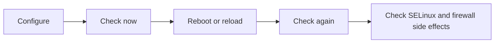

# Networking, Users, and Security Labs

> Test your ability to configure network settings, firewalld, local users and groups, sudo access, SSH keys, and SELinux, and to prove it all still works after a reboot.

## At a Glance

**Why this matters for RHCSA**

These are high-value hands-on areas. They combine configuration, verification, and troubleshooting, and many tasks fail because learners forget persistence or SELinux side effects.

**Real-world use**

Administrators constantly assign IP settings, control access, create users, manage sudo, allow services through firewalls, and fix SELinux labeling and policy issues.

**Estimated study time**

5 to 7 hours

## Prerequisites

- A working lab VM: `servera.lab.example` (`192.168.122.10`), user `student` (password `student`, sudo), root password `redhat`.
- A second VM for SSH tests: `serverb.lab.example` (`192.168.122.11`).
- Previous lesson or lab exposure to systemd and basic shell work.
- Lessons to read first: [13 Networking, Hostname Resolution, and firewalld](13-networking-hostname-resolution-and-firewalld.md), [14 Users, Groups, Passwords, and Sudo](14-users-groups-passwords-and-sudo.md), [15 SELinux, SSH Keys, and Security](15-selinux-ssh-keys-and-security.md).

The machines, addresses and passwords are the shared environment described in [23 VM Lab Setup and Baseline Checks](23-vm-lab-setup-and-baseline-checks.md).

## Objectives Covered

Official RHEL 10 wording only:

- Configure IPv4 and IPv6 addresses
- Configure hostname resolution
- Configure network services to start automatically at boot
- Restrict network access using firewalld and firewall-cmd
- Create, delete, and modify local user accounts
- Change passwords and adjust password aging for local user accounts
- Create, delete, and modify local groups and group memberships
- Configure privileged access
- Configure firewall settings using firewall-cmd/firewalld
- Manage default file permissions
- Configure key-based authentication for SSH
- Set enforcing and permissive modes for SELinux
- List and identify SELinux file and process context
- Restore default file contexts
- Manage SELinux port labels
- Use Boolean settings to modify system SELinux settings

## Commands/Tools Used

`ip`, `nmcli`, `hostnamectl`, `getent`, `ss`, `firewall-cmd`, `useradd`, `usermod`, `groupadd`, `passwd`, `chage`, `visudo`, `ssh-keygen`, `ssh-copy-id`, `getenforce`, `sestatus`, `restorecon`, `setsebool`, `getsebool`, `semanage`, `setfacl`, `getfacl`, `chmod`, `chgrp`

## Offline Help References For This Topic

- `man nmcli`
- `man firewall-cmd`
- `man useradd`
- `man usermod`
- `man visudo`
- `man ssh-keygen`
- `man ssh-copy-id`
- `man semanage`
- `man setfacl`

## Drill index

| Drill | What you do | Objective it trains |
|---|---|---|
| [Guided lab](#guided-hands-on-lab) | Network, hostname, user, sudo, SSH key, firewall and SELinux in one pass | All groups below |
| [1](#drill-1-users-supplementary-groups-and-non-login-shell) | Users, supplementary group, `/sbin/nologin` | Create, delete, and modify local user accounts; local groups and group memberships |
| [2](#drill-2-static-networkmanager-profile) | Static IPv4 profile | Configure IPv4 and IPv6 addresses |
| [3](#drill-3-hostname-and-local-name-resolution) | Hostname and `/etc/hosts` | Configure hostname resolution |
| [4](#drill-4-selinux-boolean-for-http-home-directories) | `httpd_enable_homedirs` boolean | Use Boolean settings to modify system SELinux settings |
| [5](#drill-5-allow-httpd-on-custom-port-82) | SELinux port label plus firewall port | Manage SELinux port labels; firewalld |
| [6](#drill-6-serve-content-from-a-nonstandard-directory-with-selinux) | `fcontext` rule for `/srv/webcontent` | Restore default file contexts; list and identify SELinux file context |
| [7](#drill-7-create-users-with-specific-uids-and-expiration-policy) | UIDs, password aging, account expiry | Change passwords and adjust password aging |
| [8](#drill-8-grant-a-group-read-only-acl-and-adjust-the-acl-mask) | Group ACL and ACL mask | Supporting skill (not a listed objective) |
| [9](#drill-9-create-a-collaborative-directory-for-one-group-only) | SGID collaboration directory | Supporting skill; manage default file permissions |
| [10](#drill-10-label-a-custom-directory-so-httpd-can-read-it) | Persistent web-content label on `/data/xfs` | Restore default file contexts; list and identify SELinux file context |
| [11](#drill-11-ipv6-address-on-a-networkmanager-profile) | IPv6 address on a profile | Configure IPv4 and IPv6 addresses |
| [12](#drill-12-firewalld-runtime-versus-permanent) | Runtime versus permanent, restrict by source | Restrict network access using firewalld and firewall-cmd |
| [13](#drill-13-key-based-ssh-login-to-serverb) | SSH key login to `serverb` | Configure key-based authentication for SSH |
| [Exam-style 1 and 2](#exam-style-tasks) | User plus sudo; web port with firewall plus SELinux | Configure privileged access; Manage SELinux port labels |

## Concept Explanation In Simple Language

This lab file checks whether you can make access work correctly and securely.

Common failure patterns here:

- networking looks right, but the connection profile was not activated
- firewall rule works now, but not after reload or reboot
- user exists, but home directory, shell, or group membership is wrong
- SSH key exists, but permissions or key installation are wrong
- service still fails because SELinux blocks it

The key theme is layered verification:

1. configure
2. check current behavior
3. check persistence
4. check security side effects



## Common Beginner Mistakes

- Setting an IP but forgetting to bring the connection up
- Opening a firewall port temporarily when persistence is required
- Creating users without verifying group membership
- Editing sudo rules unsafely
- Changing an SELinux setting at runtime only and forgetting persistence

## Command Breakdowns

### Change a connection profile

```bash
sudo nmcli connection modify eth0 ipv4.addresses 192.168.122.50/24
sudo nmcli connection modify eth0 ipv4.gateway 192.168.122.1
sudo nmcli connection modify eth0 ipv4.method manual
sudo nmcli connection up eth0
```

`eth0` is only an example. Look up the real profile name with `nmcli connection show` first.

### Create a user with custom home

```bash
sudo useradd -m -d /srv/alice -s /bin/bash alice
```

### Open a firewall service permanently

```bash
sudo firewall-cmd --add-service=http --permanent
sudo firewall-cmd --reload
```

### Add an SELinux port label

```bash
sudo semanage port -a -t http_port_t -p tcp 85
```

## Worked examples

### Worked Example 1: Verify a user completely

```bash
id alice
getent passwd alice
ls -ld /srv/alice
```

Verification:

- all three checks should agree about user identity, home path, and existence

### Worked Example 2: Verify a firewall rule correctly

```bash
sudo firewall-cmd --list-all
sudo firewall-cmd --list-ports
```

Verification:

- the expected service or port should appear in active rules

### Worked Example 3: Verify SELinux for a custom HTTP port

```bash
sudo semanage port -l | grep http_port_t
ss -tuln | grep :85
```

Verification:

- port label and listening state should both make sense

## Reset this page's lab state

Every drill below has its own **Setup** that creates what it needs. If you are repeating drills, or a drill complains that a user, label or rule already exists, run this block once first. It only removes things this page creates.

??? warning "Reset lab state (run on servera as student)"
    ```bash
    for u in alice bob carol dana; do sudo userdel -r "$u" 2>/dev/null; done
    for g in labteam webadmins auditors; do sudo groupdel "$g" 2>/dev/null; done
    sudo rm -f /etc/sudoers.d/webadmins /etc/sudoers.d/labteam /etc/httpd/conf.d/port82.conf /etc/httpd/conf.d/port85.conf /etc/httpd/conf.d/webcontent.conf
    sudo semanage port -d -t http_port_t -p tcp 82 2>/dev/null
    sudo semanage port -d -t http_port_t -p tcp 85 2>/dev/null
    sudo semanage fcontext -d '/srv/webcontent(/.*)?' 2>/dev/null
    sudo semanage fcontext -d '/data/xfs(/.*)?' 2>/dev/null
    sudo setsebool -P httpd_enable_homedirs off
    sudo firewall-cmd --permanent --remove-port=82/tcp --remove-port=85/tcp --remove-port=8081/tcp --remove-service=https --remove-service=http 2>/dev/null
    sudo firewall-cmd --permanent --remove-rich-rule='rule family="ipv4" source address="192.168.122.11" service name="http" accept' 2>/dev/null
    sudo firewall-cmd --reload
    sudo rm -rf /srv/webcontent /data/xfs /data/labteam /srv/report.txt /srv/alice
    CON=$(nmcli -t -f NAME,TYPE con show --active | awk -F: '$2=="802-3-ethernet"{print $1;exit}')
    sudo nmcli connection modify "$CON" -ipv4.addresses 192.168.122.60/24 2>/dev/null
    sudo nmcli connection up "$CON"
    sudo nmcli connection delete net 2>/dev/null
    sudo nmcli connection delete v6lab 2>/dev/null
    ```
    The block does not undo a changed hostname, leaves the shared lab's `/etc/hosts` lines for `servera` and `serverb` alone (the drills add them only if missing), and keeps your original network profile and its first address.

## Guided Hands-On Lab

### Lab Goal

Perform a complete networking, access, and SELinux workflow with exact values.

### Setup

Two VMs: `servera` (work as `student`) and `serverb`.

```bash
# on servera
sudo dnf -y install httpd policycoreutils-python-utils
# on serverb: the account that receives the SSH key (lab password only)
sudo useradd -m alice 2>/dev/null; echo 'alice:alice' | sudo chpasswd
```

If you ran this lab before, run the page reset above first.

### Task Steps

- [ ] 1. Record the active device and profile name (`nmcli`), and the current IPv4 address (`ip`).
- [ ] 2. On that profile, **add** a second address `192.168.122.60/24` (keep the existing one), bring the profile up, and confirm both addresses show.
- [ ] 3. Set the hostname to `servera.lab.example`.
- [ ] 4. Add `192.168.122.11 serverb.lab.example serverb` to `/etc/hosts` and prove `getent hosts serverb` answers.
- [ ] 5. Create group `webadmins`, then user `alice` with home `/srv/alice`, shell `/bin/bash`, and `webadmins` as a supplementary group.
- [ ] 6. Set password aging on `alice`: maximum 90 days, minimum 7, warning 14.
- [ ] 7. Add a sudo drop-in `/etc/sudoers.d/webadmins` letting members of `webadmins` run any command, mode `0440`, created safely (with `visudo`), and verify the syntax.
- [ ] 8. As `student` on servera, generate an ed25519 key with no passphrase and install it for `alice@serverb` with `ssh-copy-id`.
- [ ] 9. Permanently open the `https` service in firewalld.
- [ ] 10. Prepare `httpd` for TCP `85`: `Listen 85` in a drop-in, SELinux port label `http_port_t`, permanent firewall port, service enabled and (re)started.
- [ ] 11. Test with `curl http://localhost:85`.
- [ ] 12. Reboot and verify every item that must persist.

??? question "Hint 1"
    Step 2 uses a plus sign in front of the property (`+ipv4.addresses`) so you add to the list instead of replacing it. Step 10 needs three separate layers: the service config, SELinux, and the firewall.

??? question "Hint 2"
    The tools for step 10 are `semanage port`, `firewall-cmd --permanent`, `systemctl enable` plus `systemctl restart` (so a running `httpd` re-reads `Listen`), and a file under `/etc/httpd/conf.d/`. A bind error in `systemctl status httpd` means the SELinux port label is missing.

??? success "Solution"
    ```bash
    # 1-2: addresses (additive, safe over SSH)
    nmcli -t -f NAME,DEVICE connection show --active
    CON=$(nmcli -t -f NAME,TYPE con show --active | awk -F: '$2=="802-3-ethernet"{print $1;exit}')      # your active ethernet profile
    ip -br addr
    sudo nmcli connection modify "$CON" +ipv4.addresses 192.168.122.60/24
    sudo nmcli connection up "$CON"
    ip -br addr                                   # both 192.168.122.10/24 and .60/24

    # 3-4: hostname and local resolution
    sudo hostnamectl set-hostname servera.lab.example
    grep -q 'serverb.lab.example' /etc/hosts || echo "192.168.122.11 serverb.lab.example serverb" | sudo tee -a /etc/hosts
    getent hosts serverb

    # 5-6: group, user, aging
    sudo groupadd webadmins
    sudo useradd -m -d /srv/alice -s /bin/bash -G webadmins alice
    echo 'alice:alice' | sudo chpasswd
    sudo chage -M 90 -m 7 -W 14 alice
    id alice; getent passwd alice; ls -ld /srv/alice; sudo chage -l alice

    # 7: sudo drop-in: syntax-check a temp file, then install it with the right mode
    T=$(mktemp); echo '%webadmins ALL=(ALL) ALL' > "$T"
    sudo visudo -cf "$T" && sudo install -m 0440 -o root -g root "$T" /etc/sudoers.d/webadmins; rm -f "$T"
    # (interactive alternative: sudo visudo -f /etc/sudoers.d/webadmins)
    sudo visudo -c
    sudo -l -U alice

    # 8: SSH key to serverb
    [ -f ~/.ssh/id_ed25519 ] || ssh-keygen -t ed25519 -N '' -f ~/.ssh/id_ed25519
    ssh-copy-id alice@serverb                     # password: alice
    ssh -o PasswordAuthentication=no alice@serverb hostname

    # 9: firewall service
    sudo firewall-cmd --add-service=https --permanent
    sudo firewall-cmd --reload

    # 10-11: httpd on 85
    echo 'Listen 85' | sudo tee /etc/httpd/conf.d/port85.conf
    sudo semanage port -a -t http_port_t -p tcp 85
    sudo firewall-cmd --add-port=85/tcp --permanent
    sudo firewall-cmd --reload
    echo 'guided lab page' | sudo tee /var/www/html/index.html
    sudo restorecon -Rv /var/www/html
    sudo systemctl enable httpd
    sudo systemctl restart httpd
    ss -tlnp | grep ':85'
    curl http://localhost:85
    ```
    **Verify:** `sudo firewall-cmd --list-all` shows `https` and `85/tcp`; `sudo semanage port -l | grep http_port_t` lists `85`; `ssh -o PasswordAuthentication=no alice@serverb hostname` prints `serverb.lab.example` (or your serverb name) without a password prompt.

    **Reboot and re-check (step 12):** `sudo reboot`, then run `hostnamectl`, `ip -br addr` (both addresses), `getent hosts serverb`, `id alice`, `sudo visudo -c`, `sudo firewall-cmd --list-all`, `systemctl is-active httpd`, `curl http://localhost:85`, `getenforce`. All must still be correct.

### Expected Result

- network configuration is understandable and testable
- user and group administration is correct
- SSH keys work or are prepared correctly
- firewall and SELinux configuration can be verified after reboot

### Verification Commands

```bash
ip addr
nmcli connection show
getent hosts servera.lab.example
id alice
groups alice
sudo visudo -c
ssh -o PasswordAuthentication=no alice@serverb hostname
sudo firewall-cmd --list-all
getenforce
sestatus
sudo semanage port -l | grep http_port_t
```

### Cleanup

You may keep the user, rules, and key pair if they support later practice, or run the page reset block.

## Independent Practice Tasks

Do each of these on `servera`, then check yourself against the collapsed answers. The drills later in this page cover several of them in more depth.

- [ ] 1. Configure static IPv4 address `192.168.122.50/24`, gateway `192.168.122.1` on a new profile named `net` (see Drill 2).
- [ ] 2. Add DNS server `192.168.122.1` to profile `net` with `nmcli`.
- [ ] 3. Create user `dana` **without** a home directory, then explain when that is useful.
- [ ] 4. Create user `bob` with home directory `/srv/bob`.
- [ ] 5. Create group `labteam` and add `alice`, `bob` and `carol` to it (create the users first if missing).
- [ ] 6. Create a sudoers drop-in `/etc/sudoers.d/labteam` giving group `labteam` all commands, using `visudo -f`.
- [ ] 7. Generate an SSH key and test key-based login to `serverb` (see Drill 13).
- [ ] 8. Set SELinux to permissive mode and then back to enforcing mode.
- [ ] 9. Create `/srv/webcontent/index.html` with the wrong label (`chcon -t tmp_t`), then restore the default context.
- [ ] 10. Configure port `85` for `httpd` with both SELinux and firewalld (see Exam-Style Task 2).

??? success "Answers"
    ```bash
    # 1-2
    IFACE="$(nmcli -t -f DEVICE,TYPE device status | awk -F: '$2=="ethernet"{print $1; exit}')"
    sudo nmcli connection add con-name net type ethernet ifname "$IFACE" \
      ipv4.method manual ipv4.addresses 192.168.122.50/24 ipv4.gateway 192.168.122.1 \
      connection.autoconnect no
    sudo nmcli connection modify net ipv4.dns 192.168.122.1
    nmcli -f ipv4 connection show net
    # (only run "nmcli connection up net" from the VM console; it replaces your SSH address)

    # 3: no home (-M). Useful for service accounts that never log in or own files
    sudo useradd -M dana
    getent passwd dana; ls -d /home/dana 2>&1

    # 4-6
    sudo useradd -m -d /srv/bob bob
    sudo useradd carol; sudo useradd -m -d /srv/alice alice 2>/dev/null
    sudo groupadd labteam
    sudo usermod -aG labteam alice; sudo usermod -aG labteam bob; sudo usermod -aG labteam carol
    getent group labteam
    sudo visudo -f /etc/sudoers.d/labteam     # type: %labteam ALL=(ALL) ALL, save, exit
    sudo ls -l /etc/sudoers.d/labteam         # visudo creates it as 0440
    sudo visudo -c

    # 8
    sudo setenforce 0; getenforce
    sudo setenforce 1; getenforce

    # 9
    sudo mkdir -p /srv/webcontent && echo hi | sudo tee /srv/webcontent/index.html
    sudo chcon -t tmp_t /srv/webcontent/index.html
    ls -Z /srv/webcontent/index.html
    sudo restorecon -v /srv/webcontent/index.html   # reverts to the policy default for that path
    ```
    Task 9 note: without an `fcontext` rule for `/srv/webcontent`, the restored type is the default for its parent, not web content. Drill 6 adds the rule.
    `setenforce` changes only the running mode. The boot mode comes from `SELINUX=` in `/etc/selinux/config`.

## Core Skill Drills

These drills practise the skills named in the official objectives, with exact values and clearer verification.

### Drill 1: Users, supplementary groups, and non-login shell

**Setup:** `sudo userdel -r bob 2>/dev/null; sudo userdel -r carol 2>/dev/null; sudo groupdel labteam 2>/dev/null`

**Task:** As `root` (use `sudo`):

- [ ] Create a group named `labteam`.
- [ ] Create user `bob` and add `labteam` as a **supplementary** group (keep his primary group).
- [ ] Create user `carol` with shell `/sbin/nologin`.
- [ ] Verify both users fully.

What to check before moving on:

- [ ] `bob` exists
- [ ] `labteam` appears as a supplementary group, not a replacement primary group
- [ ] `carol` shows `/sbin/nologin` in account data

??? question "Hint 1"
    A supplementary group is added to an existing user with `usermod`. The option that appends is easy to get wrong: without it, the user loses their other supplementary groups.

??? question "Hint 2"
    Use `id`, `getent group` and `getent passwd` to check. The shell is the last field of the passwd line.

??? success "Solution"
    ```bash
    sudo groupadd labteam
    sudo useradd bob
    sudo usermod -aG labteam bob
    sudo useradd -s /sbin/nologin carol
    id bob
    getent group labteam
    getent passwd carol
    ```
    **Verify:**

    - `id bob` should list `labteam` in `groups=` and keep `gid=...(bob)` as the primary group
    - `getent passwd carol` should end with `/sbin/nologin`

    **Persistence:** user and group databases are files (`/etc/passwd`, `/etc/group`), so this survives reboot. Re-run the three checks after a reboot to be sure.

### Drill 2: Static NetworkManager profile

!!! warning "Run this from the VM console"
    Bringing up a profile with a different address on the same interface drops your SSH session (servera normally uses `192.168.122.10`). Use the hypervisor console, and finish with the restore step in the solution.

**Setup:** note the original profile and the real interface name:

```bash
ORIG=$(nmcli -t -f NAME,TYPE con show --active | awk -F: '$2=="802-3-ethernet"{print $1;exit}'); echo "$ORIG"
IFACE="$(nmcli -t -f DEVICE,TYPE device status | awk -F: '$2=="ethernet"{print $1; exit}')"; echo "$IFACE"
sudo nmcli connection delete net 2>/dev/null
```

**Task:** As `root` (use `sudo`), create a new connection profile named `net`.

- [ ] Use your real interface name from the Setup output, not a guessed one.
- [ ] Configure static IPv4 address `192.168.122.50/24`.
- [ ] Set gateway `192.168.122.1`.
- [ ] Set DNS `8.8.8.8`.
- [ ] Activate the profile.

What to check before moving on:

- [ ] `nmcli connection show net` displays the expected values
- [ ] `nmcli connection up net` succeeds
- [ ] `ip addr` reflects the intended address
- [ ] the profile is stored on disk (it will be there after a reboot)

??? question "Hint 1"
    `nmcli device status` gives the device name; `nmcli connection show` gives profile names. They are not always the same string.

??? question "Hint 2"
    Use `nmcli connection add` with `type ethernet`, then `ipv4.method manual` so the static address is actually used. Settings are not live until `nmcli connection up`.

??? success "Solution"
    ```bash
    nmcli device status
    sudo nmcli connection add con-name net type ethernet ifname "$IFACE" \
      ipv4.addresses 192.168.122.50/24 ipv4.gateway 192.168.122.1 ipv4.method manual \
      connection.autoconnect no
    sudo nmcli connection modify net ipv4.dns 8.8.8.8
    sudo nmcli connection up net
    nmcli connection show net | grep -E 'ipv4\.(method|addresses|gateway|dns)'
    ip addr show "$IFACE"
    sudo ls /etc/NetworkManager/system-connections/
    ```
    **Verify:** `ip addr show` lists `192.168.122.50/24`; `nmcli connection show net` shows `ipv4.method: manual`.

    **Persistence:** `nmcli` writes the profile to `/etc/NetworkManager/system-connections/net.nmconnection`, so the profile survives a reboot. The solution sets `connection.autoconnect no`, so after a reboot the profile still exists but your original profile is the active one (check with `nmcli -f NAME,DEVICE connection show --active`). On the exam, a profile you want active at boot needs `connection.autoconnect yes` (the default).

    **Restore your lab network when finished:**
    ```bash
    sudo nmcli connection down net
    sudo nmcli connection up "$ORIG"
    sudo nmcli connection delete net
    ```

### Drill 3: Hostname and local name resolution

**Setup:** none. The shared lab (see [23](23-vm-lab-setup-and-baseline-checks.md)) may already have this `/etc/hosts` line; the solution only adds it if it is missing.

**Task:** As `root` (use `sudo`):

- [ ] Set the hostname to `servera.lab.example`.
- [ ] Add an `/etc/hosts` entry mapping `192.168.122.10` to `servera.lab.example` and `servera`, so the system can resolve that name locally.
- [ ] Verify hostname resolution.

What to check before moving on:

- [ ] `hostnamectl` shows the new hostname
- [ ] `getent hosts servera.lab.example` returns the expected mapping
- [ ] `/etc/hostname` holds the name (so it survives a reboot)

??? question "Hint 1"
    Two different things: the machine's own name (`hostnamectl`) and how names turn into addresses (`/etc/hosts`, checked with `getent hosts`).

??? question "Hint 2"
    `getent hosts` uses the same lookup order as applications; `nslookup` and `dig` skip `/etc/hosts`, so they are the wrong check here.

??? success "Solution"
    ```bash
    sudo hostnamectl set-hostname servera.lab.example
    grep -q 'servera.lab.example' /etc/hosts || echo "192.168.122.10 servera.lab.example servera" | sudo tee -a /etc/hosts
    hostnamectl
    getent hosts servera.lab.example
    cat /etc/hostname
    ```
    **Verify:** `hostnamectl` shows `Static hostname: servera.lab.example`, and `getent hosts servera.lab.example` prints `192.168.122.10 servera.lab.example servera`.

    **Persistence:** `hostnamectl set-hostname` writes `/etc/hostname`; `/etc/hosts` is a plain file. Reboot and run `hostnamectl` and `getent hosts servera.lab.example` again.

### Drill 4: SELinux boolean for HTTP home directories

**Setup:** `sudo dnf -y install httpd policycoreutils-python-utils` and `sudo setsebool -P httpd_enable_homedirs off`

**Task:** As `root` (use `sudo`), ensure `httpd` is allowed to access user home directories.

- [ ] Find the correct boolean (it contains `httpd` and `home`).
- [ ] Turn it on **persistently**.
- [ ] Confirm the value is on now and is the default after reboot.

What to check before moving on:

- [ ] you identify the right boolean
- [ ] the change is persistent
- [ ] the value stays enabled after reboot

??? question "Hint 1"
    `getsebool -a` lists every boolean; filter with `grep`. `semanage boolean -l` shows the current value **and** the persistent default side by side.

??? question "Hint 2"
    `setsebool` without `-P` changes only the running system.

??? success "Solution"
    ```bash
    getsebool -a | grep httpd | grep home
    sudo setsebool -P httpd_enable_homedirs on
    getsebool httpd_enable_homedirs
    sudo semanage boolean -l | grep httpd_enable_homedirs
    ```
    **Verify:** `getsebool` prints `httpd_enable_homedirs --> on`. In `semanage boolean -l` both the "Current" and "Default" columns show `on` (illustrative: `(on , on)`). If only the first is on, you forgot `-P`. <!-- VERIFY: exact column layout of semanage boolean -l on RHEL 10 -->

    **Reboot and re-check:** `getsebool httpd_enable_homedirs` still prints `on`.

### Drill 5: Allow `httpd` on custom port `82`

**Setup:**

```bash
sudo dnf -y install httpd policycoreutils-python-utils
sudo semanage port -d -t http_port_t -p tcp 82 2>/dev/null
sudo firewall-cmd --permanent --remove-port=82/tcp 2>/dev/null; sudo firewall-cmd --reload
sudo rm -f /etc/httpd/conf.d/port82.conf
```

**Task:** As `root` (use `sudo`):

- [ ] Add the SELinux port label so `httpd` can use TCP `82`.
- [ ] Open TCP `82` permanently in `firewalld`.
- [ ] Reload the firewall.
- [ ] Verify both layers separately.
- [ ] Stretch: make `httpd` actually listen on `82` (`Listen 82` in `/etc/httpd/conf.d/port82.conf`), enable and start it, and fetch the default page with `curl`.

What to check before moving on:

- [ ] the SELinux port label exists
- [ ] the firewall port rule exists
- [ ] you understand that firewall success alone is not enough

??? question "Hint 1"
    Two independent layers. `semanage port` for SELinux, `firewall-cmd` for the firewall. Doing one tells you nothing about the other.

??? question "Hint 2"
    If you skip the SELinux label and start `httpd` on `82`, it fails to bind. `journalctl -u httpd` and `ausearch -m avc -ts recent` show why.

??? success "Solution"
    ```bash
    sudo semanage port -a -t http_port_t -p tcp 82
    sudo firewall-cmd --add-port=82/tcp --permanent
    sudo firewall-cmd --reload
    sudo semanage port -l | grep http_port_t | grep 82
    sudo firewall-cmd --list-ports

    # stretch: prove it works end to end
    echo 'Listen 82' | sudo tee /etc/httpd/conf.d/port82.conf
    sudo systemctl enable httpd
    sudo systemctl restart httpd
    echo 'port 82 page' | sudo tee /var/www/html/index.html
    sudo restorecon -Rv /var/www/html
    ss -tlnp | grep ':82'
    curl http://localhost:82
    ```
    **Verify:** the `semanage port -l` line for `http_port_t` ends with `82` in its list; `firewall-cmd --list-ports` shows `82/tcp`; `curl` prints `port 82 page`.

    **Persistence:** `semanage port -a` is stored in policy and `--permanent` is stored in firewalld's config, so both survive a reboot. `systemctl enable` makes `httpd` start at boot. Reboot, then repeat the three checks and `systemctl is-active httpd`.

### Drill 6: Serve content from a nonstandard directory with SELinux

**Setup:**

```bash
sudo dnf -y install httpd policycoreutils-python-utils
sudo semanage fcontext -d '/srv/webcontent(/.*)?' 2>/dev/null
sudo rm -rf /srv/webcontent
```

**Task:** `httpd` should serve content from `/srv/webcontent`. As `root` (use `sudo`):

- [ ] Create `/srv/webcontent` and an `index.html` file inside it containing `webcontent page`.
- [ ] Point Apache at it: a drop-in `/etc/httpd/conf.d/webcontent.conf` with `DocumentRoot "/srv/webcontent"` and a `<Directory>` block that allows access.
- [ ] Add a persistent SELinux file-context rule for `/srv/webcontent` and its contents (`httpd_sys_content_t`).
- [ ] Apply the correct labels with `restorecon`.
- [ ] Open the `http` service permanently in firewalld, enable and start `httpd`, and check with `curl`.

What to check before moving on:

- [ ] the rule is stored in SELinux policy, not only changed once with `chcon`
- [ ] the context on `/srv/webcontent` matches web content use
- [ ] the rule survives relabeling and reboot
- [ ] `curl http://localhost` returns your page (before `restorecon` it returns 403)

??? question "Hint 1"
    `chcon` is temporary. A rule added with `semanage fcontext` is what `restorecon` reads. The regular expression must cover the directory **and** everything under it.

??? question "Hint 2"
    Start `httpd` before labeling and run `curl`: a `403 Forbidden` plus an AVC in `ausearch -m avc -ts recent` is the SELinux denial. Label, then try again.

??? success "Solution"
    ```bash
    sudo mkdir -p /srv/webcontent
    echo "webcontent page" | sudo tee /srv/webcontent/index.html
    sudo tee /etc/httpd/conf.d/webcontent.conf <<'EOF'
    DocumentRoot "/srv/webcontent"
    <Directory "/srv/webcontent">
        Require all granted
    </Directory>
    EOF
    sudo systemctl enable httpd
    sudo systemctl restart httpd
    curl -sI http://localhost | head -1          # 403 until the label is fixed
    sudo semanage fcontext -a -t httpd_sys_content_t '/srv/webcontent(/.*)?'
    sudo restorecon -Rv /srv/webcontent
    ls -Zd /srv/webcontent
    ls -Z /srv/webcontent/index.html
    sudo firewall-cmd --add-service=http --permanent
    sudo firewall-cmd --reload
    curl http://localhost
    ```
    **Verify:** `ls -Zd /srv/webcontent` and `ls -Z` show `httpd_sys_content_t`; `semanage fcontext -l -C` lists the local rule; `curl` prints `webcontent page`. `restorecon` is the step that applies the persistent rule to the files.

    **Reboot and re-check:** `sudo restorecon -Rvn /srv/webcontent` prints nothing (no label would change), `systemctl is-active httpd` is `active`, `curl http://localhost` still answers.

## Extended Objective Practice Set

These drills add more objective-matching practice with clearer verification and recovery steps.

### Drill 7: Create users with specific UIDs and expiration policy

**Setup:** `sudo userdel -r carol 2>/dev/null; sudo userdel -r dana 2>/dev/null`

**Task:** As `root` (use `sudo`):

- [ ] Create user `carol` with UID `2000`.
- [ ] Create user `dana` with UID `3000`.
- [ ] Set passwords (lab values `carol123` and `dana123`; `passwd` asks interactively, `chpasswd` takes `user:password` on stdin).
- [ ] Configure `dana` so the account expires in 30 days.
- [ ] Set password aging on `carol`: minimum 7 days, maximum 90 days, warning 14 days.

What to check before moving on:

- [ ] the UIDs are correct in account data
- [ ] the account-expiration date is visible with `chage`
- [ ] you can explain the difference between password aging and account expiration

??? question "Hint 1"
    `useradd` has an option for the UID. `chage -l USER` lists both the password dates and the "Account expires" line.

??? question "Hint 2"
    `chage -E` takes a date in `YYYY-MM-DD` form (or a day count). Compute the date with `date -d '+30 days' +%Y-%m-%d` instead of typing a fixed date, which may already be in the past.

??? success "Solution"
    ```bash
    sudo useradd -u 2000 carol
    sudo useradd -u 3000 dana
    echo 'carol:carol123' | sudo chpasswd
    echo 'dana:dana123' | sudo chpasswd         # or run: sudo passwd dana
    sudo chage -E "$(date -d '+30 days' +%Y-%m-%d)" dana
    sudo chage -m 7 -M 90 -W 14 carol
    getent passwd carol
    getent passwd dana
    sudo chage -l dana
    sudo chage -l carol
    ```
    **Verify:**

    - `getent passwd` should show `2000` and `3000`
    - `chage -l dana` should show a real "Account expires" date 30 days from today
    - `chage -l carol` shows Minimum 7, Maximum 90, Warning 14

    Password aging controls when the **password** must change. Account expiration (`-E`) disables the **account** on a date, regardless of password age.

    **Persistence:** both live in `/etc/shadow`, so they survive reboot.

### Drill 8: Grant a group read-only ACL and adjust the ACL mask

!!! note "Supporting skill (not a listed RHEL 10 objective)"
    ACLs are not named in the official RHEL 10 list. Practise them for the stronger understanding of permissions, after the listed skills.

The single-user ACL case is covered in [24 Foundations Labs](24-foundations-labs.md) Drill 9. This drill practices a different angle: a **group** ACL plus the ACL **mask**.

**Setup:**

```bash
sudo groupadd auditors 2>/dev/null
echo "quarterly numbers" | sudo tee /srv/report.txt
sudo setfacl -b /srv/report.txt
```

**Task:** As `root` (use `sudo`):

- [ ] Group `auditors` and the file `/srv/report.txt` exist (Setup).
- [ ] Give group `auditors` read-only access to the file with `setfacl`.
- [ ] Lower the ACL mask so the effective permissions stay read-only even if an entry grants more.
- [ ] Verify the entries and the "effective" line with `getfacl`.

What to check before moving on:

- [ ] `getfacl /srv/report.txt` shows a `group:auditors:r--` entry
- [ ] the `mask::` line limits effective permissions
- [ ] ownership of the file is unchanged

??? question "Hint 1"
    `setfacl -m` modifies an entry. Entry syntax is `type:name:permissions`, for example `g:NAME:r`.

??? question "Hint 2"
    The mask is its own entry (`m::PERMS`). Setting or changing other entries recalculates the mask, so set the mask **last**.

??? success "Solution"
    ```bash
    sudo setfacl -m g:auditors:r /srv/report.txt
    sudo setfacl -m m::r /srv/report.txt        # set the ACL mask to read-only
    getfacl /srv/report.txt
    ls -l /srv/report.txt                        # a "+" after the mode means an ACL exists

    # stretch: see the mask cap an over-generous entry
    sudo setfacl -m g:auditors:rw /srv/report.txt
    sudo setfacl -m m::r /srv/report.txt
    getfacl /srv/report.txt                      # group:auditors:rw-   #effective:r--
    ```
    **Verify:**

    - `group:auditors:r--` appears in `getfacl` output
    - the `mask::r--` line caps effective permissions at read-only
    - `getfacl` shows `# owner:`/`# group:` unchanged (no ownership change)

    **Persistence:** ACLs are stored in the file's extended attributes on disk and survive reboot. They do not survive being copied with a tool that drops xattrs.

### Drill 9: Create a collaborative directory for one group only

!!! note "Supporting skill (not a listed RHEL 10 objective)"
    The official list says "Manage default file permissions"; SGID collaboration directories are not named. The skill builds on [06 Links, Permissions, and Default Permissions](06-links-permissions-and-default-permissions.md).

**Setup:**

```bash
sudo userdel -r alice 2>/dev/null; sudo userdel -r bob 2>/dev/null
sudo groupdel labteam 2>/dev/null; sudo rm -rf /data/labteam
sudo groupadd labteam
sudo useradd alice; sudo useradd bob
```

**Task:** As `root` (use `sudo`):

- [ ] Make `alice` a member of `labteam`; `bob` is **not** a member.
- [ ] Create `/data/labteam`.
- [ ] Give group ownership to `labteam`.
- [ ] Let group members collaborate there (read, write, enter).
- [ ] Make new files inherit the group automatically.
- [ ] Deny access to users outside the group.

What to check before moving on:

- [ ] the directory group is correct
- [ ] SGID is set
- [ ] others do not have access
- [ ] a file created by `alice` is owned by group `labteam`; `bob` cannot list the directory

??? question "Hint 1"
    The special permission that makes new files inherit the directory's group is the set-group-ID bit. In numeric form it is the leading digit of a four-digit mode.

??? question "Hint 2"
    Test as each user with `sudo -u alice ...` and `sudo -u bob ...` instead of trusting the mode string.

??? success "Solution"
    ```bash
    sudo usermod -aG labteam alice
    sudo mkdir -p /data/labteam
    sudo chgrp labteam /data/labteam
    sudo chmod 2770 /data/labteam
    ls -ld /data/labteam
    sudo -u alice touch /data/labteam/from-alice.txt
    ls -l /data/labteam
    sudo -u bob ls /data/labteam               # Permission denied
    ```
    **Verify:**

    - the mode should show SGID with something like `drwxrws---`
    - the new file's group is `labteam`, not `alice`
    - only owner and group have access; `bob` gets "Permission denied"

    **Persistence:** mode, group and membership are on disk, so they survive reboot. Re-run the `ls -ld` and the two `sudo -u` tests after rebooting.

### Drill 10: Label a custom directory so httpd can read it

This drill is about picking the right SELinux type for a custom path. `/home` itself is `home_root_t` and `/home/alice` is `user_home_dir_t`, so "copy the type from `/home`" would be wrong for a web directory. Here the target type is chosen from what the service needs: `httpd_sys_content_t`.

**Setup:**

```bash
sudo dnf -y install policycoreutils-python-utils
sudo useradd -m alice 2>/dev/null
sudo semanage fcontext -d '/data/xfs(/.*)?' 2>/dev/null
sudo rm -rf /data/xfs
sudo mkdir -p /data/xfs && echo "xfs data page" | sudo tee /data/xfs/index.html
```

**Task:** As `root` (use `sudo`):

- [ ] Inspect the context type used on `/home` and on `/home/alice`, and write both down.
- [ ] Inspect the current type on `/data/xfs` and `/data/xfs/index.html`.
- [ ] Add a persistent SELinux file-context rule for `/data/xfs` and its contents with type `httpd_sys_content_t`.
- [ ] Apply the labels with `restorecon`.
- [ ] Prove the rule is persistent: change one file with `chcon -t tmp_t`, then restore it with `restorecon`.
- [ ] Verify the result.

What to check before moving on:

- [ ] the file type on `/data/xfs` and its contents is `httpd_sys_content_t`
- [ ] the policy change is persistent (`semanage fcontext -l -C` lists it)
- [ ] `restorecon` applies the label correctly, even after a `chcon` experiment

??? question "Hint 1"
    `ls -Zd` shows the type of a directory itself. A rule added with `semanage fcontext -a` does nothing to existing files until `restorecon` applies it.

??? question "Hint 2"
    The path pattern needs `(/.*)?` on the end to cover the contents. After `chcon`, a plain `restorecon -v FILE` puts the policy type back.

??? success "Solution"
    ```bash
    ls -Zd /home /home/alice                      # home_root_t, user_home_dir_t
    ls -Zd /data/xfs /data/xfs/index.html         # current type (illustrative: default_t)
    sudo semanage fcontext -a -t httpd_sys_content_t '/data/xfs(/.*)?'
    sudo restorecon -Rv /data/xfs
    ls -Zd /data/xfs
    ls -Z /data/xfs/index.html

    # prove persistence of the rule
    sudo chcon -t tmp_t /data/xfs/index.html
    ls -Z /data/xfs/index.html
    sudo restorecon -v /data/xfs/index.html       # back to httpd_sys_content_t
    sudo semanage fcontext -l -C | grep /data/xfs
    ```
    **Verify:** both `ls -Z` lines show `httpd_sys_content_t`; `semanage fcontext -l -C` lists the `/data/xfs(/.*)?` rule; `restorecon -Rvn /data/xfs` prints nothing. <!-- VERIFY: type shown on a new directory directly under / on RHEL 10 (default_t or root_t) -->

    Use `restorecon`, not `chcon`, when the task requires persistence: `chcon` is lost on the next relabel, while the `semanage fcontext` rule is stored in policy.

    **Reboot and re-check:** `ls -Zd /data/xfs` still shows `httpd_sys_content_t`.

### Drill 11: IPv6 address on a NetworkManager profile

This uses a throwaway `dummy0` interface, so your real network and SSH session are never touched.

**Setup:** `sudo nmcli connection delete v6lab 2>/dev/null`

**Task:** As `root` (use `sudo`):

- [ ] Create a dummy interface profile named `v6lab` on device `dummy0` with IPv4 disabled.
- [ ] Give it the static IPv6 address `fd00:122::50/64` (manual method).
- [ ] Bring it up and confirm the address is on `dummy0`.
- [ ] Prove it works by pinging the address.

What to check before moving on:

- [ ] `ip -6 addr show dummy0` shows `fd00:122::50/64`
- [ ] `nmcli connection show v6lab` shows `ipv6.method: manual`
- [ ] the profile comes back after a reboot

??? question "Hint 1"
    IPv6 has its own property group: `ipv6.method`, `ipv6.addresses`. The IPv4 and IPv6 settings are independent.

??? question "Hint 2"
    `ping` needs the `-6` flag (or use `ping6` if present) to test an IPv6 address.

??? success "Solution"
    ```bash
    sudo nmcli connection add type dummy con-name v6lab ifname dummy0 \
      ipv4.method disabled ipv6.method manual ipv6.addresses fd00:122::50/64
    sudo nmcli connection up v6lab
    ip -6 addr show dummy0
    nmcli connection show v6lab | grep -E 'ipv6\.(method|addresses)'
    ping -6 -c 2 fd00:122::50
    ```
    **Verify:** `ip -6 addr show dummy0` lists `inet6 fd00:122::50/64 scope global`; the ping answers.

    **Persistence:** the profile is saved in `/etc/NetworkManager/system-connections/v6lab.nmconnection`. After a reboot, `nmcli connection show --active` should list `v6lab`. <!-- VERIFY: dummy connection type is available and autoconnects on the RHEL 10 lab image -->

    **Cleanup:** `sudo nmcli connection delete v6lab`

### Drill 12: firewalld runtime versus permanent

**Setup:**

```bash
sudo firewall-cmd --permanent --remove-port=8081/tcp 2>/dev/null
sudo firewall-cmd --permanent --remove-service=https 2>/dev/null
sudo firewall-cmd --permanent --remove-service=http 2>/dev/null
sudo firewall-cmd --permanent --remove-rich-rule='rule family="ipv4" source address="192.168.122.11" service name="http" accept' 2>/dev/null
sudo firewall-cmd --reload
```

The two extra lines make sure `http` is not already open to everyone in zone `public`, and that no earlier rich rule for `192.168.122.11` is left, so the stretch really tests the source restriction.

**Task:** As `root` (use `sudo`):

- [ ] Add TCP `8081` to the firewall **at runtime only** and show that it is missing from the permanent configuration.
- [ ] Make the runtime change permanent without retyping it.
- [ ] Permanently allow service `https`, then remove `8081/tcp` permanently.
- [ ] Show that after `firewall-cmd --reload` the runtime and permanent views agree.
- [ ] Stretch: allow the `http` service **only** from `192.168.122.11` using a permanent rich rule (needs `httpd` running on `servera`; test from `serverb` with `curl http://192.168.122.10`, and from another source it must fail).

What to check before moving on:

- [ ] `--list-ports` and `--permanent --list-ports` differ after the runtime-only change
- [ ] after reload, the runtime-only rule would vanish; the permanent one stays
- [ ] you can read `firewall-cmd --list-all` and name what is open

??? question "Hint 1"
    `--permanent` edits the stored configuration but does not touch the running firewall; leaving it off does the opposite.

??? question "Hint 2"
    There is a single command that copies the current runtime configuration into the permanent one. Look in `man firewall-cmd` for "runtime-to-permanent".

??? success "Solution"
    ```bash
    sudo firewall-cmd --add-port=8081/tcp                    # runtime only
    sudo firewall-cmd --list-ports                           # shows 8081/tcp
    sudo firewall-cmd --permanent --list-ports               # does NOT show it
    sudo firewall-cmd --runtime-to-permanent
    sudo firewall-cmd --permanent --list-ports               # now shows 8081/tcp

    sudo firewall-cmd --permanent --add-service=https
    sudo firewall-cmd --permanent --remove-port=8081/tcp
    sudo firewall-cmd --reload
    sudo firewall-cmd --list-all

    # stretch: restrict by source address
    sudo firewall-cmd --permanent --add-rich-rule='rule family="ipv4" source address="192.168.122.11" service name="http" accept'
    sudo firewall-cmd --reload
    sudo firewall-cmd --list-rich-rules
    ```
    **Verify:** `firewall-cmd --list-all` shows `services:` including `https`, no `8081/tcp`, and the rich rule if you did the stretch.

    **Persistence:** only `--permanent` changes (or `--runtime-to-permanent`) survive `--reload` and reboot. After a reboot, `sudo firewall-cmd --list-all` must match the permanent configuration. Remove the stretch rule with `--permanent --remove-rich-rule=...` and `--reload` when done. <!-- VERIFY: rich-rule support and syntax with the nftables backend on RHEL 10 -->

### Drill 13: Key-based SSH login to serverb

**Setup:**

```bash
# on serverb: the target account, with a lab password so ssh-copy-id can authenticate once
sudo userdel -r carol 2>/dev/null; sudo useradd -m carol; echo 'carol:carol123' | sudo chpasswd
# on servera as student: remove any old key pair from this drill
rm -f ~/.ssh/id_ed25519 ~/.ssh/id_ed25519.pub
```

**Task:** On `servera` as `student`:

- [ ] Generate an ed25519 key pair with an empty passphrase at the default path.
- [ ] Install the public key for `carol@serverb` with `ssh-copy-id`.
- [ ] Log in to `carol@serverb` with password authentication **disabled for the test** and print the hostname.
- [ ] Check the permissions of `~/.ssh` and `authorized_keys` on serverb.

What to check before moving on:

- [ ] `ssh -o PasswordAuthentication=no carol@serverb hostname` works without a prompt
- [ ] `~/.ssh` is `700` and `authorized_keys` is `600` on serverb
- [ ] you can say what was copied (public key only) and where it went

??? question "Hint 1"
    The private key never leaves `servera`. `ssh-copy-id` appends the **public** key to `~/.ssh/authorized_keys` of the remote user.

??? question "Hint 2"
    If it still asks for a password, check the modes on the remote `.ssh` directory and file, and the SELinux context with `ls -Zd ~/.ssh`.

??? success "Solution"
    ```bash
    ssh-keygen -t ed25519 -N '' -f ~/.ssh/id_ed25519
    ssh-copy-id carol@serverb                      # password: carol123
    ssh -o PasswordAuthentication=no carol@serverb hostname
    ssh carol@serverb 'ls -ld ~/.ssh ~/.ssh/authorized_keys; ls -Zd ~/.ssh'
    ```
    **Verify:** the third command prints the serverb hostname with no password prompt; the `ls` shows `drwx------` for `.ssh` and `-rw-------` for `authorized_keys`.

    If the permissions are wrong (for example after copying the key by hand), fix them on serverb:
    ```bash
    chmod 700 ~/.ssh; chmod 600 ~/.ssh/authorized_keys; restorecon -Rv ~/.ssh
    ```
    **Persistence:** the key lives in files on disk, so it survives reboot. Reboot serverb, then repeat the login test. <!-- VERIFY: default PasswordAuthentication setting in sshd on RHEL 10 (ssh-copy-id needs it enabled for the first copy) -->

## Verification Steps

1. Confirm you can verify a user with `id`, `getent passwd`, and directory checks.
2. Confirm you can verify both firewall rules and listening ports separately.
3. Confirm you can verify both SELinux runtime mode and configured boot mode (`getenforce` and `grep ^SELINUX= /etc/selinux/config`).
4. Confirm you can explain why firewall success alone does not prove SELinux success.

## Troubleshooting Section

### Problem: network change does not take effect

Symptom:

- settings were modified but the interface still has old values

Fix:

- run `nmcli connection up NAME`
- re-check the connection profile name carefully

### Problem: permission denied with SSH key login

Symptom:

- SSH still asks for password or rejects key use

Fix:

- verify the key was installed for the right user
- check the remote user home and `.ssh` permissions

### Problem: firewall rule not persistent

Symptom:

- port works now but disappears later

Fix:

- use `--permanent`
- reload firewalld
- re-check with `firewall-cmd --list-all`

### Problem: SELinux still blocks service

Symptom:

- firewall and service look correct, but access still fails

Fix:

- inspect contexts with `ls -Z`
- inspect port labels with `semanage port -l`
- inspect relevant booleans with `getsebool -a | grep httpd`

## Common Mistakes And Recovery

- Mistake: trusting `useradd` without verifying the result.
  Recovery: always run `id`, `getent passwd`, and inspect the home directory.
- Mistake: opening firewall port `85` but forgetting the SELinux port label.
  Recovery: treat firewall and SELinux as separate layers.
- Mistake: using `setenforce 0` as a permanent fix.
  Recovery: fix the policy issue and return to enforcing mode.

!!! warning "Must survive reboot"
    | Change | Persistent? | Make it persist with |
    |---|---|---|
    | `nmcli connection modify` / `add` | Yes (profile saved), applied by `nmcli connection up` | `nmcli connection up NAME`, then check after reboot |
    | `firewall-cmd --add-port=...` | No | `--permanent` (or `--runtime-to-permanent`), then `--reload` |
    | `setenforce 0/1` | No | `SELINUX=` in `/etc/selinux/config` |
    | `setsebool BOOL on` | No | `setsebool -P BOOL on` |
    | `chcon -t TYPE FILE` | No (lost on relabel) | `semanage fcontext -a` then `restorecon` |
    | `semanage port -a` | Yes | stored in policy |
    | `useradd`, `usermod`, `chage`, sudo drop-ins | Yes | files on disk |
    | `systemctl start httpd` | No | `systemctl enable httpd` (and `restart` to apply new config) |

## Mini Quiz

1. What command activates a changed connection profile?
2. What command safely checks sudoers syntax?
3. What command shows SELinux runtime mode quickly?
4. What command adds a persistent firewall port rule?
5. What command maps port `85` to the HTTP SELinux type?

??? success "Answers"
    1. `nmcli connection up NAME`
    2. `visudo -c`
    3. `getenforce`
    4. `firewall-cmd --add-port=PORT/proto --permanent`
    5. `semanage port -a -t http_port_t -p tcp 85`

## Exam-Style Tasks

### Exam-Style Task 1

**Setup:**

```bash
sudo userdel -r alice 2>/dev/null; sudo groupdel webadmins 2>/dev/null
sudo rm -f /etc/sudoers.d/webadmins; sudo rm -rf /srv/alice
```

**Task:** Create group `webadmins`. Create user `alice` with home `/srv/alice` and shell `/bin/bash`, add her to `webadmins` as a supplementary group, and let members of `webadmins` run any command through sudo. Configure sudo safely and verify everything with commands.

Grader mindset checklist:

- [ ] user must exist
- [ ] home directory must be `/srv/alice`
- [ ] shell must be `/bin/bash`
- [ ] group membership must be correct
- [ ] sudo configuration must pass syntax check and actually grant access

??? question "Hint 1"
    Put the rule in a file under `/etc/sudoers.d/`, not in `/etc/sudoers` itself. Edit it with `visudo -f` so a typo is caught before it locks you out.

??? success "Solution"
    ```bash
    sudo groupadd webadmins
    sudo useradd -m -d /srv/alice -s /bin/bash alice
    sudo usermod -aG webadmins alice
    echo 'alice:alice' | sudo chpasswd
    ```
    Create the sudoers drop-in **one** of these two ways (not both). Interactive:
    ```bash
    sudo visudo -f /etc/sudoers.d/webadmins        # type: %webadmins ALL=(ALL) ALL, save, exit
    ```
    Or non-interactive, syntax-checked before it is installed:
    ```bash
    T=$(mktemp); echo '%webadmins ALL=(ALL) ALL' > "$T"
    sudo visudo -cf "$T" && sudo install -m 0440 -o root -g root "$T" /etc/sudoers.d/webadmins; rm -f "$T"
    ```
    Then verify:
    ```bash
    ls -l /etc/sudoers.d/webadmins                 # -r--r----- root root
    sudo visudo -c
    id alice
    getent passwd alice
    ls -ld /srv/alice
    sudo -l -U alice
    ```
    **Verify:** `visudo -c` ends with `parsed OK`; `sudo -l -U alice` lists `(ALL) ALL`; `id alice` includes `webadmins`.

    **Persistence:** all files on disk. After a reboot repeat `id alice`, `sudo visudo -c`, `sudo -l -U alice`.

### Exam-Style Task 2

**Setup:**

```bash
sudo dnf -y install httpd policycoreutils-python-utils
sudo semanage port -d -t http_port_t -p tcp 85 2>/dev/null
sudo firewall-cmd --permanent --remove-port=85/tcp 2>/dev/null; sudo firewall-cmd --reload
sudo rm -f /etc/httpd/conf.d/port85.conf
```

**Task:** Configure access for a web service on TCP port `85` with both firewalld and SELinux, make `httpd` listen on it, then prove the configuration is correct and persistent.

Grader mindset checklist:

- [ ] firewall port or service rule must exist (permanent)
- [ ] SELinux port label must exist
- [ ] `httpd` must be enabled and listen on port `85`
- [ ] `curl http://localhost:85` must return a page
- [ ] settings must still make sense after reboot

??? question "Hint 1"
    Three layers again: service config (`Listen`), SELinux (port label), firewall (permanent port). Check `systemctl status httpd` if the service refuses to start.

??? success "Solution"
    ```bash
    echo 'Listen 85' | sudo tee /etc/httpd/conf.d/port85.conf
    sudo semanage port -a -t http_port_t -p tcp 85
    sudo firewall-cmd --add-port=85/tcp --permanent
    sudo firewall-cmd --reload
    echo 'task 2 page' | sudo tee /var/www/html/index.html
    sudo restorecon -Rv /var/www/html
    sudo systemctl enable httpd
    sudo systemctl restart httpd
    sudo semanage port -l | grep http_port_t
    sudo firewall-cmd --list-ports
    ss -tuln | grep :85
    curl http://localhost:85
    ```
    **Verify:** `85` in the `http_port_t` list, `85/tcp` in the firewall, a listener on `:85`, and `curl` prints `task 2 page`.

    **Reboot and re-check:** run the same four checks plus `systemctl is-enabled httpd`.

## Recap / Memory Anchors

- `nmcli` changes need activation
- verify users from multiple angles
- firewall and SELinux are separate checks
- runtime state and boot persistence are not the same

## Quick Command Summary

| Task | Command |
|---|---|
| Show addresses and profiles | `ip addr`, `nmcli connection show` |
| Activate a profile | `nmcli connection up eth0` |
| Hostname and lookup | `hostnamectl`, `getent hosts servera.lab.example` |
| User with custom home | `useradd -m -d /srv/alice -s /bin/bash alice` |
| Add supplementary group | `usermod -aG webadmins alice` |
| Check sudo syntax | `visudo -c` |
| SSH key and install | `ssh-keygen`, `ssh-copy-id carol@serverb` |
| Firewall rule, permanent | `firewall-cmd --list-all`, `firewall-cmd --add-port=85/tcp --permanent`, `firewall-cmd --reload` |
| SELinux mode | `getenforce`, `sestatus` |
| Restore labels | `restorecon -Rv /var/www/html` |
| Persistent file label | `semanage fcontext -a -t httpd_sys_content_t '/data/xfs(/.*)?'` |
| Port label | `semanage port -a -t http_port_t -p tcp 85` |

## Continue In Order

**Previous:** [25 Administration Core Labs](25-administration-core-labs.md) · **Next:** [28 RHCSA 10 Mixed Practice Bank](28-rhcsa-10-mixed-practice-bank.md): mixed, unlabelled tasks that test everything together.

After that, return to [17a RHCSA Command Reference Cheat Sheet](17a-rhcsa-command-reference-cheat-sheet.md) and [17 Final Review and Cheat Sheets](17-final-review-cheat-sheets.md).
