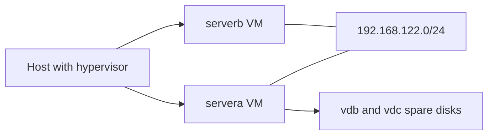

# 29 RHCSA and RHCE Local Lab Blueprint

!!! info "Optional"
    You only need this page if you do not already have the two lab machines described in [23 VM Lab Setup and Baseline Checks](23-vm-lab-setup-and-baseline-checks.md). If `servera` and `serverb` already pass the baseline check there, skip to [24 Foundations Labs](24-foundations-labs.md). The RHCE and Ansible material at the end of this page is **not part of RHCSA**.

> By the end of this page you will have two VMs, `servera` and `serverb`, with the names, static addresses, user accounts and spare disks that every lab in this course assumes, plus a clean snapshot to roll back to.

!!! example "Try it now (2 minutes)"
    ```bash
    lscpu | grep -i virtualization ; ls /dev/kvm
    ```
    Notice that a `Virtualization:` line and `/dev/kvm` mean your Linux host can run fast KVM guests. No `/dev/kvm`? Enable virtualization in your BIOS/UEFI settings, or use a hypervisor such as UTM or VirtualBox (see the generic settings below).

## Why it matters

RHCSA needs repeatable practice for storage, networking, users, services, SELinux, SSH, NFS, and reboot-safe configuration. Two VMs are enough to practise every remote task: one main box to break and fix, and one second host for SSH, file copy and NFS.

This setup models a small production network:

- one administrator or main host (`servera`)
- one application or utility host (`serverb`)

That is close enough to real work that the same lab helps with both exam preparation and job skills.

**Objectives covered:** this page supports every objective group by providing the lab; it does not train a listed objective itself. It prepares:

- hostnames, IP addresses and roles
- extra disks for LVM, swap, and filesystem practice
- SSH, NFS, autofs, firewalld, and SELinux practice targets
- a baseline snapshot and verification checklist

**Prereqs:** [22 Labs Track and Skill Check Guide](22-labs-track-and-skill-check-guide.md) and [23 VM Lab Setup and Baseline Checks](23-vm-lab-setup-and-baseline-checks.md) (read the environment table first) · **Time:** about 2 to 4 h for the first build, plus 30 to 60 minutes to verify and snapshot it

**You need:**

- a local hypervisor: `virt-manager`/`KVM` (steps below), `UTM`, `VirtualBox`, or `VMware`
- a RHEL 10 installation ISO (or a compatible rebuild) already downloaded
- enough disk space for two VMs plus snapshots (about 50 GB)
- enough memory to run both VMs together (4 to 8 GB free)
- root or administrator access on your host machine

## How it works

The shared environment is the same in every lesson, lab and mock:

| Item | Value |
|---|---|
| Hosts | `servera.lab.example` (main), `serverb.lab.example` (client/remote) |
| Network | `192.168.122.0/24`, servera `192.168.122.10`, serverb `192.168.122.11` |
| Login | user `student` (sudo, password `student`), root password `redhat` (lab only) |
| Spare disks | `/dev/vdb` and `/dev/vdc` on servera, 2 GiB each, empty |
| OS | RHEL 10 (or a compatible clone) |

Why two machines, not one: if you try to do everything on one VM you can still learn basic commands, but you lose realism for SSH and key-based trust, multi-host service checks, NFS exports and client mounts, and firewall and hostname resolution practice between systems.



### VM roles and resources

| VM | Role | vCPU | RAM | System disk | Extra disks |
|---|---|---:|---:|---:|---|
| `servera` | main practice box | 2 | 2 to 4 GB | 20 GB | `vdb` 2 GiB, `vdc` 2 GiB |
| `serverb` | second host: SSH, copy, NFS, firewall, SELinux targets | 2 | 2 GB | 20 GB | 2 x 2 GiB (optional) |

Why the extra disks matter:

- you need safe space for GPT partitioning
- you need separate devices for `PV`, `VG`, `LV`, and swap practice
- the labs only ever touch `vdb` and `vdc`, never the system disk

### Network design

Use one NIC on a network that lets the two VMs talk to each other and gives them the `192.168.122.0/24` range:

- On KVM/libvirt this is the `default` NAT network, which already uses `192.168.122.0/24` with gateway `192.168.122.1`. It also gives package access through NAT.
- On other hypervisors use a NAT network or a host-only/internal network you configure with that range. If you want both package access and isolation, add a second NIC (`NIC 1` NAT for updates, `NIC 2` host-only for the lab) and put the static address on the lab one.

One NIC is enough for simple SSH and service practice; two NICs make package access easier while keeping the lab network isolated and predictable. Either way, your hostnames and `/etc/hosts` should not depend on luck.

!!! warning "Use a virtio disk bus"
    The labs say `/dev/vdb` and `/dev/vdc`. That only matches when the VM disks use the **virtio** bus. On a SATA or SCSI bus the same disks appear as `/dev/sdb` and `/dev/sdc`, and every drill would need renaming. In VirtualBox/VMware/UTM choose a VirtIO disk controller if offered.

## Commands, step by step

This is the full build on a Linux host with KVM. Other hypervisors: create two VMs with the same sizes, names, disks and address plan, then continue from step 4.

### 1. Prepare the host

```bash
sudo dnf install -y qemu-kvm libvirt virt-install virt-manager libguestfs-tools
sudo systemctl enable --now libvirtd
sudo usermod -aG libvirt "$USER"          # log out and in again afterwards
virsh net-list --all
```

```text title="Example output"
 Name      State    Autostart   Persistent
--------------------------------------------
 default   active   yes         yes
```

If `default` is inactive: `virsh net-start default` and `virsh net-autostart default`.

### 2. Create `servera` from the ISO

Put the ISO somewhere readable (for example `~/isos/rhel-10-x86_64-dvd.iso`), then:

```bash
IMG=/var/lib/libvirt/images
sudo virt-install --name servera \
  --memory 2048 --vcpus 2 \
  --disk path=$IMG/servera.qcow2,size=20,format=qcow2,bus=virtio \
  --disk path=$IMG/servera-vdb.qcow2,size=2,format=qcow2,bus=virtio \
  --disk path=$IMG/servera-vdc.qcow2,size=2,format=qcow2,bus=virtio \
  --network network=default,model=virtio \
  --cdrom ~/isos/rhel-10-x86_64-dvd.iso \
  --os-variant detect=on,require=off
```
<!-- VERIFY: `--os-variant detect=on,require=off` is accepted by the virt-install shipped on the host; otherwise pick one from `osinfo-query os` -->

| Option | Meaning |
|---|---|
| `--memory 2048 --vcpus 2` | 2 GB RAM and 2 CPUs |
| first `--disk` | the 20 GB system disk, appears as `vda` |
| second and third `--disk` | the two empty 2 GiB spare disks, appear as `vdb` and `vdc` |
| `--network network=default` | the libvirt NAT network, `192.168.122.0/24` |
| `--cdrom` | the installation ISO |

A console window opens. Install with these choices:

- **Installation destination:** tick only the 20 GiB disk (`vda`). Leave the two 2 GiB disks **unticked** so they stay empty. Use automatic partitioning.
- **Root password:** `redhat`.
- **User account:** name `student`, password `student`, tick "make this user administrator".
- **Software selection:** Minimal Install (or Server) is enough.
- **Network and host name:** enable the interface, set host name `servera.lab.example`. The address can stay on DHCP for now.
- Begin installation, reboot, and eject the ISO if asked.

### 3. Set the static address, hosts file and hostname

Log in as `student` on the `servera` console (`virsh console servera` or the virt-manager window):

```bash
sudo hostnamectl set-hostname servera.lab.example
CON=$(nmcli -t -f NAME,TYPE con show --active | awk -F: '$2=="802-3-ethernet"{print $1;exit}')
sudo nmcli connection modify "$CON" ipv4.method manual \
  ipv4.addresses 192.168.122.10/24 ipv4.gateway 192.168.122.1 ipv4.dns 192.168.122.1
sudo nmcli connection up "$CON"
sudo tee -a /etc/hosts <<'EOF'
192.168.122.10 servera.lab.example servera
192.168.122.11 serverb.lab.example serverb
EOF
ip -br addr
lsblk
```

```text title="Example output"
lo               UNKNOWN        127.0.0.1/8 ::1/128
enp1s0           UP             192.168.122.10/24
NAME   MAJ:MIN RM  SIZE RO TYPE MOUNTPOINTS
vda    252:0    0   20G  0 disk
|-vda1 ...
vdb    252:16   0    2G  0 disk
vdc    252:32   0    2G  0 disk
```
<!-- VERIFY: interface name (enp1s0) on the RHEL 10 guest -->

Check the system is registered or has a repository so `dnf` works (`dnf repolist`). With a compatible rebuild this works out of the box.

### 4. Create `serverb`

Pick one way.

**Option A: repeat steps 2 and 3** with `--name serverb`, `serverb*.qcow2` file names, host name `serverb.lab.example` and address `192.168.122.11/24`. Safest, takes the longest.

**Option B: clone `servera`** after it passes the baseline check in [23](23-vm-lab-setup-and-baseline-checks.md):

```bash
virsh shutdown servera
sudo virt-clone --original servera --name serverb --auto-clone
sudo virt-sysprep -d serverb
```
<!-- VERIFY: virt-sysprep default operations on a RHEL 10 guest reset the machine-id and SSH host keys without removing the student user -->

Boot **only `serverb`** first (keep `servera` shut down so the two do not share the address `192.168.122.10`), then on its console:

```bash
sudo hostnamectl set-hostname serverb.lab.example
CON=$(nmcli -t -f NAME,TYPE con show --active | awk -F: '$2=="802-3-ethernet"{print $1;exit}')
sudo nmcli connection modify "$CON" ipv4.addresses 192.168.122.11/24
sudo nmcli connection up "$CON"
```

Now start `servera` again with `virsh start servera`. The `/etc/hosts` entries came across with the clone.

### 5. Set up SSH trust and verify the lab

On `servera`:

```bash
ssh-keygen -t ed25519
ssh-copy-id student@serverb.lab.example
ssh student@serverb.lab.example hostname
ping -c 3 serverb.lab.example
```

`student` exists on `serverb` with the password `student` because you created it in the installer (or cloned it), so `ssh-copy-id` can authenticate once and install your key.

Then run the full baseline table in [23 VM Lab Setup and Baseline Checks](23-vm-lab-setup-and-baseline-checks.md) on both machines.

### 6. Install baseline tools and snapshot

```bash
sudo dnf install -y vim bash-completion curl wget tar chrony nfs-utils
```

Shut both VMs down and take the clean snapshot (see the snapshot section in 23):

```bash
virsh shutdown servera ; virsh shutdown serverb
virsh snapshot-create-as servera --name baseline
virsh snapshot-create-as serverb --name baseline
virsh start servera ; virsh start serverb
```

To undo a lab later: `virsh shutdown servera`, `virsh snapshot-revert servera baseline`, `virsh start servera`.

### Useful checks

```bash
nmcli connection show
nmcli device status
ip -br addr
ping -c 3 192.168.122.11
ping -c 3 serverb.lab.example
systemctl is-active sshd
systemctl is-enabled sshd
lsblk
sudo parted -l
```

- `nmcli connection show` lists configured connections; `nmcli device status` shows active device state
- `ip -br addr` gives a short readable IP summary
- test IP reachability first, then hostname resolution
- `is-active` proves it works now, `is-enabled` proves it is ready after reboot
- `lsblk` shows current block devices; `parted -l` gives a readable partition summary

**Commands used on this page:** `hostnamectl`, `nmcli`, `ip`, `ping`, `ssh`, `ssh-keygen`, `ssh-copy-id`, `dnf`, `systemctl`, `lsblk`, `parted`, `virsh`, `virt-install`, `virt-clone`.

**Offline help:** `man hostnamectl`, `man nmcli`, `man ssh-copy-id`, `man virt-install`, `man virsh`.

### Alternative: build from a cloud image

If you already downloaded a Red Hat style cloud image, it is a quick way to clone many VMs, but there is one warning:

- cloud images are convenient for fast cloning
- normal installed VMs (the ISO route above) are easier for boot repair and rescue practice

Boot, rescue and password-reset exercises are part of the objectives, so keep at least `servera` as a normal ISO install.

A cloud image needs its first user and password set through cloud-init, otherwise you cannot log in. A minimal `user-data` file for the shared environment:

```yaml
#cloud-config
users:
  - name: student
    sudo: ALL=(ALL) ALL
    lock_passwd: false
chpasswd:
  expire: false
  users:
    - {name: student, password: student, type: text}
    - {name: root, password: redhat, type: text}
ssh_pwauth: true
```

```bash
sudo virt-install --name servera --memory 2048 --vcpus 2 --import \
  --disk path=/var/lib/libvirt/images/servera.qcow2,bus=virtio \
  --disk size=2,bus=virtio --disk size=2,bus=virtio \
  --network network=default --cloud-init user-data=./user-data \
  --os-variant detect=on,require=off
```
<!-- VERIFY: virt-install --cloud-init user-data=... syntax and that the cloud-config schema above is accepted by the RHEL 10 cloud image -->

Resize or copy the downloaded image into `/var/lib/libvirt/images/servera.qcow2` first; then continue from step 3 above.

## Worked examples

### Worked Example 1: Decide whether one NIC is enough

Short answer:

- yes, one NIC can work
- but two NICs are better for a serious lab

Why:

- one NIC is enough for simple SSH and service practice
- two NICs make package access easier while keeping the lab network isolated and predictable

Verification:

- you can explain the difference between internet/package access and lab-only communication

### Worked Example 2: Decide which VM does what

Best answer:

- `servera` is the main box where you do most work and where the spare disks live
- `serverb` is the remote host you SSH to, copy files to, and later use as the NFS server or client

Verification:

- you can explain why the labs name `servera` and `serverb` and never use other names

## Hands-on lab

**Setup:** a host with a hypervisor, the ISO, and 50 GB free (see "You need" above).

**Task:**

- [ ] Create `servera` with a 20 GB system disk, 2 vCPU, 2048 MB RAM and two extra 2 GiB virtio disks.
- [ ] Install RHEL 10 on the 20 GB disk only, with user `student` (password `student`) as administrator and root password `redhat`.
- [ ] Set host name `servera.lab.example` and static address `192.168.122.10/24` (gateway `192.168.122.1`).
- [ ] Create `serverb` with host name `serverb.lab.example` and address `192.168.122.11/24`.
- [ ] Add both names to `/etc/hosts` on both machines.
- [ ] From `servera`: `ping`, `ssh` and `scp` to `serverb` work by name, and key-based login works after `ssh-copy-id`.
- [ ] `lsblk` on `servera` shows `vdb` and `vdc` at 2G with no signature.
- [ ] Install `vim bash-completion curl wget tar chrony nfs-utils` on both.
- [ ] Take a `baseline` snapshot of both VMs.
- [ ] Reboot both VMs and re-check names, addresses and SSH.

??? question "Hint 1"
    Everything the labs rely on is in the environment table: names, addresses, users and the spare disks.

??? question "Hint 2"
    Use `virt-install` with three `--disk` options for `servera`; for `serverb` either repeat it or use `virt-clone`, then fix the hostname and address before both machines run at once.

??? success "Solution"
    Follow steps 1 to 6 above in order. The key commands are:

    ```bash
    # host
    sudo virt-install --name servera --memory 2048 --vcpus 2 \
      --disk path=/var/lib/libvirt/images/servera.qcow2,size=20,format=qcow2,bus=virtio \
      --disk path=/var/lib/libvirt/images/servera-vdb.qcow2,size=2,format=qcow2,bus=virtio \
      --disk path=/var/lib/libvirt/images/servera-vdc.qcow2,size=2,format=qcow2,bus=virtio \
      --network network=default,model=virtio --cdrom ~/isos/rhel-10-x86_64-dvd.iso \
      --os-variant detect=on,require=off

    # in each guest (use .11 and serverb on serverb)
    sudo hostnamectl set-hostname servera.lab.example
    CON=$(nmcli -t -f NAME,TYPE con show --active | awk -F: '$2=="802-3-ethernet"{print $1;exit}')
    sudo nmcli connection modify "$CON" ipv4.method manual \
      ipv4.addresses 192.168.122.10/24 ipv4.gateway 192.168.122.1 ipv4.dns 192.168.122.1
    sudo nmcli connection up "$CON"

    # on servera
    ssh-keygen -t ed25519
    ssh-copy-id student@serverb.lab.example
    ```

    **Verify:**

    ```bash
    hostnamectl
    ip -br addr
    lsblk
    ping -c 3 serverb.lab.example
    ssh student@serverb.lab.example hostname
    ```

    Then `sudo reboot` both machines and repeat the five commands.

**Expected result:**

- both VMs boot successfully and have stable names and IPs
- `servera` can reach `serverb` by name and with a key
- the spare disks are visible with `lsblk`
- you have a clean rollback point

### Independent practice

- [ ] Change the lab IP plan to a different private subnet and update both systems correctly, then change it back.
- [ ] Rebuild one VM from the ISO without touching the other.
- [ ] Add another extra disk to `serverb` and confirm the system sees it after reboot.
- [ ] Configure passwordless SSH from `servera` to `serverb`.
- [ ] Configure `chronyd` on both systems and verify time sync status (`chronyc sources`).
- [ ] Create a small NFS export on `serverb` (`/srv/nfs/share`) and mount it manually on `servera`.

**Verification steps:**

1. `hostnamectl` shows the right names.
2. `ip -br addr` shows `192.168.122.10/24` and `192.168.122.11/24`.
3. `systemctl is-active sshd` and `systemctl is-enabled sshd` are `active` and `enabled`.
4. `lsblk` shows the spare disks on `servera`.
5. `ping -c 3 serverb.lab.example` and `ssh serverb.lab.example hostname` work from `servera`.
6. After `sudo reboot`, the same checks still pass.

### Troubleshooting

**Problem: cloud image boots but you cannot log in.** Symptoms: login fails even though the VM is running, or SSH rejects your user. Checks: did you define the initial user correctly in cloud-init or the import wizard? Did you set a password or inject an SSH key? Did you disable password authentication too early? Fix: rebuild the seed config cleanly and verify the username before cloning more VMs.

**Problem: VMs can reach the internet but not each other.** Symptoms: package install works, lab IP addresses do not respond. Fix: check that both VMs are on the same network, that the NIC exists and is up, and that the addresses are in the same subnet. After a clone, check that the two machines do not have the same IP.

**Problem: hostnames resolve on one system but not the other.** Symptoms: `ping 192.168.122.11` works but `ping serverb.lab.example` fails. Fix: check `/etc/hosts`, confirm each host has both lab names, and verify spacing and spelling.

**Problem: extra disks are missing.** Symptoms: the hypervisor shows the disk but `lsblk` inside the VM does not. Fix: power off and re-check the virtual hardware attachment, make sure the disk is attached to the correct VM, reboot the guest and check `dmesg | tail`. Disks that appear as `sdb`/`sdc` mean the bus is not virtio.

**Problem: SSH works with password but not with keys.** Symptoms: `ssh-copy-id` ran but key login still prompts or fails. Fix: check permissions on `~/.ssh` (`700`) and `~/.ssh/authorized_keys` (`600`), verify you copied the key to the correct user, and test with `ssh -v serverb.lab.example`.

**Problem: `ssh-copy-id` asks for a password that does not work.** The target user needs a password. Set one on `serverb`: `echo 'student:student' | sudo chpasswd`.

## Common mistakes

- **Mistake:** using random VM names. **Recovery:** rename them now and keep the `servera`, `serverb` pattern for the rest of your practice.
- **Mistake:** no snapshot after baseline. **Recovery:** stop and create one clean snapshot before you start harder tasks.
- **Mistake:** doing storage practice on the main OS disk. **Recovery:** leave `vda` alone and use only `vdb` and `vdc` for partitions and LVM.
- **Mistake:** building only one VM and then trying to simulate remote tasks locally. **Recovery:** build `serverb` too.
- **Mistake:** dynamic IP addresses, then losing track of the hosts. **Recovery:** set the static addresses from the table.
- **Mistake:** a cloned VM keeps the other machine's address, hostname or machine-id. **Recovery:** boot it alone and fix the address and hostname before starting the original.
- **Mistake:** trying to memorize the whole lab. **Recovery:** memorize the design, not every exact command. The important thing is that you can rebuild the lab and verify it.

## Exam tips

!!! tip "What the exam expects"
    This page trains no exam objective by itself. Its value is that a lab you can rebuild in under an hour lets you repeat boot, rescue and storage practice as often as you need.

!!! warning "Must survive reboot"
    | Change | Persistent? | Make it persist with |
    |---|---|---|
    | `hostname` command | No | `hostnamectl set-hostname` |
    | `ip addr add` | No | `nmcli connection modify` then `nmcli connection up` |
    | `systemctl start sshd` | No | `systemctl enable --now sshd` |
    | Entries in `/etc/hosts` | Yes | nothing more needed |

## Quiz

1. Why is a second VM useful for RHCSA practice?
2. Why are extra disks better than using the main OS disk for storage labs?
3. What is the main advantage of having both NAT and host-only networking?
4. What commands quickly confirm hostname, IP addresses, and visible disks?
5. Why should you take a baseline snapshot before serious RHCSA practice?
6. Why must the VM disks use the virtio bus for this course?

??? success "Answers"
    1. For SSH, file copy, NFS, firewall and SELinux tasks that need a second host.
    2. You can wipe and repartition them freely, and a mistake cannot destroy the operating system.
    3. NAT gives package access, host-only gives a stable isolated lab network.
    4. `hostnamectl`, `ip -br addr`, `lsblk`.
    5. So you can roll back to a clean state after a lab goes wrong.
    6. Because the labs name the disks `/dev/vdb` and `/dev/vdc`; other buses call them `sdb` and `sdc`.

## Summary

- `servera` = main box with the spare disks
- `serverb` = the second host
- the spare disks are for practice, not the OS disk
- stable hostnames and stable IPs save time
- snapshot the clean baseline before you break anything

| Task | Command |
|---|---|
| Create a VM | `sudo virt-install --name servera --cdrom ISO --disk ...` |
| Set hostname | `hostnamectl set-hostname servera.lab.example` |
| Static IP | `nmcli connection modify "$CON" ipv4.method manual ipv4.addresses 192.168.122.10/24` |
| SSH trust | `ssh-keygen -t ed25519` then `ssh-copy-id student@serverb.lab.example` |
| Snapshot | `virsh snapshot-create-as servera --name baseline` |
| Roll back | `virsh snapshot-revert servera baseline` |
| Install baseline tools | `sudo dnf install -y vim bash-completion curl wget tar chrony nfs-utils` |

**Previous:** [23 VM Lab Setup and Baseline Checks](23-vm-lab-setup-and-baseline-checks.md) · **Next:** [24 Foundations Labs](24-foundations-labs.md): return here after this blueprint is built.

---

## Appendix: RHCE-style extras (not part of RHCSA)

!!! info "Optional"
    Nothing in this appendix is needed for RHCSA practice. It keeps the original three-VM and Ansible material for readers who want one lab that also supports later automation practice. The RHCSA section labs stay the main path.

### Why a third VM

An Ansible lab needs one control node and at least one managed node. A third system, `serverc`, also makes NFS, autofs, and service isolation easier to practise. The three-VM layout models a small network: an administrator host, an application host and a storage host.

| VM | Main role | Why it exists |
|---|---|---|
| `servera` | main box and control node | daily RHCSA practice now, Ansible control node later |
| `serverb` | managed node 1 | services, users, firewall, SELinux, scripting targets |
| `serverc` | managed node 2 and storage node | NFS exports, autofs targets, extra storage and service practice |

| VM | vCPU | RAM | Main disk | Extra disks |
|---|---:|---:|---:|---|
| `servera` | 2 | 4 GB | 20 GB | `2 x 2 GiB` |
| `serverb` | 2 | 2 to 4 GB | 20 GB | `1 x 2 GiB` or more |
| `serverc` | 2 | 2 to 4 GB | 20 GB | `2 x 2 GiB` |

`serverc` takes the same shared-table pattern:

| Host | Hostname | Lab IP |
|---|---|---|
| `servera` | `servera.lab.example` | `192.168.122.10/24` |
| `serverb` | `serverb.lab.example` | `192.168.122.11/24` |
| `serverc` | `serverc.lab.example` | `192.168.122.12/24` |

Add the third line to `/etc/hosts` on all three machines:

```bash
echo '192.168.122.12 serverc.lab.example serverc' | sudo tee -a /etc/hosts
```

### Build steps for `serverc`

Repeat step 4 (Option A or B) of the build with name `serverc`, host name `serverc.lab.example` and address `192.168.122.12/24`, then:

```bash
ssh-copy-id student@serverc.lab.example
ssh student@serverc.lab.example hostname
ping -c 3 serverc.lab.example
```

Original 3-VM checklist, kept for reference:

1. Create `servera` from the image with at least `2 vCPU`, `4 GB RAM` and the system disk.
2. Clone or create `serverb` and `serverc` from the same base image.
3. Give `serverb` one extra disk and `serverc` two extra disks.
4. Set hostnames, stable IPs and `/etc/hosts` entries on all three systems.
5. Set or confirm a usable password for your admin user and for `root`.
6. Enable `sshd` on all three systems.
7. From `servera`, verify you can `ping`, `ssh`, and copy files to `serverb` and `serverc`.
8. Install baseline tools on all systems:

```bash
sudo dnf install -y vim bash-completion curl wget tar chrony nfs-utils
```

9. On `servera`, install Ansible when you are ready for RHCE:

```bash
sudo dnf install -y ansible-core
```

10. Generate an SSH key on `servera` and copy it to the other two systems.
11. On `serverc`, create initial NFS directories:

```bash
sudo mkdir -p /srv/nfs/share /srv/nfs/home
```

12. Take a clean snapshot of all three VMs.

### Appendix worked examples

**Which VM should be the NFS server?** Use `serverc`. It has the most extra storage, it keeps storage services separated from your main control node, and it lets `servera` and `serverb` act as clients. (In the two-VM lab, `serverb` is the NFS server.)

**Which VM should be the Ansible control node?** Use `servera`. It is your main machine already, it can hold inventory, playbooks and SSH keys, and the other machines can act as managed nodes. You should be able to describe the inventory idea in one sentence: one control node, multiple managed nodes.

### Appendix independent practice

- [ ] Rebuild one VM from the base image without touching the others.
- [ ] Configure passwordless SSH from `servera` to both managed nodes.
- [ ] Install `ansible-core` on `servera` and create a simple inventory file for `serverb` and `serverc`.
- [ ] Configure `chronyd` on all three systems and verify time sync status.
- [ ] Create a small NFS export on `serverc` and mount it manually on `serverb`.

### Appendix verification

```bash
hostnamectl
ip -br addr
systemctl is-active sshd
systemctl is-enabled sshd
lsblk
ping -c 3 serverb.lab.example
ping -c 3 serverc.lab.example
ssh serverb.lab.example hostname
ssh serverc.lab.example hostname
sudo reboot
```

After the reboot, repeat `hostnamectl`, `ip -br addr`, `lsblk`, and the SSH checks.

### Appendix exam-style tasks

**Task 1.** You have three VMs built from one base image. Prepare them so that `servera` can use SSH to reach `serverb` and `serverc` by hostname, all systems have stable hostnames and addresses, `serverc` is ready to be used later as an NFS server, and the setup survives reboot.

- [ ] all three hostnames are correct
- [ ] name resolution works by hostname, not only IP
- [ ] `sshd` is active and enabled
- [ ] `servera` can connect remotely to the other nodes
- [ ] the result still works after reboot

??? success "Solution"
    1. Set all hostnames with `hostnamectl set-hostname`.
    2. Configure stable lab IPs using `nmcli`.
    3. Add all names and addresses to `/etc/hosts` on all systems.
    4. Enable and start `sshd` with `systemctl enable --now sshd`.
    5. On `servera`, generate an SSH key and use `ssh-copy-id` for the admin user on `serverb` and `serverc`.
    6. Create `/srv/nfs/share` and `/srv/nfs/home` on `serverc`.
    7. Reboot each system and re-run `hostnamectl`, `ip -br addr`, and `ssh`.

**Task 2.** Prepare the same 3-VM lab for future RHCE work so that `servera` is ready to become the control node, `serverb` and `serverc` are ready to become managed nodes, extra disks are visible for later storage labs, and you can explain why this layout supports both RHCSA and RHCE.

- [ ] the role of each VM is clear
- [ ] `servera` has the required admin tooling
- [ ] the managed nodes are reachable
- [ ] block devices are visible where expected
- [ ] the design is documented clearly enough to rebuild

??? success "Solution"
    1. Keep `servera` as the main system and install `ansible-core` there.
    2. Keep `serverb` and `serverc` as managed nodes reachable over SSH.
    3. Attach extra disks to all systems and confirm them with `lsblk`.
    4. Record a simple host map:

    ```text
    servera = RHCSA main box, RHCE control node
    serverb = managed node 1
    serverc = managed node 2, NFS and storage node
    ```

    5. Verify everything still works after reboot.

### Appendix quiz

1. Which VM should usually be your Ansible control node?
2. Which VM is the best default NFS server in the 3-VM design?

??? success "Answers"
    1. `servera`.
    2. `serverc`.

### Appendix anchors

- `servera` = main box now, control node later
- `serverb` = managed node
- `serverc` = managed node plus storage/NFS duties

```bash
ssh-copy-id student@serverc.lab.example
sudo mkdir -p /srv/nfs/share /srv/nfs/home
sudo dnf install -y ansible-core
```
