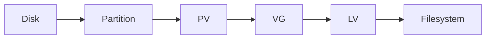

# Style Guide

Contributor reference for lesson pages. It lives at the repo root and is not published (it has no `docs/` symlink and is not in `mkdocs.yml`).

## Voice

- Second person, plain language, short sentences. Assume a beginner on the topic.
- Keep the author's best lines (for example "A task that works now but not later is not enough"). Keep the Mistake / Recovery pairing.
- Exact values only. Never write "per your lab" or "the usual disk": give the name, size and path.
- Every claim about RHEL 10 behaviour is either certain or tagged `<!-- VERIFY: ... -->` so it lands on the VM test list (`rg -n 'VERIFY:' *.md`).
- Do not claim exam duration, pass mark or exam internals. Cite only the official objective wording from the RHEL 10 EX200 page.

## Shared lab environment

Every lesson, lab and mock uses the same machines so state never has to be guessed.

| Item | Value |
|---|---|
| Hosts | `servera.lab.example` (main), `serverb.lab.example` (client/remote) |
| Network | `192.168.122.0/24`, servera `192.168.122.10`, serverb `192.168.122.11` |
| Login | user `student` (sudo, password `student`), root password `redhat` (lab only) |
| Spare disks | `/dev/vdb` and `/dev/vdc` on servera, 2 GiB each, empty |
| OS | RHEL 10 (or a compatible clone) |

Disk reset snippet (use before any storage drill; destroys data on `/dev/vdb`). Pages must inline it as a collapsed `??? warning "Disk reset"` block, because this guide is not published:

```bash
sudo umount /dev/vdb* 2>/dev/null
sudo swapoff /dev/vdb* 2>/dev/null
sudo vgremove -ff -y vgdata vgexam 2>/dev/null
sudo wipefs -a /dev/vdb
```

Remove any related lines from `/etc/fstab` after a reset.

Users and groups a drill needs must be created in that drill's **Setup** step. Never rely on state left behind by another drill.

## Callout vocabulary

| Use | Syntax |
|---|---|
| Quick first experience | `!!! example "Try it now (2 minutes)"` |
| What the exam expects | `!!! tip "What the exam expects"` |
| Must survive reboot | `!!! warning "Must survive reboot"` |
| Retained topic not in the RHEL 10 list | `!!! note "Supporting skill (not a listed RHEL 10 objective)"` |
| Hint | `??? question "Hint 1"` |
| Solution | `??? success "Solution"` |
| Quiz answers | `??? success "Answers"` |

Checklists use `- [ ]` task lists.

## Lesson template

Every topic page follows this skeleton. Existing sections are reorganised into it; nothing is deleted.

````markdown
---
description: One-sentence summary used in search results and link previews.
---

# NN Topic Title

> One-line promise: what you will be able to do at the end.

!!! example "Try it now (2 minutes)"
    ```bash
    one-safe-command
    ```
    Notice X. By the end of this lesson you will know why.

## Why it matters
2-4 sentences: the exam task this unlocks and the real-world job it does.

**Objectives covered:** exact official wording from the RHEL 10 list only.
**Prereqs:** [NN Title](NN-slug.md) · **Time:** about N h

## How it works
Plain-language concept, step by step.



## Commands, step by step
### 1. Do the thing
```bash
sudo command -x arg
```
```text title="Example output"
realistic output
```
<!-- VERIFY: exact output on RHEL 10 -->

| Option | Meaning |
|---|---|
| `-x` | what it does and when you need it |

## Common mistakes
- **Mistake:** ... **Recovery:** `command`

## Hands-on lab
**Setup:** shared lab environment, spare disk `/dev/vdb`.

**Task:**

- [ ] Step one, with exact values
- [ ] Step two

??? question "Hint 1"
    A nudge, no commands.

??? question "Hint 2"
    The command to use, without its options.

??? success "Solution"
    ```bash
    full commands
    ```
    **Verify:** `command` should show ...

## Exam tips
!!! tip "What the exam expects"
    The exact end state a grader checks.

!!! warning "Must survive reboot"
    | Change | Persistent? | Make it persist with |
    |---|---|---|
    | `swapon /dev/vdb2` | No | an fstab line, then `swapon -a` |

**Verify like a grader:** `cmd1`, `cmd2`, then reboot and check again.

## Quiz
1. Question?

??? success "Answers"
    1. Answer.

## Summary
- 3-5 memory anchors (keep the author's lines here)

| Task | Command |
|---|---|
| Do X | `cmd` |

**Previous:** [NN-1 Title](NN-prev.md) · **Next:** [NN+1 Title](NN-next.md): one sentence on why it comes next.
````

Rules for the template:

- Merge the older "Common Beginner Mistakes" and "Common Mistakes And Recovery" into the one **Common mistakes** section, keeping every item.
- Move answer keys and solutions into `???` blocks right after the task; do not remove them.
- Target about 2,000-3,500 words of teaching per lesson.
- At least one Mermaid diagram where it helps (fenced as `mermaid`). Use `flowchart` only (the vendored offline Mermaid build supports flowcharts, not sequence/state/gantt diagrams); keep node labels short and avoid `$` in labels.
- Lessons whose topic is not on the RHEL 10 list (for example the Podman chapter) keep a banner saying so and carry the supporting-skill callout.

## Commits

Small, logical commits with imperative messages. No AI attribution in commit messages, PR text or file contents.
